import TopicHeader from '../../../components/TopicHeader.astro';
import Ladder from '../../../components/Ladder.astro';
import TheoremCode from '../../../components/TheoremCode.astro';
import CodeSnippet from '../../../components/CodeSnippet.astro';
import WhatYouNeed from '../../../components/WhatYouNeed.astro';
import Cards from '../../../components/Cards.astro';
import Drill from '../../../components/Drill.astro';
import LookalikePairs from '../../../components/LookalikePairs.astro';
import SelfTest from '../../../components/SelfTest.astro';
import Checkpoint from '../../../components/Checkpoint.astro';
import DecisionMapUpdate from '../../../components/DecisionMapUpdate.astro';

<TopicHeader topic="1.6" />

## What this note covers

A monotonic stack is a stack that we keep sorted at all times. This one idea solves next smaller / greater element (NSE / NGE), largest rectangle in histogram and sum of subarray minimums, each in $O(n)$ time.

The motivation is speed. Many problems ask, for every element, "where is the nearest element to the right (or left) that is smaller?" Checking every pair costs $n \times n$ steps, which is $10^{10}$ steps for $n = 10^5$. A monotonic stack answers the same question for all elements in about $2n$ steps.

Here is the problem in numbers. For each of $n = 2 \cdot 10^5$ daily temperatures, find how many days we wait until a warmer day. Scanning forward from every day costs about $n^2 / 2 = 2 \cdot 10^{10}$ steps on a decreasing sequence. At $10^8$ simple steps per second (topic 0.2) that is about 200 seconds. The scans share work. Once a day $j$ meets a warmer day $i$, day $j$ is finished and never matters again. While $j$ still waits, every waiting day after it is at most as warm as $j$, because otherwise it would already have finished $j$. So the waiting days form a pile whose values never rise from bottom to top. A new day finishes waiting days from the top of the pile down. Every day enters the pile once and leaves it at most once, so the total work is $O(n)$.

The topic covers three things. First, the nearest greater or smaller element on either side of every position. Second, the span of a minimum: the stretch of the array in which one element is the smallest. Spans give sums over all subarrays and the largest rectangle in a histogram. Third, the monotonic deque, the two-ended version of the stack, which keeps the maximum or minimum of a sliding window in $O(1)$ per step.

### What you need

<WhatYouNeed topic="1.6" />

### What this note does not cover

- The minimum or maximum of arbitrary ranges given as queries (sparse table, range minimum query). That is topic 5.1. A stack answers only questions about the nearest smaller or larger element.
- Changing arrays with range queries (segment tree). That is topic 5.3.
- Using a deque to speed up a recurrence over all earlier positions (dynamic programming optimisation). That is Phase 3 and topic 7.3.

### Terms used in this lesson

- The **next greater element** of position $i$ in an array $a$ is the nearest position $j > i$ with $a_j > a_i$. The **previous greater element** is the nearest $j < i$ with $a_j > a_i$. Next smaller and previous smaller use $<$ instead. Variants with $\ge$ or $\le$ decide ties. Example: in $(2, 5, 3, 4)$ the next greater element of position 2 (value 3) is position 3 (value 4), and position 1 (value 5) has none.
- A **monotonic stack** is a stack whose values, read from bottom to top, only decrease or only increase. Example: $(9, 6, 6, 2)$ is a non-increasing stack.
- The **span** of position $i$ (for minima) is the longest subarray that contains $i$ and in which $a_i$ is a minimum. It starts just after the previous smaller element and ends just before the next smaller element.
- A **monotonic deque** is a deque (double-ended queue) whose values, from front to back, only decrease or only increase. Elements are added at the back and removed from both ends.
- In a window that moves right, an element is **dominated** if a later element of the window is at least as large. A dominated element can never be the maximum of a window again.
- The **leftmost minimum** of a subarray is the first position that holds its smallest value, and the **rightmost minimum** is the last. Example: in $(2, 1, 3, 1)$ the leftmost minimum is position 1 and the rightmost is position 3. His note counts each subarray at its leftmost minimum. Counting at the rightmost minimum is the mirror image and gives the same totals.
- A **histogram** is a row of bars of width 1. A **rectangle under the bars** that covers the bars $l..r$ has height at most the lowest of them, so its largest area is $\min(h_l, \dots, h_r) \cdot (r - l + 1)$. Example: for heights $(3, 1, 2)$ the rectangle over all three bars has area $1 \cdot 3 = 3$.

- Stack topics
- Largest rectangle in histogram
- Dry run of the histogram stack
- Next Smaller Element (NSE)
- Sum of subarray minimums (A2, super minimum sum)
- Better way for NSE and PSE
- Elements not distinct
- Other three directions (NGE, PGE: next greater element, previous greater element)
- Number of rectangles in histogram
- Bracketing
- Min of every window of size k (monotone deque)
- Recognition cards
- Quick revision
- Check yourself
- Practice problems

## Stack topics

→ Stack:
- i) Monotonic stack
- ii) NGE/NSE (Next Greater Element / Next Smaller Element)
- iii) Bracketing

The symbol ∴ in the notes below means "therefore".

Quick definitions before we start:
- **Stack** = last in, first out (LIFO). Push on top, pop from top.
- **Monotonic** = only goes one way. Monotonic stack: values (bottom → top) never decrease (or never increase).
- Before pushing a new element, pop everything that breaks the order. Every element that gets popped has found its answer: the new element.
- Store **indices** in the stack, not values. An index gives both the value (`arr[idx]`) and the position.
- T.C. (time complexity) = $O(n)$. Each element is pushed once and popped at most once. (Amortised: one step may pop many elements, but total pops $\le$ total pushes. For $n = 10^5$ that is at most $10^5$ pushes + $10^5$ pops = $2 \times 10^5$ operations.)
- Common mistake: storing values and then being unable to compute widths. Widths need positions, so store indices.

## Largest rectangle in histogram

**Question:** Largest rectangle in histogram. Find the rectangle of the largest area that fits completely inside the bars.

Histogram = bars side by side, each bar has width 1. Heights here: 2, 1, 5, 6, 2, 3.

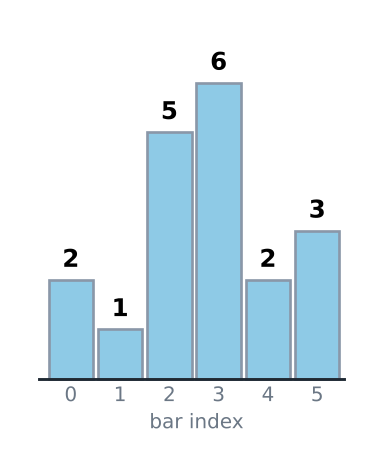

*A histogram with bar heights 2, 1, 5, 6, 2 and 3.*

A second question is asked about the same kind of picture: find the number of rectangles in the histogram. It is solved in the section "Number of rectangles in histogram" below.

First the largest rectangle. Observation: the height of a rectangle is the height of the shortest bar inside it. So for every bar we ask: how far can we extend to the left and to the right before we meet a shorter bar?

Why this matters: the brute force tries every pair of left and right ends, which is about $n^2/2$ rectangles. For $n = 10^5$ that is $5 \times 10^9$ rectangles, far too slow. The stack finds the best extent of every bar in one pass.

To see how a stack helps, take an array of bar heights:

1 3 5 7 4

The bars wait in a monotone stack (the heights only go up from bottom to top). The picture shows the stack after 1, 3, 5 and 7 are pushed, with the next bar, 4, about to arrive:

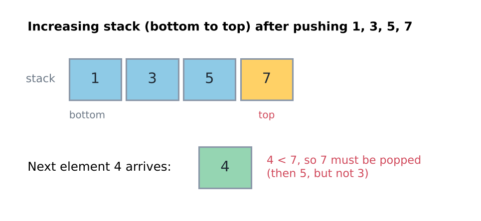

*The stack holds 1, 3, 5, 7, and then the bar 4 arrives.*

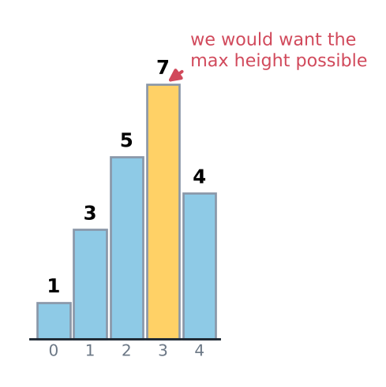

*Bars 1, 3, 5, 7, 4. For the bar 7, we want to choose the largest height possible.*

It is better to keep pushing a bar as long as it is at least as tall as the bar on top of the stack.

The reason: while the bars keep growing, no bar has found its right boundary yet, so we cannot fix its rectangle. Such bars wait in the stack, and the stack stays sorted.

When 4 appears, we need to calculate the contribution (the area it adds to the answer) of all rectangles that can be made with 7 as the height.

With 7 as the height we can make a rectangle of width 1.

We add this contribution of 7 to the answer, and then remove 7 from the stack.

We do not remove the bar itself. We only stop using the height 7. (The bar stays in the picture, so the area under it can still be used by the next rectangle. Only the height 7 is gone, because the incoming bar 4 is lower.)

The next height we can use is 5, with width 2. We have to keep track of the popped 7 somehow.

The "somehow" is the new top of the stack. After 7 is popped, the top is 5, and the wall to the left of 5 (the bar 3) sits right below it in the stack. So there is no need to remember 7 separately: the width is simply the distance between the new top and the incoming bar.

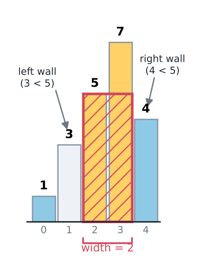

*Height 5, width 2. The left wall is 3 and the right wall is 4.*

The width is calculated from the incoming element and the previous element. (The previous element is the bar just below the popped one in the stack.)

So this width is decided by the previous smaller element and the next smaller element.

The two walls of the height 5 are the bar 3 on the left and the incoming bar 4 on the right. In the notes this is written as `3 ≤ 5 ✗ 4`: the 3 is not taller than 5, and the 4 is the bar that stops it.

Look at the picture: on the left, 3 is smaller than 5, and on the right, the incoming 4 is also smaller than 5. These are the two walls. The bars between the walls (5 and 7) are all at least 5 tall, so a rectangle of height 5 fits over them:

width = (index of next smaller) − (index of previous smaller) − 1

For every bar we find the contribution of its height with the largest width available.

So we can use either the monotonic stack or the next greater element / next smaller element (NGE / NSE) arrays.

Note: we have added sentinel values at the beginning and at the end of the array. The sentinel value is 0 here. (It is used in the code below.)

A sentinel is a fake element placed at the ends so that we do not need special cases. 0 is smaller than every real bar, so the 0 at the end pops everything still left in the stack, and the 0 at the front is never popped (so the stack is never empty).

```cpp
/*
Largest rectangle in histogram.
arr[1..n] = bar heights, arr[0] = arr[n+1] = 0 (sentinels).
*/
// Fabricator/STL/Stack/RectangleInHistogram.cpp
void solve() {
    int n;
    cin>>n;

    vector<int> arr(n+2);
    for(int i=1; i<=n; i++) cin>>arr[i];
    arr[0] = arr[n+1] = 0;

    //monotonic stack
    vector<int> st;
    st.push_back(0);

    int ans = 0;
    for(int i=1; i<n+2; i++){
        while(arr[i] < arr[st.back()]){
            // arr[st.back()] has found both ends
            // hence we can find its contribution
            int pos = st.back();
            st.pop_back();

            int height = arr[pos];
            int width = i - st.back() - 1;

            ans = max(ans, height * width);
        }

        st.push_back(i);
    }

    cout<<ans<<endl;
}
```

`2 1 5 6 2 3` → 10 and `1 3 5 7 4` → 12 (both tested).

Cost: the loop runs over $n + 1$ positions. Each index is pushed once and popped at most once, so the time is $O(n)$. The stack can hold all $n$ bars (for example when the heights only increase), so the memory is $O(n)$ (S.C., space complexity).

Edge cases. Equal heights, for example `2 2`: the second 2 does not pop the first 2, because the pop needs a strictly smaller bar. At the end the second 2 is popped first (width 1, area 2), then the first 2 is popped with the full width 2 (area 4). So the answer 4 is not lost. Heights that only increase, for example `1 2 3`: nothing is popped until the last sentinel 0, which then pops all bars (areas 3, 4, 3, best 4). The sentinel 0 assumes that heights are not negative.

Note: `height * width` is an int here. With large limits (for example heights and $n$ up to $10^5$, area up to $10^{10}$) use `long long`, otherwise the product overflows.

Note: `5 × 2 = 10` is just one rectangle on the way. For `1 3 5 7 4` the best is 12 (height 3 over 4 bars, or height 4 over 3 bars).

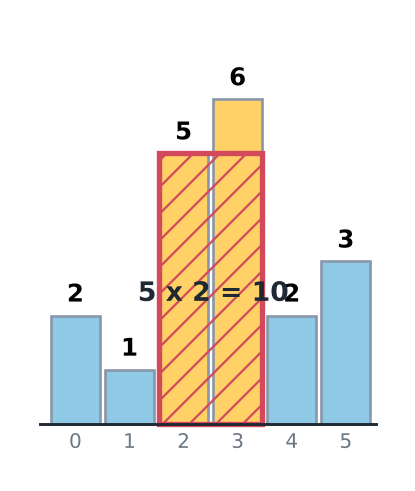

*For the heights 2 1 5 6 2 3 the best rectangle is $5 \times 2 = 10$.*

Two common mistakes appear when the histogram is written with two scans (nearest lower bar on the left, then on the right), each with its own stack.

Common mistake 1: the stack is not cleared between the scans. Take heights `0 2`. The left scan ends with positions 0 and 1 still on the stack. The right-to-left scan starts with them. For bar 1 it finds position 0 as the "next lower bar on the right", although position 0 is on its left. The width becomes $0 - 0 - 1 = -1$, and the real rectangle of area 2 is lost. The program prints 0 instead of 2. Fix: every scan starts with an empty stack. Write `st.clear()`, or declare a new stack for each scan.

Common mistake 2: equal bars stop the rectangle. Pop only strictly higher bars, for example `while (!st.empty() && h[st.back()] > h[i]) st.pop_back();`, and each bar stops at its equal neighbour. Take heights `3 3`. Bar 0 covers only itself and bar 1 covers only itself, so the output is 3 instead of 6. Fix: a rectangle of height $h_i$ extends over every bar at least as high. It stops only at strictly lower bars, so pop everything `>=`. Unlike the sum of minimums, the same rule on both sides is correct here, because a maximum is not changed by repeats.

## Dry run of the histogram stack

This section follows the stack step by step for `1 3 5 7 4` with sentinel 0 at both ends. Box = height, small number = index in the array with sentinels (0 to 6). The bars 1, 3, 5, 7 are each taller than the top of the stack, so they are only pushed, and nothing is popped yet.

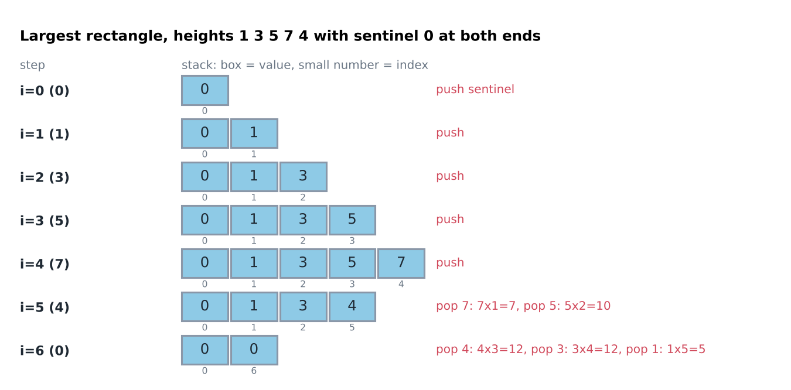

*The stack after every step.*

- 4 arrives: pop 7 → left wall 5, width = 5 − 3 − 1 = 1, area 7. Pop 5 → left wall 3, width 2, area 10. Now the top is 3, and 4 &lt; 3 is false, so stop. Push 4.
- The last 0 arrives: pop 4 → left wall 3, width = 6 − 2 − 1 = 3, area 12. Pop 3 → left wall 1, width 4, area 12. Pop 1 → left wall = first 0, width 5, area 5.
- ans = 12.

The same result by the formula $\text{width} = (\text{next smaller index}) - (\text{previous smaller index}) - 1$: for the bar 3 (index 2) the next smaller is the last 0 (index 6) and the previous smaller is 1 (index 1), so the width is $6 - 1 - 1 = 4$ and the area is $3 \times 4 = 12$.

For `2 1 5 6 2 3` the pops are (height, width, area): (2,1,2) (6,1,6) (5,2,10) (3,1,3) (2,4,8) (1,6,6). ans = 10.

## Next Smaller Element (NSE)

Next Smaller Element (NSE): for each element, we want the index of the first element on its right that is smaller. We put a sentinel -1 at the end. It is the smallest value, so every element gets an answer.

Brute force: for every element scan to the right until a smaller one is found. In the worst case (an increasing array) this is $n(n - 1)/2$ comparisons, about $5 \times 10^9$ for $n = 10^5$.

Idea in plain words: the stack keeps the indices of the elements that are still waiting for their answer. The values of the waiting elements always increase from bottom to top, because a waiting element that is larger than a later one would already have been answered. When a new element x arrives, every waiting element larger than x has found its answer, and that answer is x. Those elements are exactly the ones on top of the stack, so we pop while the top is larger than x. Then x starts waiting itself.

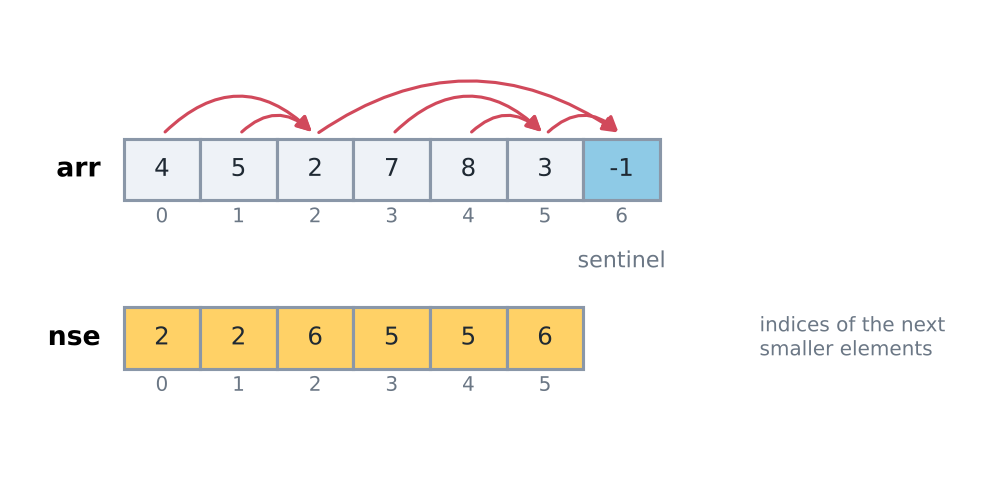

*The array [4 5 2 7 8 3] with the sentinel -1 at the end, and the answer nse = [2 2 6 5 5 6].*

The sentinel value -1 sits at index 6. (Here "idx" is short for index.)

The array nse holds the indices of the next smaller elements.

Now the stack steps for this array. The first 4 and 5 are pushed, because each is larger than the top:

arr: 4 5 2 7 8 3

idx: 0 1 2 3 4 5

st: [0 1]   (values 4 5)     nse: [ ]

The next element is 2, and 2 &lt; 5.

So we pop 5 (we pop its index, 1) and write 2 in nse as the next smaller element of 5.

Then 2 &lt; 4 is also true, so we repeat the same step for 4.

Now we push 2 and continue. (7 and 8 are pushed after it, each larger than the top.)

st: [2 3 4]   (values 2 7 8)

Now we meet 3, and 3 &lt; 8.

Pop the indices 4 and 3 (the values 8 and 7); both get nse = 5. 3 &lt; 2 is false, so stop. Push 5. st: [2 5]. nse = [2 2 _ 5 5 _].

Finally we meet -1.

-1 is smaller than both 3 and 2, so both are popped with nse = 6. st: []. nse = [2 2 6 5 5 6].

The -1 is added at index 6 of the original array.

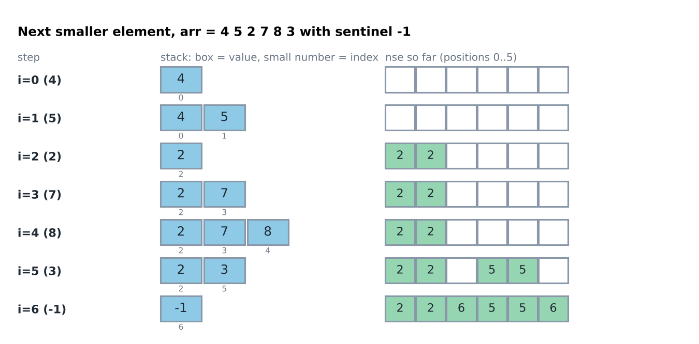

*The stack and the nse array after every step.*

The same loop in code is shown below. (`_print` is the print helper of his template; it writes a vector to the error stream.) Here the array is 1-based and the sentinel 0 sits at both ends, so every printed answer is shifted by +1 compared with the 0-based example above. One loop also gives the previous smaller element (pse): when an element is popped, the new top of the stack is its previous smaller.

```cpp
/*
Next smaller element (nse) and previous smaller element (pse) of every index.
arr[1..n] = input, arr[0] = arr[n+1] = 0 (sentinels). 0 in the answer = none.
*/
// Fabricator/STL/Stack/NSE.cpp
void solve() {
    int n;
    cin>>n;

    int arr[n+2];
    for(int i=1; i<=n; i++) cin>>arr[i];

    arr[0] = arr[n+1] = 0;

    // next smaller element
    // previous smaller element
    vector<int> nse(n+2);
    vector<int> pse(n+2);
    vector<int> st;
    st.push_back(0);

    for(int i=1; i<(n+2); i++){
        while(arr[i] < arr[st.back()]){
            int pos = st.back();
            st.pop_back();

            nse[pos] = i;
            pse[pos] = st.back();
        }

        st.push_back(i);
    }

    _print(nse);
    _print(pse);
}
```

`4 5 2 7 8 3` → nse = `3 3 7 6 6 7` (−1 each → `2 2 6 5 5 6`), pse = `0 1 0 3 4 3`.

Cost: every index is pushed once and popped at most once, so the time is $O(n)$; the stack and the two answer arrays take $O(n)$ memory. If an element has no smaller element on its right, the sentinel at the end answers for it (index $n + 1$ in this code). The sentinel 0 works because the input values are positive. If values can be 0 or negative, use a sentinel smaller than every value.

Note: a pop happens only when the new element is **strictly** smaller. Equal elements stay in the stack, so this pse is really "previous smaller **or equal**". This detail matters later, in the duplicates section.

Now the same scan, stated as a theorem. His section above pops while the top is larger (next smaller). The theorem uses the mirror image, next greater, because the daily temperatures problem asks for it. The other signs are in the section "Other three directions (NGE, PGE)" below.

**Theorem 1.6.1 (monotonic stack).** Scan $i = 0, 1, \dots, n - 1$ and keep a stack of positions. At step $i$, pop every position $j$ on top with $a_j < a_i$ and record $\text{next}[j] = i$, then push $i$. Positions still on the stack at the end have no next greater element. Then:
1. The values on the stack never increase from bottom to top.
2. Every recorded $\text{next}[j]$ is the next greater element of $j$.
3. Just after the pops at step $i$, the top of the stack (if any) is the previous greater-or-equal element of $i$: the nearest $j < i$ with $a_j \ge a_i$.
4. The whole scan takes $O(n)$ time.

In plain words: keep a pile of positions whose values never go up. A new value removes everything smaller from the top of the pile, and each removed position has just found its answer.

Small example first: $a = (2, 1, 4, 3, 5)$, positions $0$ to $4$.

| step $i$ | $a_i$ | popped (next = $i$) | stack after (values) |
|---|---|---|---|
| 0 | 2 | none | 2 |
| 1 | 1 | none | 2, 1 |
| 2 | 4 | 1, then 0 | 4 |
| 3 | 3 | none | 4, 3 |
| 4 | 5 | 3, then 2 | 5 |

So $\text{next} = (2, 2, 4, 4, \text{none})$. For part 3: at step 1 (value 1) the top is position 0 (value 2), and at step 3 (value 3) the top is position 2 (value 4). Each is the nearest earlier value that is at least as large.

Why it works. "Step $i$" means the loop iteration that reads $a_i$.
1. Part 1. An empty stack has no neighbours that could break the rule. At step $i$ the pops stop at a top $t$ with $a_t \ge a_i$ (or at an empty stack). Then $i$ goes on top of $t$. So every push keeps the values from rising.
2. Part 2, a popped position. Let $j$ be popped at step $i$, so $a_j < a_i$. We claim no position $k$ with $j < k < i$ has $a_k > a_j$. Suppose one did. At step $k$ every position above $j$ on the stack has a value at most $a_j$ (by part 1), so less than $a_k$. All of them are popped, and then $j$ is popped at step $k$, not at step $i$. That is a contradiction.
3. By step 2, $i$ is the first position after $j$ with a larger value. This proves part 2 for every popped position.
4. Part 2, a position never popped. If some later position were larger than $a_j$, the first such position would pop $j$, by the argument of step 2. So $j$ has no next greater element, and it stays on the stack.
5. Part 3. Let $t$ be the top after the pops at step $i$ ($t = -1$ if the stack is empty). The pops stopped at $t$, so $a_t \ge a_i$.
6. Suppose some position lies strictly between $t$ and $i$. Let $k$ be one with the largest value (the leftmost if tied). Nothing sits above $t$ on the stack, so $k$ is not on it. Some step $m$ with $k < m \le i$ popped it, and $a_m > a_k$.
7. If $m < i$, then $m$ lies between $t$ and $i$ with a value larger than $a_k$, which contradicts the choice of $k$. So $m = i$ and $a_k < a_i$. Every position strictly between $t$ and $i$ has a value at most $a_k$, so less than $a_i$. With step 5, $t$ is the nearest earlier position with a value at least $a_i$.
8. Part 4. Each position is pushed once and popped at most once, so all pops together are at most $n$ (Theorem 0.2.4). Everything else is constant work per step. So the time is $O(n)$ and the memory is $O(n)$.

This proof needs: (1) the question is about the nearest greater (or smaller) element in one direction, not about a range given in advance; (2) the pop comparison decides the tie rule: popping on $a_j < a_i$ gives "next strictly greater", popping on $a_j \le a_i$ gives "next greater or equal"; (3) scanning from the right gives the same answers in the other direction. Check these on every problem.

<TheoremCode unit="1.6/thm-1" />

The unit adds one thing his functions do not: the next greater and the previous greater-or-equal element in a single scan. Example 1: the value 4 at position 2 pops positions 1 and 0 (steps 2 and 3 of the proof), so their next greater position is 2. Example 2, with a repeated value: in $(3, 3, 1, 2)$ the second 3 does not pop the first, because $3 < 3$ is false. So the previous greater-or-equal element of position 1 is position 0 (part 3). The `previousGreater` below (a new function, built like his `previousSmaller`) pops on `<=`, so it returns the previous strictly greater element. That is the other tie rule of the same scan.

Common mistake: popping equal values in next greater. Take the input $a = (0, 0)$. With `a[st.back()] <= a[i]` the second 0 pops the first and records itself as its next greater element. The output is next $= (1, \text{none})$ and previous greater-or-equal $= (\text{none}, \text{none})$. The correct output is next $= (\text{none}, \text{none})$ and previous $= (\text{none}, 0)$. Fix: decide for each answer whether ties count, and write the pop condition that says exactly that. Test with repeated values.

## Sum of subarray minimums (A2, super minimum sum)

**Question:** A2, the super minimum sum problem.

Given an array A of size N. All elements are distinct.

Find the sum of the minimum of all possible subarrays of the array A.

(A subarray is a continuous part of the array.)

$1 \le t \le 10$  |  $1 \le N \le 10^5$  |  $1 \le A_i \le 10^6$

This sounds like the contribution technique.

(Contribution technique: instead of looking at every subarray, look at every element and ask how much it adds to the answer.)

We need to find the minimum of every subarray and add them all up. Here is an example.

Brute force: take all subarrays and find the minimum of each. There are $O(N^2)$ subarrays. For $N = 10^5$ that is about $5 \times 10^9$ subarrays, which is infeasible.

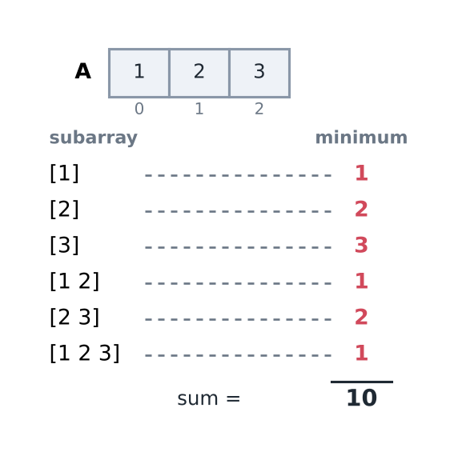

*For A = 1 2 3 the minimums are 1 2 3 1 2 1, and the sum is 10.*

So we check how many times each element becomes the minimum of a subarray.

- 1 becomes the minimum 3 times.
- 2 becomes the minimum 2 times.
- 3 becomes the minimum 1 time.

So the sum is $1 \times 3 + 2 \times 2 + 3 = 10$

We need to think about how many subarrays have A[i] as their minimum. In the picture below, i is the position of A[i], a is the position of the previous smaller element and b is the position of the next smaller element (both cells hold values smaller than x = A[i]).

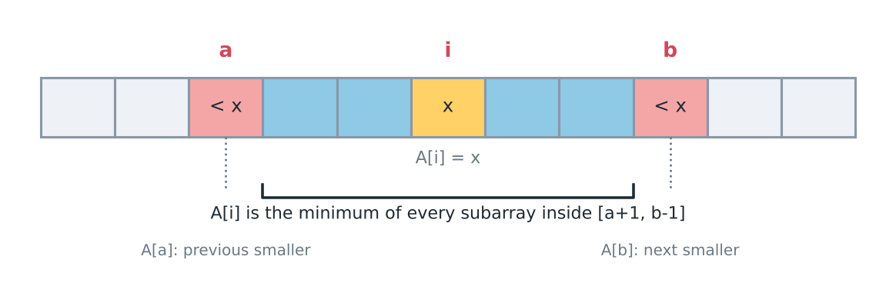

*The positions satisfy a &lt; i &lt; b.*

Here A[a] is the previous smaller element and A[b] is the next smaller element.

Therefore A[i] is the minimum in all subarrays inside [a+1, b-1] that contain i. (That means: in every subarray that lies inside the range a+1 to b−1 and contains i.)

A subarray in which A[i] is the minimum must contain i. Its start can be any position in `a+1 ... i` → `i − a` choices. Its end can be any position in `i ... b−1` → `b − i` choices. Any start can be paired with any end, so:

The number of subarrays is $(i - a) \times (b - i)$, so the contribution is $A_i \times (i - a) \times (b - i)$.

Example: the array `1 5 3 4 2` and the element 3 (index 2).

For 3 to be the minimum, the subarray must start after the 1 and must end before the 2. So a = 0 and b = 4 (the indices of the 1 and the 2).

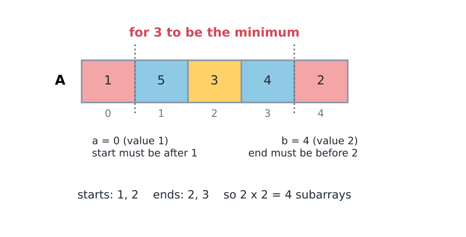

*The start can be 1 or 2, and the end can be 2 or 3, so there are $2 \times 2 = 4$ subarrays.*

Here the contribution of 3 = $3 \times 2 \times 2 = 12$ (subarrays: [5 3], [5 3 4], [3], [3 4]).

The same formula for every element of `1 5 3 4 2` (previous smaller index a, next smaller index b; a = −1 if there is none on the left, b = n = 5 if there is none on the right):

- 1 (index 0): $a = -1$, $b = 5$, $1 \times 1 \times 5 = 5$ (subarrays that start at index 0, all five of them).
- 5 (index 1): $a = 0$, $b = 2$, $5 \times 1 \times 1 = 5$.
- 3 (index 2): $a = 0$, $b = 4$, $3 \times 2 \times 2 = 12$.
- 4 (index 3): $a = 2$, $b = 4$, $4 \times 1 \times 1 = 4$.
- 2 (index 4): $a = 0$, $b = 5$, $2 \times 4 \times 1 = 8$.

Total = 5 + 5 + 12 + 4 + 8 = 34.

Answer can go up to ~ $10^6 \times (10^5)^2 / 2 \approx 5 \times 10^{15}$, which does not fit in a 32-bit int (about $2 \times 10^9$), so use `long long`. It fits in a 64-bit `long long` (about $9 \times 10^{18}$).

The full code comes after we fix the duplicates case (below). First, a shorter way to compute NSE and PSE (previous smaller element).

## Better way for NSE and PSE

There is a better way to compute NSE. It needs no stack. It fills the answers from right to left and reuses the answers already found.

```cpp
vector <int> nse(n);

for (int i=n-1; i>=0; i--) {
    nse[i] = i+1;
    while (nse[i]<n && arr[nse[i]] >= arr[i])
        nse[i] = nse[nse[i]];
}
```

Idea in plain words: start at i+1. If it is not smaller, jump to its nse. This is safe because every element between i+1 and nse[i+1] is greater than or equal to `arr[i+1]`, and `arr[i+1]` itself is not smaller than `arr[i]`, so no answer can hide in between.

Dry run on `[1 6 4 7 5 2]` for i = 2 (value 4): start at 3 (value 7, not smaller) → jump to nse[3] = 4 (value 5, not smaller) → jump to nse[4] = 5 (value 2, smaller). Stop: nse[2] = 5.

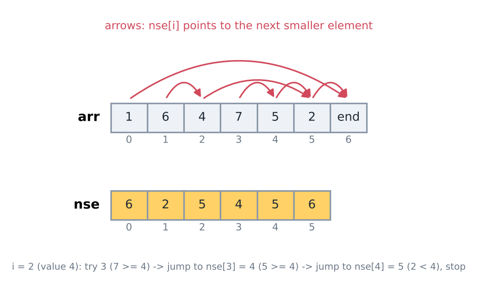

*For [1 6 4 7 5 2] the answer is nse = [6 2 5 4 5 6]. For i = 2 the chain is 3, then nse[3] = 4, then nse[4] = 5, and we stop.*

T.C. = $O(n)$ amortised, same as the stack. The jump chain is exactly what the stack would have held. An element that has been skipped is never visited again by an earlier index: it is covered by a smaller (or equal) element in front of it, and an earlier index that arrives there jumps over it. So the total number of jumps is at most n. Memory: $O(n)$ for the nse array. If nothing smaller exists, nse[i] ends at n (one past the last index).

For Previous Smaller Element, the same code runs from left to right:

```cpp
vector <int> pse (n);
for (int i=0; i<n; i++) {
    pse[i] = i-1;
    while (pse[i] >= 0 && arr[pse[i]] >= arr[i])
        pse[i] = pse[pse[i]];
}
```

`[1 6 4 7 5 2]` → pse = `[-1 0 0 2 2 0]` (−1 = none). Both pieces tested on this array.

Note: `>=` means equal elements are skipped too, so this gives the **strictly** smaller element.

Now we can use NSE and PSE to solve the previous problem, in which all elements of the array were distinct.

Here is that solution as a function. Trace on `1 5 3 4 2` (all distinct): the contributions are 5, 5, 12, 4 and 8, so the answer is 34, the same total as the table above.

```cpp
/*
Sum of the minimum of every subarray, when ALL elements are distinct.
Strict "smaller" on both sides, using the jump loops above.
*/
// New function (not in his repo): it shows that the distinct case needs no tie rule, and it gives the wrong answer 10 on 1 1 1.
long long sumOfSubarrayMinimumsDistinct(const vector<int>& A) {
    int n = A.size();
    vector<int> nse(n), pse(n);
    for (int i = n - 1; i >= 0; i--) {
        nse[i] = i + 1;
        while (nse[i] < n && A[nse[i]] >= A[i]) nse[i] = nse[nse[i]];
    }
    for (int i = 0; i < n; i++) {
        pse[i] = i - 1;
        while (pse[i] >= 0 && A[pse[i]] >= A[i]) pse[i] = pse[pse[i]];
    }
    long long total = 0;
    for (int i = 0; i < n; i++)
        total += (long long)A[i] * (i - pse[i]) * (nse[i] - i);
    return total;
}
```

Compiled and run: `1 2 3` gives 10, `1 5 3 4 2` gives 34, and `1 1 1` gives 10 (wrong, the right answer is 6). Cost: $O(N)$ time and $O(N)$ memory. Mistake to avoid: using this function on arrays with repeated values.

The same two arrays also solve the histogram without a stack walk. Bar i can stretch from just after its previous smaller bar to just before its next smaller bar, so its best rectangle has width nse[i] − pse[i] − 1.

```cpp
/*
Largest rectangle in a histogram using previous and next smaller indices.
For bar i the widest rectangle of height h[i] spans (pse[i], nse[i]), both ends excluded.
*/
// New function (not in his repo): the same answer as the stack code, written with the NSE and PSE arrays he describes.
long long largestRectangleByNeighbours(const vector<int>& h) {
    int n = h.size();
    vector<int> nse(n), pse(n);
    for (int i = n - 1; i >= 0; i--) {
        nse[i] = i + 1;
        while (nse[i] < n && h[nse[i]] >= h[i]) nse[i] = nse[nse[i]];
    }
    for (int i = 0; i < n; i++) {
        pse[i] = i - 1;
        while (pse[i] >= 0 && h[pse[i]] >= h[i]) pse[i] = pse[pse[i]];
    }
    long long best = 0;
    for (int i = 0; i < n; i++)
        best = max(best, (long long)h[i] * (nse[i] - pse[i] - 1));
    return best;
}
```

Compiled and run: `2 1 5 6 2 3` gives 10, `1 3 5 7 4` gives 12, and `2 2` gives 4 (equal bars are fine here, because the strict rule lets both bars stretch over each other). Cost: $O(n)$ time, $O(n)$ memory. Both functions were compared with brute force on 20000 random small arrays.

## Elements not distinct

But what if the elements are not distinct?

The problem: a row of equal values, `1 1 1`. Every element has no strictly smaller element on either side.

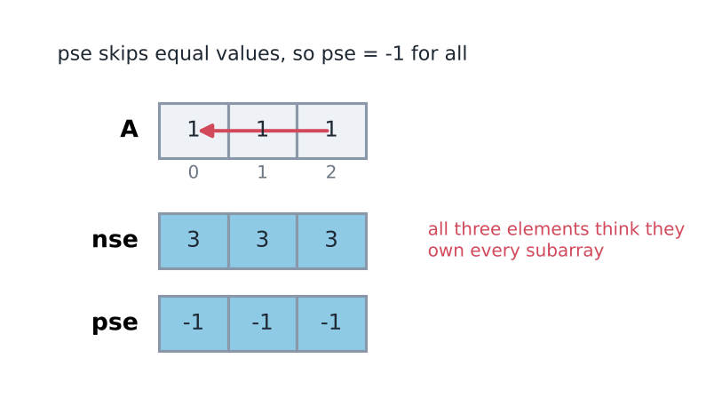

*For 1 1 1 we get nse = [3 3 3] and pse = [-1 -1 -1].*

Using these arrays to calculate the contributions leads to a wrong result.

Look at what goes wrong: each of the three 1s thinks that the whole array belongs to it. (i−a)(b−i) = 3, 4, 3 → 10. The correct answer is 6 (6 subarrays, each with minimum 1). Some subarrays were counted more than once.

Instead, the idea we use is this: when we find the minimum of a subarray, we count it only if it is the first occurrence of that value in the subarray. Then we add its contribution, otherwise we do not. (So each subarray is given to exactly one element: the leftmost one among equal minimums.)

This means we need to find the previous smaller or equal element, so that we can count from that position.

The two arrays for `1 1 1` are psee = [-1 0 1] and nse = [3 3 3].

We calculate the contributions using these two arrays.

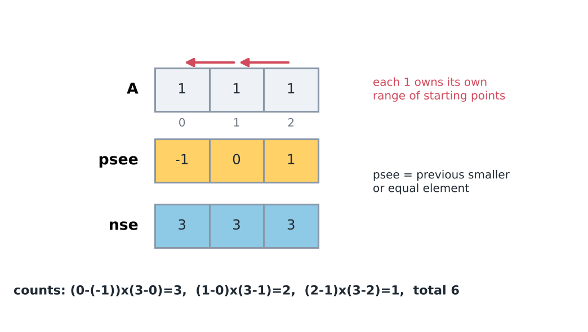

*With psee = [-1 0 1] and nse = [3 3 3] the counts are 3, 2 and 1, so the total is 3 + 2 + 1 = 6.*

(psee = previous smaller or equal element. The first 1 has none, so −1. The second 1 finds the first 1 at index 0. The third 1 finds the second 1 at index 1.) Check: `1×(0−(−1))×(3−0) = 3`, `1×(1−0)×(3−1) = 2`, `1×(2−1)×(3−2) = 1` → 6.

Left side: "or equal". Right side: strictly smaller. Using strict on both sides, or "or equal" on both sides, gives a wrong answer (the first double counts, the second misses subarrays). One side strict, the other side "or equal": then every subarray is assigned to exactly one minimum, its leftmost one.

```cpp
/*
Question: sum of the minimum of all subarrays of A (elements can repeat).
Left side: previous smaller OR equal (psee). Right side: next strictly smaller (nse).
*/
// Used for: A2 super minimum sum and the number of rectangles in a histogram (below).
long long sumOfSubarrayMinimums(const vector<int>& A) {
    int n = A.size();
    vector<int> nse(n), psee(n);
    for (int i = n - 1; i >= 0; i--) {
        nse[i] = i + 1;
        while (nse[i] < n && A[nse[i]] >= A[i]) nse[i] = nse[nse[i]];
    }
    for (int i = 0; i < n; i++) {
        psee[i] = i - 1;
        while (psee[i] >= 0 && A[psee[i]] > A[i]) psee[i] = psee[psee[i]];  // > : equal is not skipped
    }
    long long total = 0;
    for (int i = 0; i < n; i++)
        total += (long long)A[i] * (i - psee[i]) * (nse[i] - i);
    return total;
}
```

`{1,2,3}` → 10, `{1,1,1}` → 6, `{1,5,3,4,2}` → 34, `{3,1,2,4}` → 17 (tested; also compared with the brute force on 20000 random small arrays with repeated values).

Cost: the two jump loops are $O(N)$ in total and the last loop is $O(N)$, so the time is $O(N)$ per test case. With $t \le 10$ and $N \le 10^5$ that is about $10^6$ steps. Memory is $O(N)$ for the two arrays. The brute force would need about $5 \times 10^9$ steps for one test case. Mistakes to avoid: using `>=` on both sides, or `>` on both sides; computing the product in `int`; and forgetting that $a = -1$ and $b = n$ are the values when no smaller element exists.

Worked example `3 1 2 4` (psee, nse, contribution): 3 has psee $-1$ and nse 1, so $3 \times 1 \times 1 = 3$. 1 has psee $-1$ and nse 4, so $1 \times 2 \times 3 = 6$. 2 has psee 1 and nse 4, so $2 \times 1 \times 2 = 4$. 4 has psee 2 and nse 4, so $4 \times 1 \times 1 = 4$. Total = $3 + 6 + 4 + 4 = 17$.

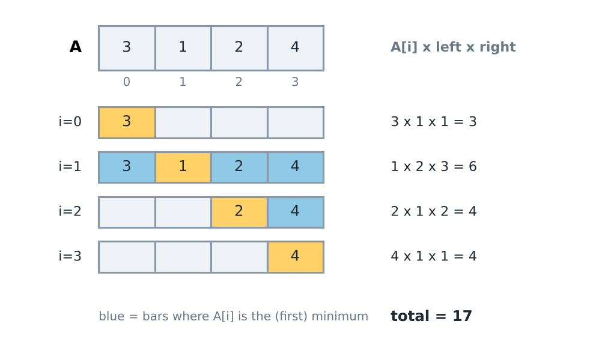

*For 3 1 2 4 the total is 3 + 6 + 4 + 4 = 17.*

Now the whole idea as a theorem. It keeps his tie rule (the cards and ladder hints below use the mirror rule, the rightmost minimum; both are correct, with the strict side swapped): each subarray is counted at its leftmost minimum. For each position $i$ let $L_i$ be the previous position with $a_{L_i} \le a_i$ (or $-1$ if there is none), the psee of his note. Let $R_i$ be the next position with $a_{R_i} < a_i$ (or $n$), his nse.

**Theorem 1.6.2 (contribution of each minimum).**
1. The subarrays $[l, r]$ with $L_i < l \le i \le r < R_i$ are exactly those in which $i$ is the leftmost position of the minimum value. There are $(i - L_i)(R_i - i)$ of them, and every subarray is counted for exactly one $i$.
2. So the sum of the minimums of all subarrays is $\sum_i a_i (i - L_i)(R_i - i)$. It is computed in $O(n)$ with two monotonic stacks.
3. For bars of heights $h_i$, let $P_i$ be the previous bar strictly lower than $h_i$ (or $-1$) and $Q_i$ the next bar strictly lower than $h_i$ (or $n$). The largest rectangle under the bars has area $\max_i h_i (Q_i - P_i - 1)$.

In plain words: every subarray has one leftmost smallest element. The subarrays that a given element decides start after the nearest smaller-or-equal element on its left and end before the nearest smaller element on its right. So their number is a product of two distances.

Small example first: $a = (3, 1, 2)$, $n = 3$.

| $i$ | $a_i$ | $L_i$ | $R_i$ | $(i - L_i)(R_i - i)$ | $a_i$ times that |
|---|---|---|---|---|---|
| 0 | 3 | −1 | 1 | 1 | 3 |
| 1 | 1 | −1 | 3 | 4 | 4 |
| 2 | 2 | 1 | 3 | 1 | 2 |

The counts add up to 6, the number of subarrays, and the contributions add up to $3 + 4 + 2 = 9$. Directly, the six subarrays $(3), (1), (2), (3, 1), (1, 2), (3, 1, 2)$ have minimums $3 + 1 + 2 + 1 + 1 + 1 = 9$. For part 3, take the bars $(3, 1, 2)$. The candidates are $3 \cdot 1$, $1 \cdot 3$ and $2 \cdot 1$, so the best rectangle has area 3.

Why it works.
1. Fix $i$ and a subarray $[l, r]$ that contains $i$. Position $i$ is the leftmost minimum of $[l, r]$ exactly when every element of $[l, i - 1]$ is greater than $a_i$ and every element of $[i + 1, r]$ is at least $a_i$.
2. The first condition says no position of $[l, i - 1]$ has a value at most $a_i$. By the definition of $L_i$ (the nearest such position on the left) that is the same as $l > L_i$. In the same way the second condition is the same as $r < R_i$.
3. So the subarrays decided by $i$ are exactly those with $L_i < l \le i \le r < R_i$. There are $i - L_i$ choices of $l$ and $R_i - i$ choices of $r$, and the choices are independent. That gives the product.
4. Every subarray has exactly one leftmost minimum, so it is counted for exactly one $i$. Part 1 is shown.
5. Part 2. A subarray decided by $i$ has minimum $a_i$, so the sum of all minimums is $\sum_i a_i (i - L_i)(R_i - i)$. Both $L$ and $R$ are nearest-element questions, so Theorem 1.6.1, with the comparisons changed to "smaller", gives them in $O(n)$.
6. Part 3. Take a best rectangle, covering the bars $l..r$, and let $i$ be a lowest bar in it. Its height is at most $h_i$. Every bar in $l..r$ is at least $h_i$ high, so $P_i < l$ and $r < Q_i$.
7. So its width is at most $Q_i - P_i - 1$, and its area is at most $h_i (Q_i - P_i - 1)$. That candidate is itself a valid rectangle, because every bar strictly between $P_i$ and $Q_i$ is at least $h_i$ high.
8. So the best area equals the largest candidate over all $i$. This shows part 3.

This proof needs: (1) the quantity summed over subarrays is a minimum (or maximum), its value is decided by one element, and the subarrays where that element decides form a rectangle of choices, $l$ times $r$; (2) ties are broken on exactly one side (strict on one side, non-strict on the other), or subarrays with repeated minimums are counted twice; (3) counts reach $n(n+1)/2$ and sums reach $10^9 \cdot n(n+1)/2$, which is about $2 \cdot 10^{19}$ for $n = 2 \cdot 10^5$. That is more than a `long long` holds ($9 \cdot 10^{18}$), so such problems usually ask for the answer modulo a number.

His function `sumOfSubarrayMinimums` above is this theorem with the leftmost convention, so no extra unit is needed. The theorem with the rightmost convention (previous strictly smaller, next smaller-or-equal) is the mirror image and gives the same sums.

Examples. The first is the table above. The second shows the tie rule on $(2, 2)$: position 0 has $L_0 = -1$ and $R_0 = 2$, so it counts the two subarrays that start at 0. Position 1 has $L_1 = 0$ and $R_1 = 2$, so it counts only $[1, 1]$. The total is $2 \cdot 2 + 2 \cdot 1 = 6$. The same-rule mistake gives 8, because the subarray $(2, 2)$ is counted by both equal minimums: $2 \cdot 2 + 2 \cdot 2$ instead of $2 + 2 + 2$.

## Other three directions (NGE, PGE)

It is the same technique with the comparison reversed. There are 4 combinations of right / left and smaller / greater:

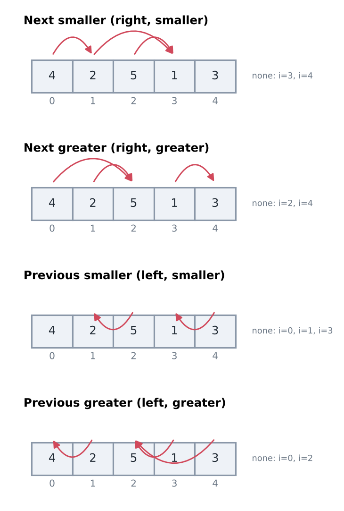

*The four variants on the array 4 2 5 1 3.*

| Query | Look | Pop while (stack of indices) |
|---|---|---|
| Next smaller | right | `a[top] > a[i]` |
| Next greater | right | `a[top] < a[i]` |
| Previous smaller | left | `a[top] >= a[i]` |
| Previous greater | left | `a[top] <= a[i]` |

For the "next" queries, a popped element receives the answer `i`. For the "previous" queries, the answer is the element left on top after the pops. How equal values are treated is decided by `>` versus `>=` (see the duplicates section above).

Trace of next greater on `4 2 5 1 3` (the stack holds indices): index 0 is pushed. Index 1 (value 2): the top 4 is not smaller, so push. Index 2 (value 5): pop index 1 ($2 < 5$) and index 0 ($4 < 5$), both get answer 2; push index 2. Index 3 (value 1): push. Index 4 (value 3): pop index 3 ($1 < 3$), answer 4; the top 5 is not smaller, so push. The indices 2 and 4 are left in the stack, so they get the answer 5 (none). Result: `2 2 5 4 5`. The cost is $O(n)$ time and $O(n)$ memory, the same as for the smaller case.

Each variant as a function. A value of n (right side) or -1 (left side) in the answer means "none".

```cpp
/*
For every index i, the nearest index to the RIGHT with a strictly smaller value, n if none.
Example: a = 4 2 5 1 3 gives 1 3 3 5 5
*/
// New function (not in his repo): the plain stack version of NSE, one function per direction so the four differ by one sign.
vector<int> nextSmaller(const vector<int>& a) {
    int n = a.size();
    vector<int> res(n, n);
    stack<int> st;  // indices; values grow from bottom to top
    for (int i = 0; i < n; i++) {
        while (!st.empty() && a[st.top()] > a[i]) {  // a[i] is the answer for these
            res[st.top()] = i;
            st.pop();
        }
        st.push(i);
    }
    return res;
}

/*
Nearest index to the RIGHT with a strictly greater value, n if none.
Example: a = 4 2 5 1 3 gives 2 2 5 4 5
*/
// New function (not in his repo): NGE, the comparison of nextSmaller reversed.
vector<int> nextGreater(const vector<int>& a) {
    int n = a.size();
    vector<int> res(n, n);
    stack<int> st;  // indices; values shrink from bottom to top
    for (int i = 0; i < n; i++) {
        while (!st.empty() && a[st.top()] < a[i]) {
            res[st.top()] = i;
            st.pop();
        }
        st.push(i);
    }
    return res;
}

/*
Nearest index to the LEFT with a strictly smaller value, -1 if none.
Example: a = 4 2 5 1 3 gives -1 -1 1 -1 3
*/
// New function (not in his repo): PSE, where the answer is the element left on top after the pops.
vector<int> previousSmaller(const vector<int>& a) {
    int n = a.size();
    vector<int> res(n, -1);
    stack<int> st;
    for (int i = 0; i < n; i++) {
        while (!st.empty() && a[st.top()] >= a[i]) st.pop();  // not smaller: useless for later
        if (!st.empty()) res[i] = st.top();
        st.push(i);
    }
    return res;
}

/*
Nearest index to the LEFT with a strictly greater value, -1 if none.
Example: a = 4 2 5 1 3 gives -1 0 -1 2 2
*/
// New function (not in his repo): PGE, the comparison of previousSmaller reversed.
vector<int> previousGreater(const vector<int>& a) {
    int n = a.size();
    vector<int> res(n, -1);
    stack<int> st;
    for (int i = 0; i < n; i++) {
        while (!st.empty() && a[st.top()] <= a[i]) st.pop();  // not greater: useless for later
        if (!st.empty()) res[i] = st.top();
        st.push(i);
    }
    return res;
}
```

Compiled and run on `4 2 5 1 3`: next smaller `1 3 3 5 5`, next greater `2 2 5 4 5`, previous smaller `-1 -1 1 -1 3`, previous greater `-1 0 -1 2 2`. All four were compared with brute force on 20000 random small arrays with repeated values.

How equal values behave depends on the sign you choose. With repeated values you must decide what a tie means:

| You want | Pop condition | What happens to equal values |
|---|---|---|
| next strictly smaller | pop while `a[top] > a[i]` | equal values stay on the stack |
| next smaller or equal | pop while `a[top] >= a[i]` | equal values are popped |
| previous strictly smaller | pop while `a[top] >= a[i]` | equal values are popped (the jump code above computes this) |
| previous smaller or equal | pop while `a[top] > a[i]` | equal values stay, so the answer can be an equal element (this is psee) |

In the sum of subarray minimums, one side must be strict and the other side must be "or equal".

Next greater element is also hidden inside two well-known problems. In Daily Temperatures we want the distance in days to the next warmer day, which is the next greater index minus i. In a circular array the first element follows the last one, so we walk the array twice (positions 0 to 2n−1, using `i % n`) and push an index only during the first walk.

```cpp
/*
Daily Temperatures: for each day, how many days until a warmer day? 0 if there is none.
Example: 73 74 75 71 69 72 76 73 gives 1 1 4 2 1 1 0 0
*/
// New function (not in his repo): next greater element, answering with a distance instead of an index.
vector<int> dailyTemperatures(const vector<int>& temp) {
    int n = temp.size();
    vector<int> wait(n, 0);
    stack<int> st;  // days still waiting for a warmer day
    for (int i = 0; i < n; i++) {
        while (!st.empty() && temp[st.top()] < temp[i]) {
            wait[st.top()] = i - st.top();
            st.pop();
        }
        st.push(i);
    }
    return wait;
}

/*
Next Greater Element II: the array is circular. For each element give the next greater VALUE, or -1.
Example: 1 2 1 gives 2 -1 2
*/
// New function (not in his repo): shows the two-walk trick for circular arrays.
vector<int> nextGreaterCircular(const vector<int>& a) {
    int n = a.size();
    vector<int> res(n, -1);
    stack<int> st;
    for (int i = 0; i < 2 * n; i++) {  // walk the array twice
        int pos = i % n;               // real position
        while (!st.empty() && a[st.top()] < a[pos]) {
            res[st.top()] = a[pos];
            st.pop();
        }
        if (i < n) st.push(pos);       // push only during the first walk
    }
    return res;
}
```

Compiled and run: `73 74 75 71 69 72 76 73` gives `1 1 4 2 1 1 0 0`, and the circular `1 2 1` gives `2 -1 2` (the last 1 wraps around to the 2). Both match brute force on 20000 random arrays. Cost: $O(n)$ time and $O(n)$ memory; the circular version makes $2n$ steps. Mistake to avoid: walking the array only once. Then the last 1 of `1 2 1` finds no greater element and prints -1, while the correct answer is 2.

Another way to get next greater is to scan from the right. Keep a stack of candidates. For position $i$, pop every candidate with value at most $a_i$, because for every position further left, $a_i$ hides them. The top that remains is the next greater element of $i$. Then push $i$. Both directions are $O(n)$. The left-to-right scan finds the answer of an element when it is popped. The right-to-left scan finds it when the element is pushed.

```cpp
/*
Nearest index to the RIGHT with a strictly greater value, n if none. Scan from the right.
Example: a = 4 2 5 1 3 gives 2 2 5 4 5
*/
// New function (not in his repo): the right-to-left form of nextGreater; the answer is read when i is pushed.
vector<int> nextGreaterFromRight(const vector<int>& a) {
    int n = a.size();
    vector<int> res(n, n);
    stack<int> st;  // candidates; values grow towards the bottom
    for (int i = n - 1; i >= 0; i--) {
        while (!st.empty() && a[st.top()] <= a[i]) st.pop();  // hidden by a[i] for everything on the left
        if (!st.empty()) res[i] = st.top();
        st.push(i);
    }
    return res;
}
```

Compiled and run: `4 2 5 1 3` gives `2 2 5 4 5`, the same as `nextGreater`. Cost: $O(n)$ time and memory, each position is pushed once and popped at most once.

The sum of subarray minimums has the same mirror. The sum of subarray maximums is the same code with every comparison reversed. The sum of $\max - \min$ over all subarrays is the difference of the two sums. For $a = (3, 1, 2)$ the minimums add up to 9 (table in Theorem 1.6.2) and the maximums $3 + 1 + 2 + 3 + 2 + 3$ add up to 14. The difference is 5, and directly $0 + 0 + 0 + 2 + 1 + 2 = 5$.

Worked example 1: Buildings. This is AtCoder Beginner Contest 372, problem D. In short: $N \le 2 \cdot 10^5$ buildings stand in a row with distinct heights. For each building $i$, count the buildings $j > i$ such that no building strictly between $i$ and $j$ is taller than building $j$.

Idea, in the six steps of recognising a problem.
1. Budget. $N = 2 \cdot 10^5$ needs $O(N)$ or $O(N \log N)$. All pairs is $4 \cdot 10^{10}$, far too slow. The counts are at most $N$, so `int` is enough.
2. Tools. Brute force checks every pair $(i, j)$ and the buildings between them: $O(N^3)$. Read from position $i + 1$ to the right, the counted buildings are the new records, each taller than everything before it. That is a question about the nearest taller building, the shape of Theorem 1.6.1. A second reading: building $j$ is counted for every $i$ from its previous taller building up to $j - 1$, so the counts are range additions (difference array, topic 1.2).
3. Deciding property. Process $i$ from right to left and keep the records of the suffix $i + 1, \dots, N$ on a stack, nearest on top. Their heights increase from top to bottom, and $c_i$ is their number. When building $i$ joins the suffix, it is a record, since nothing is before it. An old record stays a record exactly when it is taller than $h_i$. The shorter old records are all on top, so we pop them and push $i$.
4. Proof for this problem. Invariant: before step $i$ (from $N - 1$ down to 0) the stack holds exactly the $j > i$ with $h_j > h_k$ for all $i < k < j$, nearest on top, with increasing heights. It holds before step $N - 1$ (empty stack). At step $i$ the answer $c_i$ is the stack size. For step $i - 1$ the counted set is $i$ itself plus those old $j$ that are taller than $h_i$. The shorter old ones form the top of the stack, and the loop pops exactly them. Each building is pushed and popped at most once, so the cost is $O(N)$ (Theorem 0.2.4).

Trace on heights $(2, 1, 4, 3, 5)$, right to left. Stack heights are written top first.
- $i = 4$: $c = 0$. Nothing to pop. Push 5. Stack: 5.
- $i = 3$: $c = 1$. Height 5 is not shorter than 3. Push 3. Stack: 3, 5.
- $i = 2$: $c = 2$. Pop 3 (shorter than 4). Push 4. Stack: 4, 5.
- $i = 1$: $c = 2$. Nothing is shorter than 1. Push 1. Stack: 1, 4, 5.
- $i = 0$: $c = 3$. Pop 1 (shorter than 2). Push 2. Stack: 2, 4, 5.

The answer is $c = (3, 2, 2, 1, 0)$. Check $i = 0$ directly: $j = 1$ has nothing between, $j = 2$ has only the shorter 1 between, $j = 3$ is hidden by 4, and $j = 4$ is taller than 1, 4 and 3. That is 3 buildings.

<CodeSnippet unit="1.6/example-1" />

Cost: $O(N)$ time and $O(N)$ memory. Common mistake: read `st.size()` after the push instead of before it. Then building $i$ counts itself. On heights $(1, 2)$ the code prints $(2, 1)$ instead of $(1, 0)$. Fix: read the size first, then pop, then push.

Alternative. Compute $P_j$, the previous taller building of each $j$ (Theorem 1.6.1, left to right). Building $j$ is counted exactly for $i = \max(P_j, 0), \dots, j - 1$. The building at $P_j$ itself is allowed, because it is the end $i$ and not between. So add 1 on that range with a difference array and take prefix sums (Theorem 1.2.3). On $(2, 1, 4, 3, 5)$ we get $P = (-1, 0, -1, 2, -1)$, so building 1 is counted for $i = 0$, building 2 for $i = 0..1$, building 3 for $i = 2$, and building 4 for $i = 0..3$. The totals are $(3, 2, 2, 1, 0)$ again. It is $O(N)$ too, and it separates the stack step from the counting.

## Number of rectangles in histogram

This is the problem "find the number of rectangles in the histogram" from the start: rectangles that stand on the floor and have integer sides. Over the bars `l..r`, any height from `1` up to `min(h[l..r])` fits. So that range holds exactly `min(h[l..r])` rectangles.

Adding over all ranges gives the **sum of subarray minimums**, the same function as above. `1 3 5 7 4` → 46 (brute force also gives 46).

By the contribution formula, with psee on the left and nse on the right: 1 gives $1 \times 1 \times 5 = 5$, 3 gives $3 \times 1 \times 4 = 12$, 5 gives $5 \times 1 \times 2 = 10$, 7 gives $7 \times 1 \times 1 = 7$, 4 gives $4 \times 3 \times 1 = 12$. Total = $5 + 12 + 10 + 7 + 12 = 46$. The brute force over all pairs of ends would need about $n^2/2$ steps; this needs $O(n)$ time and $O(n)$ memory.

The small case `1 3`: the ranges are [1], [3], [1 3] with minimums 1, 3, 1, so the sum is 5. Counted directly on the picture: 1 rectangle over the bar 1 alone, 3 rectangles (heights 1, 2, 3) over the bar 3 alone, and 1 rectangle (height 1) over both bars, so 1 + 3 + 1 = 5.

## Bracketing

Question: given a string of brackets, check that every opening bracket has a matching closing bracket in the correct order. For example `([)]` is not balanced: the `)` arrives while the open `[` is on top. The stack fits because the bracket opened last must be closed first (last in, first out). Stack rule: push each opening bracket. When a closing bracket arrives, the top must be its partner. At the end the stack must be empty.

To match the pairs we map each opening bracket to a positive number +x and its closing bracket to −x. Then `st.top() + val == 0` means that the pair matches.

```cpp
/*
Given a string of brackets, check if all the brackets are balanced
*/
// Fabricator/STL/BalancedBrackets.cpp
void solve(){
    string s;
    getline(cin, s);
    map<char, int> mp;
    mp['('] = 1;
    mp[')'] = -1;
    mp['{'] = 2;
    mp['}'] = -2;
    mp['['] = 3;
    mp[']'] = -3;

    bool is_balanced = true;
    stack<int> st;
    for(auto c: s){
        int val = mp[c];
        if(val > 0){
            st.push(val);
        }
        else{
            if(!st.empty() && (st.top() + val == 0)){
                st.pop();
            }
            else{
                is_balanced = false;
                break;
            }
        }
    }

    if(!st.empty()) is_balanced = false;

    if(is_balanced) cout<<"Is Balanced\n";
    else cout<<"Not Balanced\n";
}
```

`()[]{}` ✓, `{[]}` ✓, `(]` ✗, `([)]` ✗, `((` ✗ (tested).

Trace of `([)]`: `(` is pushed (1). `[` is pushed (3). `)` has value −1; the top is 3, and 3 + (−1) is not 0, so the string is not balanced. Trace of `{[]}`: push 2, push 3; `]` has value −3 and 3 + (−3) = 0, so pop; `}` has value −2 and 2 + (−2) = 0, so pop; the stack is empty, so it is balanced.

Cost: one pass, $O(n)$ time; the stack can hold up to $n$ opening brackets, so the memory is $O(n)$. Edge cases: a closing bracket when the stack is empty (checked by `!st.empty()`), an opening bracket never closed (checked at the end), and a character that is not a bracket: its map value is 0, so it falls into the closing branch and the answer is "Not Balanced".

## Min of every window of size k (monotone deque)

A close relative of the monotonic stack. A deque (double-ended queue: push and pop at both ends) is kept so that its front always holds the minimum of the current window.

Problem: print the minimum of every window of size $k$ in an array of size $n$. Why brute force fails: scanning each window costs $k$ steps and there are $n - k + 1$ windows, so about $(n - k + 1) \times k$ steps. This is largest near $k = n / 2$; for $n = 10^5$ and $k = 5 \times 10^4$ it is about $2.5 \times 10^9$. The deque costs $O(n)$ in total, because each element enters once and leaves once.

Idea in plain words: when a new element x arrives, every element behind it in the deque that is larger than x can never be the minimum again, because x is smaller and leaves the window later. So those elements are removed from the back. What remains is increasing from front to back, so the front is the minimum of the window. An element is removed from the front when it leaves the window.

Dry run on `4 2 5 1 3`, k = 3: insert 4 → [4]. Insert 2 → pop 4, deque [2]. Insert 5 → [2 5]; the first window is complete, min = 2. Insert 1 → pop 5 and 2, deque [1]; the element leaving the window (4) is not at the front, so nothing to remove; min = 1. Insert 3 → [1 3]; the leaving element 2 is not at the front either; min = 1. Output `2 1 1`.

```cpp
/*
Given an array of size n, find minimum of every window of size k.
*/
// Fabricator/STL/MinInKWindow-MonotoneDequeue.cpp
struct monotone_deque{
    deque<int> dq;
    void insert(int x){
        while(!dq.empty() && dq.back() > x)
            dq.pop_back();

            dq.push_back(x);
    }

    void erase(int x){
        if(!dq.empty() && dq.front() == x)
            dq.pop_front();
    }

    int get_min(){
        return dq.front();
    }
};

void solve(){
    int n, k;
    cin>>n>>k;
    int arr[n];
    for(auto &x: arr) cin>>x;

    monotone_deque mt;
    for(int i=0; i<n; i++){
        mt.insert(arr[i]); // O(1) --> Amortized
        if((i-k) > 0) mt.erase(arr[i-k]); // O(1)
        if(i >= (k-1)) cout<<mt.get_min()<<" "; // O(1)
    }
}
```

Cost: $O(n)$ time in total and $O(k)$ memory, since the deque holds at most the k elements of one window. The deque stores values, not indices. This works because equal values are kept (the pop needs a strictly larger value), so erasing by value removes the correct copy.

Note: `if((i-k) > 0)` should be `>= 0`. When `i == k`, `arr[0]` leaves the window but is not erased. On `1 5 6 7`, k = 2 this prints `1 1 1`, while the correct output is `1 5 6`. (On `4 2 5 1 3`, k = 3 it prints the correct `2 1 1`, so the bug stays hidden.)

Now the same deque as a theorem. His code keeps values and finds the minimum. The theorem keeps positions and finds the maximum, which is the mirror image. Positions let us see whether the front has left the window.

**Theorem 1.6.3 (monotonic deque).** For the windows $[i - k + 1, i]$ of a fixed length $k$, keep a deque of positions. At step $i$: pop from the back every position $j$ with $a_j \le a_i$, push $i$ at the back, and pop the front if it is at most $i - k$ (it is outside the window). Then the front is a position of the window maximum. Each step is $O(1)$ amortised, so the total is $O(n)$.

In plain words: in a window that moves right, an element followed by a larger or equal one can never be the maximum again. We call it dominated. A deque that keeps only the elements that are not dominated has the window maximum at its front.

Small example first: $a = (1, 3, -1, -3, 5)$, $k = 3$. The windows $(1, 3, -1)$, $(3, -1, -3)$ and $(-1, -3, 5)$ have maximums 3, 3 and 5. The deque holds positions, shown here by value.

| step $i$ | action | deque after (values) | window maximum |
|---|---|---|---|
| 0 | push 0 | 1 | none yet |
| 1 | pop 0 (1 is at most 3), push 1 | 3 | none yet |
| 2 | push 2 | 3, −1 | 3 |
| 3 | push 3; front 1 is still inside $[1, 3]$ | 3, −1, −3 | 3 |
| 4 | pop 3, 2 and 1, push 4 | 5 | 5 |

Why it works. Let $W_i$ be the window after step $i$, the positions $\max(0, i - k + 1)$ to $i$. Claim: after step $i$ the deque holds exactly the non-dominated positions of $W_i$, in increasing order of position, and their values strictly decrease from front to back.
1. Before step 0 the window and the deque are both empty, so the claim holds.
2. Assume the claim after step $i - 1$. The values strictly decrease from front to back, so the positions with $a_j \le a_i$ form a suffix of the deque, and the loop pops exactly that suffix. These are the positions that $i$ dominates. They stay dominated in every later window that contains them, because such a window also contains $i$.
3. A position dominated in $W_{i-1}$ is still dominated in $W_i$, because its dominator lies to its right and leaves the window later. Position $i$ is not dominated, since nothing follows it. After the push the deque holds exactly the non-dominated positions of $W_{i-1}$ together with $i$. The values still strictly decrease, because the position below $i$ has a value greater than $a_i$.
4. The window then loses at most one position, $i - k$, and only if it was inside. It is the leftmost position, so it can only be the front. Removing the leftmost position changes nobody else's status, since dominators lie to the right. That proves the claim after step $i$.
5. The front is the maximum. Take any position of $W_i$ that is not in the deque. A later position of the window with a value at least as large dominates it. If that one is dominated too, follow its dominator, and so on. The chain moves right, so it ends at a non-dominated position, which is in the deque, and the values never decrease along the chain. The front has the largest value in the deque, so it is at least the value of every position of $W_i$.
6. Each position enters the deque once and leaves it at most once, so all pops together are at most $n$ (Theorem 0.2.4). So the total time is $O(n)$.

This proof needs: (1) the window moves only to the right, so a dominated element never becomes useful again; (2) only the maximum (or the minimum) is needed. Other order statistics, such as the median, need a `multiset` (topic 0.6); (3) before reading the front, the deque is not empty and its front is inside the window. Check these on every problem.

<TheoremCode unit="1.6/thm-3" />

Examples. At $i = 4$ the value 5 removes 3, −1 and −3 (step 2 of the proof). With a repeated maximum, as in $a = (4, 4, 2, 1)$ and $k = 2$, the later 4 removes the earlier one, which can never be the answer again, so the maximums are $4, 4, 2$. His min version keeps equal values instead, and erases by value; both tie rules are correct.

Alternatives. For the minimum, reverse the comparison. For a fixed length $k$ only, there is also a block trick, using prefix maximums as in topic 1.2. Cut the array into blocks of $k$ and keep, inside each block, the prefix maximums and the suffix maximums. A window of length $k$ touches at most two blocks. Its maximum is the larger of the suffix maximum of the first block from the window start and the prefix maximum of the second block up to the window end. Example: $a = (1, 3, -1, -3, 5, 3, 6, 7)$ and $k = 3$ give the blocks $(1, 3, -1)$, $(-3, 5, 3)$, $(6, 7)$. The window $(-1, -3, 5)$ is the suffix $(-1)$ of block 0 and the prefix $(-3, 5)$ of block 1, so its maximum is $\max(-1, 5) = 5$. The deque is simpler, and it also works when the window length changes.

Common mistake: the window is one too wide. Write the check as `if (dq.front() < i - k) dq.pop_front();` and position $i - k$ stays, although the window is $[i - k + 1, i]$. Take $n = 2$, $k = 1$ and $a = (4, 1)$. The output is `4 4` instead of `4 1`. Fix: remove every position before $i - k + 1$, that is, while `dq.front() <= i - k`. It is the same boundary as in his note's `(i-k) >= 0` remark.

Common mistake: reading the back of the deque. Write `a[dq.back()]` for the answer. The back is always the newest position $i$. Take $n = 2$, $k = 2$ and $a = (2, 1)$. The output is 1 instead of 2. Fix: the values decrease from front to back, so the extreme sits at the front. Write that invariant in a comment next to the deque.

The same deque also works when the left end of the window moves irregularly, as in the shrinkable windows of topic 1.3. When the left end passes the front's position, pop the front. Two deques, one for the maximum and one for the minimum, give the spread $\max - \min$ of the window in $O(1)$. That decides conditions like "max minus min is at most $K$" while both ends move.

Worked example: the longest window with $\max - \min \le K$. A window with spread at most $K$ keeps that property for every window inside it (topic 1.3). So for each right end $r$ the left end $l$ moves right until the condition holds. Then $[l, r]$ is the longest valid window ending at $r$. Brute force over all windows with a scan inside is $O(n^3)$. The budget for $n = 2 \cdot 10^5$ is $O(n)$ or $O(n \log n)$.

<CodeSnippet unit="1.6/spread-window" />

How it works: the `mx` deque holds the window maximum candidates, the `mn` deque holds the minimum candidates. When $l$ passes a front's position, that front is popped. Cost: $O(n)$, each position enters and leaves each deque once. Common mistake: checking only one front. Remove the line that pops the front of `mn`, and take $n = 3$, $K = 1$, $a = (0, 3, 3)$. At $r = 1$ the spread is 3, so $l$ moves to 1. But `mn` still has position 0 at its front, so the spread still reads as 3, and $l$ keeps moving past $r$ until a deque is empty. Reading the front of an empty deque is undefined behaviour. It can print 1 instead of 2, or crash. Fix: after every step of $l$, check the front of every deque. Alternative: a `multiset` of the window values (topic 0.6) gives the maximum and the minimum in $O(\log n)$ each. It is easier to write, and $O(n \log n)$ is fast enough for $n = 2 \cdot 10^5$.

Worked example 2: Maximum Subarray Sum II. This is CSES 1644. In short: $n \le 2 \cdot 10^5$ integers with $|x_i| \le 10^9$. Print the largest sum of a subarray whose length is between $a$ and $b$.

Idea, in the six steps of recognising a problem.
1. Budget. $n = 2 \cdot 10^5$ needs $O(n)$ or $O(n \log n)$. All pairs of ends is $O(n^2)$ when $b - a$ is large. Sums reach $2 \cdot 10^{14}$ in absolute value, so use `long long`.
2. Tools. Brute force over both ends. A subarray sum is a difference of prefix sums, $p_r - p_l$ (topic 1.2). For a fixed right end $r$, the best start is the $l$ with the smallest $p_l$ among $r - b \le l \le r - a$. As $r$ grows, that range of allowed starts moves right by one. It is a sliding window over $p$, and Theorem 1.6.3 keeps its minimum.
3. Deciding property. The window of starts only moves right, and only its minimum is needed. The window is never empty, because $r - a \ge r - b$ and $r \ge a$. So: prefix sums, then one pass over $r$ with a deque of starts whose prefix sums increase from front to back.
4. Proof for this problem. The subarrays with right end $r$ and an allowed length are exactly those starting after $l$, with $\max(0, r - b) \le l \le r - a$, and their sums are $p_r - p_l$. For fixed $r$ the largest sum uses the smallest $p_l$ in that range. By Theorem 1.6.3 with the comparisons reversed, the front of the deque is a position of that minimum, as long as every start of the range has been pushed and the front is not below $r - b$. At step $r$ the program pushes $r - a$, and the lower end of the range moves by at most one per step, so popping at most one front is enough. Each start enters and leaves the deque once, so the cost is $O(n)$.

Trace on $x = (-1, 2, 3, -2, 4)$ with $a = 2$, $b = 3$. The prefix sums are $p = (0, -1, 1, 4, 2, 6)$.
- $r = 2$: start 0 becomes allowed. Deque: 0. Best $= p_2 - p_0 = 1$.
- $r = 3$: start 1 has $p_1 = -1$, which pops start 0 ($0 \ge -1$). Deque: 1. Best $= p_3 - p_1 = 5$.
- $r = 4$: start 2 is pushed. Deque: 1, 2. The front 1 is not below $4 - 3 = 1$. Candidate $p_4 - p_1 = 3$. Best stays 5.
- $r = 5$: start 3 is pushed. The front 1 is below $5 - 3 = 2$, so it is popped. Candidate $p_5 - p_2 = 5$. Best stays 5.

The answer is 5, the subarray $(2, 3)$. Brute force over the seven subarrays of length 2 or 3 agrees.

<CodeSnippet unit="1.6/example-2" />

Cost: $O(n)$ time and $O(n)$ memory for the prefix sums. Common mistake: starting `r` at 1 and pushing `r` itself instead of `r - a`. Then a start closer than $a$ is allowed and subarrays shorter than $a$ are counted. Fix: the start that becomes allowed at step $r$ is $r - a$. Alternative: keep the allowed prefix sums in a `multiset` (topic 0.6). Insert $p_{r-a}$, erase $p_{r-b-1}$ and read the smallest with `begin()`. It is $O(n \log n)$ and fast enough here. The deque is shorter and $O(n)$.

## Recognition cards

A recognition card lists the weak signals in a statement, the constraint shape, the property that decides, and how to test it. Read each card against the problems you have seen in this lesson.

<Cards topic="1.6" />

## Quick revision

- Monotonic stack: store indices, keep the order sorted, pop whatever breaks the order. Time $O(n)$, memory $O(n)$: each index is pushed once and popped at most once.
- NSE: pop while `a[top] > a[i]`; each popped element gets answer `i`. Leftover elements get n (or the sentinel).
- PSE: after the pops, the top of the stack is the answer.
- Histogram: $\text{width} = \text{nse} - \text{pse} - 1$, $\text{area} = \text{height} \times \text{width}$, sentinel 0 at both ends. Equal bars are fine: the earlier bar gets the full width.
- Number of rectangles in a histogram = sum of subarray minimums (`1 3 5 7 4` → 46).
- Contribution of $A_i$ as the minimum = $A_i \times (i - a) \times (b - i)$, with $a = -1$ and $b = n$ when no smaller element exists.
- Distinct elements: strict comparison on both sides. Repeated elements: left side psee (smaller or equal), right side nse (strict). `1 1 1` → 6, not 10.
- Jump trick: `nse[i] = i+1; while (nse[i] < n && arr[nse[i]] >= arr[i]) nse[i] = nse[nse[i]];`
- Use `long long` for sums and areas (sum of minimums can reach about $5 \times 10^{15}$).
- Brackets: push openings; on a closing bracket the top must match; the stack must be empty at the end.
- Window minimum: monotone deque, front = minimum, remove the leaving element when `i − k >= 0`. Time $O(n)$, memory $O(k)$.
- Theorem 1.6.1: a scan with a stack of positions that never rise gives the next greater element when a position is popped. After the pops the top is the previous greater-or-equal element. Time $O(n)$.
- Theorem 1.6.2: with $L_i$ = previous smaller-or-equal and $R_i$ = next strictly smaller, element $i$ is the leftmost minimum of $(i - L_i)(R_i - i)$ subarrays. The sum of minimums is $\sum a_i (i - L_i)(R_i - i)$. The histogram answer is $\max h_i (Q_i - P_i - 1)$ with strictly lower bars on both sides.
- Theorem 1.6.3: in a window that moves right, drop dominated elements from the back, drop the front when it leaves, and the front is the maximum. Time $O(n)$.

## Check yourself

### Identification drill

Each item names a problem without saying which card decides it. Choose a card, write the property you checked, then reveal the answer.

<Drill topic="1.6" />

### Look-alike pairs

Two problems that read almost the same but need different tools. The flipping difference is the one detail that changes the decision.

<LookalikePairs topic="1.6" />

### Self-test

Answer each question on paper before opening its answer.

<SelfTest topic="1.6" />

### Checkpoint

Three problems in 90 minutes. Pass rule: at least 2 of 3 in time, and the right card on all 8 drill items.

<Checkpoint topic="1.6" />

### Decision map update

How the cards of this topic are chosen against the tools you already have.

<DecisionMapUpdate topic="1.6" />

## Practice problems

Work through the ladder in order: each rung adds one twist to its card. The extra problems below it use the same cards.

<Ladder topic="1.6" />
