import TopicHeader from '../../../components/TopicHeader.astro';
import Ladder from '../../../components/Ladder.astro';

<TopicHeader topic="1.7" />

## What this note covers

This note covers: operators, the sign bit, 2's complement, sets as bitmasks, x^th bit tricks and counting set bits. After that come the bit application problems (contribution technique, extending end, k^th one in binary sequence, pair xor) and the built-in functions to remember.

- Operators
- Two's complement (sign bit, -10 + 10, overflow)
- Sets as bitmasks (union, intersection, all subsets)
- X^th bit: check / set / unset / flip
- Counting set bits
- Bit application: sum of all subarray ANDs (atomic item, extending end)
- ORs and XORs
- Number of distinct AND values
- Question: index of k^th 1 in binary sequence
- Question: sum of all pair xor
- Some functions to remember
- Quick revision
- Practice problems

Terms used in this lesson: T.C. = time complexity, comple = complement, Ques = question, e.g. = for example, MSB = most significant bit (leftmost), LSB = least significant bit (rightmost), LC = LeetCode, B.S. = binary search, TLE = time limit exceeded, CP = competitive programming. Set bit = bit which is 1. Subarray = continuous part of the array. AND, OR, XOR (exclusive OR) = the bit operations `&`, `|`, `^`.

Why learn this? Take an array of n = 10^5 numbers and the question "what is the sum of the AND of every subarray?". There are n(n+1)/2, about 5·10^9, subarrays. At roughly 10^8 simple operations per second that is about 50 seconds, far over a typical 1 to 2 second limit. The idea of this lesson: a number is 32 independent yes/no flags, so we can solve each flag alone. That costs about 32 · 10^5 = 3.2·10^6 operations, which runs in a few milliseconds.

## Operators

Bit manipulation means working directly on the bits (the 0 and 1 digits) of a number. These are the operators used for it:

Operators : `~, |, &, ^, >>, <<, -`

The logical operators are different. They work on whole true / false values:

logical operators : `&&, ||, !`

The table below shows each bit operator on 5 = 101 and 3 = 011.

| op | meaning | e.g. (5 = 101, 3 = 011) |
|---|---|---|
| `~` | flip every bit | `~5 = -6` |
| `\|` | 1 if any bit is 1 | `5 \| 3 = 7` |
| `&` | 1 if both bits are 1 | `5 & 3 = 1` |
| `^` | 1 if bits are different | `5 ^ 3 = 6` |
| `<<` | shift left, x2 per step | `5 << 1 = 10` |
| `>>` | shift right, /2 per step | `5 >> 1 = 2` |

Note: logical operators look at the whole number as true / false. `6 && 1` is true but `6 & 1 = 0`. Don't mix them.

## Two's complement

A computer stores a number in a fixed number of bits. To also store negative numbers, it uses the leftmost bit as the **sign bit**. 1 → negative, 0 → positive (or zero). The figure shows an 8-bit box with the sign bit marked.

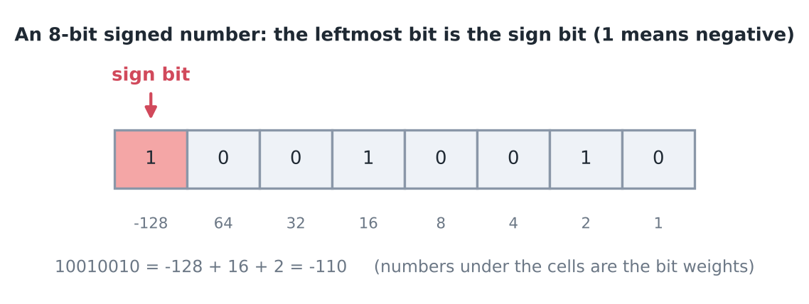

*sign bit has weight -128 in 8 bits.*

Negative numbers are stored as the two's complement of the positive number. The steps are: flip every bit (this is the 1's complement, written 1's comple), then add 1 (this gives the 2's complement). Here is the working for 5:

```
5 → 0 0 0 0 0 1 0 1

1's comple → ~5 → 1 1 1 1 1 0 1 0

2's comple → (1's comple +1)

→ 1 1 1 1 1 0 1 1
```

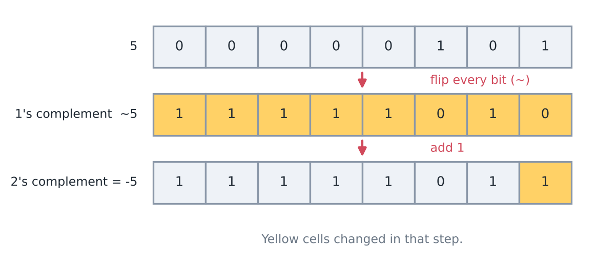

*5 → flip all → add 1 → -5.*

The same steps for 10:

```
10 → 0 0 0 0 1 0 1 0

1's → 1 1 1 1 0 1 0 1

2's → 1 1 1 1 0 1 1 0
```

Note: first bit of 1's comple of 10 is 1 (flip of 0), not 0.

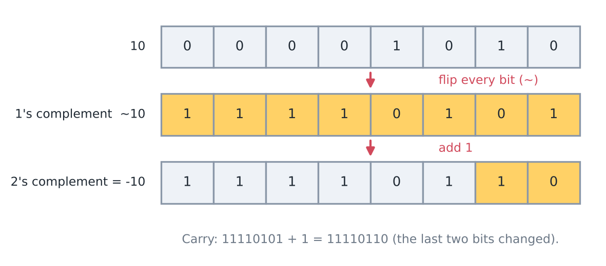

*carry here goes 2 places, last two bits change.*

Why does it work? Say 8 bits. Total patterns = 256. Flipping all bits of x gives 255 - x. Add 1 → 256 - x. So x + (-x) = 256, and 256 does not fit in 8 bits, so only 0 remains. This is why the machine can use the same adder circuit for both plus and minus.

Example with x = 5: flipping gives 250, adding 1 gives 251 = `11111011`, and 5 + 251 = 256, which wraps to 0 in 8 bits. So `11111011` behaves exactly like -5.

Range for 8 bits: -128 to 127. For int (32 bit): $-2^{31}$ to $2^{31}-1$.

```cpp
/*
Problem: show how a computer stores a negative number with 8 bits.
Take the 1's complement (flip every bit), then add 1. Keep only 8 bits.
*/
// Needs <bitset> and <string>.
string bits8(unsigned char v){
    return bitset<8>(v).to_string();   // e.g. 5 -> "00000101"
}

unsigned char ones_complement_8bit(unsigned char v){
    return (unsigned char)(~v);        // ~v is an int, the cast keeps the low 8 bits
}

unsigned char twos_complement_8bit(unsigned char v){
    return (unsigned char)(ones_complement_8bit(v) + 1);   // the carry out of bit 7 is dropped
}
```

Output for 5 → `00000101 11111010 11111011`, for 10 → `00001010 11110101 11110110`.

### -10 + 10

The machine stores (-10) as the 2's comple of 10. To check, add (-10) and (+10) bit by bit:

```
(-10)   1 1 1 1 0 1 1 0
(+10)   0 0 0 0 1 0 1 0
+      ------------------
 (1)    0 0 0 0 0 0 0 0   → gives zero on bit
 ¯¯¯                         by bit addition.
```

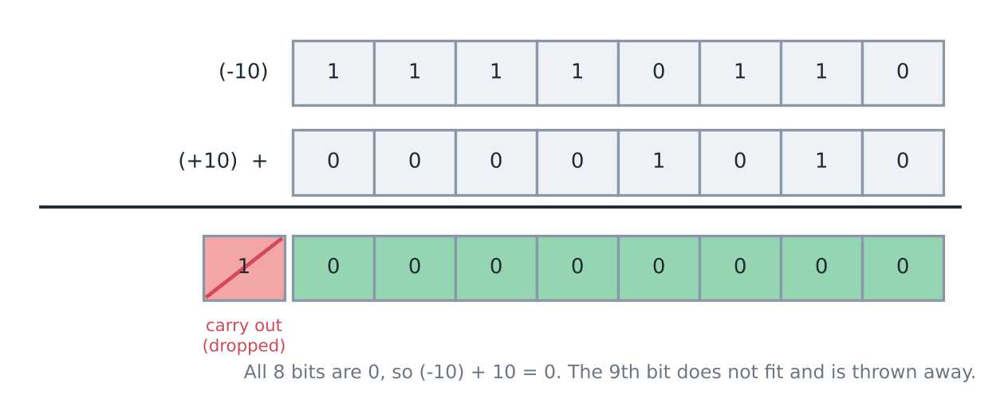

*9^th bit (carry) is thrown away.*

Next, overflow. INT_MAX is the largest positive value. For 8-bit it is 0 1 1 1 1 1 1 1 (= 127). (For 32 bit it is $2^{31}-1$.) Adding INT_MAX to itself:

```
→   0 1 1 1 1 1 1 1  ┐
+   0 1 1 1 1 1 1 1  ┘ INT_MAX
   -----------------      (for 8-bit)
    1 1 1 1 1 1 1 0  → -ive no.
```

The result starts with 1, so it is read as negative. Which negative number? Take the 2's comple again to find its size:

```
    1 1 1 1 1 1 1 0
1's 0 0 0 0 0 0 0 1
       +          1
   -----------------
    0 0 0 0 0 0 1 0  → 2
```

so INT_MAX + INT_MAX = -2 (overflow, wrapped around).

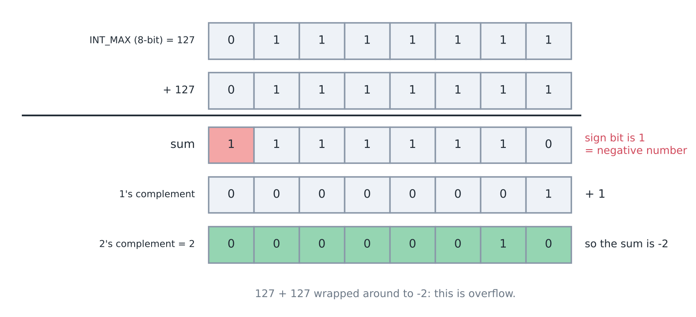

*overflow: sum becomes negative.*

Note: 8-bit is only to understand. In C++ `int` overflow is undefined behaviour, so use `long long` when sum can be big.

Taking the 2's comple of a number gives its negative, and taking it once more gives the number back:

```
X ──────────→ -X ──────────→ X
   2's comple     2's comple
```

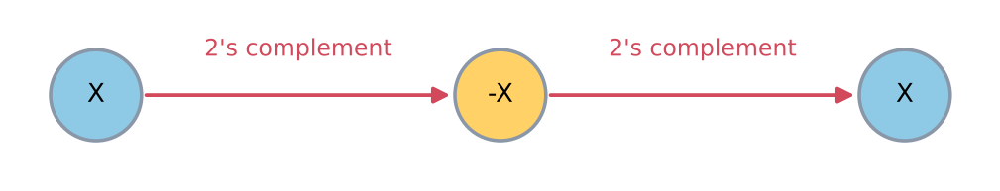

*2's comple twice → back to X.*

## Sets as bitmasks

A **bitmask** is an integer used as a row of yes/no flags: bit i says whether element i is in the set. One integer then stores a whole set, and set operations become single machine instructions.

Example: take the array below. Each element gets a bit position (its index), and a mask says which elements are chosen.

```
arr = { 2 , 3 , 5 , 7 }
        0   1   2   3
```

6 = (0 1 1 0) = \{3,5\}
                3 2 1 0

10 = (1 0 1 0) = \{3,7\}    (for unions we can take OR)

\{3,5\} U \{3,7\} = \{3,5,7\} = 6 | 10

```
6 | 10 =
  0 1 1 0
  1 0 1 0
 ---------
 {1 1 1 0}   = {3,5,7}
 {3 2 1 0}
```

Union (U) is the OR operation `|`, and intersection (∩) is the AND operation `&`:

U → OR  `|`    ∩ → AND  `&`

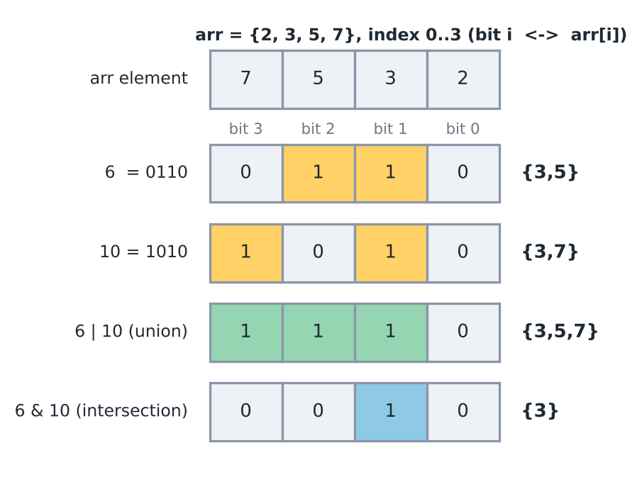

*bit i = 1 means arr[i] is inside the set. 6 & 10 = 2 = \{3\}.*

To list all subsets, use the masks themselves. A set of 3 elements has 2^3 = 8 subsets, so:

\{ 2,3,5 \} → 2^3 → 8 subsets
loop over (0 - 7) to generate all subsets.

Think of it as: every number from 0 to $2^n - 1$ is one choice of "take / don't take" for each element. mask = 5 = 101 → take arr[0] and arr[2]. T.C. = $O(2^n \cdot n)$.

Cost with numbers: n = 20 gives $2^{20} \approx 10^6$ masks, each checked with 20 bit tests, so about $2 \cdot 10^7$ operations. That is fine. n = 40 gives $10^{12}$ masks, which is impossible. So this loop is for n up to about 20 to 25.

Common mistake: for n = 31 or more, `1 << n` overflows `int`. Write `1ll << n` (the suffix `ll` makes the constant a 64-bit `long long`).

```cpp
// Fabricator/BitManipulation/SubSets.cpp
void solve() {
    int n;
    cin>>n;

    vector<int> arr(n);
    for(auto &ele: arr) cin>>ele;

    for(int mask = 0; mask < (1 << n); mask++){
        for(int bit=0; bit<n; bit++){
            if(mask & (1<<bit)){
                cout<<arr[bit]<<" ";
            }
        }

        cout<<endl;
    }
}
```

For \{2,3,5\} it prints: (empty), `2`, `3`, `2 3`, `5`, `2 5`, `3 5`, `2 3 5`.

## X^th bit

Four common jobs on the x^th bit of a number n (bit 0 is the rightmost): check it, set it to 1, unset it to 0, or flip it. Each one is a single expression:

```
X^th bit ─┬→ check → n & (1<<x)
          ├→ set   → n | (1<<x)
          ├→ unset → n & (~(1<<x))
          └→ flip  → n ^ (1<<x)
```

`1<<x` is the **mask**, a number with only x^th bit on. Everything else is just AND / OR / XOR with this mask.

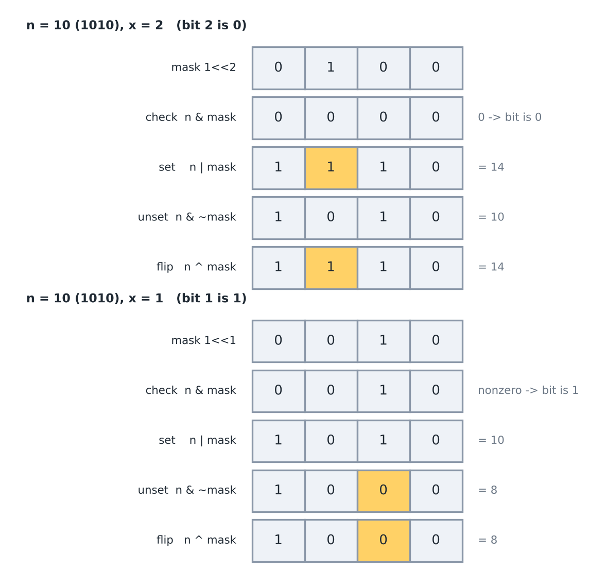

*n = 10 (1010), once with a 0 bit (x = 2), once with a 1 bit (x = 1).*

Note: check gives non-zero, not exactly 1. Compare with `!= 0` or use `(n >> x) & 1`. For `long long` use `1ll << x`, plain `1 << x` is int.

Repo version (queries on a 64 bit number: 1 check, 2 set, 3 unset, 4 flip, 5-7 popcount checks, 8 popcount, 9 print n):

```cpp
// Fabricator/BitManipulation/BitMagic1.cpp
void solve() {
    long long n = 0;
    int q;
    cin>>q;

    while(q--){
        int t, i;
        cin>>t;
        switch (t)
        {
            case 1:
            cin>>i;
            cout<<((n >> i) & 1ll)<<endl;
            break;

            case 2:
            cin>>i;
            n = n | (1ll << i);
            break;

            case 3:
            cin>>i;
            n = n & (~(1ll << i));
            break;

            case 4:
            cin>>i;
            n = n ^ (1ll << i);
            break;

            case 5:
            cout<<(__builtin_popcountll(n) == 60)<<endl;
            break;

            case 6:
            cout<<(__builtin_popcountll(n) > 0)<<endl;
            break;

            case 7:
            cout<<(__builtin_popcountll(n) == 0)<<endl;
            break;

            case 8:
            cout<<__builtin_popcountll(n)<<endl;
            break;

            case 9:
            cout<<n<<endl;
            break;
        
            default:
            break;
        }
    }
}
```

## Counting set bits

Counting set bits means counting how many bits of a number are 1. The compiler gives a ready function for it (popcount = population count):

`__builtin_popcount (x);`   ← internal function.

The simplest manual way is to look at the last bit, count it, and shift right:

```cpp
cnt = 0;
while(n) {
    if(n & 1) {
        cnt++;
    }
    n = n >> 1;
}
```

(doesn't work on negative numbers.)

Why? For negative `int`, `>>` keeps pushing the sign bit 1 from left, so n never becomes 0 → infinite loop.

The same idea as recursion (written in short form, it needs types to compile):

```cpp
count (n){
    if(n==0)
        return 0;
    return count(n/2)
        + (n&1);
}
```

Note: it needs types (`int count(int n)`). Also wrong for -ive, `count(-1)` gives 1 (n/2 rounds towards 0), real answer is 32.

For negative numbers use `__builtin_popcount()`. Another way is to remove the lowest set bit again and again, and count the removals:

```cpp
int count2 (int n){
    if (n==0) return 0;
    return count2 (n & (n-1)) + 1;
}
```

This works for negative numbers as well.

Note: for `INT_MIN`, `n-1` overflows. Use `unsigned` to be safe.

The trick is the expression n & (n-1). Here it is for x = 3, 12 and 16 (each x above its x-1, then the AND):

```
x = 3        x = 12        x = 16
  1 1          1 1 0 0       1 0 0 0 0
  1 0          1 0 1 1       0 1 1 1 1
 -----        ---------     -----------
  1 0          1 0 0 0       0 0 0 0 0
```

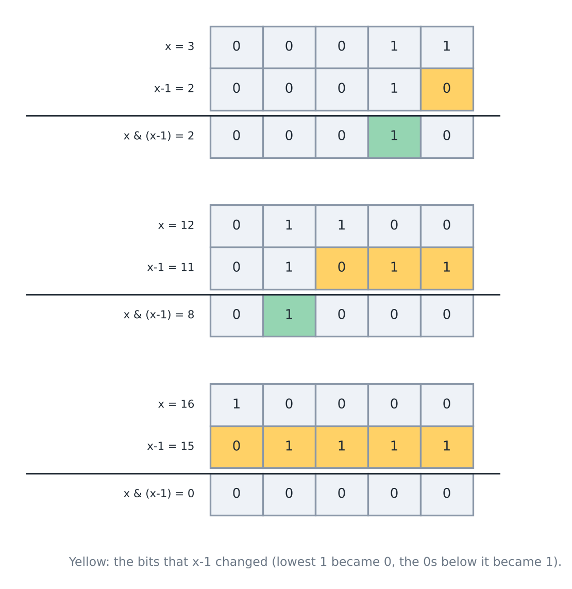

*x-1 → lowest 1 becomes 0, zeros below it become 1. AND kills that 1.*

[ n & (n-1) ] → flips the first set bit.

Precisely, it turns **off** the lowest set bit. So count2 counts how many times we can remove a bit before n becomes 0. T.C. = O(no. of set bits).

Why it works: subtracting 1 from n borrows from the lowest set bit. That bit becomes 0 and every zero below it becomes 1. Bits above it do not change. So AND of n and n-1 keeps the upper bits and clears the rest.

Dry run, n = 12 = `1100`: 12 & 11 = `1100` & `1011` = `1000` (count 1). Then 8 & 7 = `1000` & `0111` = 0 (count 2). Answer 2, in 2 steps instead of 4 shifts. The cost depends on the number of set bits, so a number such as $2^{30}$ (one set bit) takes 1 step, while the shift loop takes 31.

`__builtin_popcountll()` → for long long integers.

Summary of the ways to count set bits:

| way | T.C. | -ive numbers |
|---|---|---|
| shift loop | O(bits) | infinite loop |
| recursion n/2 | O(bits) | wrong |
| n & (n-1) | O(set bits) | works |
| builtin | O(1) | works |

## Bit application

Now the first bit application problem.

Question: arr : [3, 2, 7, 1]. Find the sum of all (subarray &) of an array, that is, the sum of the AND of every subarray.

[ sum of all (subarray) ]  \} Contribution technique

Contribution technique: do not compute each subarray's AND. Instead ask "how much does each small piece add to the final answer?". Here the small piece is one bit position. The answer is a sum over bit positions of (number of subarrays whose AND has that bit) times $2^{bit}$, because every number is a sum of powers of two.

The sketch below shows the two ways to use the contribution technique. Both can solve this problem. The dotted arrow marks the pivot, the position we fix while counting.

```
contribution technique
 ┌→ atomic item     }  can be solved
 └→ extending end   }  using both.
        └ → pivot.
```

Brute force: all subarrays, AND each → $O(n^2)$ with running AND. For n = 10^5 that is about 5·10^9 steps. Better: use contribution technique, T.C. = O(32 n) = 3.2·10^6 steps.

### Atomic item contri

The first way is the atomic item: treat one bit position as one small item. Write numbers in binary, one row per bit position (MSB on top, LSB at bottom).

```
      3  2  7  1
MSB   0  0  1  0
 │    1  1  1  0
 ↓    1  0  1  1
LSB
```

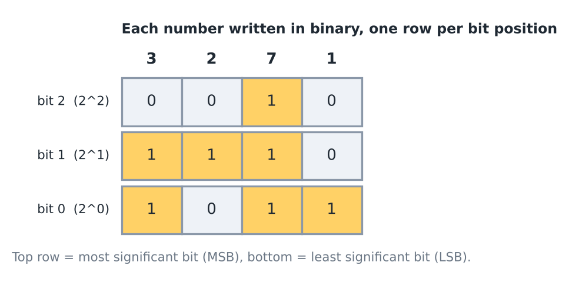

*each column = one number, each row = one bit position.*

Take the top row (bit 2). The bits of 3, 2 and 7 in this row only combine with each other, so each row can be solved alone (R[2] is the row of bit 2):

```
      3    2    7    R[2]
   [ (0)  (0)  (1) ]   0     ← These bits
      1    1    1      1        will always
      1    0    1      0        interact within
                                their range.
```

These bits will always interact within their range (inside their own row). A bit position is 1 in AND of a subarray only if **all** elements of that subarray have 1 there.

```
3  2  7  1
0  0  1  0  ]→ 1
1  1  1  0
1  0  1  1
```

For each row we ask: how many subarrays will have 1 bit at their respective position? A subarray has a 1 there only if it lies fully inside a run of 1s. Count them row by row:

Row `0 0 1 0` → only one subarray will have this position bit as 1.
Row `1 1 1 0` → 6 sub arrays.
Row `1 0 1 1` → 4.

Each row counts subarrays, and a 1 in bit k is worth 2^k. So the total is:

```
3  2  7  1
0  0  1  0  →  1 x 2^2 = 4
1  1  1  0  →  6 x 2^1 = 12   }  20
1  0  1  1  →  4 x 2^0 = 4
```

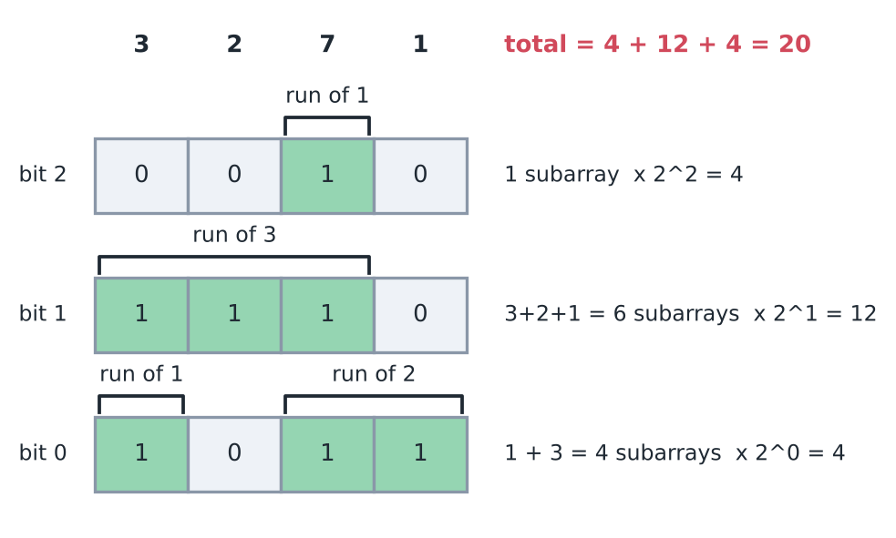

*run of ones → count subarrays inside it, multiply by 2^bit.*

Another example, arr = [1, 3, 2]. Its bit rows (bit 1 on top, bit 0 below) are:

```
1  3  2
0  1  1  →
1  1  0
```

To see that the method is right, write all the subarray &s and add them. The columns show the bits of each AND (top bit 1, bottom bit 0):
```
 1     3     2    1 2 3   3 & 2   1 2 3 2 2
(0) + (1) + (1) + (0) + (1) + (0)
(1)   (1)   (0)   (1)   (0)   (0)
```
So the sum is 1 + 3 + 2 + 1 + 2 + 0 = 9

(2^0) + (2^0 + 2^1) + 2^1 + 2^0 + 2^1 + 0

Note: the six subarrays are [1], [3], [2], [1,3], [3,2], [1,3,2] with ANDs 1, 3, 2, 1, 2, 0.

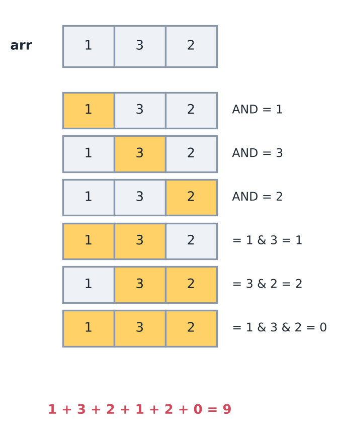

*sum = 9.*

In this sum, we are counting the number of 2^0's, 2^1's, 2^2's ... when we are counting number of subarrays with 1 bit after anding.

Put the bits of the six ANDs in one table (one row per subarray):

```
[2^1 2^0]
  0   1
  1   1
  1   0
  0   1
  1   0
 ------
 3x2^1  3x2^0  =
```

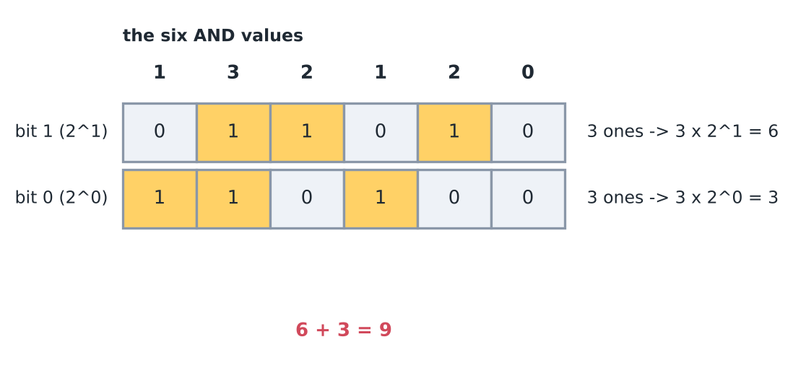

*3 ones in each column.*

Hence, we are calculating the positional values via bits & powers of 2s.

3x2^1 + 3x2^0
6 + 3 = (9)

Now, the question boils down to finding the number of subarrays with positional bit as 1. A run of consecutive 1s gives subarrays; a 0 breaks the run. For the first row below, the run of three 1s gives 4C2 subarrays:

```
[ 1  1  1  0 ] → how many
  ¯¯¯¯¯¯¯¯¯      Subarrays
   4C2
```

The second row has two runs, of lengths 1 and 2, so it gives 2C2 + 3C2:

```
[ 1  0  1  1 ]
  ¯     ¯¯¯¯
 2C2  +  3C2
```

Observation: a run of L ones has $\frac{L(L+1)}{2}$ subarrays (choose start and end, or pick 2 cut points out of L+1 gaps = (L+1)C2). So run of 3 → 4C2 = 6, run of 1 → 2C2 = 1, run of 2 → 3C2 = 3.

Code (atomic item). `cnt_subarrays_with_1` counts exactly this for one bit row; `solve` loops over all 32 bits:

```cpp
// Fabricator/BitManipulation/BitContributionTechnique-AtomicItem.cpp
long long cnt_subarrays_with_1(vector<int> &temp){
    long long cnt = 0;
    long long curr = 0;
    for(int i=0; i<temp.size(); i++){
        if(temp[i] == 1){
            curr++;
        }
        else{
            cnt += ((curr + 1ll) * curr) / 2ll;
            curr = 0;
        }
    }

    cnt += ((curr + 1ll) * curr) / 2ll;

    return cnt; 
}

void solve() {
    long long n;
    cin>>n;

    vector<long long> arr(n);
    for(auto &ele: arr) cin>>ele;

    long long ans = 0;
    for(int bit=0; bit<32; bit++){
        vector<int> temp;
        for(long long i=0; i<n; i++){
            temp.push_back((arr[i] >> bit) & 1);
        }

        long long cnt_subarrays = cnt_subarrays_with_1(temp);

        ans += cnt_subarrays * (1 << bit);
    }

    cout<<ans<<endl;
}
```

Gives 20 for `3 2 7 1` and 9 for `1 3 2`. T.C. = O(32 n), memory O(n).

Note: `cnt_subarrays * (1 << bit)` is int shift, bit goes till 31. Use `1ll << bit` to be safe.

Size check: there can be about 5·10^9 subarrays, so the counts need `long long`. If every value is at most 10^9, the answer is at most 5·10^9 × 10^9 = 5·10^18, which fits in `long long` (limit about 9.2·10^18). If values could reach $2^{31}-1$, the answer could reach about 10^19, which does not fit, so the problem must keep the values smaller.

### ORs and XORs

What if the question asks for ORs ? Take one bit row of 1 0 0 1. All 10 subarrays are drawn below as lines, and the two zeros in brackets are the ones that make subarrays of only zeros:

```
 1  (0   0)  1
 ═══════════════
 ═══════════════ ]   7 subarrays
 ═══════════════
```

[ Total - (only zero's subarr) ]
5C2 - 3C2        \} We need to change only the
                   subarray counting.

(5x4)/2 - (3x2)/2
8 - 3 = 7

Note: (5x4)/2 = 10 not 8. So 10 - 3 = 7. Answer 7 is right.

Think: OR bit is 0 only when the whole subarray is zeros. So subarrays with OR bit 1 = total - subarrays made only of 0s. Only counting changes, rest same.

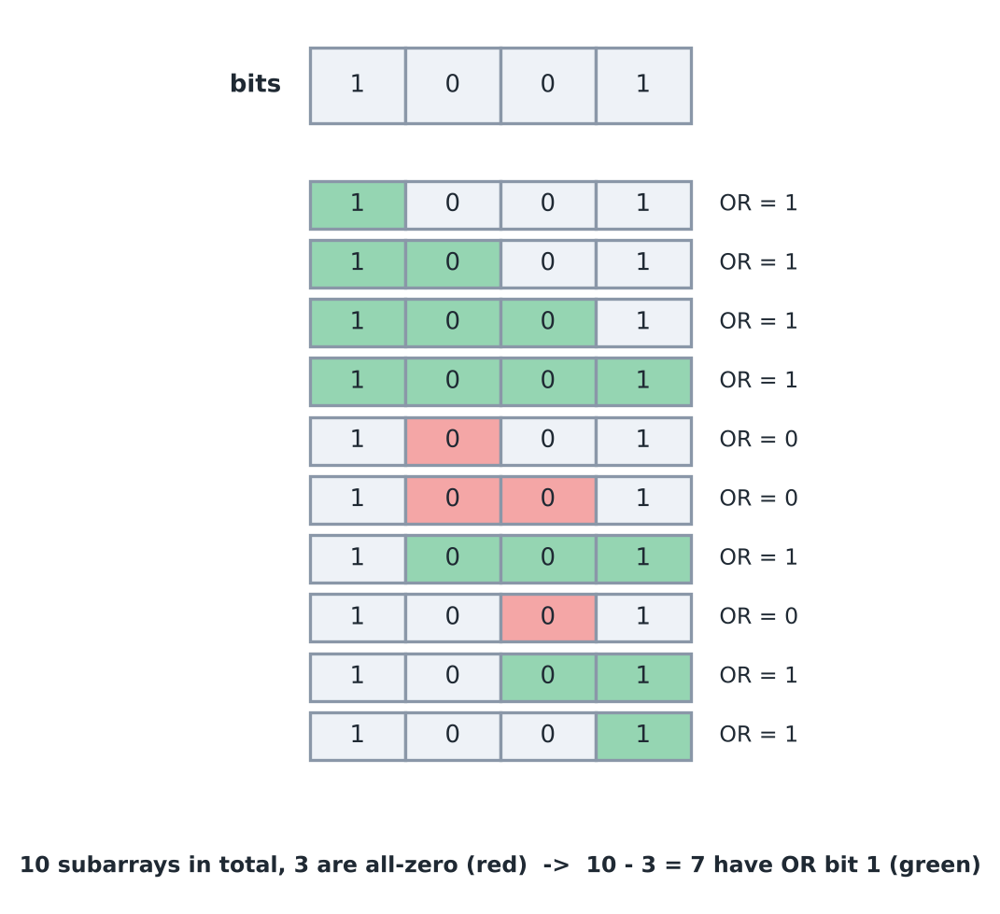

*10 total, 3 all-zero (red), 7 have OR bit 1.*

What about XORs? A bit of the XOR of a subarray is 1 when the subarray has an odd number of 1s there, so counting runs of 1s does not work. A different tool is needed: prefix xor. It uses three properties of XOR: a ^ a = 0 (equal values cancel), a ^ 0 = a, and the order of the values does not matter.

Idea: prefix xor. P[0] = 0, P[i+1] = P[i] ^ arr[i]. Then xor of arr[l..r] = P[r+1] ^ P[l] (first l elements cancel out, because a ^ a = 0). So sum of xor of all subarrays = sum of xor of all pairs of P (n+1 values). That is the last question of this note. For [1,5,7] it comes 22.

Dry run: P = [0, 1, 4, 3]. The six pairs give 0^1 = 1, 0^4 = 4, 0^3 = 3, 1^4 = 5, 1^3 = 2, 4^3 = 7, and 1+4+3+5+2+7 = 22. Direct check: the subarray xors are 1, 5, 7, 4, 2, 3, which also sum to 22.

Why the cancelling works: P[r+1] is arr[0] ^ ... ^ arr[r] and P[l] is arr[0] ^ ... ^ arr[l-1]. In P[r+1] ^ P[l] every element before index l appears twice, so it cancels, and only arr[l..r] is left. The pair sum over P is then solved bit by bit, exactly as in the last question of this note, so the cost is O(32 (n+1)) with O(n) memory for P.

### Extending end

The second way is extending end. Motivation: the atomic item method needs the whole array up front and works one bit at a time. Extending end instead scans left to right and keeps a small summary of all subarrays that end at the current position. This is the method to use when the question asks for something else about the AND values, such as how many distinct values there are.

— Extending End : Idea : look at one bit row. The vertical line below marks the end of the subarrays that are being counted (the end is after d, and e comes next):

```
      a   b   c   d | e
   [               0 |     ]
                   1 |
                   1 |
       ..          1 |
                     ↑
```

we're checking the subarrays ending here.

If d has any positional bit as 0 then every subarray ending at d will have that positional bit as 0. If d has 1, the subarray can reach back as far as the previous 0 in that row. The sketch shows three bit rows ending at d; the circled 0s are the zeros that stop a run:

```
                   d
        ┌          0 ─→ all AND values
        │   (0)(0) ─ 1 ─→ only one sub array    will have 0
        │ (0) 1  1  1  1  1        will have
        └  0  1 (0) 1  1  1       1 here
                                   by looking
                                   at previous
                                   zero.
```

For the row `0 1 0 1 1 1`, the last cell is 1 and the previous 0 is at index 2, so 3 subarrays (starting at index 3, 4 or 5) have the bit 1. Looking at the previous 0 gives 3.

For the row `0 1 1 1 1 1`, the previous 0 is at index 0, so 5 subarrays have the bit 1. Again by looking at the previous zero.

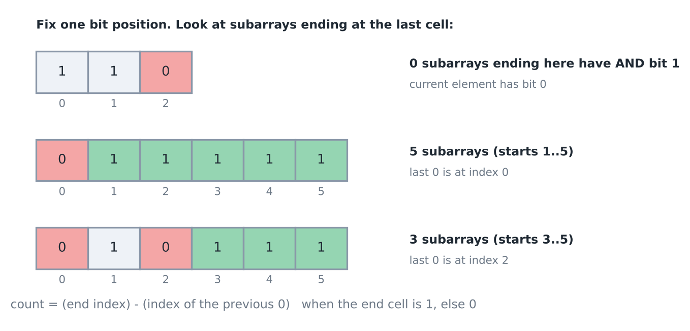

*count = (end index) - (index of previous 0), if end cell is 1. Else 0.*

Adding this over every end position of the row 1 1 1 0 gives 1 + 2 + 3 + 0 = 6 (the previous 0 is taken at index -1 when there is none). This is the same as the run formula 4C2 = 6.

### No. of distinct AND values

Now a question that the atomic item method cannot answer: how many different AND values are there? The claim: the number of distinct AND values (among subarrays ending at one position) is equal to the number of bits [32 for int]. More exactly it is at most that many, and fewer when some bit never turns off.

Intuition: fix the end position and grow the subarray to the left. AND can only turn bits off, never on. Each of the 32 bits can turn off at most once, so the AND value changes at most 32 times. Therefore at most 33 different values appear among the subarrays ending at one position. Across all n positions that is at most 33 n values to handle, not n(n+1)/2.

The table below shows 10 numbers in 4 bits (column = number, row = bit position). The AND is taken from each start position up to index 9. A vertical line marks where the AND value changes:

```
 0   1   2   3 | 4   5   6 | 7   8 | 9
-------------------------------------
 0             | 0       0 | 1     | 1
 0           0 | 1       ↓ | 1     | 1
 0             | 0         | 0   0 | 1
 1             | 1         | 1     | 1
-------------------------------------
 ⌣⌣⌣⌣⌣     ⌣⌣⌣     ⌣⌣
                            This pos bit
                            flips to 0 here.
```

All these ranges have same numbers after the bit is flipped.

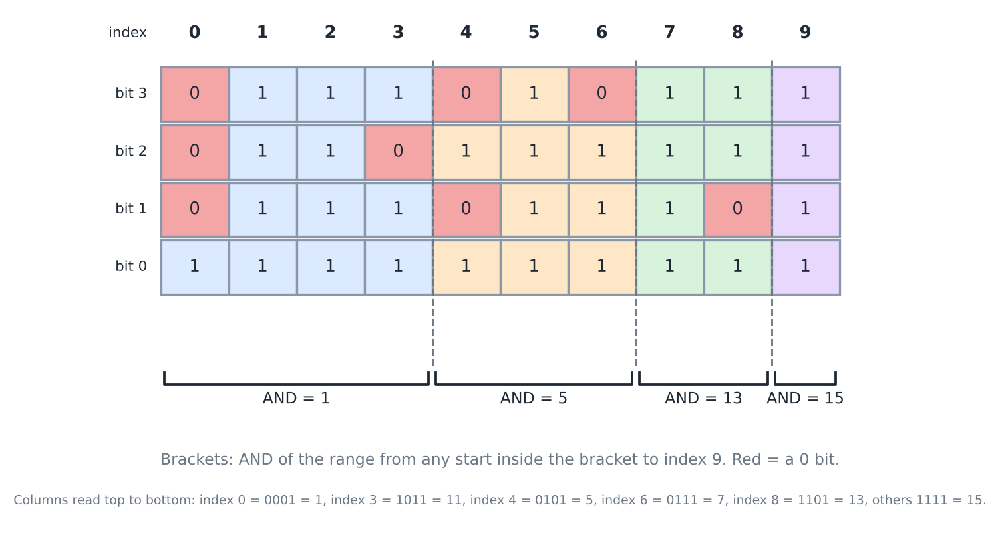

*ranges 0-3, 4-6, 7-8, 9 → AND = 1, 5, 13, 15. Blank cells taken as 1.*

Trace from index 9 moving left: the third row gets its first 0 at index 8, the top row at index 6, and the second row at index 3. The bottom row never has a 0. Each first 0 switches one bit off for all starts at or before it, so only 4 different values appear for 10 starts: 15 for start 9, 13 for starts 7 to 8, 5 for starts 4 to 6 and 1 for starts 0 to 3.

Now, since on ANDing bits in the number can flip only 'bit size' no. of times there are only 'bit size' no. of distinct ANDed numbers possible.

Another example with the array 2 4 6 5 7. Each subarray ends at the last element 7, and the lines show how far back it reaches:

```
           ────────────────── 4
              ─────────── 5
                 ──────── 7
     2     4     6     5     7
    (0)    1     1     1     1
     1     0     1    (0)    1
     0     0    (0)    1     1
                           └→ 7
                        ┌──────→ 5
                     ┌─────────→ 4
                ┌───────────────→ 4
          ┌─────────────────────→ 0
```

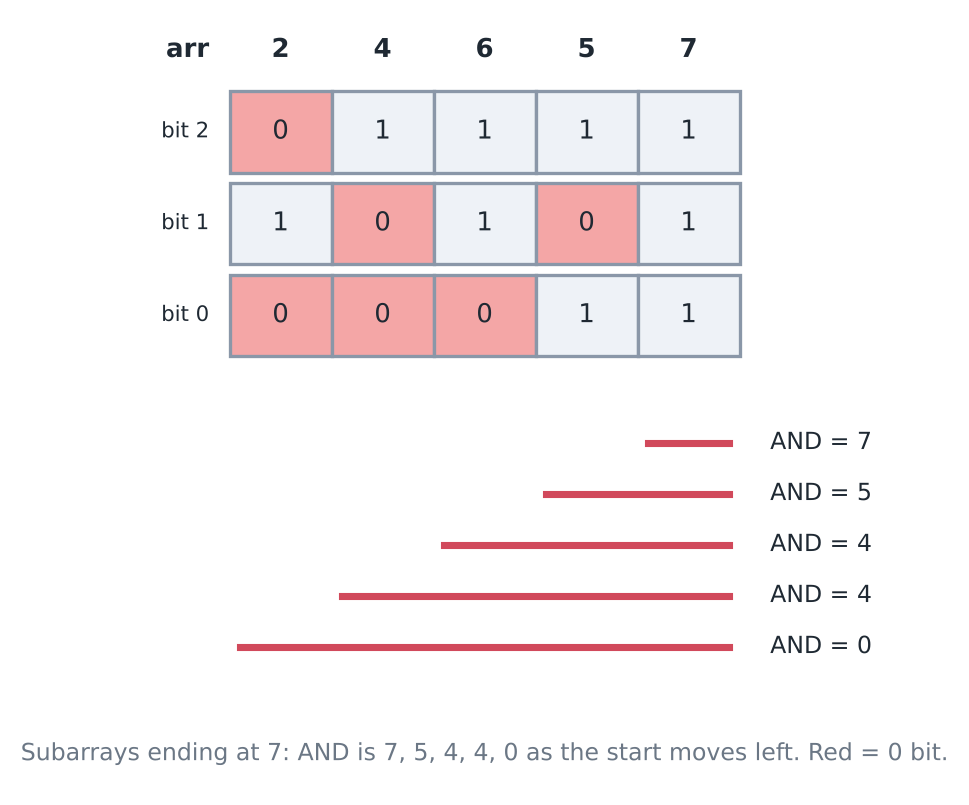

*ANDs ending at 7 (start moving left): 7, 5, 4, 4, 0.*

7 changes to 5 only after it sees a 0.
Then it keeps / continues the same value
until it sees another 0.

5 changes to 4 only after seeing a 0.

4 keeps 4 as no new zero.

4 changes to 0 on seeing next zero.

\* The change will only happen at the first zero at every bit position.

```
7  AND → 1  (once)
5  AND → 1
4  AND → 2
0  AND → 1 .
```

\* At any end point there can be only at most 'bit size' AND values. [32 or 64].

Now, 6 appears as the next element (extending). The left list is the tally for subarrays ending at 7 (AND value → how many). The right side shows each old value ANDed with 6, then the merged result:

```
0 → 1        0 → 1
4 → 2        6 → 2
5 → 1        4 → 1
7 → 1        6 → 1       7 & 6 → 6
-------      6 → 1       5 & 6 → 4
   7                     4 & 6 → 4
                6        4 & 6 → 4
                         0 & 6 → 0
                         6 & 6 → 6
```

Note: after AND with 6, equal values merge. So new tally = 0 → 1, 4 → 3, 6 → 2 (total 6 subarrays, the last 6 is the new single element [6]).

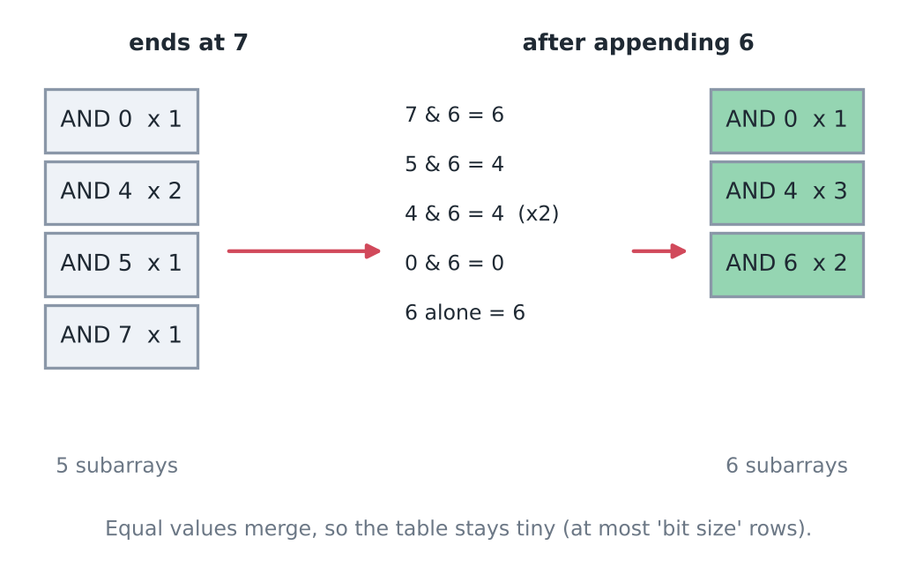

*equal values merge, so table never grows beyond 'bit size' rows.*

The tally gives the answer. In short: keep a map \{AND value → count of subarrays ending here\}. For new element x → AND every key with x, merge, add (x → 1). Sum `value * count` for the answer. T.C. = O(n · 32 · log 32).

```cpp
// Fabricator/BitManipulation/BitContributionTechnique-ExtendingEnd.cpp
void solve() {
    long long n;
    cin>>n;

    vector<long long> arr(n);
    for(auto &ele: arr) cin>>ele;

    map<long long, long long> last_and;
    long long ans = 0;
    for(int i=0; i<n; i++){
        map<long long, long long> new_and;
        for(auto v: last_and){
            new_and[v.first & arr[i]] += v.second;
        }

        new_and[arr[i]]++;

        for(auto v: new_and){
            ans += v.first * v.second;
        }

        last_and = new_and;
    }

    cout<<ans<<endl;
}
```

Same output, 20 and 9. Checked against brute force too.

Trace for [3, 2, 7, 1] (tally = AND value → number of subarrays ending here). After 3: \{3:1\}, value sum 3. After 2: 3&2 = 2 and the new [2], so \{2:2\}, sum 4. After 7: 2&7 = 2 (twice) and the new [7], so \{2:2, 7:1\}, sum 4 + 7 = 11. After 1: 2&1 = 0 (twice), 7&1 = 1 and the new [1], so \{0:2, 1:2\}, sum 2. Total 3 + 4 + 11 + 2 = 20, the same as the atomic item method.

Cost: each tally has at most about 32 keys, so the work per element is about 32 map operations, O(n · 32 · log 32) in all, with O(32) memory for the tally. A common mistake is to forget `new_and[arr[i]]++`: the subarray with only the new element must be added.

Check LC (LeetCode): Bitwise ORs of Subarrays. The task is to count the distinct OR values. The same idea works with OR: when the subarray grows, a bit can only go 0 → 1, once, so at most about 32 distinct values end at each position.

```cpp
// Fabricator/BitManipulation/BitwiseORsOfSubarrays.cpp
/*
https://leetcode.com/problems/bitwise-ors-of-subarrays/description/
*/

int subarrayBitwiseORs(vector<int>& arr) {
    int n = arr.size();

    set<long long> total_or;
    set<long long> last_or;
    long long ans = 0;
    for(int i=0; i<n; i++){
        set<long long> curr_or;
        for(auto or_val: last_or){
            curr_or.insert(arr[i] | or_val);
        }

        curr_or.insert(arr[i]);

        for(auto or_val: curr_or){
            total_or.insert(or_val);
        }

        last_or = move(curr_or);
    }

    return total_or.size();
}

void solve() {
    int n;
    cin>>n;
    
    vector<int> v(n);
    for(auto &ele: v) cin>>ele;

    cout<<subarrayBitwiseORs(v)<<endl;
}
```

Gives 3 for `[1,1,2]` (the values are 1, 2, 3) and 6 for `[1,2,4]` (the values are 1, 2, 4, 3, 6, 7). Cost: O(32 n log 32) with sets, memory O(32) for `last_or` and O(distinct values) for `total_or`.

## Question: index of k^th 1

Plan of this section: first the simple solution that builds the string (enough for small k), then why it fails for k up to 10^9, then binary search on the number plus a per-bit counting formula.

Question:

S = 0 1 10 11 100 101 110 111 1000 ....
    0 1 2  3  4   5   6   7   8

We have infinite sequence of binary representation of natural numbers.
Given q queries of the form '? k', find the index of k^th 1.

Sample input and output (i/p = input, o/p = output). Here 1 is the number of queries q.

```
i/p :
1
? 10

o/p :
15
```

Index starts from 0, k starts from 1.

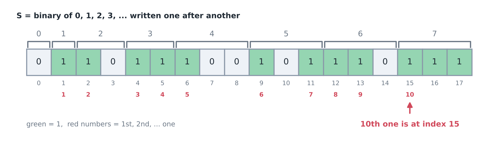

*S = 0 1 10 11 100 101 110 ... , 10^th one is at index 15.*

Constraints (three cases):

i) q ≤ 10 , k ≤ 10^5

ii) q ≤ 10^5 , k ≤ 10^5

iii) q ≤ 10^5 , k ≤ 10^9

Except 0, all numbers have at least 1 bit set.
∴ for k ≤ 10^5 we can go at max 10^5 numbers' binary rep.

10^3 ~ 2^10  ⇐⇒  10^6 ~ 2^20.

∴ At max 20 bits needed per no.

20 x 10^5 length of the string
2 x 10^6 len of the string.

These are upper bounds. A number up to 10^5 has at most 17 bits, and about half of its bits are 1, so in practice about 1.5·10^4 numbers and a string of about 1.9·10^5 characters are enough to hold 10^5 ones (checked by running the code). The simple bound is already small enough.

Hence, we can precompute the whole s & also precompute all the positions of 1s & then answer the queries in O(1).

T.C. — O( k x log_2(k) + q )

max log_2 k bits will be added for a number.

q ≤ 10 , k ≤ 10^5
q ≤ 10^5 , k ≤ 10^5     \} Both solved by using above soln.

for q ≤ 10^5 & k ≤ 10^9 → we cannot build the string s as it'll lead to TLE

The obvious candidate is Binary Search.
for finding k^th element we know B.S (binary search) and backtracking.

Only B.S' T.C. matches the requirement.

check (x) → ( (# 1s in [1......x]) ≥ k )

Binary search needs a monotone check: once x has at least k ones in front of it, every larger x also has. The sketch below shows the numbers with k = 10 pointing at 7:

```
                              k^th
                               ↓
 0   1   10   11   100  101  110  111  1000
 0   1   2    3    4    5    6   (7)   8
```

we'll need to know this 7. to compute all the 1s. to find k^th 1.

The values of the check (the boolean predicate) for k = 10:

```
 0   0   0   0   0   0   0  |1|   1   1
 0   1   2   3   4   5   6  (7)   8   9
```

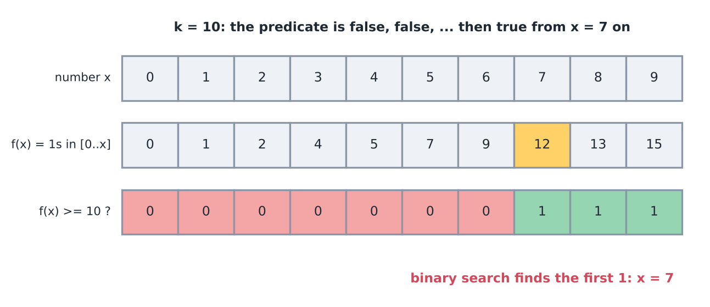

*predicate is false till 6, true from 7. First true = 7.*

Now, we change focus to the check function. Let f(n) be the total count of 1s in all numbers from 0 to n.

f(n) = the number of 1s in [0......n]

f(5) = 7

f(7) = 5+7 = 12

(f(7) is built from f(5) because the numbers 6 and 7 add 2 and 3 ones.)

```
0 - 0           f(7) = f(5) +
1 - 1             6 - 2
2 - 1             7 - 3
3 - 2            -------
4 - 1                5
5 - 2
-------
   7
```

f(x) = Σ (i=0 to x) the number of 1s in i

The loop over all numbers is too slow for 10^9, so count by columns. Write 0 to 6 in 3 bits and count the 1s in each column (bit position):

```
0 ── 0 0 0
1 ── 0 0 1
2 ── 0 1 0
3 ── 0 1 1
4 ── 1 0 0
5 ── 1 0 1
6 ── 1 1 0
      ↑ ↑ ↑
```

In contribution technique we count column wise.

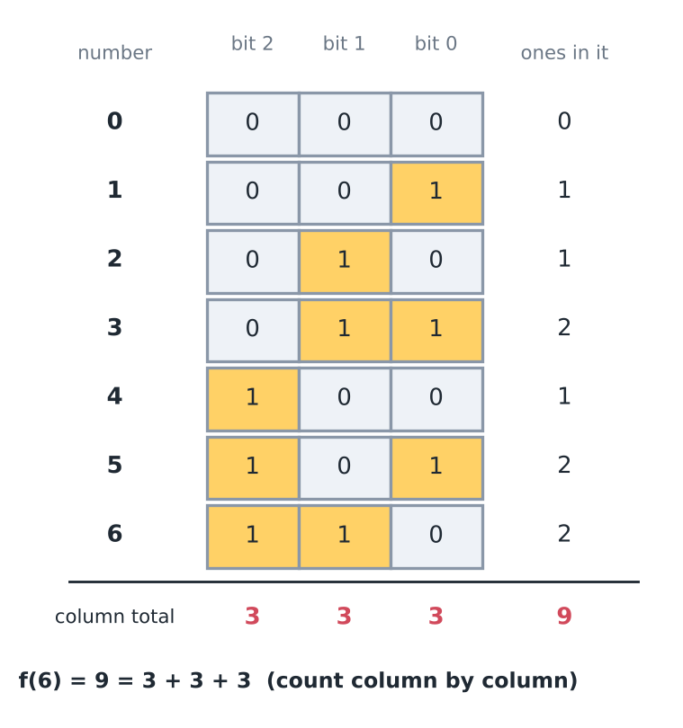

*each column has 3 ones, f(6) = 3 + 3 + 3 = 9.*

Also, these columns are periodic at their position.

0^th position has 0 1 0 1 0 1 ....  (repeat "0 1")
1^st pos has 0 0 1 1 0 0 1 1 ....  (repeat "0 0 1 1")
2^nd pos has 0 0 0 0 1 1 1 1 0 0 0 0 1 1 1 1 ....  (repeat "0 0 0 0 1 1 1 1")

0^th position has period 2.
1^st → 4
2^nd → 8

for i^th position , period = 2^(i+1)

```
      2^(i+1)
      ↙     ↘
   2^i → 0s   2^i → 1s
 first half   second half
   zeros      of ones.
```

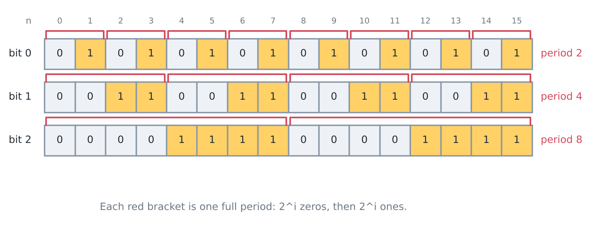

*one period = 2^i zeros then 2^i ones.*

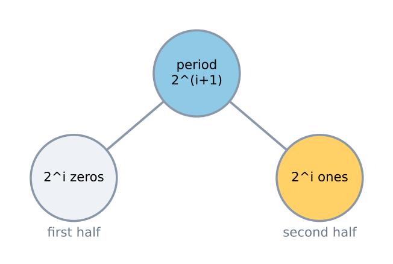

*first half zeros, second half ones.*

for x :

⌊ x / 2^(i+1) ⌋  full pattern will occur.

So, to count 1s. we count complete periods occurring in the range. and the partial periods.

full = total / 2^(i+1)        x.
                              total = x+1

left = total % (2^(i+1)) .

max(left - 2^i, 0) ← 1s in left

full * 2^i ← 1s in full periods.

Total 1s = (full * 2^i) + max(left - 2^i, 0);
in i^th bit.

Why max(.., 0)? In the partial period first $2^i$ numbers are zeros, so ones come only after that. If left ≤ $2^i$ then no 1 at all.

Example: x = 10, i = 1. total = 11, period = 4, full = 2, left = 3. ones = 2*2 + max(3-2, 0) = 5. Check: bit 1 is 1 for 2,3,6,7,10 → 5 ✓.

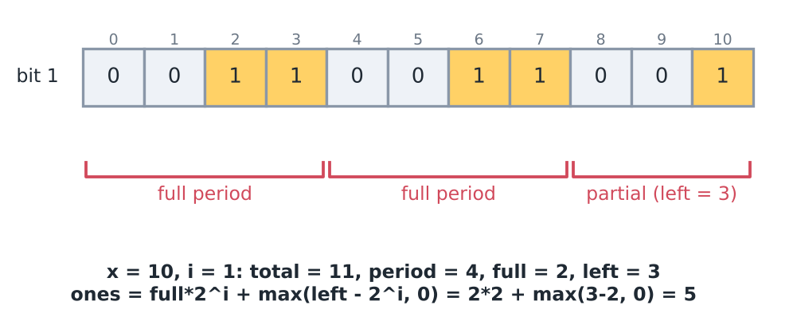

*2 full periods + partial with left = 3.*

Σ (from l to r) the number of 1s (i) = f(r) - f(l-1)

Now, we know how we can find the integer containing the k^th one.

For example: for k=10 we know 7 is the integer where the k^th 1 lies.

We find f(6), gives how many ones have already counted.

f(6) = 9

k=10 ⇒ we need only 1 one from 7.

We simply generate binary of 7 & pick the 1 at index 0 (the first 1).

Now, we need to count the index of this 1 of 7 from the beginning of S. For that we need the length of S before 7. Numbers of the same length form groups, so the table lists the length (size) of each number:

```
Size  1   1   2   2   3    3    3    3    4     4
bin   0   1   10  11  100  101  110  111  1000  1001
num   0   1   2   3   4    5    6    7    8     9
```

Group by length. The number 0 is a special case (it writes one character). Each group is a range of numbers with the same length times the length:

```
0 - 0 - 1 }  consider special case
1 - 1 → 1 x 1
2 - 3 → 2 x 2
4 - 7 → 3 x (4)
8 - 15 → 4 x 8
```

(1 x (2-1)) + 2 x (4-2) + 3 x (8-4) + 4 x (9-8+1)

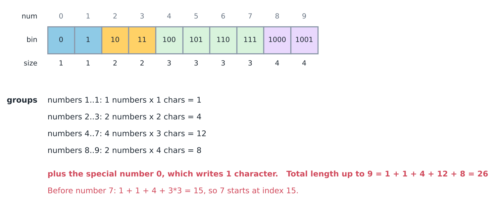

*same length numbers form a group of size 1, 2, 4, 8 ...*

Dry run k = 10: f(6) = 9 &lt; 10, f(7) = 12 ≥ 10 → number is 7. Need 1 one from 7 → first 1 of "111" → position 0. Length of S before 7 = 1 (for "0") + 1 + 4 + 9 = 15. Answer = 15 + 0 = 15 ✓.

Code. `solve_via_precompute` is for k ≤ 10^5, `solve` is binary search for k ≤ 10^9. `count_of_ones` = f(x), `total_index_till_x` = length of S till x.

```cpp
// Fabricator/BitManipulation/SearchInBitSequence.cpp
string get_bit_str(int x){
    string curr = "";
    while(x > 0){
        if(x & 1){
            curr += "1";
        }
        else{
            curr += "0";
        }

        x >>= 1;
    }

    if(curr == ""){
        curr = "0";
    }

    reverse(curr.begin(), curr.end());

    return curr;
}

// This works for q <= 10 and k <= 10^5
// This works for q <= 10^5 and k <= 10^5
void solve_via_precompute() {
    string s = "";
    int cnt_one = 0;
    int curr_num = 0;

    while(cnt_one < 100100){
        string curr_bits = get_bit_str(curr_num);

        int new_one = 0;
        for(auto v: curr_bits){
            if(v == '1'){
                new_one++;
            }
        }

        s += curr_bits;
        cnt_one += new_one;
        curr_num++;
    }

    vector<int> pos_one;
    for(int i=0; i<s.length(); i++){
        if(s[i] == '1'){
            pos_one.push_back(i);
        }
    }

    int q;
    cin>>q;
    while(q--){
        int k;
        cin>>k;

        cout<<pos_one[k-1]<<endl;
    }
}

long long count_of_ones(long long x){
    long long res = 0;
    long long total = x+1;

    for(int i=0; i<32; i++){
        long long two_pow_i = (1ll << (i+1));
        long long full_period = total / two_pow_i;
        long long partial_period = total % two_pow_i;

        two_pow_i >>= 1;
        res += (full_period * two_pow_i) + max(partial_period - two_pow_i, 0ll);
    }

    return res;
}

bool check(long long mid, int k){
    return count_of_ones(mid) >= k;
}

long long binary_search(int k){
    long long lo = 0, hi = k, ans = -1;
    while(lo <= hi){
        long long mid = lo + (hi - lo) / 2;
        if(check(mid, k)){
            ans = mid;
            hi = mid - 1;
        }
        else{
            lo = mid + 1;
        }
    }

    return ans;
}

long long get_kth_one_in_num(long long num, long long k){
    long long cnt = 0;
    string s = get_bit_str(num);
    for(long long i=0; i<s.size(); i++){
        if(s[i] == '1'){
            cnt++;
        }

        if(cnt == k){
            return i;
        }
    }

    return -1;
}

long long total_index_till_x(long long x){
    long long len = 1;
    long long num = 1;
    long long ans = 0;

    while(num <= x){
        long long same_till = (num * 2) - 1;
        if(same_till <= x){
            ans += len * (same_till - num + 1);
            num = same_till + 1;
            len++;
        }
        else{
            ans += len * (x - num + 1);

            break;
        }
    }

    return ans + 1;
}

void solve(){
    int q;
    cin>>q;

    while(q--){
        int k;
        cin>>k;

        long long kth_one = binary_search(k);
        long long pos_in_kth_one = k - count_of_ones(kth_one - 1);

        long long index = get_kth_one_in_num(kth_one, pos_in_kth_one);

        cout<<total_index_till_x(kth_one - 1) + index<<endl;
    }
}
```

`k = 10` → 15. `k = 10^9` → 1954175149. Both ways agree (checked k = 10 and 5 → 15 and 6).

Cost of the binary search version: about 30 search steps (since $\log_2 10^9 \approx 30$), each step calls `count_of_ones`, which loops over 32 bits. That is about 1000 operations per query, so 10^5 queries cost about 10^8 operations. The precompute version needs a string of length at most about 2·10^6 (about 1.9·10^5 in practice, as computed above), and it is used only for k up to 10^5. For k = 10^9 the answer is about 2·10^9, so the string would hold about 2·10^9 characters (about 2 GB), which is too much to build in time or memory.

Note: B.S. starts with `hi = k`, it's fine as f(k) ≥ k for k ≥ 1. Also use `long long` for index, k = 10^9 makes the index big.

Mistakes to avoid: forgetting number 0 writes one char "0" (zero ones). And index from 0 but k from 1.

## Question: sum of all pair xor

Question: Given an array arr of size n,
find Σ(i=1 to n) Σ(j=i+1 to n) (A[i] ^ A[j]).
(Sum of all pair xor).      n ≤ 10^5

Brute force: all pairs, $O(n^2)$ → too slow for 10^5. There are n(n-1)/2, about 5·10^9, pairs, which is about 50 seconds at 10^8 operations per second. The per-bit method below needs 32 · 10^5 = 3.2·10^6 operations.

Bit expressions are sum independent on each bit. This means the xor of two numbers is the sum over bit positions of (2^position when the two bits differ), so each bit position can be solved alone.

```
arr   1  5  7
 2    0  1  1
 1    0  0  1
 0    1  1  1
bits ↑
```

Start with a simpler version where the numbers are just 0s & 1s. Take ten values:

1 0 1 0 1 1 0 1 0 1

ans = 24

Count them: the number of 0s = 4        the number of 1s = 6.

Total valid pairs that give xor as 1
= 6 x 4 = 24.

Rest all pairs (0, 0) and (1, 1) give zeros (hence meaningless). Each valid pair takes one 0 and one 1, so the number of valid pairs is the product of the two counts.

#0s C_1 x #of 1s C_1

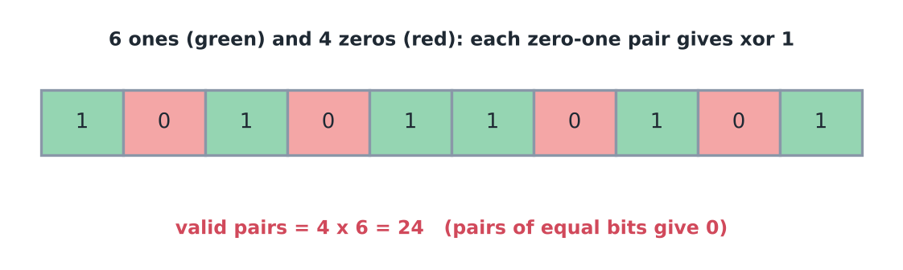

*xor = 1 only for (0, 1) pairs → 4 x 6 = 24.*

Now apply this to each bit row of arr = 1, 5, 7 (rows are bit positions 2, 1, 0):

```
arr    1  5  7
 2    [0  1  1]  → 2x1 = 2 valid pairs
 1    [0  0  1]  → 2x1 = 2 valid pairs
 0    [1  1  1]  → 3x0 = 0
bit ↑
```

Now on adding the bit position values

2 x 2^2 + 2 x 2^1 + 2^0 x 0
= 8 + 4 = 12

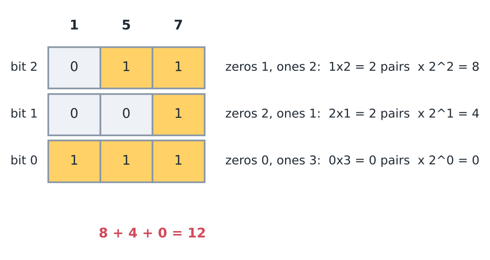

*8 + 4 + 0 = 12. Check: 1^5 + 1^7 + 5^7 = 4 + 6 + 2 = 12.*

T.C. = O(32 n), extra memory O(1) besides the array.

```cpp
// Fabricator/BitManipulation/PairwiseSumOfXor.cpp
void solve() {
    int n;
    cin>>n;

    vector<int> arr(n);
    for(auto &ele: arr) cin>>ele;

    long long ans = 0;

    for(int bit_pos=0; bit_pos<32; bit_pos++){
        long long cnt_zero = 0;
        long long cnt_one = 0;
        for(int i=0; i<n; i++){
            if(arr[i] & (1 << bit_pos)){
                cnt_one++;
            }
            else{
                cnt_zero++;
            }
        }
        
        long long valid_pairs = cnt_one * cnt_zero;
        ans += valid_pairs * (1 << bit_pos);
    }

    cout<<ans<<endl;
}
```

`1 5 7` → 12.

Note: if numbers use all 32 bits, write `1ll << bit_pos` at the last line.

Size check: one bit can give up to (5·10^4)^2 = 2.5·10^9 valid pairs, which is above the `int` limit of about 2.1·10^9. That is why the counts are `long long`.

## Some functions to remember

The compiler gives ready functions for the most useful bit questions: the highest set bit, the count of set bits and the trailing zeros.

i) MSB → ⌊log_2(n)⌋       → fail for x=0.

GCC : `__lg(x)` or `31 - __builtin_clz(n)`
      `__lg(n)` or `63 - __builtin_clzll(n)`

C++20 : `std::bit_width(n) - 1`

Note: for 64 bit use `__builtin_clzll`, plain `clz` looks only at 32 bits. `clz(0)` is undefined, so n = 0 fails here.

ii) Counting set bits :

GCC : `__builtin_popcount (n)`
      `__builtin_popcountll (n)`

C++20 : `popcount (n)`

iii) LSB / Trailing zeros :

GCC : `__builtin_ctz (n)`       \} fail for
      `__builtin_ctzll (n)`     \} n = 0

C++20 : `countr_zero (n)`

`__builtin_clz`
 └ count leading zeros

`__builtin_ctz`
 └ count trailing zeros.

(C++20 ones are in `<bit>` header.)

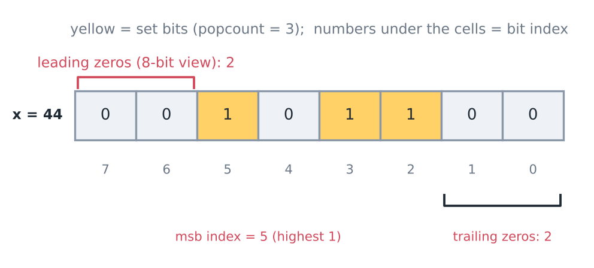

*x = 44 = 00101100 → popcount 3, msb index 5, trailing zeros 2.*

For x = 44: `__builtin_popcount` = 3, `31 - __builtin_clz(44)` = 5 (same as `__lg(44)`), `__builtin_ctz` = 2, `44 & -44` = 4 (lowest set bit as a value). For $2^{40} + 2^3$: `popcountll` = 2, `63 - clzll` = 40, `ctzll` = 3.

Repo version, with the zero case handled (queries: binary string, MSB, LSB, is power of two, largest power of two dividing n, smallest power of two ≥ n):

```cpp
// Fabricator/BitManipulation/BitMagic2.cpp
string num_to_bin_str(long long n){
    string s = "";
    for(int i=0; i<64; i++){
        if(n & (1ll << i)){
            s += "1";
        }
        else{
            s += "0";
        }
    }

    reverse(s.begin(), s.end());

    return s;
}

int pos_lsb(long long n){
    if (n == 0) return -1;
    uint64_t u = static_cast<uint64_t>(n);
    return __builtin_ctzll(u);
}

int pos_msb(long long n){
    if (n == 0) return -1;
    uint64_t u = static_cast<uint64_t>(n);
    return 63 - __builtin_clzll(u);
}

bool is_pow_of_two(long long n){
    return (n >= 2) && ((n & (n-1)) == 0);
}

long long kth_power_of_two_dividing(long long n){
    if(n == 0) return -1ll;
    uint64_t u = static_cast<uint64_t>(n);
    return u & (~u + 1ULL);
}

unsigned long long kth_power_of_two_min(long long n){
    if (n <= 1) return 2ULL;
    if (n > (1LL << 62)) return 0;
    uint64_t u = static_cast<uint64_t>(n);
    return 1ULL << (64 - __builtin_clzll(u - 1));
}

void solve() {
    long long n;
    cin>>n;

    string bin_org = num_to_bin_str(n);
    int msb = pos_msb(n);
    int lsb = pos_lsb(n);
    int is_pow = is_pow_of_two(n);
    long long kth_div = kth_power_of_two_dividing(n);
    unsigned long long kth_min = kth_power_of_two_min(n);

    cout<<bin_org<<endl;
    cout<<msb<<endl;
    cout<<lsb<<endl;
    cout<<is_pow<<endl;
    cout<<kth_div<<endl;
    cout<<kth_min<<endl;
}
```

Input `44` → binary ends `...101100`, msb 5, lsb 2, not pow of two, 4, 64. Input `64` → msb 6, lsb 6, is pow of two, 64, 64.

Note: `is_pow_of_two` returns false for 1 ($2^0$) because of `n >= 2`.

## Quick revision

- Operators: `~ | & ^ << >>`. The leftmost bit is the sign bit; 1 means negative.
- One's complement = `~x`. Two's complement = `~x + 1` = `-x`. Applying it twice returns x. The 8-bit range is -128 to 127.
- INT_MAX + INT_MAX overflows to a negative number (undefined behaviour in C++). Use `long long` for big sums.
- A subset is a mask: bit i stands for arr[i]. Union = `|`, intersection = `&`. All subsets = masks 0 to $2^n-1$, cost $O(2^n \cdot n)$.
- Check bit x: `n & (1<<x)`. Set: `n | (1<<x)`. Unset: `n & ~(1<<x)`. Flip: `n ^ (1<<x)`. Use `1ll` for 64-bit values.
- Counting set bits: `__builtin_popcount` (`__builtin_popcountll` for `long long`). The shift loop and the n/2 recursion fail for negative numbers. `n & (n-1)` removes the lowest set bit, so it costs O(number of set bits).
- Contribution technique: treat each bit alone. Answer = sum over bits of (count of items with that bit) × $2^{bit}$.
- A run of L ones contains L(L+1)/2 = (L+1)C2 subarrays. AND: count subarrays made only of 1s. OR: total minus subarrays made only of 0s. XOR of subarrays: prefix xor, then the pair xor sum.
- XOR rules: a ^ a = 0, a ^ 0 = a, order does not matter. So the xor of arr[l..r] is P[r+1] ^ P[l] with prefix xor P.
- Extending end: keep a map from AND value to the count of subarrays ending here. It has at most about 32 keys, because each bit turns off only at its first zero. Do not forget to add the new element alone with count 1.
- Size check: with values up to 10^9 the sum of all subarray ANDs is at most 5·10^18, which fits in `long long`.
- Sum of pair xor: for each bit, zeros × ones × $2^{bit}$. Cost O(32 n).
- k-th 1 in the binary sequence: for small k (up to 10^5) build the string once. For k up to 10^9 use binary search for the smallest x with f(x) ≥ k. For each bit i: total = x+1, full = total / $2^{i+1}$, left = total % $2^{i+1}$, ones = full × $2^i$ + max(left − $2^i$, 0). The index is (length of S before x) + (position of the needed 1 inside x).
- Most significant bit: `31 - __builtin_clz(n)`, `63 - __builtin_clzll(n)` or `bit_width(n)-1`. Trailing zeros: `__builtin_ctz` or `countr_zero`. Both clz and ctz are undefined for 0.

## Practice problems

LeetCode
- [Bitwise ORs of Subarrays](https://leetcode.com/problems/bitwise-ors-of-subarrays/description/)
- [Maximum Number That Sum of the Prices Is Less Than or Equal to K](https://leetcode.com/problems/maximum-number-that-sum-of-the-prices-is-less-than-or-equal-to-k/description/)

maang.in
- [XOR and AND](https://maang.in/problems/XOR-and-AND-49)

### Problem ladder

<Ladder topic="1.7" />
