import TopicHeader from '../../../components/TopicHeader.astro';
import Ladder from '../../../components/Ladder.astro';

<TopicHeader topic="2.1" />

## What this note covers

Understand a number through its factors. A **prime** is a number greater than 1 that is divisible only by 1 and itself. A **divisor** of N is a number that divides N exactly, with no remainder. The **prime factorisation** of N writes N as a product of primes, for example $360 = 2^3 \cdot 3^2 \cdot 5$.

This note covers:

- Primality test, finding divisors, and prime factorisation (all of them loop only up to $\sqrt{N}$).
- Sieve of Eratosthenes (a method that finds all primes up to N together), segmented sieve, fast factorisation, and the count and sum of divisors.
- Euler totient (how many numbers from 1 to n are coprime with n, that is, share no factor with n except 1), and the product of divisors.
- The power of a number inside N!, the equation $\frac1a + \frac1b = \frac1n$, and the harmonic lemma (floor(N/x) has only about $2\sqrt{N}$ distinct values).

Fast exponentiation with a modulus is needed in a few places. It is explained in detail in 2.2.

Why this matters: the constraints of most number problems are too large for a plain loop. A loop to $10^9$ takes about 10 seconds at $10^8$ simple operations per second, but a loop to $\sqrt{10^9} \approx 31623$ is instant. Every technique below is a way to replace "try everything up to N" with "try only up to $\sqrt{N}$" or "handle many numbers at once".

## Table of contents

- Primality Test → is N prime or not, loop up to $\sqrt{N}$
- Finding divisors → all divisors, as pairs (i, N/i)
- Prime factorisation → N = product of primes
- Sieve of Eratosthenes → all primes up to n
- Segmented Sieve → primes in a range [a, b]
- Fast Factorization → smallest prime factor array
- Sieve Applications → count and sum of divisors
- Euler Totient function → count of coprime numbers
- Product of divisors → product of all divisors
- Power of a number in N! → highest power of x in N!, trailing zeros
- 1/a + 1/b = 1/n → counting integer solutions
- Harmonic Lemma based summation optimisation → blocks of equal floor(N/x)

## Primality Test

Problem: check whether a given number N is prime.

Brute force: check every number from 2 to (N-1) and see whether any of them divides N.

Cost: for $N \approx 10^9$ this is about $10^9$ divisions, roughly 10 seconds. Too slow when there are many queries.

Optimised: assume that N is not prime. Then N is a product of prime powers, and the first prime divides N:

  $N = p_1^{\alpha_1} \, p_2^{\alpha_2} \, p_3^{\alpha_3} .....$

  $N = p_1^{\alpha} (D)$ ⇒ $p_1 \mid N$.

One of the multipliers (the factors of N) must be $\le \sqrt{N}$.
This is because if both were $\ge \sqrt{N}$, then $(\ge\sqrt{N}) \times (\ge\sqrt{N})$ would give $> N$, which is not valid.

Intuition: divisors of a composite number come in pairs $(d, N/d)$. In every pair the smaller one is at most $\sqrt{N}$, so if no number up to $\sqrt{N}$ divides N, no divisor exists at all.

```cpp
bool is_prime (long long x){          // O(√N).
    for (long long i=2; i*i <= x; i++) {
        if (x%i == 0)
            return 0;
    }
    return 1;
}
```

Cost: the loop runs at most $\sqrt{N}$ times and uses O(1) extra memory.

Note: x = 0 and x = 1 return 1 (true) here but they are not prime, so handle `x > 1` outside, like `if(n > 1 && is_prime(n))` in PrimalityCheck.cpp. Using `i*i <= x` instead of sqrt(x) avoids floating point issues (sqrt works on decimal numbers, so for large values the result can be off by a tiny amount and the loop may stop one step early or late). For N ≈ 10^9 this is about 3×10^4 steps only.

Dry run for x = 91: the loop runs for i = 2, 3, 4, 5, 6 (none divides 91), then i = 7 and 91 % 7 = 0, so 91 = 7 · 13 is not prime. For x = 97: the loop runs for i = 2 to 9 (since 10·10 = 100 > 97), nothing divides, so 97 is prime.

Common mistake: with `int`, the product `i*i` can overflow when x is near $2 \cdot 10^9$. That is why the loop variable here is `long long`.

```cpp
// Fabricator/Maths/PrimalityCheck.cpp
bool is_prime(long long x){
    for(long long i=2; i*i<=x; i++){
        if(x % i == 0){
            return false;
        }
    }

    return true;
}
```

The note above says the caller must handle values below 2. Here is the same test with that check inside, so it is safe to call on any input:

```cpp
// New function (not from the Fabricator repo): the same test, but it also rejects 0 and 1.
/*
  Problem: primality test that also rejects 0 and 1.
*/
bool is_prime_checked(long long x) {
    if (x < 2) return false;
    for (long long i = 2; i * i <= x; i++)
        if (x % i == 0) return false;
    return true;
}
```

Compiled and run: `is_prime_checked` returns false for 0, 1 and 91, and true for 2, 97 and 1000000007. The original `is_prime(1)` returns true, which is the problem this version fixes. Cost: O(√x) time and O(1) memory.

## Finding divisors

Problem: find all the divisors of a number N.

For example, the divisors of 12 are 1, 2, 3, 4, 6, 12.

Brute force: iterate over every number from 1 to N and check each one.

Cost: for $N = 10^{12}$ that is $10^{12}$ checks, far too many. The pairing below brings it down to $10^6$.

Every divisor $d_1$ has a partner $d_2$ such that N = $d_1 \times d_2$.

The figure below splits the numbers into two groups: group 1 holds 1 to √N and group 2 holds √N+1 to N. For N = 12 it joins every divisor to its partner.

For every divisor in group 2 there is a partner divisor in group 1, and the other way round. So it is enough to look at group 1 only: each divisor i found there gives the second divisor N/i for free.

N can have at most $2\sqrt{N}$ divisors.

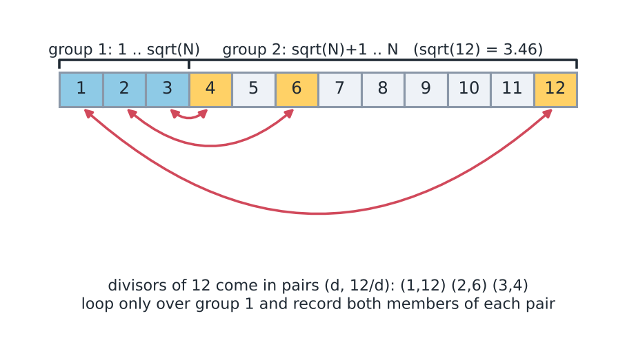
*The divisors of 12 pair up as (1,12), (2,6) and (3,4). We loop only over group 1.*

(2√N is just an upper bound. The real maximum is far less: 1344 divisors for N ≤ 10^9 and 103680 for N ≤ 10^18.)

```cpp
vector <long long> divisors (long long x){
    vector <long long> div;
    for (long long i=1; i*i <= x; i++){
        if (x%i == 0) {
            div.push_back(i);
            if (i*i != n) {
                div.push_back(n/i);
            }
        }
    }
    return div;
}
```
The time complexity (T.C.) is O(√n). The memory is the size of the answer, at most $2\sqrt{n}$ numbers.

Note: the parameter is `x` but the body uses `n`, so this will not compile as written. Use `x` in both places. With `i*i != x`, the value 6 for x = 36 is pushed only once. The result is not sorted.

Dry run for x = 36: i = 1 gives 1 and 36; i = 2 gives 2 and 18; i = 3 gives 3 and 12; i = 4 gives 4 and 9; i = 5 does not divide; i = 6 gives 6 once because 6·6 = 36. That is 9 divisors, found with 6 loop steps.

```cpp
// Problem:
// All divisors of x in O(sqrt(x)); every divisor i <= sqrt(x) comes with its
// partner x / i.
vector<long long> divisors_of(long long x) {
    vector<long long> result;
    for (long long i = 1; i * i <= x; i++) {
        if (x % i == 0) {
            result.push_back(i);
            if (i * i != x) result.push_back(x / i);   // skip when i == x / i
        }
    }
    return result;
}
```

## Prime factorisation

Problem: find the prime factorisation of N.

Brute force: test every number from 2 to N as a factor. For $N = 10^{12}$ this is $10^{12}$ steps, far too slow.

$N = p_1^{\alpha_1} \, p_2^{\alpha_2} \, p_3 ......$

Only one prime can be $> \sqrt{N}$.

Idea: divide out every i up to √N completely. Whatever is left after that (if it is greater than 1) is the one big prime. Reason: two primes both above $\sqrt{N}$ would multiply to more than N.

```cpp
vector<pair<long long, long long>> prime_factor (long long x){
    vector<pair<long long, long long>> fact;
    for(long long i=2; i*i <= x; i++) {
        if (x%i == 0) {
            int cnt = 0;
            while (x%i == 0){
                cnt++;
                x/=i;
            }
            fact.push_back ({i, cnt});
        }
    }
    if (x>1) {
        fact.push_back ({x,1});
    }
    return fact;
}
```
The T.C. (time complexity) is O(√N). The memory is O(log N), because N has at most $\log_2 N$ prime factors counted with repetition.

Dry run for x = 360: for i = 2 the value of x goes 360 → 180 → 90 → 45, so we push (2,3). For i = 3 it goes 45 → 15 → 5, so we push (3,2). For i = 4 the test 16 > 5 stops the loop. Since x = 5 > 1, we push (5,1). So 360 = 2³·3²·5. For prime 97 the loop finds nothing, and the last `if` pushes (97,1). (In the notebook an early `return fact;` before the `if` is crossed out, because it would miss the big prime.)

Common mistake: forgetting the last `if (x>1)`. Then 97, or 14 = 2 · 7 (which would give only the factor 2), lose their big prime.

What if there are many queries (n ≤ 10^6)? Trial division costs up to √N every time. Better: store the smallest prime factor `sp[i]` of every number with a sieve, then factorise in O(log N) by repeatedly dividing by sp[n].

```cpp
// Fabricator/Maths/FastFactorization.cpp
int sp[DEF_ARR_SIZE];

void precompute_sp(){
    for(int i=2; i<DEF_ARR_SIZE; i++){
        sp[i] = i;
    }

    for(int i=2; i<DEF_ARR_SIZE; i++){
        if(sp[i] == i){
            for(int j=2*i; j<DEF_ARR_SIZE; j+=i){
                if(sp[j] == j){
                    sp[j] = i;
                }
            }
        }
    }
}

vector<int> prime_factors(int n){
    vector<int> factors;
    while(n > 1){
        factors.push_back(sp[n]);
        n /= sp[n];
    }

    return factors;
}
```

```cpp
// Fabricator/Maths/HowManySolutions.cpp
map<long long, long long> prime_factors_with_pow(long long n){
    map<long long, long long> val;
    for(long long i=2ll; i*i<=n; i++){
        if(n % i == 0){
            long long cnt = 0;
            while(n % i == 0){
                cnt++;
                n /= i;
            }

            val[i] = cnt;
        }
    }

    if(n > 1){
        val[n] = 1;
    }

    return val;
}
```

Note: `DEF_ARR_SIZE` is `1'000'100` in the repo. Checked 360 → 2 2 2 3 3 5 and 600851475143 = 71 · 839 · 1471 · 6857.

## Sieve of Eratosthenes

Problem: find all primes $\le 10^7$.

Brute force: loop over every number in the range and run the primality test on it.

Loop over [1, 10^7] and run the primality test for each number. This costs O(n√n).

Cost: $10^7 \cdot \sqrt{10^7} \approx 10^7 \cdot 3162 \approx 3 \cdot 10^{10}$ operations, about 300 seconds at $10^8$ per second. The sieve below needs about $2 \cdot 10^7$.

Sieve:

We loop from 2 to N. For each prime we meet, we mark all the multiples of that prime as not prime. We skip every number that is already marked as not prime.

Why it works: a number that is still unmarked when the loop reaches it has no smaller prime factor, so it must be prime. Every composite is marked by its smallest prime factor.

Trace for N = 30: i = 2 is unmarked, so it is prime, and it marks 4, 6, 8, ..., 30. Then i = 3 is prime and marks 6, 9, ..., 30. i = 4 is already marked, so it is skipped. i = 5 is prime and marks 10, 15, 20, 25, 30. The primes 7, 11, ... only re-mark numbers that are already marked. The numbers left unmarked are 2, 3, 5, 7, 11, 13, 17, 19, 23, 29, which are the 10 primes up to 30.

The picture below shows the same idea for N = 10.

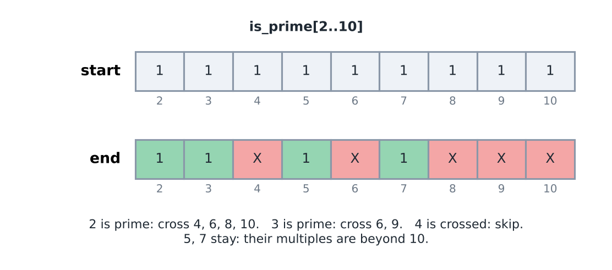
*Prime 2 crosses out 4, 6, 8, 10. Prime 3 crosses out 6 and 9. The number 4 is skipped because it is already crossed out. The numbers 5 and 7 stay.*

Code (first version, the inner loop starts at 2*i):
```cpp
for (int i=2; i<=N; i++) is_prime[i] = 1;
for (int i=2; i<=N; i++){
    if (is_prime[i]) {
        for (int j=2*i; j<=N; j+=i){
            is_prime[j] = 0;
        }
    }
}
```

Optimised:

```cpp
for (int i=2; i<=N; i++) is_prime[i] = 1;
for (int i=2; i<=N; i++){
    if (is_prime[i]) {
        for (long long j= 1ll*i*i; j<=N; j+=i){
            is_prime[j] = 0;
        }
    }
}
```

We can start from **i\*i**

The reason is as follows. Take a multiple of i that is smaller than i*i. It can be written as `p*i` with p smaller than i. The line below shows where it sits.

This number has i as a factor. On the number line the order is: i ... `(p*i)` ... `i*i`.

Because `(p*i) < i*i`, we have `p < i`. So the earlier primes must already have struck off all multiples below **i\*i**.

In words: a multiple `p*i` with p smaller than i has the smaller factor p. The prime factors of p are all smaller than i, so earlier primes have already marked it.

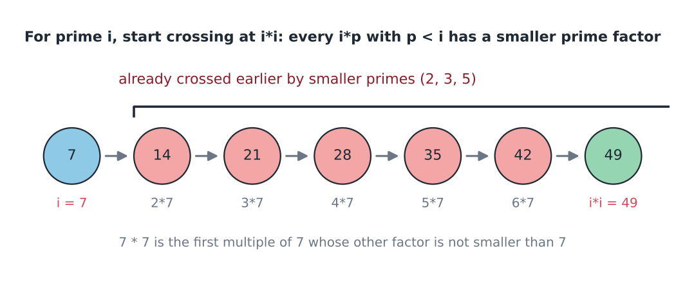
*For i = 7, the multiples 14 to 42 are already crossed out by 2, 3 and 5. The first new one is 49.*

`1ll*i*i` is a long long, so that `i*i` does not overflow in int. (For i above 46340, `i*i` is more than the largest int, 2147483647. Without `1ll` the product would wrap around to a negative number and the loop would write outside the array.)

Number of times the inner loop runs:

$\lfloor \frac{N}{2} \rfloor + \lfloor \frac{N}{3} \rfloor + \lfloor \frac{N}{5} \rfloor + \lfloor \frac{N}{7} \rfloor + ......$

$= \sum_{\substack{p \in prime \\ p \le N}} \lfloor \frac{N}{p} \rfloor \approx O(n \log \log n)$

Why this sum is small: it is $N$ times the sum of $1/p$ over primes, and that sum grows extremely slowly (about $\ln \ln N$; it is only about 3 for N = $10^7$). So the cost is only slightly more than N.

Measured for N = 10^7: 664579 primes, simple version = 29,465,738 inner runs, `i*i` version = 22,850,051 (N·ln ln N ≈ 27.8 million, so the formula gives a good estimate).

The grid below lists the numbers 2 to 50 and shows why the primes up to √50 are enough.

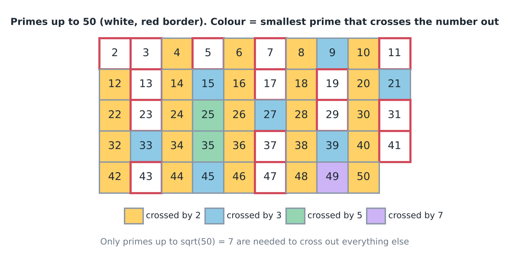
*Only the primes 2, 3, 5 and 7 (all at most √50) are needed to strike out every composite number up to 50.*

Memory for N = 10^7: an int array needs 40 MB, a char array 10 MB, and a `vector<bool>` about 1.25 MB.

The outer loop may also stop at $\sqrt{N}$. For a larger i, the first number to cross out is i·i, which is already above N, so the inner loop has nothing to do. Stopping early only saves the checks, and the cost stays O(n log log n).

```cpp
// Fabricator/Maths/SieveOfEratosthenes.cpp
vector<bool> sieve_of_eratosthenes(){
    vector<bool> is_prime(DEF_ARR_SIZE, true);
    is_prime[0] = is_prime[1] = false;
    for(int i=2; i<DEF_ARR_SIZE; i++){
        if(is_prime[i]){
            for(long long j=1ll*i*i; j<DEF_ARR_SIZE; j+=i){
                is_prime[j] = false;
            }
        }
    }

    return is_prime;
}
```

Note: `DEF_ARR_SIZE` is `1'000'100` in the repo. Primes below 1,000,100 = 78504.

## Segmented Sieve

Question: find the primes in the range [a,b] where $0 \lt a \le b \le 10^{12}$ and $b-a \le 10^6$

Building a sieve up to $10^{12}$ is not possible. (An array of size $10^{12}$ needs about 1 terabyte even at one byte per number, so memory is the problem.)

Checking each number between a and b (that is, b-a numbers) costs $O(\sqrt{b})$ per number. The total is about $O(10^{12})$, which is infeasible.

Idea: to check whether a number N is prime, we need to check only the primes $\le \sqrt{N}$.

Why? Let's say N is not prime, so $p_1 \cdot k = N$ ($p_1$ is a prime and k is some integer greater than 1). One of the two must be $\le \sqrt{N}$ (if both were $> \sqrt{N}$, the product would be $> N$).

- If $p_1 \le \sqrt{N}$, then a prime up to $\sqrt{N}$ divides N, which proves the claim.
- If $k \le \sqrt{N}$, then k is made of some prime that is also $\le \sqrt{N}$, and that prime also divides N.

Phase 1: find the primes in the range [1, sqrt(b)], because these are enough to check all the numbers up to b.

Here $\sqrt{b}$ is at most $10^6$, so a normal sieve can find these primes.

Phase 2: Sieve the range [a,b] using the primes found in the range [1, sqrt(b)].

This means the array slot `x - a` stands for the number `x`. The array size is only $b-a+1 \le 10^6$.

Example: a = 28, b = 36. $\sqrt{36} = 6$, so phase 1 runs on [1,6] (1 means prime and 0 means not prime).

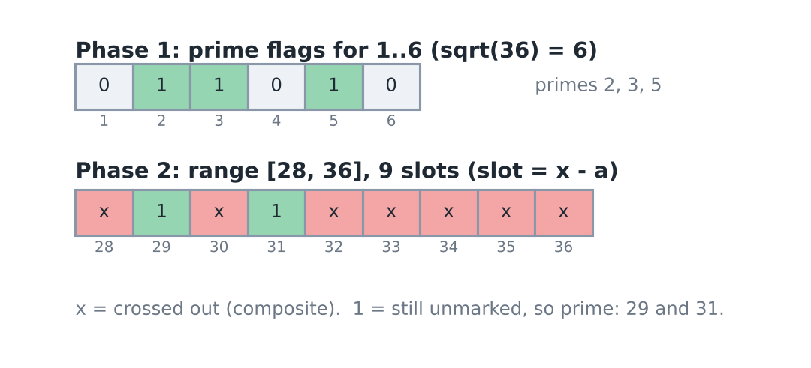
*Phase 1 gives the primes 2, 3 and 5. After phase 2 only 29 and 31 are left.*

Iterate over the phase 1 primes and mark all the multiples of each prime in the range. The picture below shows this for the example.

![Multiples crossed out by 2, 3 and 5 in [28, 36]](../../../assets/notes/2-1-number-theory/figC02_segsieve_rows.png)
*Prime 2 crosses out 28, 30, 32, 34, 36. Prime 3 crosses out 30, 33, 36. Prime 5 crosses out 30 and 35. The first multiple of p in the range is ceil(28/p) * p.*

What remains are 29 and 31, the primes in the range [28, 36].

```cpp
for (prime : [1, sqrt(b)]) {
    long long curMul = ((a+prime-1) / prime) * prime;
    while (curMul <= b) {
        is_prime [curMul-a] = 0;
        curMul += prime;
    }
}
```

We must also add a check that curMul ≠ prime.

The expression `((a+prime-1)/prime)*prime` rounds a up to the first multiple of prime (the "ceil trick"). Check: a = 28, prime = 5 gives (32/5)·5 = 6·5 = 30. Why the check? If the prime itself lies in [a,b] (for example a = 1 or a = 2), the loop would cross it out too. That is why we need `curMul != prime`.

The same code with that check:

```cpp
// Fabricator/Maths/SegmentedSieve.cpp
vector<int> sieve_of_eratosthenes(int n){
    vector<bool> is_prime(n, true);
    is_prime[0] = is_prime[1] = false;
    for(int i=2; i<n; i++){
        if(is_prime[i]){
            for(long long j=1ll*i*i; j<n; j+=i){
                is_prime[j] = false;
            }
        }
    }

    vector<int> primes;
    for(int i=0; i<n; i++){
        if(is_prime[i]){
            primes.push_back(i);
        }
    }

    return primes;
}

vector<long long> segmented_sieve(long long a, long long b){
    int n = sqrt(b);
    vector<int> base_primes = sieve_of_eratosthenes(n);
    vector<bool> is_prime(b-a+1, true);
    for(auto prime: base_primes){
        long long curr_mul = ((a + prime - 1)/prime) * prime;
        while(curr_mul <= b){
            if(curr_mul != prime){
                is_prime[curr_mul-a] = false;
            }

            curr_mul += prime;
        }
    }

    vector<long long> primes;
    for(int i=0; i<b-a+1; i++){
        if(is_prime[i] && (a+i) >= 2){
            primes.push_back(a + i);
        }
    }

    return primes;
}
```

Note: `sieve_of_eratosthenes(n)` returns primes strictly less than `n`. If $\lfloor \sqrt{b} \rfloor$ is itself prime (e.g. b = 49 or 50), then $7^2 = 49$ is never crossed out. Phase 1 should be called with `n + 1`. (Tested: in [24, 50] the number 49 was wrongly reported as prime. The ranges [28,36], [1,100], [90,120] and a range near $10^{12}$ gave correct answers.)

Also `a = 1`: no prime crosses out 1, which is why there is the `(a+i) >= 2` check.

Time complexity (T.C.):

The number of primes in [0, N] is about $\frac{N}{\log N}$.

The number of times marking happens in [a,b] is $\Sigma \lceil \frac{(b-a+1)}{P} \rceil$, summed over each prime $P \le \sqrt{b}$.

$O((b-a) \log \log b)$

This uses the same relation as in the sieve of Eratosthenes. (Phase 1 costs $O(\sqrt{b} \log\log b)$, which is small next to this.)

For b = 10^12 and b - a = 10^6: phase 1 sieves up to $10^6$ (about 78,000 primes), and phase 2 does roughly $10^6 \cdot \log\log 10^{12} \approx 3 \cdot 10^6$ markings. Memory is about $10^6$ flags.

Note: use `long long`. Values like $i*i$ or $b$ overflow in int. Memory is only O(b-a) for the range flags plus O(√b) for the phase 1 primes, so the huge value of b never needs an array.

## Fast Factorization

Question: find the prime factorisation of every number from 1 to $10^6$.

For example, 60 = 2 · 2 · 3 · 5.

Brute force: trial division up to $\sqrt{n}$ for every number. With many queries this is slow: $10^6$ queries at $\sqrt{10^6} = 1000$ steps each is $10^9$ steps.

The idea is pre-computation (calculating once, before the queries start). We store something for each number that will help us factorise the numbers easily.

A number N can have at most $O(\log N)$ prime factors (counted with repetition).

Proof: suppose a number is made entirely of 2s, that is, 2 · 2 · 2 ··· (c times) = N. Then $2^c = N$ ⇒ $c = \log_2 (N)$. The same holds for all other primes (a larger prime gives even fewer factors).

We will build a table of the smallest prime factor (sp) of every number.

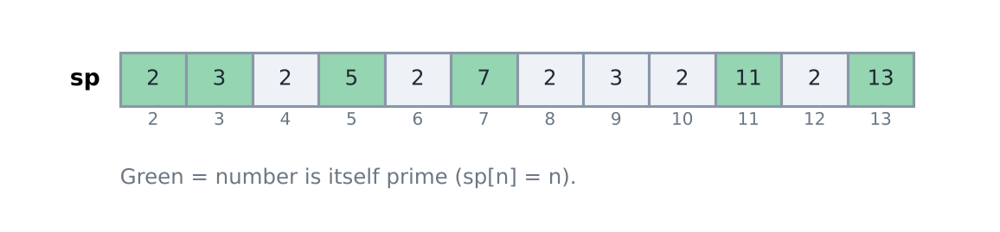
*The values of sp[n] for n = 2 to 13. A green cell means n is prime, because then sp[n] = n.*

The next three lines show how to break 8 into primes using sp. Here sp(8) = 2.

- 8 → 2 · ( ), where ( ) is the prime factorisation (pf) of 8/2 = 4.
- 8 → 2 · (2 · ( )), where ( ) is the pf of 4/2 = 2.
- 8 → (2 · 2 · 2).

So the rule is $pf(n) = sp(n) \cdot pf\left(\frac{n}{sp(n)}\right)$.

(pf = prime factors.) Take sp(n), divide it out of n, and repeat until n = 1.

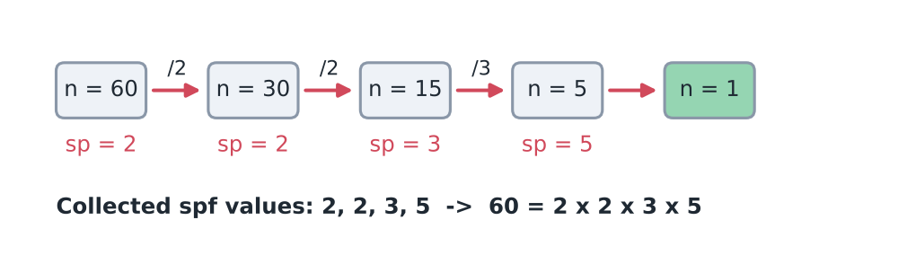
*60 → 30 → 15 → 5 → 1. The smallest prime factors used are 2, 2, 3 and 5.*

Creating the sp array:

Trace for 12: all values start with sp[12] = 12. The prime 2 reaches 12 first and sets sp[12] = 2. Later the prime 3 also reaches 12, but sp[12] is already 2, so the check `sp[j] == j` stops the overwrite. The sp array for 1 to $10^6$ costs about $10^6 \cdot \log\log 10^6 \approx 3 \cdot 10^6$ steps.

```cpp
for (int i= 2; i<=N; i++) {
    sp[i] = i; // → assuming each no. is prime.
}
for (int i= 2; i<=N; i++) {
    if (sp [i] == i) { // i is prime.
        for (int j= 2*i; j<=N; j+= i) {
            if (sp[j] == j) {
                sp[j] = i;
            }
        }
    }
}
```

The T.C. (time complexity) of building the sp array is $O(N \log \log N)$.

`sp[j] == j` means that no smaller prime has claimed j yet. Primes arrive in increasing order, so the first prime to reach j is its smallest prime factor.

Using sp[] for fast factorisation:

```cpp
vector <int> prime_fact ( int n) {
    vector <int> ans;
    while ( n > 1) {
        ans.push_back (sp[n]);
        n /= sp[n];
    }
    return ans;
}
```

The T.C. (time complexity) of one factorisation is $O(\log n)$.

Dry run for n = 84: sp[84] = 2 → n = 42; sp[42] = 2 → n = 21; sp[21] = 3 → n = 7; sp[7] = 7 → n = 1. Result 2, 2, 3, 7. Four steps, and each step divides n by at least 2, so there are never more than $\log_2 n$ steps.

The same code from the Fabricator repository:

```cpp
// Fabricator/Maths/FastFactorization.cpp
const int DEF_ARR_SIZE = 1'000'100;
int sp[DEF_ARR_SIZE];
void precompute_sp(){
    for(int i=2; i<DEF_ARR_SIZE; i++){
        sp[i] = i;
    }

    for(int i=2; i<DEF_ARR_SIZE; i++){
        if(sp[i] == i){
            for(int j=2*i; j<DEF_ARR_SIZE; j+=i){
                if(sp[j] == j){
                    sp[j] = i;
                }
            }
        }
    }
}

vector<int> prime_factors(int n){
    vector<int> factors;
    while(n > 1){
        factors.push_back(sp[n]);
        n /= sp[n];
    }

    return factors;
}
```

If only the distinct primes are needed (each prime once), divide out the whole power of each prime:

```cpp
// Fabricator/Maths/Coprime.cpp (needs sp[] from above)
vector<int> prime_factors(int n){
    vector<int> factors;
    while(n > 1){
        factors.push_back(sp[n]);
        int curr_fact = sp[n];
        while(n % curr_fact == 0) n /= curr_fact;
    }

    return factors;
}
```

Note: the sp array takes $O(N)$ memory, about 4 MB for $10^6$ numbers. For a single very large number ($10^{12}$), just use trial division in $O(\sqrt{n})$.

## Sieve Applications

$N = p_1^{\alpha_1} p_2^{\alpha_2} \dots p_n^{\alpha_n}$

Two quantities are read from this prime factorisation. Counting divisors one by one with the square-root loop costs $O(\sqrt{n})$ for each number, which is too slow for many numbers. With sp[] the factorisation of each number takes $O(\log n)$, and the formulas below turn it into the answer.

$S_0$ is the number of divisors.

Every prime factor has $(1+\alpha_i)$ options. (In a divisor, the power of $p_i$ can be $0, 1, \dots, \alpha_i$, and the choices for different primes are independent.)

The number of divisors of N = $(1+\alpha_1)(1+\alpha_2) \dots (1+\alpha_n)$

For example, $60 = 2^2 \cdot 3 \cdot 5$ gives $3 \cdot 2 \cdot 2 = 12$.

$S_1$ is the sum of divisors.

Sum = $\left(\frac{p_1^{\alpha_1+1} - 1}{p_1 - 1}\right) . \left(\frac{p_2^{\alpha_2+1} - 1}{p_2 - 1}\right) + \dots$

Note: the dots between the brackets mean a product, not a plus. Think of it as: $(1 + p_1 + \dots + p_1^{\alpha_1})(1 + p_2 + \dots)\dots$ If you expand this, every term is exactly one divisor. For example, for 60 it is $(1+2+4)(1+3)(1+5) = 7 \cdot 4 \cdot 6 = 168$.

Using sp[] both are easy to get:

```cpp
/*
  Problem: for n <= 10^6 return {number of divisors, sum of divisors}.
  Uses the sp[] array (smallest prime factor) from above.
*/
pair<long long, long long> divisor_count_and_sum(int n){
    long long count = 1, sum = 1;
    while(n > 1){
        int p = sp[n];
        int alpha = 0;
        long long p_pow = 1;       // p^alpha so far
        long long term_sum = 1;    // 1 + p + ... + p^alpha
        while(n % p == 0){
            n /= p;
            alpha++;
            p_pow *= p;
            term_sum += p_pow;
        }

        count *= (alpha + 1);
        sum *= term_sum;
    }

    return {count, sum};
}
```

Trace for n = 60: sp[60] = 2, and 60 → 30 → 15 gives alpha = 2, so term_sum = 1 + 2 + 4 = 7 and count = 3. Next sp[15] = 3 gives alpha = 1, term_sum = 4, count = 6. Next sp[5] = 5 gives term_sum = 6, count = 12. The sum is 7 · 4 · 6 = 168. The loop runs once per prime power, so the cost is $O(\log n)$ and no extra memory is used beyond sp[].

(Checked for every n up to $10^6$ against a divisor sieve. 60 → 12 divisors, sum 168.)

## Euler Totient function

Problem: for a number x, count the numbers a in [1,x] such that gcd (x,a) = 1. Such numbers are called coprime with x. The notebook writes this count as $f(n)$ and uses n and x for the same number.

Let $f(n)$ be the count of numbers in [1,x] such that gcd (x,a) = 1 (the coprime numbers).

(gcd = greatest common divisor. Coprime means gcd = 1.)

Brute force: compute gcd for every a from 1 to x. This costs about $x \log x$ steps for one number, and for all numbers up to N it is about $N^2 \log N$, far too slow for $N = 10^6$.

For example, for x = 6 the numbers 1 and 5 are coprime with 6, so $f(6) = 2$.

To find a formula, take a number with two prime factors:

Let $X = p_1^2 \cdot p_2^3$.

Write the numbers 1, 2, ..., x in a row. We cannot take the multiples of $p_1$ and $p_2$, so we exclude them. The count of numbers left is:

$x - \frac{x}{p_1} - \frac{x}{p_2} + \frac{x}{p_1 \cdot p_2}$

($\frac{x}{p_1}$ is the number of multiples of $p_1$, and $\frac{x}{p_2}$ is the number of multiples of $p_2$. The numbers divisible by both were subtracted twice, so they are added back once.)

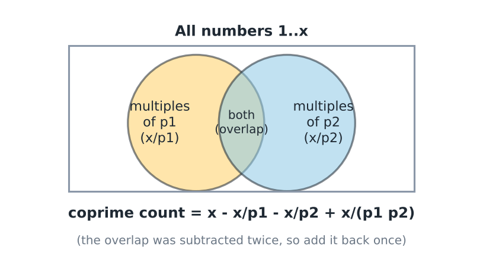
*Subtract both circles, then add the overlap back once.*

$= x\left(1 - \frac{1}{p_1}\right) - \frac{x}{p_2}\left(1 - \frac{1}{p_1}\right)$

$= x \left(1 - \frac{1}{p_1}\right)\left(1 - \frac{1}{p_2}\right)$

Without loss of generality (the same steps work for any number of primes):

$f(n) = x . \left(1 - \frac{1}{p_1}\right)\left(1 - \frac{1}{p_2}\right)\left(1 - \frac{1}{p_3}\right) + \dots$
This count $f(n)$ is written $\phi(n)$ and is called the totient of n.

Note: this is also a product (not a sum), and $p_i$ are the distinct primes of n.

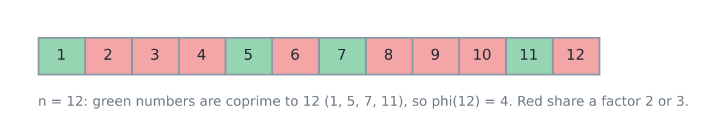
*phi(12) = 12 · (1/2) · (2/3) = 4, and the four numbers coprime to 12 are 1, 5, 7 and 11.*

To get the totient of every number up to N at once, use a sieve. The array is_prime[] comes from the sieve of Eratosthenes above.

```cpp
for (int i= 1; i<=N; i++) {
    phi[i] = i;
}
for (int i= 2; i<=N ; i++) {
    if (is_prime [i]) {
        for (int j= i; j<=N; j+= i) {
            phi [j] -= phi [j]/i ;
        }
    }
}
```

The line `phi [j] -= phi [j] / i` means $x - \frac{x}{i} = x\left(1 - \frac{1}{i}\right)$, where i is a new prime factor of j.

The inner loop calculates $x\left(1 - \frac{1}{i}\right)$ for all multiples of i. In this way it adds the contribution of $\left(1 - \frac{1}{i}\right)$ to all the multiples of i.

(The division is exact because phi[j] is still divisible by i at that point. T.C. (time complexity): $O(N \log \log N)$, and the memory is one array of N+1 numbers. Compared with a brute-force gcd count for n ≤ 3000, all values matched.)

Dry run for j = 12 (prime factors 2 and 3): phi[12] starts at 12. Prime 2: 12 - 12/2 = 6. Prime 3: 6 - 6/3 = 4. So $\phi(12) = 4$, which agrees with the picture above.

If the totient of a single number is needed (from the Fabricator repository):

```cpp
// Fabricator/Maths/Totient.cpp
vector<long long> prime_factors(long long n){
    vector<long long> facts;
    for(long long i=2; i<=n; i++){
        if(n % i == 0){
            facts.push_back(i);
            while(n % i == 0){
                n /= i;
            }
        }
    }

    return facts;
}
```

```cpp
// Fabricator/Maths/Totient.cpp (inside solve, n is the input, facts = prime_factors(n))
    long long totient = n;
    for(auto fact: facts){
        totient /= fact;
        totient *= (fact - 1);
    }
```

Divide first, then multiply, so that the intermediate number stays exact. For example, $\phi(6) = 2$ and $\phi(10^6) = 400000$.

Trace for n = 12: facts = 2, 3. Start with totient = 12. For 2: 12 / 2 = 6, then 6 · 1 = 6. For 3: 6 / 3 = 2, then 2 · 2 = 4. So $\phi(12) = 4$. Dividing first is exact because each prime in facts divides n, and so it also divides the current value of totient.

Note: here `prime_factors` loops up to `i<=n`, so for a prime n it costs $O(n)$. Loop up to `i*i<=n` to get $O(\sqrt{n})$.

The values of $\phi(n)$ for small n, each checked against a direct count of the numbers in [1, n] that are coprime with n:

| $n$ | 1 | 2 | 3 | 4 | 5 | 6 | 7 | 8 | 9 | 10 | 11 | 12 |
|---|---|---|---|---|---|---|---|---|---|---|---|---|
| $\phi(n)$ | 1 | 1 | 2 | 2 | 4 | 2 | 6 | 4 | 6 | 4 | 10 | 4 |

Properties of $\phi(n)$:

i) $\phi(p) = p-1$, where p is a prime.

ii) $\phi(p^k) = p^k - p^{k-1}$

iii) $\phi(a \cdot b) = \phi(a) \cdot \phi(b)$ if gcd (a,b) == 1. This is called the multiplicative property.

Proofs:
i) $\phi(p) = p\left(1 - \frac{1}{p}\right) = (p-1)$ ✓
ii) $\phi(p^k) = p^k\left(1 - \frac{1}{p}\right) = p^k - p^{k-1}$ ✓
iii) $\phi(p_1 . p_2)$ = $p_1 p_2 \left(1 - \frac{1}{p_1}\right)\left(1 - \frac{1}{p_2}\right)$ ✓
   $= (p_1 - 1)(p_2 - 1)$

(Coprime numbers have different primes, so the same grouping works for any coprime a and b.)

Example of the multiplicative property: $\phi(12) = \phi(4) \cdot \phi(3) = 2 \cdot 2 = 4$. It fails without coprimality: $\phi(2 \cdot 2) = 2$, but $\phi(2) \cdot \phi(2) = 1$.

## Product of divisors

Problem: find the product of all divisors of X. Multiplying the divisors one by one needs a list of all of them, and the product is a huge number, so a formula in terms of the prime factorisation is better. The notebook builds it with an example.

Let $X = (p_1^2 \; p_2^3 \; p_3^1)$

Some divisors will have $p_1^0$, some $p_1^1$ and some $p_1^2$.

In the product of all divisors, let us see the power of $p_1$ in that product.

The number of divisors with $p_1^0$ equals the number of divisors of $p_1^0 p_2^3 p_3^1$, which is $1 \times (3+1) \times (1+1) = 8$.

For $p_1^1$ the term is $2 \times 4 \times 2$.

For $p_1^2$ the term is $3 \times 4 \times 2$.

So for all the powers of $p_1$ the sum is $1 \times 4 \times 2 + 2 \times 4 \times 2 + 3 \times 4 \times 2$
= $\frac{2 \times (2+1)}{2} \times (3+1) \times (1+1)$

Note: the divisors with $p_1^1$ are also $4 \times 2 = 8$ in number (the choices for $p_2$ and $p_3$ are the same). So the power of $p_1$ is (0+1+2) × 8 = 24, and $\frac{2 \times (2+1)}{2} \times 4 \times 2 = 24$ ✓. The final formula stays the same.

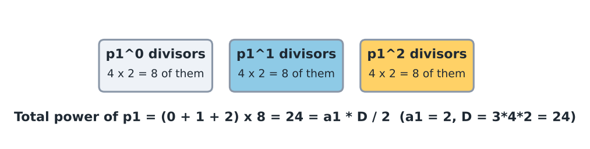
*Each power of p1 has 8 divisors, so the total power of p1 is (0+1+2) × 8 = 24.*

For $p_2$ it is $\frac{3 \times (3+1)}{2} \times (2+1) \times (1+1)$

For $p_3$ it is $\frac{1 \times (1+1)}{2} \times (2+1) \times (3+1)$

Product of all divisors = $\frac{2 \times (2+1)}{2} (3+1) \times (1+1) \times$
$\frac{3 \times (3+1)}{2} (2+1) \times (1+1) \times$
$\frac{1 \times (1+1)}{2} (2+1)(3+1)$ ✓

For a general number $p_1^{a_1} p_2^{a_2} \dots p_k^{a_k}$:

Product of all divisors = $\prod p_i^{\left(\frac{a_i \times (a_i+1)}{2}\right) \times \left(\frac{\#D}{a_i + 1}\right)}$

Here #D is the number of divisors.

Product of all divisors = $\prod p_i^{\left(\frac{a_i \times \#D}{2}\right)}$

Observation: divisors come in pairs $(d, X/d)$ whose product is $X$. There are $\#D/2$ pairs, so the product is $X^{\#D/2}$, which is the same formula. If $\#D$ is odd, X is a perfect square and all $a_i$ are even, so $a_i \cdot \#D$ is always even.

Check with X = 12: divisors 1, 2, 3, 4, 6, 12 form the pairs (1,12), (2,6), (3,4), each with product 12, so the total is $12^3 = 1728$.

For the code we need the factorisation with exponents and a power function, both from the Fabricator repository:

```cpp
// Fabricator/Maths/HowManySolutions.cpp
map<long long, long long> prime_factors_with_pow(long long n){
    map<long long, long long> val;
    for(long long i=2ll; i*i<=n; i++){
        if(n % i == 0){
            long long cnt = 0;
            while(n % i == 0){
                cnt++;
                n /= i;
            }

            val[i] = cnt;
        }
    }

    if(n > 1){
        val[n] = 1;
    }

    return val;
}
```

```cpp
// Fabricator/Maths/Exponentiation.cpp (MOD = 1000000007)
long long mpow(long long base, long long exp) {
    base %= MOD;
    long long result = 1;
    while (exp > 0) {
        if (exp % 2 == 1) result = (result * base) % MOD;
        base = (base * base) % MOD;
        exp /= 2;
    }
    return result;
}
```

Here mpow (also called bin_pow) is fast power (binary exponentiation, which computes $a^b$ in O(log b) steps). It is explained in detail in 2.2.

```cpp
/*
  Problem: product of all divisors of n (n up to 10^12), modulo 10^9+7.
  Formula: product of p^(a * D / 2) over the prime powers p^a of n, D = number of divisors.
  Uses prime_factors_with_pow and mpow (both shown above).
*/
long long product_of_divisors(long long n){
    map<long long, long long> factors = prime_factors_with_pow(n);
    long long d = 1;                       // number of divisors
    for(auto pr: factors){
        d *= (pr.second + 1);
    }

    long long ans = 1;
    for(auto pr: factors){
        // a * D is always even: if D is odd, every exponent a is even
        long long exponent = pr.second * d / 2;
        ans = (ans * mpow(pr.first, exponent)) % MOD;
    }

    return ans;
}
```

Trace for n = 12: factors = \{2: 2, 3: 1\}, so d = 3 · 2 = 6. For the prime 2 the exponent is 2 · 6 / 2 = 6, and $2^6 = 64$. For the prime 3 the exponent is 1 · 6 / 2 = 3, and $3^3 = 27$. The answer is 64 · 27 = 1728. The cost is $O(\sqrt{n})$ for the factorisation plus $O(\log)$ per prime for the powers, and the memory is the map of at most 11 primes.

(Checked against brute force for n ≤ 3000. Product of divisors of 12 = 1728 = $12^3$.)

## Power of a number in N!

Problem: find the largest power of x in N!, where $N \le 10^{18}$ and $X \le 10^{12}$.

In other words: find the largest a such that
$x^a | N!$ and $x^{a+1} \nmid N!$

That is, $x^a$ divides N! and $x^{a+1}$ does not divide N!.

(The sign | means "divides" and $\nmid$ means "does not divide". N! is N factorial, the product 1 · 2 · ... · N.)

For example, N = 5 and x = 6 give a = 1.

($5! = 120 = 6 \cdot 20$ but $36 \nmid 120$.)

Why brute force fails: N! has about $10^{19}$ digits for $N = 10^{18}$, so it can never be written down. We count prime factors instead.

The power of a prime p in N! is:

$\left\lfloor \frac{N}{p} \right\rfloor + \left\lfloor \frac{N}{p^2} \right\rfloor + \left\lfloor \frac{N}{p^3} \right\rfloor + \dots\dots + \left\lfloor \frac{N}{p^k} \right\rfloor$

Intuition: among 1..N, $\lfloor N/p \rfloor$ numbers contain at least one p. Of those, $\lfloor N/p^2 \rfloor$ contain a second p, and so on. Each level adds one more p.

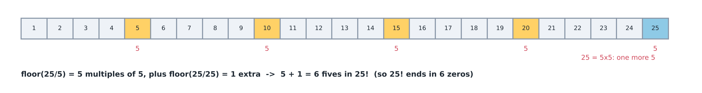
*For N = 25 and p = 5 there are 5 + 1 = 6 factors of 5 in 25!.*

For instance, if x = 10, then we need the largest y with $10^y | N!$. This is the same as finding the number of zeroes at the end of N!.

$10^y = 2^y 5^y$, so we need both $2^y | N!$ and $5^y | N!$.

We need to find the largest y that satisfies both $2^y | N!$ and $5^y | N!$.

The number of 2s in N! is larger than the number of 5s in N!. So the 5s are the restriction here, and the answer is the largest power of 5 in N!.

Coming back to our problem: we need $x^a | N!$ and $x^{a+1} \nmid N!$.

As an example, let $X = 2 \cdot 3^3 = 54$.

$54^a | N!$

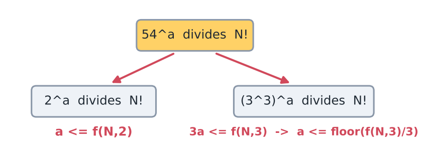
*Each prime power gives its own upper bound on a.*

$f(N,p) = \left\lfloor \frac{N}{p} \right\rfloor + \left\lfloor \frac{N}{p^2} \right\rfloor + \dots\dots$

From the prime 2 we get $a \le f(N,2)$.

From the prime 3 (which appears 3 times in X) we get $3a \le f(N,3)$, so $a \le \left\lfloor \frac{f(N,3)}{3} \right\rfloor$.

Because $f(N,3) \le f(N,2)$, we get $\left\lfloor \frac{f(N,3)}{3} \right\rfloor \le f(N,2)$. In this case the bound from the prime 3 is the answer, but it is not always true that the largest prime factor gives the answer.

For example, for $X = 2^4 \cdot 3^3$ we get $a \le \frac{f(N,2)}{4}$ and $a \le \frac{f(N,3)}{3}$.

So we must always go through all the prime factors. For $X = \prod p_i^{a_i}$:

$y = \min_i \left(\left\lfloor \frac{f(N, p_i)}{a_i} \right\rfloor\right)$ ✓

$f(N,p) = \left\lfloor \frac{N}{p} \right\rfloor + \left\lfloor \frac{N}{p^2} \right\rfloor + \left\lfloor \frac{N}{p^3} \right\rfloor + \dots\dots$

The T.C. (time complexity) is the number of non-zero terms in f(N,p), because the sum stops at the first zero.

The first term that becomes zero appears when $p^y \ge N$, that is, $y \ge \log_p N$. So the T.C. is $O(\log_p N)$.

(A small correction: the term is zero exactly when $p^y > N$. If $p^y = N$ the term is 1. This changes the count by at most one term.)

The T.C. of $y = \min_i \left(\left\lfloor \frac{f(N, p_i)}{a_i} \right\rfloor\right)$ has these steps:

1. Find the prime factorisation of x, which costs $O(\sqrt{x})$.
2. For each prime factor, compute f(N,p), which costs $O(\log_p N)$.
3. Take the minimum of all the results.

The number of prime factors is at most $\log x$. So the total is $O(\sqrt{x} + \log x \cdot \log N)$.

For $x = 10^{12}$ and $N = 10^{18}$: factorising x takes at most $10^6$ steps, and each of at most 11 distinct prime factors needs at most 60 divisions (the product of the first 11 primes is about $2 \cdot 10^{11}$, and the first 12 primes already give more than $10^{12}$). So the factorisation dominates.

Code: do not compute $p^k$ directly, because it can overflow. Divide N by p again and again instead, since $\lfloor \lfloor N/p \rfloor / p \rfloor = \lfloor N/p^2 \rfloor$. The factorisation is `prime_factors_with_pow` (from the product of divisors section), and `INF = 1e18`:

```cpp
/*
  Problem: power of the prime p in n! (n up to 10^18): n/p + n/p^2 + n/p^3 + ...
  Dividing n again and again avoids computing p^k, which could overflow.
*/
long long power_of_prime_in_factorial(long long n, long long p){
    long long total = 0;
    while(n > 0){
        n /= p;
        total += n;
    }

    return total;
}

/*
  Problem: largest a such that x^a divides n!  (n <= 10^18, 2 <= x <= 10^12).
  For every prime power p^k in x we need k * a <= power of p in n!, so take the minimum.
*/
long long largest_power_in_factorial(long long n, long long x){
    map<long long, long long> factors = prime_factors_with_pow(x);
    long long best = INF;
    for(auto pr: factors){
        best = min(best, power_of_prime_in_factorial(n, pr.first) / pr.second);
    }

    return best;
}
```

(Checks: 100! ends in 24 zeros. N = 5, x = 6 gives 1. N = $10^{18}$, x = 54 gives 166666666666666660. A brute force check for N ≤ 60, x ≤ 200 matched. For x = 1 there is no largest a.)

Dry run for 100! and x = 10 = 2 · 5: power of 5 is 20 + 4 = 24 (100/5 = 20, 20/5 = 4, 4/5 = 0). Power of 2 is 50 + 25 + 12 + 6 + 3 + 1 = 97. The minimum is 24, so 100! ends in 24 zeros.

Dry run for 100! and x = 54 = 2 · 3³: the power of 2 is 97 and gives 97 / 1 = 97. The power of 3 is 33 + 11 + 3 + 1 = 48 and gives 48 / 3 = 16. The minimum is 16, so $54^{16}$ divides 100! but $54^{17}$ does not (the prime 3 would be needed 51 times, and 100! has only 48). The common mistake is to look only at the largest prime factor: here the prime 2 is not the limit and the prime 3 is.

Edge cases: if x = 1, every power of 1 divides N!, so there is no largest a. The function expects x ≥ 2 (for x = 1 the factor map is empty and it returns `INF`). If x is a prime larger than N, then f(N, x) = 0 and the answer is 0, for example N = 5 and x = 7 gives 0 (checked). A leftover x > 1 after the trial division is one prime with exponent 1, and `prime_factors_with_pow` already handles it.

## 1/a + 1/b = 1/n

Question: find the number of solutions of
$\frac{1}{a} + \frac{1}{b} = \frac{1}{n}$        $n \in I - \{0\}$
$1 \le n \le 10^6$                              $a,b \in I$.

(I is the set of integers. Brute force tries every pair (a, b), which is far too many, since a and b can be as large as $n^2 + n$.)

$\frac{1}{a} + \frac{1}{b} = \frac{1}{n}$

⇒ $\frac{a+b}{ab} = \frac{1}{n}$

⇒ $ab - na - nb = 0$

$ab - na - nb + n^2 = n^2$

$(a-n)(b-n) = n^2$

Write x = a-n, y = b-n and z = $n^2$, so that xy = z. Then $x | z$ and $y | z$, which means x runs over the divisors of z.

$a-n = d$   (some divisor d of z)
$a = d+n$
$b = \left(\frac{n^2}{d} + n\right)$

Idea: the equation is hard to count directly, but after adding $n^2$ to both sides it becomes a product of two integers that equals a fixed number. Each way of splitting $n^2$ into two factors gives exactly one pair (a, b).

We compute the divisors of $n^2$. This is feasible because $n^2 \le 10^{12}$, and the cost is $O(\sqrt{n})$ (see the correction below).

We iterate over all divisors, compute a and b, and count the integer solutions. Because a and b are integers, the negative divisors should also be considered.

(A small correction on the cost: the square-root loop for the number $n^2$ runs up to $\sqrt{n^2} = n$, so it takes up to $10^6$ steps, which is O(n). The formula with the prime factorisation of n, shown below, needs only $O(\sqrt{n})$.)

Note: for $d = -n$ both $a = 0$ and $b = 0$, and $\frac{1}{0}$ is not valid. Remove that one solution. So the positive pairs number $D(n^2)$ and all integer pairs number $2 D(n^2) - 1$. Also, if $n = \prod p_i^{\alpha_i}$, then $D(n^2) = \prod (2\alpha_i + 1)$ (every exponent doubles).

The sqrt loop that finds the divisors (from the Fabricator repository):

```cpp
// Fabricator/Maths/CreamPuff.cpp (num is the number)
    vector<long long> divisors;
    for(long long i=1; i*i<=num; i++){
        if(num % i == 0){
            divisors.push_back(i);
            if(i * i != num){
                divisors.push_back(num/i);
            }
        }
    }
```

Counting with the formula above:

```cpp
/*
  Problem: count integer pairs (a, b), a != 0, b != 0, with 1/a + 1/b = 1/n.
  (a - n)(b - n) = n^2, so every divisor d of n^2 gives one pair; n^2 has prod(2*alpha + 1) divisors.
  positive_only = true counts a, b > 0. Otherwise negative divisors count too, except d = -n (a = b = 0).
*/
long long count_reciprocal_solutions(long long n, bool positive_only){
    map<long long, long long> factors = prime_factors_with_pow(n);
    long long divisors_of_square = 1;
    for(auto pr: factors){
        divisors_of_square *= (2 * pr.second + 1);
    }

    return positive_only ? divisors_of_square : 2 * divisors_of_square - 1;
}
```

(n = 2: $(a-2)(b-2) = 4$ → positive $(3,6), (4,4), (6,3)$ = 3, negatives $d = -1, -4$ → 2, $d = -2$ invalid. Total 5. n = 1, 2, 4, 6, 12 → positive 1, 3, 5, 9, 15. Brute force scan n ≤ 12 matches. n = $10^6$ → 169 positive.)

`HowManySolutions.cpp` in the repository uses the same idea (exponents double, multiply (exp+1), `2*ans - 1`) with a decimal-digit variant.

## Harmonic Lemma based summation optimisation

Problem: find $\left\lfloor \frac{N}{1} \right\rfloor^3 + \left\lfloor \frac{N}{2} \right\rfloor^3 + \left\lfloor \frac{N}{3} \right\rfloor^3 + \dots\dots + \left\lfloor \frac{N}{N} \right\rfloor^3$

(The sign ⌊ ⌋ is the floor: divide and drop the fraction part.)

$N \le 10^{12}$
Brute force takes $O(N)$: iterate over all N values and compute the terms.

Cost: $10^{12}$ terms at $10^8$ per second is about $10^4$ seconds, nearly three hours.

For example: N = 12

$\left\lfloor \frac{12}{1} \right\rfloor = 12$   $\left\lfloor \frac{12}{2} \right\rfloor = 6$   $\left\lfloor \frac{12}{3} \right\rfloor = 4$   $\left\lfloor \frac{12}{4} \right\rfloor = 3$

$\left\lfloor \frac{12}{5} \right\rfloor = 2$   $\left\lfloor \frac{12}{6} \right\rfloor = 2$   $\left\lfloor \frac{12}{7} \right\rfloor = 1$   $\left\lfloor \frac{12}{8} \right\rfloor = 1$

$\left\lfloor \frac{12}{9} \right\rfloor = 1$   $\left\lfloor \frac{12}{10} \right\rfloor = 1$   $\left\lfloor \frac{12}{11} \right\rfloor = 1$   $\left\lfloor \frac{12}{12} \right\rfloor = 1$

The number of distinct values of $f(x) = \left\lfloor \frac{N}{x} \right\rfloor$ is 6.

Notice: the values repeat (2, 2 and then all 1s). So instead of computing the terms one by one, we can handle a whole block of equal values at once.

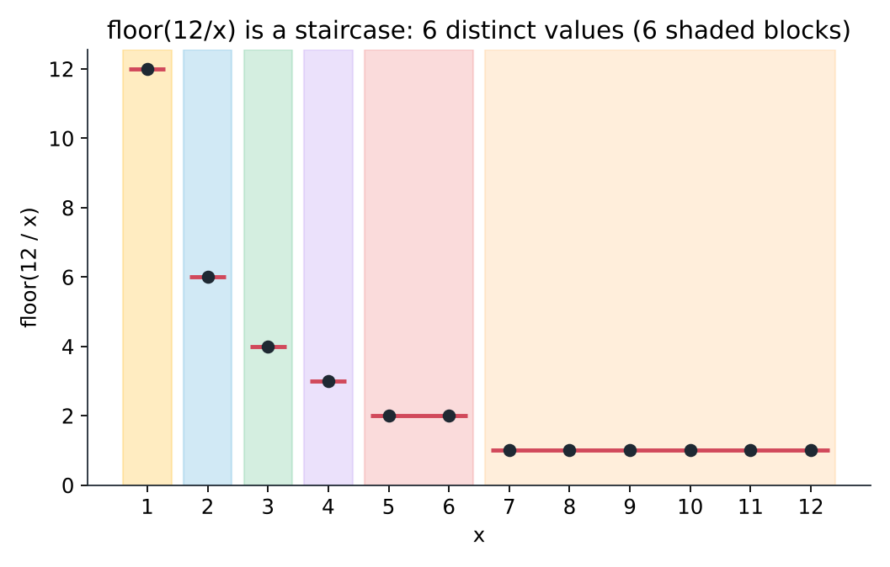
*The distinct values of floor(12/x) are 12, 6, 4, 3, 2 and 1. Each colour block has the same value.*

Harmonic Lemma: the number of distinct values that $\lfloor \frac{N}{x} \rfloor$ can take is bounded by $2\sqrt{N}$, which is $O(\sqrt{N})$.

Proof (intuition):
- If $x \le \sqrt{N}$: there are at most $\sqrt{N}$ choices of x, so at most $\sqrt{N}$ values.
- If $x > \sqrt{N}$: the value $\lfloor N/x \rfloor < \sqrt{N}$, so the values lie only in $0..\sqrt{N}$, again at most $\sqrt{N}$.

Total $\le 2\sqrt{N}$.

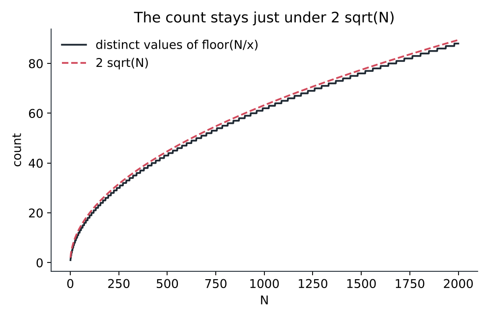
*The number of distinct values always stays just below 2 sqrt(N).*

To iterate efficiently over the distinct values of $\lfloor \frac{N}{x} \rfloor$, for any i we need to find the largest j such that $\lfloor \frac{N}{i} \rfloor = \lfloor \frac{N}{j} \rfloor$.

$j = \left\lfloor \frac{n}{\left\lfloor \frac{n}{i} \right\rfloor} \right\rfloor$

(Why: let $q = \lfloor n/i \rfloor$. The largest x for which $\lfloor n/x \rfloor \ge q$ is $\lfloor n/q \rfloor$.)

```cpp
for (int i= 1, la; i <= n ; i= la+1) {
    la= n/ (n/i) ;
    // process range i <= x <= la
}
```

The value of $\lfloor \frac{n}{i} \rfloor$ remains the same in [i, la]. The loop therefore takes $O(\sqrt{n})$ time, because it iterates over the distinct $\lfloor \frac{n}{i} \rfloor$ values, and there are $O(\sqrt{n})$ distinct values possible.

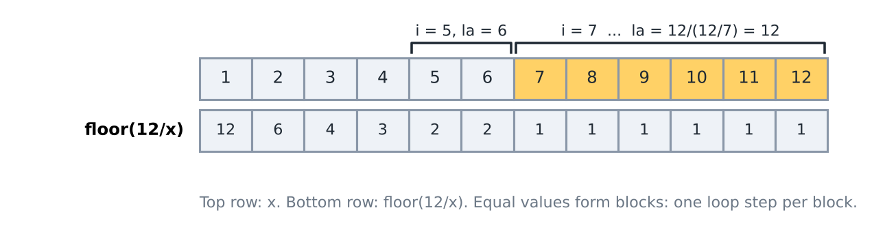
*The top row is x and the bottom row is floor(12/x). A run of equal values is one loop step.*

Dry run for n = 12: i = 1 gives la = 12/12 = 1. Next i = 2 gives la = 12/6 = 2. Then i = 3 → la = 12/4 = 3, i = 4 → la = 12/3 = 4, i = 5 → la = 12/2 = 6 (so 5 and 6 share the value 2), i = 7 → la = 12/1 = 12. That is 6 steps, one for each distinct value.

Trace of the cube sum for N = 12, block by block (value cubed times block length): 12³ · 1 = 1728, 6³ · 1 = 216, 4³ · 1 = 64, 3³ · 1 = 27, 2³ · 2 = 16, 1³ · 6 = 6. The total is 2057. Adding the 12 terms one by one gives the same: 1728 + 216 + 64 + 27 + 8 + 8 + 6 · 1 = 2057. The cost is one step per block, so about $2\sqrt{N}$ steps, and the memory is O(1).

The code of the original problem:
```cpp
ans = 0;
for (int i= 1, la; i <= n; i= la+1) {
    la= n/ (n/i);
    ans += (cube (n/i)) * (la-i+1);
}
```

Note: since $n$ is up to $10^{12}$, `i` and `la` must be `long long`. The answer is also very large (the first term alone is $10^{36}$), so take the result modulo $10^9+7$.

The same idea from the Fabricator repository, where `m` is the power (m = 3 for cubes):

```cpp
// Fabricator/Maths/HardFloor.cpp
long long bin_pow(long long base, long long exp){
    long long ans = 1;

    base = base % MOD;

    while(exp){
        if(exp & 1){
            ans = (ans * base) % MOD;
        }

        base = (base * base) % MOD;
        exp >>= 1;
    }

    return ans;
}
```

Here mpow (also called bin_pow) is fast power (binary exponentiation, which computes $a^b$ in O(log b) steps). It is explained in detail in 2.2.

```cpp
// Fabricator/Maths/HardFloor.cpp (inside solve, n and m already read)
    long long ans = 0;
    for(long long i=1, la; i<=n; i=la+1){
        long long val = n/i;
        la = n/val;

        long long calc_val = ((((la - i) + MOD) % MOD) + 1) % MOD;
        calc_val = (calc_val * bin_pow(val, m)) % MOD;
        ans = (ans + calc_val) % MOD;
    }
```

Each block adds (block length) × (value)$^m$. Sample (4, 2) → 22, ($10^{11}$, $10^8$) → 728180943 ✓. For m = 3 it matches brute force up to n = 3000. N = 12 → 6 iterations, $N = 10^{12}$ → about $2 \times 10^6$ iterations.

## Quick revision

- Prime test: it is enough to try factors up to √N → O(√N). Handle N &lt; 2 separately.
- Divisors: loop i ≤ √N, push `i` and `N/i` (only once if `i*i == N`). At most 2√N divisors.
- Prime factorisation: divide out every i ≤ √N completely; a leftover greater than 1 is a prime. For many queries, build the sp[] array with a sieve.
- Sieve: mark the multiples of each prime, starting from `i*i`. Cost O(n log log n).
- Segmented sieve: phase 1 finds the primes up to $\sqrt{b}$; phase 2 crosses out their multiples in [a,b]. Slot `x-a` stands for x, the first multiple is $\lceil a/p \rceil p$, skip p itself, and 1 is not prime. T.C: $O((b-a)\log\log b)$.
- sp[n] = smallest prime factor → $pf(n) = sp(n) \cdot pf(n/sp(n))$. Build $O(N\log\log N)$, query $O(\log n)$.
- #divisors = $\prod (1+\alpha_i)$, sum = $\prod \frac{p_i^{\alpha_i+1}-1}{p_i-1}$ (a product, not a sum).
- $\phi(n) = n \prod (1-1/p)$; $\phi(p) = p-1$; $\phi(p^k) = p^k - p^{k-1}$; multiplicative when gcd = 1. Sieve: `phi[j] -= phi[j]/p`.
- Product of divisors = $\prod p_i^{a_i \cdot \#D/2}$ = $X^{\#D/2}$.
- Power of x in N!: $f(N,p) = \sum \lfloor N/p^k \rfloor$, answer $\min_i \lfloor f(N,p_i)/a_i \rfloor$. Trailing zeros → p = 5. T.C: $O(\sqrt{x} + \log x \log N)$.
- $\frac1a + \frac1b = \frac1n$ → $(a-n)(b-n) = n^2$ → divisors of $n^2$ ($D = \prod(2\alpha_i+1)$), all integer pairs $2D - 1$.
- $\lfloor N/x \rfloor$ has at most $2\sqrt{N}$ distinct values; use `for (i=1; i<=n; i=la+1) la = n/(n/i);` with long long and a modulus.

## Practice problems

**AtCoder**

- [ABC144 C](https://atcoder.jp/contests/abc144/tasks/abc144_c)
- [ABC170 D](https://atcoder.jp/contests/abc170/tasks/abc170_d)
- [ABC177 E](https://atcoder.jp/contests/abc177/tasks/abc177_e)
- [ABC180 C](https://atcoder.jp/contests/abc180/tasks/abc180_c)
- [ABC215 D](https://atcoder.jp/contests/abc215/tasks/abc215_d)

**Codeforces**

- [Codeforces 230B](https://codeforces.com/contest/230/problem/B)

**Maang (AlgoZenith)**

- [Eulers Phi Function](https://maang.in/problems/Eulers-Phi-Function-227)
- [Hard Floor](https://maang.in/problems/Hard-Floor-235)
- [How Many Solutions](https://maang.in/problems/How-Many-Solutions-237)
- [Number of Divisors AZ101](https://maang.in/problems/Number-of-Divisors-AZ101-322)
- [Paired Cubes](https://maang.in/problems/Paired-Cubes-229)
- [Prime Check AZ101](https://maang.in/problems/Prime-Check-AZ101-323)
- [Sieve of Eratosthenes Revisited](https://maang.in/problems/Sieve-of-Eratosthenes-Revisited-234)

### Problem ladder

<Ladder topic="2.1" />
