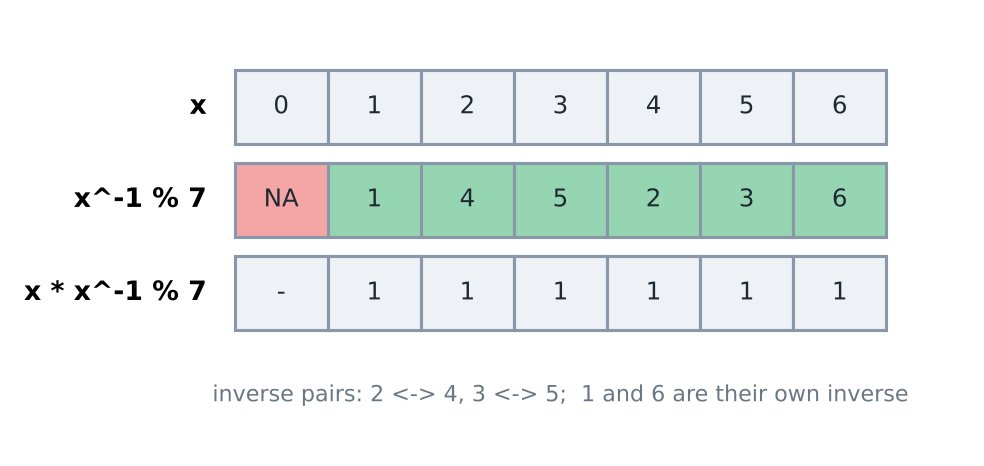

import TopicHeader from '../../../components/TopicHeader.astro';
import Ladder from '../../../components/Ladder.astro';
import TheoremCode from '../../../components/TheoremCode.astro';
import CodeSnippet from '../../../components/CodeSnippet.astro';
import WhatYouNeed from '../../../components/WhatYouNeed.astro';
import Cards from '../../../components/Cards.astro';
import Drill from '../../../components/Drill.astro';
import LookalikePairs from '../../../components/LookalikePairs.astro';
import SelfTest from '../../../components/SelfTest.astro';
import Checkpoint from '../../../components/Checkpoint.astro';
import DecisionMapUpdate from '../../../components/DecisionMapUpdate.astro';

<TopicHeader topic="2.2" />

## What this note covers

Handling huge powers and division inside a modulus. The problem: many tasks ask for a number that is far too large to store, such as $3^{1000000000}$ (about 477 million digits). The task then says "print the answer modulo $10^9+7$", meaning the remainder after dividing by $10^9+7$. All the techniques below keep every number small while we compute.

The topics are:

- Binary exponentiation (fast power: compute $a^b$ in O(log b) steps).
- Modular inverse (the number we multiply by instead of dividing, under a modulus), geometric progression (GP) sum under a modulus, and binary multiplication.
- Fermat's Little Theorem and Euler's Theorem (shrink a huge exponent), and the inverse $a^{p-2}$.

The totient ($\phi$, the count of numbers from 1 to m that are co-prime to m) was introduced in 2.1, and it is used again here. Two numbers are co-prime when their greatest common divisor (gcd) is 1, that is, they share no common factor except 1.

Two small problems show why. First: print $2^{10^{18}} \bmod (10^9+7)$. Multiplying by 2 a total of $10^{18}$ times, and reducing after each step, needs $10^{18}$ steps. At about $10^9$ multiplications per second that is $10^9$ seconds, about 30 years. But $2^{10^{18}}$ is the square of $2^{5 \cdot 10^{17}}$, which is the square of $2^{2.5 \cdot 10^{17}}$, and so on. Each squaring halves the exponent, so about 60 squarings and 60 more multiplications are enough. The answer is 719,476,260.

Second: a fair die is rolled. Print the probability that it shows a multiple of 3, "as a value modulo $998\,244\,353$". The probability is $\frac{2}{6} = \frac{1}{3}$, which is not an integer. "Modulo $998\,244\,353$" means the integer $x$ with $3x \equiv 1$, and here $x = 332\,748\,118$ (check: $3 \cdot 332\,748\,118 = 998\,244\,354 = 998\,244\,353 + 1$). Such an $x$ exists because $998\,244\,353$ is prime, and Fermat's little theorem gives a formula for it.

So this note is about three jobs: powers with huge exponents, division modulo a prime (including answers that are fractions), and exponents that are themselves too large to write down. Most counting problems after this one print their answer modulo a prime, so these tools are used in almost every later mathematics topic.

Why these two moduli: $10^9+7$ and $998\,244\,353 = 119 \cdot 2^{23} + 1$ are both prime and both below $2^{30}$. Every number that they do not divide has an inverse, and the product of two residues is below $2^{60}$, so it fits in `long long`.

### What you need

<WhatYouNeed topic="2.2" />

### What this note does not cover

- Factorials, binomial coefficients, stars and bars and inclusion-exclusion. They come in topic 2.3, which uses the inverses from this note.
- Expected values. They come in topic 2.4, whose answers are fractions printed as in the fractions section below.
- The Chinese remainder theorem, discrete logarithms, and fast multiplication of polynomials modulo $998\,244\,353$. They are not part of this course.

### Terms used in this lesson

- **Binary exponentiation** computes $a^b \bmod m$ by squaring. It reads the bits of $b$ and needs $O(\log b)$ multiplications.
- A **modular inverse** of $a$ modulo $m$ is an integer $x$ with $ax \equiv 1 \pmod m$, written $a^{-1}$. Example: $3^{-1} \bmod 7 = 5$, because $3 \cdot 5 = 15 = 2 \cdot 7 + 1$.
- **Fermat's little theorem**: if $p$ is prime and $p$ does not divide $a$, then $a^{p-1} \equiv 1 \pmod p$.
- **Division modulo $p$**: for a prime $p$ and $p \nmid a$, $\frac{b}{a} \bmod p$ means $b \cdot a^{-1} \bmod p$.
- A rational answer $\frac{P}{Q}$ **printed modulo $p$** is the number $P \cdot Q^{-1} \bmod p$. Example: $\frac13 \bmod 998\,244\,353 = 332\,748\,118$.

## Table of contents

- Binary exponentiation → fast power
- Modulo arithmetic with division → modular inverse, GP sum, binary multiplication
- Fermat's Little Theorem → $a^{p-1} \equiv 1$, reducing the exponent
- Euler's Theorem (general version) → reducing the exponent using the totient
- Recognition cards → the three cards of this topic
- Check yourself → drill, look-alike pairs, self-test, checkpoint, decision map

## Binary exponentiation

binpow = binary exponentiation. The idea is to write b in binary. For every bit, square the base. If the bit is 1, multiply the result by the current base. The time complexity (T.C.) is O(log b). For example, for $3^5$ we write 5 = 101 in binary, so $3^5 = 3^4 \cdot 3^1$.

Why it is needed: the plain loop multiplies b times. For b = $10^9$ that is $10^9$ multiplications, about 10 seconds at $10^8$ per second. Binary exponentiation needs only about 30 steps, because $2^{30}$ is just over $10^9$ and b loses one bit per step.

Why it works: every number is a sum of powers of two, and $a^{x+y} = a^x \cdot a^y$. So $3^5 = 3^{4+1} = 3^4 \cdot 3^1$. The values $3^1, 3^2, 3^4, 3^8, \dots$ come from repeated squaring, and we multiply into the result only those whose bit is 1.

Dry run for $3^5$ (no modulus yet), reading the bits of 5 from the lowest:

| pow (binary) | lowest bit | res | base after squaring |
|---|---|---|---|
| 101 | 1 | 1 · 3 = 3 | 3² = 9 |
| 10 | 0 | 3 | 9² = 81 |
| 1 | 1 | 3 · 81 = 243 | 81² = 6561 |

The final res is 243 = $3^5$. Three steps were enough for exponent 5.

```cpp
// Fabricator/Maths/Exponentiation.cpp
long long bin_exp(long long base, long long pow, long long mod){
    if(base == 1 || pow == 0) return 1;

    long long res = 1;
    while(pow){
        if(pow & 1){
            res = (res * base) % mod;
        }

        base = (base * base) % mod;
        pow >>= 1;
    }

    return res;
}
```

```cpp
// Fabricator/Maths/Modulo.cpp
long long mpow(long long base, long long exp) {
    base %= MOD;
    long long result = 1;
    while (exp > 0) {
        if (exp % 2 == 1) result = (result * base) % MOD;
        base = (base * base) % MOD;
        exp /= 2;
    }
    return result;
}
```

(In mpow the modulus is fixed: MOD = $10^9+7$.)

Common mistakes:

- Taking the remainder only at the end. The intermediate numbers then grow without limit and overflow.
- Using `int`. With a modulus near $10^9$, the product of two remainders is near $10^{18}$. This fits in `long long` (maximum about $9.2 \cdot 10^{18}$) but not in `int` (maximum about $2.1 \cdot 10^9$).
- Forgetting `base %= mod` before the loop when the input base can be larger than the modulus.

Cost: the loop runs once per bit of the exponent, so about $\log_2 b$ times (30 for $10^9$, 60 for $10^{18}$). Each run does at most two multiplications. Memory is O(1).

**Theorem 2.2.1 (binary exponentiation).** Let $m \ge 1$, $a \ge 0$, $b \ge 0$. Start with $r = 1 \bmod m$ and $x = a \bmod m$. While $b > 0$: multiply $r$ by $x$ if $b$ is odd, square $x$, halve $b$. Then $r = a^b \bmod m$, after at most $\lfloor \log_2 b \rfloor + 1$ rounds with at most two multiplications each.

Small example first: the dry run of $3^5$ above. The bits of 5 are 1, 0, 1, so there are three rounds, and $r = 3 \cdot 81 = 243$.

Why it works:
1. Invariant: at the start of every round, $r \cdot x^{e} \equiv a^b \pmod m$, where $e$ is the current exponent. At the start $r = 1$, $x \equiv a$ and $e = b$, so it holds.
2. If $e$ is odd, $r \cdot x^e = (r \cdot x) \cdot (x^2)^{(e-1)/2}$. If $e$ is even, $r \cdot x^e = r \cdot (x^2)^{e/2}$.
3. In both cases the new $r$, $x$ and $e$ satisfy the invariant again. Reducing modulo $m$ after each product keeps the congruence (topic 0.4).
4. When $e = 0$ the invariant says $r \equiv a^b$.
5. Each round halves $e$ (rounded down), so $e$ reaches 0 after as many rounds as $b$ has bits, $\lfloor \log_2 b \rfloor + 1$.

This proof needs: (1) both factors of a product are below $m$ and the product fits in `long long`; for $m$ up to about $4.6 \cdot 10^{18}$ use the add-and-double product of "Binary multiplication" below. (2) The base is reduced first, because $a$ may be large or negative. (3) $a^0 = 1$ even for $a = 0$, and for $m = 1$ every answer is 0, which `1 % m` gives.

<TheoremCode unit="2.2/thm-1" />

The second line is the example from the start of this note. The third line shows the two edge cases of the needs list. The invariant is steps 1 to 3 of the proof.

Common mistake: starting the result at 1 instead of $1 \bmod m$. Take $a = 4$, $b = 0$, $m = 1$. The loop never runs, so the program prints 1. But every residue modulo 1 is 0, so the answer is 0. Fix: start at `1 % m`. (His `bin_exp` above returns 1 early when `pow == 0`, which has the same effect for $m = 1$; it matters only for that modulus.)

Common mistake: squaring before using the bit. Swap the two lines of the loop body, and take $a = 4$, $b = 1$, $m = 7$. The program squares first, then multiplies $r$ by $4^2 = 16 \equiv 2$. It prints 2, but the answer is 4. Bit $k$ of $b$ must be paired with $a^{2^k}$, and the swap pairs it with $a^{2^{k+1}}$. Fix: use `base` for the current bit first, then square it for the next bit.

A recursive form gives the same products from the top bit down: $a^b = (a^{\lfloor b/2 \rfloor})^2 \cdot a^{b \bmod 2}$. Here is the loop form again as a tested unit that multiplies in 128 bits, so it is safe when $m > 3 \cdot 10^9$.

<CodeSnippet unit="2.2/pow-mod" />

The loop keeps `x` equal to $a^{2^k}$ for the current bit $k$ and collects the powers whose bit is 1. Cost: one pass per bit, so $O(\log b)$.

### Example: Sum of gcd of Tuples (Hard)

[AtCoder ABC 162 E](https://atcoder.jp/contests/abc162/tasks/abc162_e). In short: over all $K^N$ sequences of length $N$ with entries from 1 to $K$ ($N, K \le 10^5$), add up the gcd of each sequence, modulo $10^9+7$.

Idea, in the recognition steps:

- Budget: $K^N$ sequences cannot be listed. With $N, K \le 10^5$ we can afford about $K \log K \approx 1.7 \cdot 10^6$ steps plus $K$ fast powers of about 17 rounds each.
- Tools: group the sequences by their gcd $d$. The answer is $\sum_d d \cdot f(d)$, where $f(d)$ counts the sequences with gcd exactly $d$. "Exactly $d$" is hard. "Every entry is a multiple of $d$" is easy: each entry has $\lfloor K/d \rfloor$ choices, so there are $\lfloor K/d \rfloor^N$ such sequences. That needs the multiples loop of topic 2.1 and a fast power.
- Deciding property: the gcd is at most $K \le 10^5$, so it fits in an array, and the count $\lfloor K/d \rfloor^N$ is a power modulo $10^9+7$.

Why it works: let $F(d)$ be the number of sequences whose entries are all multiples of $d$. That happens exactly when $d$ divides the gcd, so $F(d) = \sum_{k \ge 1} f(kd)$. Then $f(d) = F(d) - \sum_{k \ge 2} f(kd)$, computed with $d$ going from $K$ down to 1. Every sequence has exactly one gcd, so $\sum_d d \cdot f(d)$ is the requested sum.

Trace for $N = 3$, $K = 2$ (8 sequences). $d = 2$: $f(2) = 1^3 = 1$ (only 2, 2, 2), so we add $2 \cdot 1 = 2$. $d = 1$: $f(1) = 2^3 - f(2) = 7$, so we add $7$. The total is 9. Direct check: seven sequences have gcd 1 and one has gcd 2, so $7 + 2 = 9$.

<CodeSnippet unit="2.2/example-1" />

Cost: $O(K \log K)$ for the subtractions (the sum of $K/d$ over all $d$), plus $K$ fast powers of $O(\log N)$ each. Memory is $O(K)$. Common mistake: skipping the subtraction, that is, adding $d \cdot F(d)$ directly. For $N = 3$, $K = 2$ this gives $1 \cdot 8 + 2 \cdot 1 = 10$, not 9, because each sequence is counted once for every divisor of its gcd. If $K$ were up to $10^{12}$, one would group the values $d$ that share the same $\lfloor K/d \rfloor$; here the direct loop is simpler.

## Modulo arithmetic with division

Why division needs a new idea: addition, subtraction and multiplication work directly under a modulus, because we may take the remainder after each operation. Division does not. For example, (6 / 3) % 7 = 2 is fine, but for (5 / 3) % 7 the ordinary quotient 1.666... is not an integer, and cutting it down would give a wrong answer. We need a number that behaves like "one third" inside the modulus.

The notebook's own example shows the failure. Take $a = 2$, $b = 4$, $c = 4$, $M = 11$. The true value of $\frac{2^4}{4}$ is 4, and 4 % 11 = 4. If the remainder is taken inside the division, then $2^4$ % 11 = 16 % 11 = 5, and $\frac{5}{4}$ is not an integer, so the result is wrong. With the inverse of 4 modulo 11, which is 3 (because 4 · 3 = 12 and 12 % 11 = 1), the result is correct: 16 · 3 = 48 and 48 % 11 = 4.

### Modular inverse

The derivation starts from a division that is easy to see: 3 divided by 3 is 1. Write the division as a multiplication by $\frac{1}{3}$, call this unknown value x, and ask which integer x works under modulus 7:

$\left(\frac{3}{3}\right)$ % 7 = 1

$\left(3 \times \left(\frac{1}{3}\right)\right)$ % 7 = 1

Here x stands for $\frac{1}{3}$, so the equation becomes:

(3 x x) % 7 = 1

What integer value of x will satisfy the equation? Try x = 5:

(3 x 5) % 7 = 15 % 7 = 1

So (3 x 5) % 7 = 1, although 5 ≠ $\frac{1}{3}$ as numbers. Therefore we can use 5 to multiply whenever we need to divide by 3.

$\left(\frac{6}{3}\right)$ % 7 = 2.

(6 x 5) % 7 = 2.        **\*5 is modulo inverse of 3**

**\*** These modular inverses can be used in place whenever we have to divide.

Doing the same search for every number from 1 to 6 gives the full table of inverses modulo 7. The figure below shows it: the top row is x and the second row is the inverse of x modulo 7 (NA means that no inverse exists).

(For each number k, its inverse x is the value with k·x % 7 ≡ 1. For k = 1 the inverse is 1, for 2 it is 4, for 3 it is 5, for 4 it is 2, for 5 it is 3, and for 6 it is 6.)



*For every x, x * x^-1 % 7 = 1. The number 0 has no inverse.*

**\*** Modulo inverses are only possible for prime moduli.

**\*** Inverses are unique for every number and prime modulus.

Note: the exact condition is gcd(a, m) = 1 (gcd = greatest common divisor). If m is prime, every non-zero number has an inverse. If m = 10, then 4 has no inverse, because 4 and 10 share the common factor 2.

Why: a remainder of 1 modulo 10 means the number is 1 + 10k for some k, which is always odd. But 4·x is always even, so it can never leave remainder 1 when divided by 10.

With inverses, the division problem is solved:

$\left(\frac{a^b}{c}\right)$ % m = ($a^b \times c^{-1}$) % m

= [binpow (a,b,m) * inv (c,m)] % m

**Theorem 2.2.3 (modular inverse).** Let $m \ge 2$.
1. $a$ has an inverse modulo $m$ exactly when $\gcd(a, m) = 1$, and then the inverse is unique modulo $m$.
2. If $\gcd(a, m) = 1$ and the extended Euclidean algorithm (topic 2.1) gives $ax + my = 1$, then $x \bmod m$ is the inverse. This works for every modulus $m$.
3. If $m = p$ is prime and $p \nmid a$, the inverse is $a^{p-2} \bmod p$.
4. If $a$ and $b$ have inverses, then $(ab)^{-1} \equiv a^{-1} b^{-1} \pmod m$.

Small example first: $3^{-1} \bmod 7 = 3^5 \bmod 7 = 243 \bmod 7 = 5$. Modulo 10, which is not prime, $3 \cdot 7 = 21 \equiv 1$, so $3^{-1} = 7$. But 4 has no inverse modulo 10, because $\gcd(4, 10) = 2$.

Why it works:
1. Part 1. $ax \equiv 1 \pmod m$ means $ax + my = 1$ for some integer $y$. By Bezout's identity (topic 2.1) such $x$ and $y$ exist exactly when $\gcd(a, m)$ divides 1, that is, when it equals 1.
2. Uniqueness. If $x$ and $x'$ are both inverses, then $x' \equiv x'(ax) = (x'a)x \equiv x \pmod m$.
3. Part 2. Reduce $ax + my = 1$ modulo $m$. The $my$ term disappears, so $ax \equiv 1$.
4. Part 3. By Fermat's little theorem (proved below), $a \cdot a^{p-2} = a^{p-1} \equiv 1$.
5. Part 4. $(ab)(a^{-1}b^{-1}) = (aa^{-1})(bb^{-1}) \equiv 1$, and the inverse is unique.

This proof needs: (1) $\gcd(a, m) = 1$. Modulo a prime this means $p \nmid a$. If the value can be a multiple of $p$ (for example 0), there is no inverse, and the formula $a^{p-2}$ silently returns 0. (2) Part 3 needs a prime modulus; part 2 works for every modulus. (3) The extended Euclidean algorithm may return a negative $x$, so normalise it with `((x % m) + m) % m`.

<TheoremCode unit="2.2/thm-3" />

The first line shows parts 2 and 3 agree. The second line shows part 1: modulo 10 the number 3 has an inverse and 4 has none (the code prints -1).

Common mistake: printing the raw coefficient. For $a = 7$, $m = 8$ the extended Euclidean algorithm gives $7 \cdot (-1) + 8 \cdot 1 = 1$, so $x = -1$, and `-1 % 8` is $-1$ in C++. The program prints -1, but the inverse is 7. Worse, -1 is also the code for "no inverse". Fix: `((x % m) + m) % m`.

An inverse for any modulus, with the check on the gcd:

<CodeSnippet unit="2.2/inverse" />

`ext` returns $g = \gcd$ and the coefficients. If $g \ne 1$ there is no inverse and the function returns -1. For a prime modulus, `power(a, p - 2, p)` gives the same inverse, but it returns 0 instead of reporting failure when $p \mid a$. Common mistake: ignoring $g$. For $a = 0$, $m = 5$ the gcd is 5, so there is no inverse, but a program that skips the check prints the coefficient 0, and $0 \cdot 0 \not\equiv 1$. Cost: $O(\log m)$.

### Finding inverses

Searching x by trying all values takes O(m) time, which is too slow for m near $10^9$. Fermat's Little Theorem gives a formula instead.

Fermat's Little Theorem (proved in the Fermat section below) says:

$a^{p-1}$ % p = 1, where p is a prime.

Multiplying a by $a^{p-2}$ gives $a \cdot a^{p-2} = a^{p-1}$, so a x $a^{p-2}$ % p = 1. This means $a^{p-2}$ plays the role of $a^{-1}$:

$a^{-1}$ = $a^{p-2}$ % p. This is the inverse.

Two worked examples of this formula for p = 7 (the inverse of 3 and the inverse of 2):

- The inverse of 3 is $3^{-1}$ % 7 = $3^{7-2}$ % 7 = $3^5$ % 7 = 243 % 7 = 5.
- The inverse of 2 is $2^{-1}$ % 7 = $2^{7-2}$ % 7 = $2^5$ % 7 = 32 % 7 = 4.

Both answers agree with the table above (the inverse of 3 is 5, the inverse of 2 is 4).

(If a is a multiple of p, the theorem does not apply. In that case no inverse exists at all, because a % p = 0 and 0 times anything is 0, never 1.)

```cpp
// Fabricator/Maths/Modulo.cpp
int inv(int num){
    return mpow(num, MOD - 2);
}
```

Checked: inv(3) = 333333336 and 3 * 333333336 % (10^9+7) = 1.

Cost: one fast power with exponent $m-2$, so about 30 loop steps for $m = 10^9+7$ (instead of up to $10^9$ steps for a search). Memory is O(1).

(The rule about printing a non-negative remainder was seen in 0.4, and it is used again here.)

A full problem that uses every rule so far.

Question: $\left(A + \frac{(B-C)^D}{E} - F * G\right)$ % $(10^9+7)$

$1 \le A, B, C, D, E, F, G \le 10^9$

Write $(B-C)^D$ = x^D, where x is taken as follows.

x ← $[[(B-C)$ % $(10^9+7)] + (10^9+7)]$ % $(10^9+7)$

The power is $x^D$ = binpow (x, D, $10^9+7$).

The inverse of E is $E^{-1}$ = binpow (E, $10^9+7-2$, $10^9+7$).

The product is F*G = [(F % $(10^9+7)$) * (G % $(10^9+7)$)] % $10^9+7$.

Let m = $10^9+7$. The full expression is:

```
[[[A + (binpow (x, D, m) * binpow (E, m-2, m))] % m

      - [(F % m) * (G % m)] % m] + m] % m.
```

Why the extra "+ m": B - C can be negative, and in C++ the remainder of a negative number is negative or zero. Adding m before the last remainder moves the result into the range 0 to m-1.

Trace on the sample 5 3 10 3 2 4 6 (A = 5, B = 3, C = 10, D = 3, E = 2, F = 4, G = 6). Here B - C = -7, so x = (-7 + m) % m = 1000000000. Then $x^3$ is -343 modulo m, $E^{-1}$ = inv(2) = 500000004, and F·G = 24. The answer is 5 + (-343) · 500000004 - 24 modulo m, which is 499999813. Check: doubling the answer gives 999999626 = m - 381, and 2 · (5 - 24) + (-343) = -381.

Our solve() function is:

```cpp
// Fabricator/Maths/Modulo.cpp
void solve() {
    int a, b, c, d, e, f, g;
    cin>>a>>b>>c>>d>>e>>f>>g;

    int num = (b-c) % MOD;
    num = mpow(num, d);
    int den = inv(e);
    num = (num * den) % MOD;
    int f_times_g = (f * g) % MOD;
    num = (num - f_times_g) % MOD;
    num = (a + num) % MOD;

    cout<<(num % MOD + MOD) % MOD<<endl;
}
```

Note: the logic is correct, but `int` is used, so `num * den` and `f * g` (about $10^{18}$) overflow. On the sample 5 3 10 3 2 4 6 this gives 298690449, while the correct answer is 499999813 (checked). It must be changed to `long long`.

The same solution as a corrected function. First a general inverse for any prime modulus (the `inv` above is fixed to $10^9+7$), then the whole expression, using `bin_exp` from the binary exponentiation section:

```cpp
// New function (not from the Fabricator repo): a modular inverse for any prime modulus m.
/*
  Problem: inverse of c modulo a PRIME m (c must not be a multiple of m).
  Fermat's little theorem: c^(m-2) % m. Uses bin_exp from above.
*/
long long invMod(long long c, long long m) {
    return bin_exp(c % m, m - 2, m);
}

// New function (not from the Fabricator repo): the corrected, long long version of solve() above.
/*
  Problem: (A + (B-C)^D / E - F*G) % (1e9+7), 1 <= A..G <= 1e9. Division means multiply by the inverse.
*/
long long expressionMod(long long A, long long B, long long C, long long D,
                        long long E, long long F, long long G) {
    const long long m = 1000000007LL;
    long long x = (((B - C) % m) + m) % m;                  // B-C may be negative
    long long term = bin_exp(x, D, m) * invMod(E, m) % m;   // (B-C)^D * E^-1
    long long fg = (F % m) * (G % m) % m;
    long long ans = (A % m + term - fg) % m;                // may be negative here
    return ((ans % m) + m) % m;                             // printing rule
}
```

Compiled and run: the inverses of 1 to 6 modulo 7 come out as 1 4 5 2 3 6, the same as the table above. For the first example of this section, `bin_exp(2, 4, 11) * invMod(4, 11) % 11` is 4. For the sample 5 3 10 3 2 4 6, `expressionMod` returns 499999813, the same as the trace and as an independent 128-bit calculation. On 2000 random inputs it matched that calculation every time, and 1000 random values v satisfied $v \cdot v^{-1} \% (10^9+7) = 1$.

Cost: two fast powers and a few multiplications, so O(log D + log m) time (about 60 steps) and O(1) memory. Common mistake: calling `invMod` with a multiple of m. There is no inverse then, and the function silently returns 0.

**Theorem 2.2.6 (inverses of 1 to n).** Let $p$ be prime and $n < p$. Set $\text{inv}[1] = 1$ and, for $2 \le i \le n$,

$$\text{inv}[i] = -\lfloor p/i \rfloor \cdot \text{inv}[p \bmod i] \bmod p.$$

Then $\text{inv}[i] = i^{-1} \bmod p$ for every $i \le n$, and all of them take $O(n)$ time in total. This matters when many inverses are needed: $n$ separate fast powers cost $n \log p$.

Small example first, $p = 7$. $\text{inv}[2] = -3 \cdot 1 \equiv 4$. $\text{inv}[3] = -2 \cdot 1 \equiv 5$. $\text{inv}[4] = -1 \cdot \text{inv}[3] \equiv 2$. $\text{inv}[5] = -1 \cdot \text{inv}[2] \equiv 3$. $\text{inv}[6] = -1 \cdot 1 \equiv 6$. Check: $4 \cdot 2 = 8 \equiv 1$ and $5 \cdot 3 = 15 \equiv 1$.

Why it works (induction on $i$):
1. Write $p = qi + r$ with $q = \lfloor p/i \rfloor$ and $r = p \bmod i$.
2. Then $1 \le r < i$. The remainder $r$ is not 0, because the prime $p$ has no divisor $i$ with $1 < i < p$. So $\text{inv}[r]$ is already correct.
3. Reducing $p = qi + r$ modulo $p$ gives $qi + r \equiv 0$.
4. Multiply by $i^{-1} r^{-1}$: $q r^{-1} + i^{-1} \equiv 0$, so $i^{-1} \equiv -q \cdot r^{-1}$.

This proof needs: (1) $p$ is prime and $n < p$. (2) In C++ the product `-(p / i) * inv[p % i] % p` is negative or zero, so add $p$ to make it non-negative.

<TheoremCode unit="2.2/thm-6" />

The output is the table of inverses modulo 7 from the figure above, 1 4 5 2 3 6.

Common mistake: dropping the minus sign. For $p = 5$ and $n = 3$ the program computes $\text{inv}[2] = 2 \cdot 1 = 2$, but $2 \cdot 2 = 4 \not\equiv 1 \pmod 5$; the inverse is 3. The test prints 2 0 instead of 2 1. Fix: $i^{-1} \equiv -\lfloor p/i \rfloor \cdot (p \bmod i)^{-1}$.

<CodeSnippet unit="2.2/inverse-table" />

Cost: one pass, $O(n)$ time and memory. Another way: compute the prefix products $1 \cdot 2 \cdots i$, invert only the last one with Fermat, and walk back with $i^{-1} = (\text{product up to } i-1) \cdot (\text{product up to } i)^{-1}$. It is also $O(n)$ and works for any $n$ numbers, not only $1, \dots, n$.

### Fractions modulo a prime

The die problem from the start of this note is a fraction printed modulo a prime. This section says why that is allowed.

**Theorem 2.2.4 (fractions modulo a prime).** Let $p$ be prime. For integers $P, Q$ with $p \nmid Q$ define $f(P/Q) = P \cdot Q^{-1} \bmod p$. Then:
1. $f$ does not depend on how the fraction is written: if $P/Q = P'/Q'$ (both denominators not divisible by $p$), the two values agree.
2. $f$ respects the four operations: $f(u+v) = f(u) + f(v)$, $f(u-v) = f(u) - f(v)$, $f(uv) = f(u)f(v)$ and $f(u/v) = f(u) f(v)^{-1}$ when $f(v) \ne 0$, all modulo $p$.

So a whole computation with fractions can be done modulo $p$, with every division replaced by a multiplication by an inverse. The result is the residue of the exact answer.

Small example first, modulo 7: $\frac12 + \frac13 = \frac56$. Modulo 7, $\frac12 \equiv 4$ and $\frac13 \equiv 5$, so the sum is $9 \equiv 2$. Directly, $5 \cdot 6^{-1} \equiv 5 \cdot 6 = 30 \equiv 2$. Both give 2.

Why it works:
1. Part 1. $P/Q = P'/Q'$ means $PQ' = P'Q$.
2. Multiply both sides by $Q^{-1} Q'^{-1}$ modulo $p$. This gives $P Q^{-1} \equiv P' Q'^{-1}$.
3. Part 2. For $u = P/Q$ and $v = R/S$ we have $u + v = (PS + RQ)/(QS)$, and $p \nmid QS$ because $p$ is prime and divides neither $Q$ nor $S$.
4. Its value is $(PS + RQ)(QS)^{-1} \equiv (PS + RQ) Q^{-1} S^{-1} = PQ^{-1} + RS^{-1}$, using part 4 of Theorem 2.2.3.
5. The other three operations are the same calculation.

This proof needs: (1) every denominator that appears, including the intermediate ones, is not divisible by $p$. Check it for your own steps, not only for the final answer. (2) The residue does not show the fraction or which of two fractions is larger. If the problem needs a comparison, compare exact values before reducing.

<TheoremCode unit="2.2/thm-4" />

The last line is the die answer: $\frac13 \bmod 998\,244\,353 = 332\,748\,118$.

A sum of fractions as a function:

<CodeSnippet unit="2.2/fraction-sum" />

Each fraction $P/Q$ becomes $P \cdot Q^{-1}$ and the residues are added, so the exact sum is never formed. Cost: one fast power per fraction, $O(n \log p)$. Another way: keep the sum as one fraction, $\frac{R}{S} + \frac{P}{Q} = \frac{RQ + PS}{SQ}$, and invert once at the end. That needs one inverse instead of $n$.

Common mistake: comparing residues. Modulo 7, $\frac12 \equiv 4$ and $\frac13 \equiv 5$, but $\frac12 > \frac13$. The residue 4 being smaller than 5 says nothing about the fractions.

### GP sum under mod

A geometric progression (GP) is a list of terms where each term is the previous one times x. The next problem asks for the sum of such a list, modulo m.

Question: F(x, m, n) = $(1 + x^1 + x^2 + x^3 + .... + x^n)$ % m, in two cases: i) m is prime, ii) m is composite.

The sum is a GP, so we can use the GP sum formula $\frac{x^{n+1}-1}{x-1}$.

$1 \le x, n, m \le 10^9$

Why a formula is needed: adding n terms one by one takes up to $10^9$ steps, which is too slow. The formula needs only one fast power and one inverse.

$1 + x + x^2 + ..... + x^n = \frac{(x^{n+1}-1)}{x-1}$

In code the sum is [($x^{n+1}$ - 1) * inv ((x-1), m)] % m, where $x^{n+1}$ comes from binpow.

If x == 1, then f(n) = (n+1) % m, because the GP sum formula fails there (it would divide by x-1 = 0).

Note: the formula also fails if x - 1 is a multiple of m, because then x - 1 has no inverse. So the check must be `x % m == 1`.

This formula works for m prime.

Dry run for the formula: x = 3, n = 4, m = 7. The real sum is 1 + 3 + 9 + 27 + 81 = 121, and 121 % 7 = 2. By the formula: $3^5$ % 7 = 243 % 7 = 5, so the top is 5 - 1 = 4, and inv(2) = 4 (because 2 · 4 = 8 and 8 % 7 = 1). Then 4 · 4 = 16 and 16 % 7 = 2. Both ways give 2.

Why m must be prime: x - 1 needs an inverse, and for a composite m it may not have one. For example, x = 3, n = 3, m = 4: x - 1 = 2 shares the factor 2 with 4, so it has no inverse, yet the sum 1 + 3 + 9 + 27 = 40 is a normal number (40 % 4 = 0). The divide and conquer idea below never divides.

When m is not prime, the inverse of (x-1) may not exist, so we use divide and conquer.

The idea is to split the terms into two equal halves, where the second half is the first half times a power of x. Case 1 is n odd, so the number of terms n+1 is even and the split is exact. Example with n = 5 (six terms):

f(x,n) = $1 + x + x^2 + x^3 + x^4 + x^5$       n % 2 == 1

= $(1 + x + x^2) + x^3 (1 + x + x^2)$

= $(1 + x^3)(1 + x + x^2)$

= $(1 + x^3)$ * f (x, n/2)

Case 2 is n even, so the number of terms is odd. One term is taken out first, and what is left is a case 1 problem. Example with n = 4 (five terms):

Here the number of terms is odd:

f(x, n) = $1 + x + x^2 + x^3 + x^4$       n % 2 == 0.

= $1 + x (1 + x + x^2 + x^3)$

= $1 + x (f(x, n-1))$

Dry run: x = 2, n = 5 gives 6 terms (1+2+4+8+16+32 = 63). Since n is odd, the sum is $(1 + 2^3) \cdot f(2, 2)$ = 9 × 7 = 63 ✓.

Note: n odd means the number of terms (n+1) is even, so we can split them into two equal halves. n even means the number of terms is odd, so we take one term out first.

Cost: an even n becomes an odd n-1, and an odd n is then halved, so the number of levels is at most about $2 \log_2 n$ (about 60 for $n = 10^9$). Each level runs binpow in O(log n), so the time complexity (T.C.) is O(log² n), roughly 1800 multiplications for $n = 10^9$. The recursion depth is also O(log n), so memory is O(log n).

Our code:

```cpp
// Fabricator/Maths/Modulo.cpp
bool is_prime(int n){
    for(int i=2; i*i<=n; i++){
        if(n % i) return true;
    }

    return false;
}

int f(int x, int n, int m){
    if(x == 1){
        return (n + 1) % MOD;
    }

    if(!is_prime(m)){
        return f2(x, n, m);
    }

    int num = mpow(x, n+1) - 1;
    int den = inv(x-1);
    num = (num * den) % MOD;

    return num;
}

int f2(int x, int n, int m){
    if(n & 1){
        int pow = (n + 1)/2;
        int temp = 1 + mpow(x, pow);
        return (temp * f2(x, n/2, m)) % m;
    }
    else{
        return (1 + x * f2(x, n-1, m)) % m;
    }
}
```

Note: is_prime is wrong. It returns true as soon as `n % i` is non-zero, so it reports 9 and 15 as prime, and 2 as not prime (checked). f2 has no base case for n == 0, so the recursion never stops, and f2(2, 5, 1000) gives a segmentation fault (checked). Also, f uses f2 before f2 is declared, and it uses the fixed mpow/MOD instead of m. Finally, the int products overflow: f(123456789, 3, MOD) = -903367421, while the correct value is 117531387. The idea is correct, and only these fixes are needed. Working version:

```cpp
/*
  Problem: F(x, n, m) = (1 + x + x^2 + ... + x^n) % m, 1 <= x, n, m <= 1e9
  (a) m prime -> formula with inverse. Uses bin_exp from above.
*/
long long gpPrime(long long x, long long n, long long m) {
    if (x % m == 1 % m) return (n + 1) % m;
    long long top = (bin_exp(x % m, n + 1, m) - 1 + m) % m;
    long long inverse = bin_exp((x - 1) % m, m - 2, m);
    return top * inverse % m;
}

/*
  (b) any m -> halve the terms
*/
long long gpAny(long long x, long long n, long long m) {
    if (n == 0) return 1 % m;
    if (n % 2 == 1) {
        long long half = (n + 1) / 2;
        return (1 + bin_exp(x % m, half, m)) % m * gpAny(x, half - 1, m) % m;
    }
    return (1 + x % m * gpAny(x, n - 1, m)) % m;
}
```

Checked: 20000 random cases each (any m up to 200, primes up to 101) against a plain loop, no mismatch. gpAny(2, 5, 1000) = 63, gpPrime(3, 4, 7) = 2, and gpAny(3, 3, 4) = 0, which matches the examples above.

### Binary multiplication

Question: given A, B and M, all at most $10^{18}$, calculate (A.B) % M.

The formula Ans = ((A % M) * (B % M)) % M is mathematically correct, but it might overflow for M near $10^{18}$.

Why it overflows: after the remainders, both factors can be near $10^{18}$, so the product is near $10^{36}$. A `long long` holds only about $9.2 \cdot 10^{18}$.

We use binary multiplication, which works like binary exponentiation.

Why it works: B is a sum of powers of two, so A·B is the sum of A·$2^k$ for every bit k of B that is 1, and A·$2^k$ comes from doubling A k times. The idea: exponentiation uses "result × base" and "base²". Here the operations are "result + a" and "a + a" (doubling). Everything stays below M ≤ $10^{18}$, so a + a ≤ $2 \times 10^{18}$ fits in `long long`. The time complexity (T.C.) is O(log B).

Tiny example: 6 × 5 with M = 7. Write 5 = 101 (binary). Bit 1: res = 0 + 6 = 6, a = 12 % 7 = 5. Bit 0: res stays 6, a = 10 % 7 = 3. Bit 1: res = 6 + 3 = 9 % 7 = 2. The answer 2 equals 30 % 7 = 2.

```cpp
// Fabricator/Maths/BinaryMultiplication.cpp
long long bin_mul(long long a, long long b, long long mod){
    long long res = 0;
    a %= mod;
    while(b){
        if(b & 1) res = (res + a) % mod;

        a = (a + a) % mod;
        b >>= 1;
    }

    return res;
}
```

Checked: 100000 random triples up to $10^{18}$ against 128-bit arithmetic, no mismatch. bin_mul(999999999999999999, 999999999999999989, 1000000000000000000) = 11. (GCC also has the type __int128, so (__int128)a * b % m works too.)

Cost: the loop runs once per bit of B, so at most about 60 times for $B \le 10^{18}$, with one or two additions per run. Memory is O(1). Edge case: a + a must fit in `long long`, so this code is safe only while M is at most about $4.6 \cdot 10^{18}$ (half of the largest `long long`).

## Fermat's Little Theorem

The theorem in short: for a prime p, powers of a repeat with a period that divides p-1. In symbols:

$a^p \equiv a \mod p$, where p is a prime.

$a^{p-1} \equiv 1 \mod p$

[$a^{p-1} \% p == 1$]

(mod = remainder after dividing. The second form holds when p does not divide a. If a = p, the remainder is 0.)

Small check with p = 7: $2^6 = 64 = 63 + 1$, so $2^6$ % 7 = 1. Also $3^6 = 729 = 7 \cdot 104 + 1$, so $3^6$ % 7 = 1.

Why it holds: take p = 7 and a = 3. Multiply each of 1, 2, ..., 6 by 3 and take the remainder modulo 7. The results are 3, 6, 2, 5, 1, 4, which are the same six numbers in a different order (two different numbers can never give the same remainder, because 3 has an inverse). So the two products are equal: $3^6 \cdot 6! \equiv 6!$ modulo 7. Since 6! has no factor 7, it can be cancelled, which leaves $3^6 \equiv 1$. The same argument works for any prime p and any a that p does not divide.

**Theorem 2.2.2 (Fermat's little theorem).** Let $p$ be prime. (1) If $p \nmid a$, then $a^{p-1} \equiv 1 \pmod p$. (2) For every integer $a$, $a^p \equiv a \pmod p$.

Small example first: $3^6 = 729 = 104 \cdot 7 + 1$, so $3^6 \equiv 1 \pmod 7$.

Why it works, for any prime $p$ (the $p = 7$, $a = 3$ case above is the same argument with numbers):
1. Look at the $p-1$ numbers $a \cdot 1, a \cdot 2, \dots, a \cdot (p-1)$ modulo $p$. None is 0. A prime $p$ divides a product only if it divides one of the factors (Euclid's lemma, topic 2.1), and $p$ divides neither $a$ nor $i$.
2. No two are equal. If $ai \equiv aj$, then $p \mid a(i-j)$, so $p \mid i - j$. Since $|i - j| < p$, this forces $i = j$.
3. So the remainders are $1, 2, \dots, p-1$ in some order, and the products agree: $a^{p-1} \cdot (p-1)! \equiv (p-1)! \pmod p$.
4. So $p$ divides $(a^{p-1} - 1) \cdot (p-1)!$. It does not divide $(p-1)!$, a product of numbers below $p$ (Euclid's lemma again). So it divides $a^{p-1} - 1$. This is part 1.
5. Part 2. If $p \nmid a$, multiply part 1 by $a$. If $p \mid a$, both sides are 0 modulo $p$.

This proof needs: (1) $p$ is prime. For $m = 4$: $3^3 = 27 \equiv 3$, not 1. A composite modulus needs the extended Euclidean algorithm (for inverses) or Euler's theorem below. (2) $p \nmid a$ for part 1, because $0^{p-1} \equiv 0$.

<TheoremCode unit="2.2/thm-2" />

The second line is the composite-modulus warning from the needs list.

For instance, we may want $a^{b^c} \% p = a^{(b^c \% (p-1))} \% p$

Why this is needed: in $a^{b^c}$ the exponent $b^c$ can have millions of digits, so we cannot even store it. The theorem lets us replace it by its remainder modulo p-1, which is small.

$a^{3p+4} = a^{3(p-1)+7}$

$(a^{3(p-1)} . a^7) \% p$
= $[(a^{(p-1)})^3 \% p] [a^7 \% p]$
= $((a^{(p-1)} \% p)^3 \% p) (a^7 \% p)$
   (here $a^{(p-1)} \% p$ is 1)
= $a^7 \% p$.

So every block of $(p-1)$ in the exponent turns into 1. That is why we take the exponent modulo $p-1$.

Numeric check: p = 7, a = 2, exponent 25. Since 25 % 6 = 1, the claim is $2^{25}$ % 7 = $2^1$ % 7 = 2. Directly: $2^3 = 8 \equiv 1$, and 25 = 24 + 1, so $2^{25} \equiv 2$. Both agree.

**Theorem 2.2.5 (exponent reduction).** Let $p$ be prime and $e \ge 0$. (1) If $p \nmid a$, then $a^e \equiv a^{e \bmod (p-1)} \pmod p$. (2) If $p \mid a$, then $a^e \equiv 0$ for $e \ge 1$.

Small example first: $3^{100} \bmod 7$. Since $100 \bmod 6 = 4$, it is $3^4 = 81 \equiv 4$. And $2^{10^{18}} \bmod (10^9+7) = 2^{10^{18} \bmod (10^9+6)}$, both 719,476,260.

Why it works: write $e = q(p-1) + r$ with $r = e \bmod (p-1)$. Then $a^e = (a^{p-1})^q \cdot a^r \equiv 1^q \cdot a^r$ by Fermat. This is the $a^{3p+4}$ calculation above with $q = 3$. For part 2, every positive power of a multiple of $p$ is a multiple of $p$.

This proof needs: (1) the modulus is prime, and the exponent is reduced modulo $p-1$, not modulo $p$. (2) $p \nmid a$. If $a$ can be a multiple of $p$, handle it first, because reducing $e$ to 0 would give $a^0 = 1$ instead of 0. (3) When the exponent is itself a power or a product, compute it modulo $p-1$ with the rules of topic 0.4. The number $p-1$ is not prime, so never divide inside the exponent.

<TheoremCode unit="2.2/thm-5" />

The first line is the small example, the second is the multiple-of-$p$ case, the third is the example from the start of this note.

Another use: $a \cdot a^{p-2} = a^{p-1} \equiv 1$, so $a^{p-2}$ is the modular inverse of a (division under mod).

```cpp
// Fabricator/Maths/Modulo.cpp (uses mpow from above)
int inv(int num){
    return mpow(num, MOD - 2);
}
```

```cpp
// Fabricator/Maths/AZExponentiation.cpp
long long bin_pow(long long base, long long pow, long long mod){
    if(pow == 0) return 1;
    if(base == 1 || base == 0) return base;

    long long res = 1;
    base %= mod;
    
    while(pow){
        if(pow & 1){
            res = (res * base) % mod;
        }
        base = (base * base) % mod;
        pow >>= 1;
    }
    return res;
}
```

$a^{b^c} \% p$ in code (same logic as AZExponentiation's solve, with each cout turned into a return):

```cpp
/*
  Problem: A^(B^C) mod P for prime P (the repo's AZExponentiation logic with each cout turned into a return).
  Fermat: when P does not divide A, exponents can be reduced modulo P-1.
*/
long long power_tower_mod(long long a, long long b, long long c, long long p){
    if (p == 1) {
        return 0;
    }

    if (b == 0 && c > 0) {
        return 1 % p;
    }

    if (a % p == 0) {
        return 0;
    }

    long long b_pow_c = bin_pow(b, c, p - 1);
    return bin_pow(a, b_pow_c, p);
}
```

Trace: A = 2, B = 3, C = 4, P = 7. The exponent is $3^4 = 81$, and 81 % 6 = 3. So the answer is $2^3$ % 7 = 8 % 7 = 1. Direct check: $2^3 \equiv 1$ modulo 7 and 81 is a multiple of 3, so $2^{81}$ % 7 = 1 as well.

(p = 1, b = 0 and p dividing a are special cases. When p divides a, the theorem does not apply, and the answer is 0. Tested: $5^{p} \% p = 5$, $5^{p-1} \% p = 1$ for $p = 10^9+7$, inv(3) = 333333336.)

Cost: two fast powers, one with exponent c (modulus p-1) and one with exponent below p-1, so O(log c + log p) time and O(1) memory. A random test of 5000 small cases against the direct power found no mismatch.

Common mistakes:

- Reducing the exponent modulo p instead of p-1.
- Applying the reduction when p divides a.
- Computing $b^c$ first as an ordinary number. It overflows, so $b^c$ must itself be computed modulo p-1.

The same job as a tested unit, which handles $0^0$ and multiples of $p$ first:

<CodeSnippet unit="2.2/power-tower" />

For a tower of three or more levels, $a^{b^{c^d}}$, apply the reduction one level at a time. Each level needs its own modulus: $p-1$ for the exponent of the base. Since $p-1$ is not prime, the next level cannot use Fermat again. That case needs Euler's theorem below.

### Example: Divisor Analysis

[CSES 2182](https://cses.fi/problemset/task/2182). In short: a number is given by its prime factorisation, up to $10^5$ distinct primes $x \le 10^6$ with exponents $k \le 10^9$. Print the count, the sum and the product of its divisors, each modulo $10^9+7$.

Idea, in the recognition steps:

- Budget: the number itself would have more than $10^{14}$ bits, so it cannot be built. We can afford a few fast powers per prime, $O(n \log p)$ in all.
- Tools: the count and the sum come from the exponents, $\prod (k+1)$ and $\prod (1 + x + \dots + x^k)$. Each sum is a geometric sum $\frac{x^{k+1} - 1}{x - 1}$, which needs a division modulo a prime (inverse). The product of divisors is a power of each prime with a huge exponent (exponent reduction).
- Deciding property: $10^9+7$ is prime, and $x - 1$ lies between 1 and $10^6$, so it is not a multiple of $p$ and has an inverse. Each base $x \le 10^6$ is not a multiple of $p$ either, so exponents may be reduced modulo $p-1$.

Why it works: let $c$ be the number of divisors and $P$ the divisor product of the primes handled so far. Adding a prime $x$ with exponent $k$, the new divisors are exactly $d \cdot x^j$ with $d$ an old divisor and $0 \le j \le k$. Their product is

$$P^{k+1} \cdot x^{(0 + 1 + \dots + k) \cdot c} = P^{k+1} \cdot x^{c \, k(k+1)/2}.$$

The exponent is enormous, but $x$ is not a multiple of $p$, so it can be taken modulo $p-1$. That is why the program keeps $c \bmod (p-1)$ separately: $c \bmod p$ would be the wrong period. The count becomes $c(k+1)$, and the sum is multiplied by $\frac{x^{k+1}-1}{x-1}$.

Trace for $12 = 2^2 \cdot 3^1$. Prime 2, $k = 2$: count 3, sum $1+2+4 = 7$, product $1 \cdot 2 \cdot 4 = 8$. Prime 3, $k = 1$: count $3 \cdot 2 = 6$, sum $7 \cdot 4 = 28$, product $8^2 \cdot 3^{(0+1) \cdot 3} = 64 \cdot 27 = 1728$. The divisors 1, 2, 3, 4, 6, 12 have count 6, sum 28 and product 1728.

<CodeSnippet unit="2.2/example-2" />

Cost: $O(n \log p)$ time, $O(1)$ extra memory. Common mistake: reducing the exponent $c k(k+1)/2$ modulo $p$ instead of $p-1$. Another way is the product of divisors $n^{d(n)/2}$, since divisors pair up as $(d, n/d)$. It fails when $d(n)$ is odd, because halving modulo the even number $p-1$ is not allowed. The prime-by-prime formula never divides inside the exponent.

## Euler's Theorem: (General version).

For a and m co-prime, that is gcd (a, m) = 1:

$a^n \mod m = a^{n \% \phi(m)} \mod m$, where $\phi(m)$ is the totient of m.

Fermat's little theorem is a direct implication of Euler's theorem. If m is prime, then $\phi(m) = m-1$, so $a^n \mod m = a^{n \% (m-1)} \mod m$.

Why it holds: the idea is the same as for Fermat's theorem, but only the numbers co-prime to m are used, and there are $\phi(m)$ of them. For m = 10 they are 1, 3, 7, 9 (four numbers, $\phi(10) = 4$). Multiplying each by 3 and taking the remainder modulo 10 gives 3, 9, 1, 7, the same four numbers in a different order. So $3^4 \cdot (1 \cdot 3 \cdot 7 \cdot 9) \equiv 1 \cdot 3 \cdot 7 \cdot 9$, and cancelling the product leaves $3^4 \equiv 1$ modulo 10.

Why we need it: Fermat works only when the modulus is prime. For a composite modulus such as 10, Euler's theorem says the powers of a (when a is co-prime to the modulus) repeat with a period that divides $\phi(m)$.

Example: $3^{100}$ mod 10. Here gcd(3, 10) = 1 and $\phi(10) = 4$. Since 100 % 4 = 0, the answer is $3^0$ = 1. Check: $3^4 = 81 \equiv 1 \pmod{10}$, and 100 is a multiple of 4.

Note: if gcd(a, m) is not 1, this reduction does not work directly. For a very large n there is a generalised form: if $n \ge \log_2 m$, then $a^n \equiv a^{(n \% \phi(m)) + \phi(m)} \pmod m$.

```cpp
// needs bin_pow(base, pow, mod) from the Fermat section
/*
  Problem: A^N mod M when gcd(A, M) = 1 and N is huge. Reduce N modulo phi(M) (Euler's theorem).
*/
long long euler_power(long long a, long long n, long long m){
    long long phi = m, rest = m;
    for(long long p=2; p*p<=rest; p++){
        if(rest % p == 0){
            while(rest % p == 0){
                rest /= p;
            }

            phi -= phi / p;
        }
    }

    if(rest > 1){
        phi -= phi / rest;
    }

    return bin_pow(a, n % phi, m);
}
```

(For m = $10^6$, $\phi$ = 400000. Trace: $7^{123456789012}$ mod $10^6$. Here 123456789012 % 400000 = 389012, so the answer is $7^{389012}$ mod $10^6$ = 687201. The result was compared with the direct power and matched.)

Cost: finding $\phi(m)$ by trial division takes O($\sqrt{m}$) steps (about 1000 for $m = 10^6$). The power itself takes O(log n). Memory is O(1). Edge case: if gcd(a, m) is not 1, the answer can be wrong, so check the gcd first (or use the generalised form in the note above).

## Recognition cards

A card names one technique, the property that decides it, and the signals that rule it in or out. Use the cards to decide before you code.

<Cards topic="2.2" />

## Quick revision

- Inverse (m prime) = $a^{m-2}$ % m. Divide by c → multiply by inv(c). The inverse exists if and only if gcd(a, m) = 1.
- Inverses mod 7: 1→1, 2→4, 3→5, 4→2, 5→3, 6→6.
- Binary exponentiation: square the base for every bit, multiply into the result when the bit is 1. O(log b) steps, and take the remainder at every step.
- GP sum: m prime → $(x^{n+1}-1) \cdot inv(x-1)$, and if x % m == 1 the sum is (n+1) % m. Any m → n odd: $(1 + x^{(n+1)/2}) \cdot f(n/2)$, n even: 1 + x·f(n-1).
- (A·B) % M with M ≤ $10^{18}$ → binary multiplication (add and double).
- Fermat: $a^{p-1} \equiv 1$ (p does not divide a) → reduce the exponent modulo $(p-1)$; inverse = $a^{p-2}$.
- Euler: gcd(a,m) = 1 → reduce the exponent modulo $\phi(m)$.
- GP sum needs a prime m for the inverse form. For any m, halve the terms; time O(log² n), memory O(log n).
- Binary multiplication is safe while M is at most about $4.6 \cdot 10^{18}$, because a + a must fit in `long long`.
- Fermat and Euler both come from the fact that multiplying all numbers co-prime to the modulus by a gives the same set of remainders.
- Use `long long` and keep results in the range 0 to m-1.
- Theorem 2.2.1: invariant $r \cdot x^e \equiv a^b$; the loop runs $\lfloor \log_2 b \rfloor + 1$ rounds. Start the result at `1 % m`.
- Theorem 2.2.2: $a^{p-1} \equiv 1$ needs a prime $p$ with $p \nmid a$; for $m = 4$, $3^3 \equiv 3$.
- Theorem 2.2.3: the inverse exists if and only if $\gcd(a, m) = 1$ and is unique; extended Euclid works for any $m$; $(ab)^{-1} = a^{-1} b^{-1}$.
- Theorem 2.2.4: a fraction $P/Q$ with $p \nmid Q$ is $P \cdot Q^{-1}$, and sums and products of fractions agree with the residues. Residues cannot be compared.
- Theorem 2.2.5: reduce the exponent modulo $p-1$, never modulo $p$, and handle multiples of $p$ first.
- Theorem 2.2.6: $\text{inv}[i] = -\lfloor p/i \rfloor \cdot \text{inv}[p \bmod i]$ gives all inverses up to $n$ in $O(n)$.

## Check yourself

### Identification drill

Each item names a problem without saying which card decides it. Choose a card, write the property you checked, then reveal the answer.

<Drill topic="2.2" />

### Look-alike pairs

Two problems that read almost the same but need different tools. The flipping difference is the one detail that changes the decision.

<LookalikePairs topic="2.2" />

### Self-test

Answer each question on paper before opening its answer.

<SelfTest topic="2.2" />

### Checkpoint

Three problems in 120 minutes. Solve at least 2 of 3 in time and choose the right card on at least 8 of the 10 drill items.

<Checkpoint topic="2.2" />

### Decision map update

How this topic's cards are chosen against the tools you already have.

<DecisionMapUpdate topic="2.2" />

## Practice problems

**CSES**

- [CSES 1095: Exponentiation](https://cses.fi/problemset/task/1095)
- [CSES 1617: Bit Strings](https://cses.fi/problemset/task/1617)

**Codeforces**

- [Codeforces 1594E1: Rubik's Cube Coloring (easy version)](https://codeforces.com/problemset/problem/1594/E1)
- [Codeforces 584B: Kolya and Tanya](https://codeforces.com/problemset/problem/584/B)
- [Codeforces 742A: Arpa's hard exam and Mehrdad's naive cheat](https://codeforces.com/problemset/problem/742/A)
- [Congruence Equation](https://codeforces.com/problemset/problem/919/E)
- [Prime Number](https://codeforces.com/problemset/problem/359/C)

**Maang (AlgoZenith)**

- [Exponentiation AZ101](https://maang.in/problems/Exponentiation-AZ101-387)

### Problem ladder

<Ladder topic="2.2" />
