import TopicHeader from '../../../components/TopicHeader.astro';
import Ladder from '../../../components/Ladder.astro';
import TheoremCode from '../../../components/TheoremCode.astro';
import CodeSnippet from '../../../components/CodeSnippet.astro';
import WhatYouNeed from '../../../components/WhatYouNeed.astro';
import Cards from '../../../components/Cards.astro';
import Drill from '../../../components/Drill.astro';
import LookalikePairs from '../../../components/LookalikePairs.astro';
import SelfTest from '../../../components/SelfTest.astro';
import Checkpoint from '../../../components/Checkpoint.astro';
import DecisionMapUpdate from '../../../components/DecisionMapUpdate.astro';

<TopicHeader topic="2.3" />

## What this note covers

Combinatorics is the science of counting: in how many ways can something happen? Contest problems usually ask for the answer modulo a prime (for example $10^9 + 7$), because the true count is far too large to store. For instance, the number of ways to arrange 20 different books on a shelf is 20! = 2432902008176640000, and 25 books already give a number with 26 digits.

This lesson covers:

- Counting rules (sum and product), permutations (order matters), combinations (order does not matter), and nCr ($^nC_r$ = the number of ways to choose r items out of n).
- Counting problems on lines, circles and chessboards.
- Inclusion-Exclusion Principle (count every overlap exactly once) and stars and bars (count the solutions of a linear equation).
- Coding nCr (factorials, Pascal table, inverse factorials modulo a prime p).
- Derangements (arrangements in which no item stays in its original place).

The modular inverse and fast power from lesson 2.2 are reused when we code nCr.

A small problem shows why counting needs arguments, not lists. Walk on a grid from $(0, 0)$ to $(1000, 1000)$ with steps of one unit right or one unit up. How many different walks are there, modulo $10^9 + 7$? Listing them one by one is hopeless, because there are about $2 \cdot 10^{600}$ of them. But every walk has exactly 2000 steps, and 1000 of them go up. A walk is fixed by choosing which of the 2000 steps go up. So the number of walks is $\binom{2000}{1000}$, the number of ways to choose 1000 positions out of 2000. Modulo $10^9 + 7$ it is 72,475,738, computed from a table of factorials and the modular inverses of lesson 2.2.

So the idea of this note is counting without listing. Independent choices multiply, and separate cases add. Choosing positions gives binomial coefficients, which a precomputed table answers in $O(1)$ each. Splitting identical items among people is a choice of positions for separators. When objects must avoid several bad properties at once, an alternating sum counts them exactly. And when the objects look complicated, a one-to-one pairing with a simpler set (a bijection) often turns them into one binomial coefficient.

### What you need

<WhatYouNeed topic="2.3" />

### What this note does not cover

- Expected values and probability as a sum over outcomes. They come in topic 2.4.
- Counting with a table of partial answers built step by step (dynamic programming). It comes in Phase 3.
- Lucas's theorem (binomial coefficients modulo a small prime), Catalan numbers in general, Burnside's lemma and generating functions. They are not part of this course.

### Terms used in this lesson

- The **factorial** $n! = 1 \cdot 2 \cdots n$, with $0! = 1$, counts the orders of $n$ different elements. Example: $4! = 24$.
- The **binomial coefficient** $\binom{n}{r}$ ("$n$ choose $r$") is the number of subsets of size $r$ of a set of $n$ elements. It is 0 for $r < 0$ or $r > n$. Example: $\binom{5}{2} = 10$, and $\binom{5}{7} = 0$.
- A **bijection** between two sets pairs every element of one set with exactly one element of the other. Two sets in bijection have the same size, so we can count the easier one.
- A **lattice path** is a walk on integer points with unit steps right or up. Example: from $(0, 0)$ to $(2, 1)$ there are 3 lattice paths.

## Table of contents

- Combinatorics → sum rule, product rule
- Permutations → order matters
- Combinations → nCr, Pascal rule
- Lines, circles and chessboard → geometry counting
- Inclusion-Exclusion Principle → counting overlapping sets
- Counting solutions for Linear Equations → stars and bars
- Coding math stuff → factorials, nCr tables, inverse factorials
- Derangement → no item stays in its own place
- Recognition cards → the five cards of this topic
- Check yourself → drill, look-alike pairs, self-test, checkpoint, decision map

## Combinatorics

There are two basic counting rules, the sum rule and the product rule.

Counting principles: the rule of sum (used for OR) and the rule of product (used for AND).

A quick way to choose: if the choices are alternatives (this OR that, only one is made), add the counts. If the choices are made one after another (this AND that, both are made), multiply the counts. Mixing these up is the most common mistake in counting.

The first example is a class with 4 girls and 7 boys.

i) Choose one CR (class representative). The CR is a girl (4 ways) OR a boy (7 ways), so we add: 4+7 = 11.

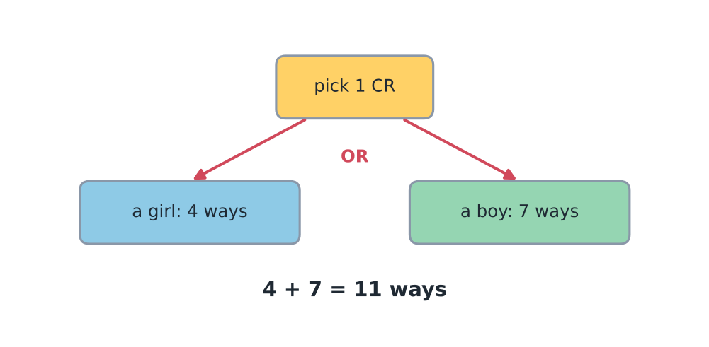

*Girl OR boy: add the counts.*

ii) Choose one head boy and one head girl. There are 7 options for the head boy AND 4 options for the head girl, so we multiply: 7 x 4 = 28 ways.

Why multiply: for each of the 7 boys, there are 4 possible girls, so the count is 4 + 4 + ... + 4 (seven times) = 28. Multiplication is repeated addition.

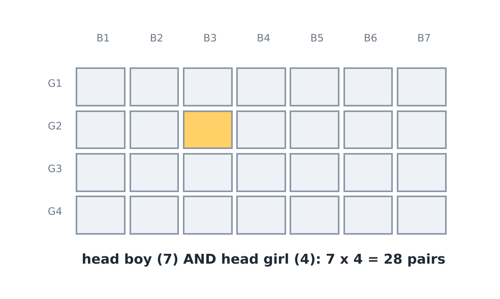

*Each box is one pair. 7 columns × 4 rows = 28.*

Example: a box contains balls: blue 1-4 (4 balls), red 1-3 (3 balls) and yellow 1-2 (2 balls).

i) Find the number of ways to select 1 ball. The ball is blue OR red OR yellow, so we add: 4+3+2 = 9.

ii) Find the number of ways to select 1 blue ball AND 1 yellow ball. There are 4 options for the blue ball and 2 for the yellow ball, so we multiply: 4 x 2 = 8.

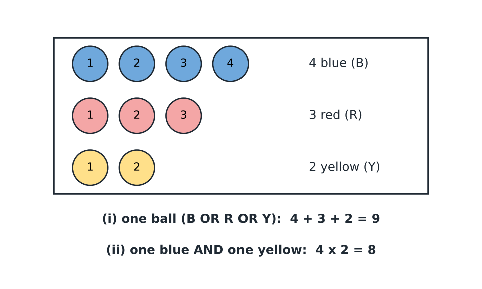

*One ball (any colour): add. One blue AND one yellow: multiply.*

Example: find the number of license plates that can be made where each plate contains two distinct English letters, followed by 3 different digits, where the first digit is not 0.

26 x 25 x 9 x 9 x 8

(26 options for the first letter; 25 for the second letter, because it must differ from the first; 9 for the first digit (1 to 9, since 0 is not allowed); 9 for the second digit (10 digits minus the one already used, and now 0 is allowed); 8 for the third digit.) = 421200.

There are 26 x 25 x 9 x 9 x 8 = 421200 plates. Writing them all down one by one is not possible, but the product rule gives the count in one line.

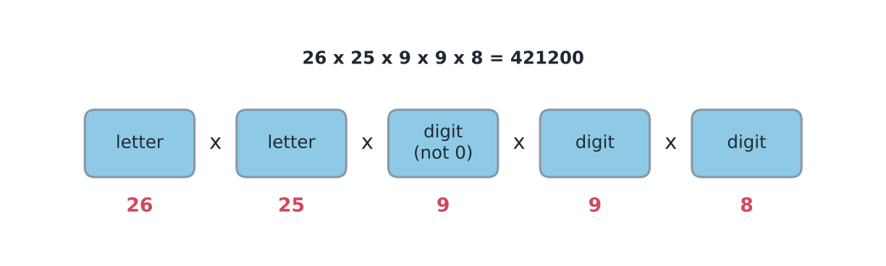

*Fill the slots one by one and multiply the number of options of each slot.*

Example: find the number of 5-letter palindromes that can be formed using English letters. What about an N-letter palindrome?

A palindrome reads the same from left to right and from right to left (for example, the word "level"). So only the first half can be chosen freely, and the second half is a copy. The figure at the end of this example shows the number of options for each letter: 26 x 26 x 26 x 1 x 1 = $26^3$.

(The 4th letter must equal the 2nd and the 5th must equal the 1st, so those two slots are forced and give only 1 option each.)

For even N the count is $26^{N/2}$, and for odd N it is $26^{(N+1)/2}$. Both cases are written together as $(26)^{\lceil N/2 \rceil}$, where $\lceil \frac{N}{2} \rceil$ is the ceiling of N/2 (N/2 rounded up).

Trace: N = 5 has 3 free letters, so $26^3$. N = 6 has 3 free letters, so $26^3$. N = 7 has 4 free letters, so $26^4$.

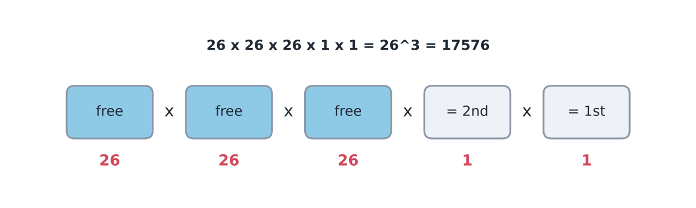

*Only the first half (rounded up) is free; the rest is a copy.*

Try this yourself: how many 5-digit numbers can be made with odd digits, such that no two consecutive digits are the same? What about an N-digit number?

The slots have 5, 4, 4, 4 and 4 options (AND means multiply), so the count is 5 x $4^4$. For N digits the count is 5 x $4^{(N-1)}$.

(The first digit has 5 options. After that, each digit has 4 options: every odd digit except the one just before it. For N = 5 this gives 5 × 256 = 1280.) Checked by listing all 5^5 strings: 1280. The palindrome rule was also checked by listing all palindromes of length N = 7 over a 3-letter alphabet: 81 = 3^4. The plate count was also checked with a loop: 421200.

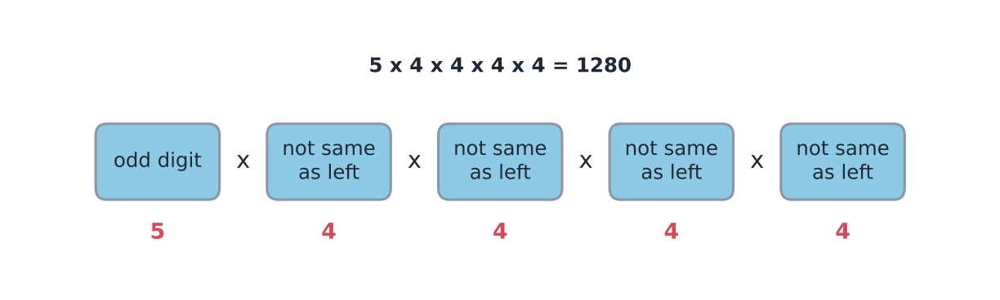

*5 options for the first slot, then 4 options for each of the next four slots.*

The three answers as functions. Each one multiplies the number of options of the slots, as above:

```cpp
// New function (not from the Fabricator repo): the palindrome rule, only ceil(N/2) slots are free.
/*
  Problem: number of palindromes of length N over an alphabet of k letters. Only the
  first ceil(N/2) places are free. (k = 26 for English letters; use a modulus for big N.)
*/
long long palindromeCount(int N, long long k) {
    long long result = 1;
    for (int i = 0; i < (N + 1) / 2; i++) result *= k;
    return result;
}

// New function (not from the Fabricator repo): the odd-digit rule, 5 options then 4 for every later digit.
/*
  Problem: N-digit numbers from the 5 odd digits where no two neighbours are equal:
  5 choices for the first digit, 4 for each later digit.
*/
long long oddDigitNumbers(int N) {
    long long result = 5;
    for (int i = 1; i < N; i++) result *= 4;
    return result;
}

// New function (not from the Fabricator repo): the license plate product written as code.
/*
  Problem: license plates: two distinct letters, then three distinct digits, first digit not 0.
*/
long long licensePlates() {
    return 26LL * 25 * 9 * 9 * 8;
}
```

Compiled and run, and each result was compared with a brute-force listing: `licensePlates()` is 421200 (a loop over all plates also gives 421200). `palindromeCount(7, 3)` is 81, the same as the 81 palindromes found among all $3^7$ strings, and `palindromeCount(5, 26)` is 17576. `oddDigitNumbers(5)` is 1280, the same as the 1280 found among all $5^5$ digit strings. For large N these numbers are huge, so compute $26^{\lceil N/2 \rceil}$ and $5 \cdot 4^{N-1}$ with fast power under the modulus (lesson 2.2). Cost: O(N) multiplications and O(1) memory.

**Theorem 2.3.1 (product and sum rules).** (1) If an object is built by a sequence of $k$ choices, and the $i$-th choice always has $m_i$ options whatever the earlier choices were, then there are $m_1 m_2 \cdots m_k$ objects, each from exactly one sequence of choices. (2) If a set splits into disjoint parts, its size is the sum of the sizes of the parts. (3) So there are $m^k$ sequences of length $k$ over $m$ symbols, $n!$ orders of $n$ different elements, and $\frac{n!}{(n-r)!}$ ordered selections of $r$ different elements out of $n$.

Small example first: strings of length 3 over $\{a, b, c\}$ with no two equal neighbours. The first letter has 3 options and each later letter has 2, so $3 \cdot 2 \cdot 2 = 12$. The count is the same whichever letter came before. That is what makes the product work.

Why it works (part 1, by induction on $k$):
1. For $k = 1$ there are $m_1$ objects.
2. For $k > 1$, split the objects by their first choice (sum rule). Each of the $m_1$ first choices is followed by $m_2 \cdots m_k$ completions, by the induction step.
3. So the total is $m_1 \cdot m_2 \cdots m_k$.
4. Part 2: each element belongs to exactly one part, so it is counted once.
5. Part 3: apply part 1 with $m$ options at each of $k$ places, with $n, n-1, \dots, 1$ options, and with $n, \dots, n-r+1$ options.

This proof needs: (1) the number of options at each step must not depend on the earlier choices, even if the options themselves do. "A letter different from the previous one" is fine (always $m - 1$). (2) Each object must come from exactly one sequence of choices. Counter-case: choose 2 of $\{1, 2, 3\}$ as "first, then second". That gives $3 \cdot 2 = 6$ sequences, but there are only 3 subsets, because each subset is built in two orders.

<TheoremCode unit="2.3/thm-1" />

The first line is the small example. The second line shows part 3: $3^3 = 27$ strings, $4! = 24$ orders, and $5 \cdot 4 \cdot 3 = 60$ ordered selections.

Another example, where the first condition needs care. Count the sequences of pairwise different integers $A_1, \dots, A_n$ with $1 \le A_i \le C_i$. If we fill the positions in input order, the number of options at a position depends on how many earlier values fell below its limit. For limits 7 and 3 in this order, the second position has 2 or 3 options depending on the first value. If we sort the limits first (here 3, then 7) and fill from the smallest limit, position $i$ (counting from 0) always has $C_i - i$ options, because the $i$ values already taken are all at most $C_i$. For limits 3 and 7 this gives $3 \cdot (7 - 1) = 18$.

<CodeSnippet unit="2.3/distinct-limits" />

Trace for limits 7 and 3: sorted, they are 3 and 7. Position 0 has $3 - 0 = 3$ options, position 1 has $7 - 1 = 6$, and the product is 18. If any $C_i - i \le 0$, no sequence exists and the answer is 0. Cost: $O(n \log n)$ for the sort, then $O(n)$.

Common mistake: not sorting. For limits 7 and 3 in input order the program computes $7 \cdot (3 - 1) = 14$, but the answer is 18. Fix: sort first, so that every used value lies below the current limit.

Common mistake: counting the current position as used. With $c_i - (i + 1)$ and the single limit 4, the program prints 3, but there are 4 sequences. Fix: with indices from 0, use $c_i - i$.

## Permutations

A permutation is one particular ordering of the items. For the set \{1, 2, 3\}, here are all the permutations:

The number of permutations of \{1, 2, 3\} is the number of ways you can reorder its elements.

```
1,2,3
1 3 2
2 1 3
2 3 1
3 1 2
3 2 1
```
There are 6 ways.

To count the permutations, we take all the places and put an AND between the possibilities for each place (that is, we multiply them).

Example: for \{1, 2, 3, 4\} the number of permutations is 4 x 3 x 2 x 1.

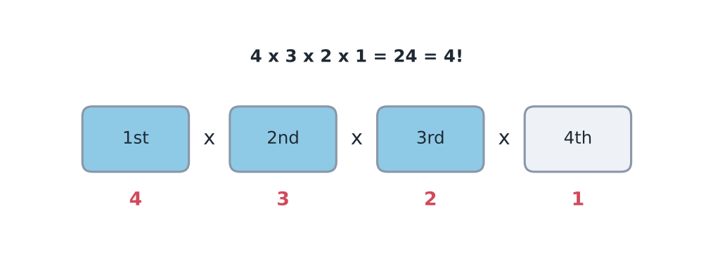

*After each place is filled, one option fewer remains.*

Trace: there are 4 choices for the first place, 3 for the second, 2 for the third and 1 for the last, so 4 x 3 x 2 x 1 = 24. Listing the orders of 10 items would need 10! = 3628800 lines, so a formula is needed.

**\*** For an array of size n, n! permutations are possible.

Example: find the number of 5-character passwords that you can create using English letters, if repetition is not allowed.

The count is 26 x 25 x 24 x 23 x 22. In other words, we need to choose 5 letters out of the 26 and place them in the 5 places. This is written 26P5, which means permuting 5 elements out of 26.

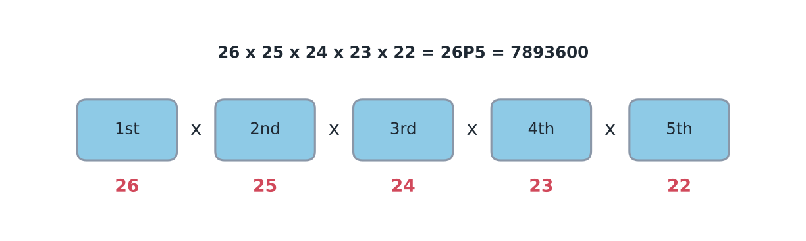

*Start from 26 and drop by one each time. 26P5 = 7893600.*

In general, $^nP_r$ = n x (n-1) x (n-2) x ..... (n-r+1)

To write this with factorials, multiply and divide by (n-r)!:

$$^nP_r = \frac{n \times (n-1) \times \dots \times (n-r+1) \times (n-r) \times (n-r-1) \times \dots \times 1}{(n-r) \times (n-r-1) \times \dots \times 1}$$

$^nP_r$ = $\frac{n!}{(n-r)!}$

(Check: 26P5 = 26!/21! = 26 x 25 x 24 x 23 x 22 = 7893600.)

What if there are duplicates?

If some items are identical, the plain n! counts the same word more than once.

For \{A, A, B, C\} the plain count is 4! permutations, and for \{A, A, B\} it is 3! permutations. To see what goes wrong, label the two As as A1 and A2. The labelled orders that differ only by swapping A1 and A2 are fused into one word, because the two As are the same letter. In the figure below, the 6 labelled orders of A1, A2 and B give only 3 different words.

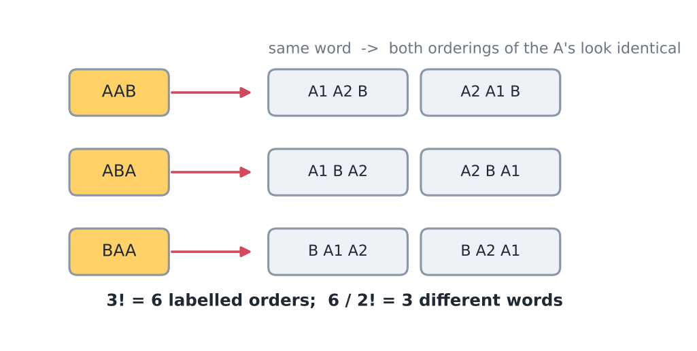

*6 labelled orders, but only 3 different words (6 / 2!).*

These are called internal permutations. They happen between the same elements, and we need to ignore them. So we divide by the factorial of the number of copies of each repeated element.

Trace: for \{A, A, B, C\} there are 4! = 24 labelled orders. Each word appears 2! = 2 times (once for each order of the two As), so the number of different words is 24 / 2 = 12.

In general, let the letter A1 appear B1 times, A2 appear B2 times, and so on up to AN, which appears BN times. The number of different arrangements is:

$\frac{(B_1 + B_2 + B_3 + ..... + B_N)!}{B_1! \; B_2! \; B_3! \; ..... \; B_N!}$

The division removes all the internal permutations of each repeated letter.

Example: there are 3 identical As, 4 identical Bs and 6 identical Cs. What is the total number of permutations?

The total number of letters is 3+4+6 = 13, so the number of permutations is $\frac{13!}{3! \; 4! \; 6!}$

= 6227020800 / 103680 = 60060. (13! fits in a long long. Factorials up to 20! fit; 21! overflows.)

The same count as a product of choices: think of the letters one group at a time. The 3 As take 3 places out of the first 3 (3C3 = 1). The 4 Bs take 4 places out of the first 7 (7C4 = 35). The 6 Cs take 6 places out of all 13 (13C6 = 1716). The product is 1 x 35 x 1716 = 60060. The function multisetPermutations below uses this form, so it never forms 13!.

Code (nPr, nCr for small n, and the multiset formula written as a product of binomials):

```cpp
/*
  Problem: nPr = n * (n-1) * ... * (n-r+1)
*/
long long nPr(int n, int r) {
    long long result = 1;
    for (int i = 0; i < r; i++) result *= (n - i);
    return result;
}

/*
  Problem: nCr for small n (multiply then divide, division is exact every step)
*/
long long binomialExact(int n, int r) {
    if (r < 0 || r > n) return 0;
    long long result = 1;
    for (int i = 1; i <= r; i++) result = result * (n - r + i) / i;
    return result;
}

/*
  Problem: arrangements when letter k appears counts[k] times
  = (sum of counts)! / (counts[0]! * counts[1]! * ...)
  Place first letter's copies, then second's among the rest, ...
*/
long long multisetPermutations(const vector<int>& counts) {
    int used = 0;
    long long result = 1;
    for (int c : counts) {
        used += c;
        result *= binomialExact(used, c);
    }
    return result;
}
```

Checked: nPr(26, 5) = 7893600 and multisetPermutations(\{3, 4, 6\}) = 60060. For AABBBCC, listing all arrangements with next_permutation gives 210, the same as the formula (7!/(2! 3! 2!) = 5040/24 = 210). binomialExact multiplies first and divides afterwards, so the intermediate product can overflow; it is safe only for small n: the product before the division is about r times the answer, and this fits in a long long for every n up to 61 (the first overflow is at n = 62, r = 31). Cost: binomialExact takes O(r) time, so multisetPermutations takes O(total length) time, and all of them use O(1) extra memory.

**Theorem 2.3.4 (multinomial coefficients).** A list of $n$ items with $c_i$ copies of value $i$ ($c_1 + \dots + c_k = n$) has $\frac{n!}{c_1! \, c_2! \cdots c_k!}$ different arrangements. Equivalently, it is $\binom{n}{c_1} \binom{n - c_1}{c_2} \cdots$.

The proof is the label-and-divide argument above: label the copies so that all items differ ($n!$ arrangements), then each arrangement of the unlabelled list comes from exactly $c_1! \cdots c_k!$ labelled ones. The second form chooses the positions of value 1, then of value 2 among the rest, and so on (product rule).

This proof needs: (1) copies of one value are indistinguishable and different values are distinguishable. (2) Modulo a prime, divide with inverse factorials (the factorial tables in "ii) nCr" below), which needs $n < p$.

<TheoremCode unit="2.3/thm-4" />

AAB has 3 arrangements ($\frac{3!}{2! \, 1!}$). MISSISSIPPI has $\frac{11!}{1! \, 4! \, 4! \, 2!} = 34\,650$. Cost: one factorial per value, or $O(n)$ with the binomial product.

## Combinations

A combination is a choice of objects where the order inside the choice does not matter. Listing all the choices is not possible for big inputs: choosing 25 objects out of 50 gives 126410606437752 choices. So a formula is needed.

nCr is the number of ways you can choose R objects out of N objects, where the order does not matter.

For example, take the set \{1 2 3 4 5\}, which has 5 objects, and suppose we need to choose 3 objects. Some of the choices are \{1 2 4\} and \{1 3 5\}, and so on. The choice \{1 2 4\} is the same as \{2 1 4\}, because the order does not matter: it is the same choice. The number of choices is denoted nCr, or written as (n r).

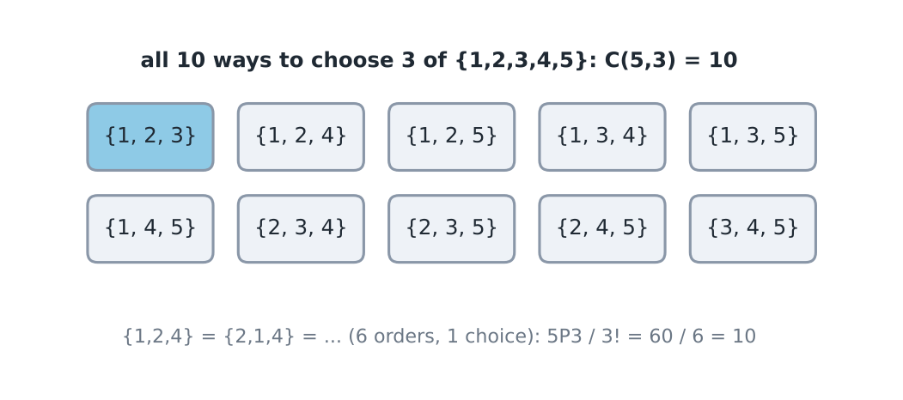

*C(5,3) = 10. Each choice can be written in 6 different orders, but it is still one choice.*

Derivation of the $^nC_r$ formula using permutations:

$^nC_r$ = $\frac{n!}{(n-r)! \, r!}$ = $\frac{^nP_r}{r!}$

After dividing by r! the order of r objects becomes irrelevant.

(Check: 5P3 = 60, 60 / 3! = 10.)

Here is another way to understand $^nC_r$. Take \{1 2 3 4 5 6\} and $^6C_3$. Permute the set, for example to \{5 2 4 6 1 3\}, and choose the first three items for the selection. Write the permutation as \{ 5 2 4 \} and \{ 6 1 3 \}, where the first group has r items and the second group has n-r items. The ordering inside neither group matters, so the number of choices is $\frac{n!}{r! \, (n-r)!}$.

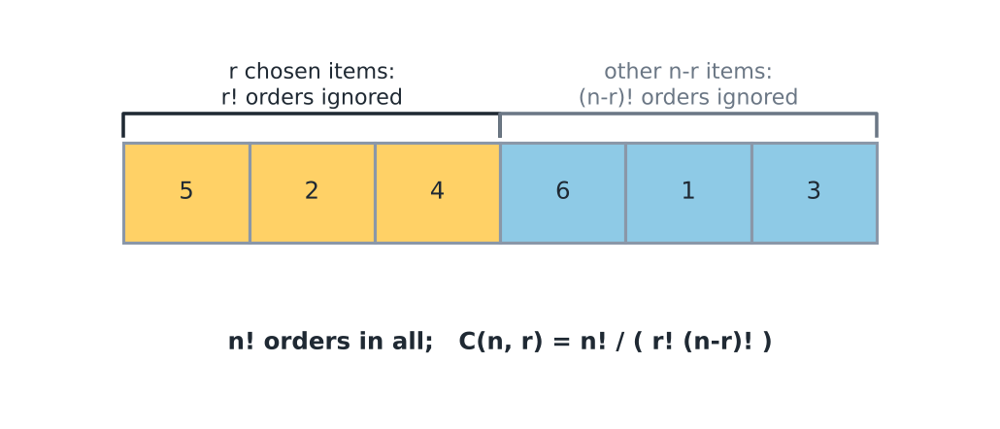

*The order inside each of the two groups does not matter, so we divide by r! and by (n-r)!.*

A second route splits all choices by looking at one item. This gives Pascal's rule:

That is, $^nC_r$ = $^{n-1}C_{r-1}$ + $^{n-1}C_r$ (boxed in the notebook).

Take the six items (1) (2) (3) (4) (5) (6) and choose 3 items. Suppose we choose (1). Then we need to choose 2 more items from the remaining 5, which gives $^5C_2$ ways. If we do not choose (1), then we need to choose 3 items from the remaining 5, which gives $^5C_3$ ways.

$^6C_3$ = $^5C_2$ + $^5C_3$

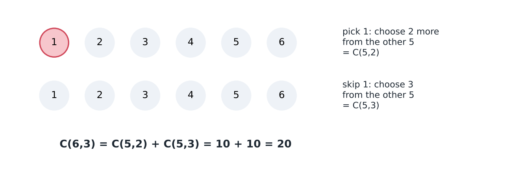

*Every choice of 3 items either contains item 1 or does not. 10 + 10 = 20.*

This rule builds Pascal's triangle: every entry is the sum of the two entries above it.

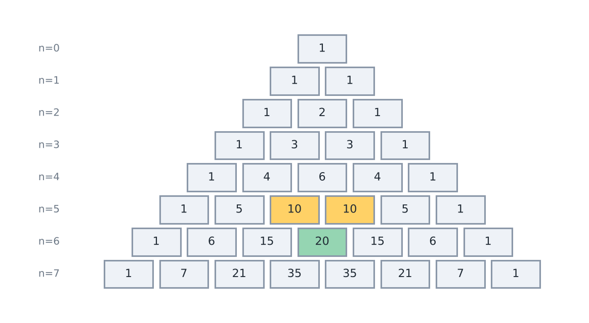

*Each entry is the sum of the two entries above it, for example 20 = 10 + 10.*

Rows 0 to 6 of the triangle are: 1 | 1 1 | 1 2 1 | 1 3 3 1 | 1 4 6 4 1 | 1 5 10 10 5 1 | 1 6 15 20 15 6 1. Row n lists nC0, nC1, ..., nCn, so the 20 in row 6 is 6C3.

When the modulus is not prime, or n is small (n ≤ $10^3$), build a table with this rule. It uses only additions, so no division is needed. Time complexity (T.C.) = O(n²), because the table has about n²/2 cells and each cell takes one addition:

```cpp
// Fabricator/Maths/nCr.cpp
// mod is non-prime, n<=10^3 and r<=n
// Pascal's Triangle
// O(n^2)
long long ncr[1001][1001];
long long nCr_tabular(long long n, long long r, long long mod){
    ncr[0][0] = 1;
    
    for(long long i=1; i<=n; i++){
        for(long long j=0; j<=i; j++){
            if(j == 0) {
                ncr[i][j] = ncr[i-1][j] % mod;
            }
            else{
                ncr[i][j] = (ncr[i-1][j] + ncr[i-1][j-1]) % mod;
            }
        }
    }

    return ncr[n][r];
}
```

Checked: nCr_tabular(10, 3, MOD) = 120, and nCr_tabular(1000, 500, 1000000007) = 159835829. Without a modulus, C(66, 33) = 7219428434016265740 is the largest central binomial coefficient that fits in a long long (C(68, 34) overflows).

If only a single value is needed, the next functions use the constant MOD = 1000000007 ($10^9 + 7$) defined at the top of the Fabricator file:

```cpp
// Fabricator/Maths/nCr.cpp
// If n<=10^9 and r<=20
// O(min(n-r, r))
long long nCr_single(long long n, long long r){
    long long num = 1;
    long long den = 1;
    long long lim = min(n-r, r);
    for(long long i=1; i<=lim; i++){
        num = (num * (n - i + 1)) % MOD;
        den = (den * i) % MOD;
    }

    return (num * inverse(den)) % MOD;
}

// n<=40 and r<=n
// O(r)
long long nCr_basic(long long n, long long r){
    long long ncr = 1;
    for(long long i=1; i<=r; i++){
        ncr *= (n - i + 1);
        ncr /= i;
    }

    return ncr;
}
```

nCr_basic(40, 20) = 137846528820 (checked). The division is exact at every step, because the partial result after step i is itself a binomial coefficient (an integer). nCr_single uses `inverse`:

```cpp
// Fabricator/Maths/nCr.cpp
long long inverse(long long num){
    return (num, MOD - 2);
}
```

Note: `(num, MOD - 2)` is the comma operator. It evaluates `num`, throws it away, and returns MOD - 2. As a result inverse(3) returns 1000000005 (checked), and nCr_single(10, 3) returns 999998567 instead of 120. The line should be `return mpow(num, MOD - 2);`, where mpow is a fast power function modulo MOD (as in lesson 2.2).

Trace of the corrected nCr_single(10, 3): lim = 3, num = 10 x 9 x 8 = 720, den = 1 x 2 x 3 = 6, and the answer is 720 x $6^{-1}$ mod p = 120. Only min(n-r, r) steps are done, so n = $10^9$ with r = 20 takes 20 steps and one fast power. It assumes that MOD is prime and that n and r are smaller than MOD; otherwise den (or num) becomes 0 modulo MOD.

For many queries (n, r ≤ $10^6$): precompute the factorials and the inverse factorials once, then answer each query in O(1). The formula is nCr = n! · (r!)⁻¹ · ((n-r)!)⁻¹. The inverse factorials are filled from the back, using $(i-1)!^{-1} = i!^{-1} \cdot i$. Only one modular inverse (one fast power, O(log p)) is needed in total.

```cpp
// Fabricator/Maths/BinomialCoefficients.cpp
long long bin_pow(long long base, long long exp){
    long long ans = 1;
    while(exp){
        if(exp & 1){
            ans = (ans * base) % MOD;
        }
        
        base = (base * base) % MOD;
        exp >>= 1;
    }

    return ans;
}

long long inverse(long long x){
    return bin_pow(x, MOD - 2);
}

long long fact[DEF_ARR_SIZE];
long long inv_fact[DEF_ARR_SIZE];
void factorial_inverse(){
    fact[0] = fact[1] = 1;
    for(long long i=2; i<DEF_ARR_SIZE; i++){
        fact[i] = (fact[i-1] * i) % MOD;
    }

    inv_fact[DEF_ARR_SIZE - 1] = inverse(fact[DEF_ARR_SIZE - 1]);
    for(long long i=DEF_ARR_SIZE - 1; i>0; i--){
        inv_fact[i-1] = (inv_fact[i] * i) % MOD;
    }
}

void solve() {
    long long a, b;
    cin>>a>>b;

    long long num = fact[a];
    long long den = (inv_fact[b] * inv_fact[a-b]) % MOD;
    
    num = (num * den) % MOD;

    cout<<num<<endl;
}
```

Checked: the input `10 3` gives 120. After factorial_inverse(), the O(log MOD) form `fact[n] * inverse(fact[n-r] * fact[r])` and the O(1) form with inv_fact give the same values: 10 for (5, 2), 159835829 for (1000, 500) and 996692777 for (1000000, 500000). The file's main calls factorial_inverse() once before reading the queries; without that call every answer would be 0. The input must satisfy b ≤ a, otherwise inv_fact[a-b] has a negative index.

Example: a committee of 6 is to be formed out of 8 men and 5 women. In how many ways can this be done, when:

- i) 2 men and 4 women are included,
- ii) at least 3 women are included,
- iii) at most 3 women are included?

i) The 2 men are chosen from the 8 men in $^8C_2$ ways, and the 4 women from the 5 women in $^5C_4$ ways, so the count is $^8C_2 \cdot ^5C_4$.

ii) At least 3 women means that the committee of 6 has 3 OR 4 OR 5 women. With 3 women the count is $^5C_3 \cdot ^8C_3$, with 4 women it is $^5C_4 \cdot ^8C_2$, and with 5 women it is $^5C_5 \cdot ^8C_1$.

$^5C_3 \cdot ^8C_3 + ^5C_4 \cdot ^8C_2 + ^5C_5 \cdot ^8C_1$

(There are only 5 women, so the number of women is 3, 4 or 5, and men fill the other seats. The cases cannot happen together, so the counts are added.)

iii) At most 3 women means that the committee of 6 has 0 OR 1 OR 2 OR 3 women. With 0 women the count is $^5C_0 \cdot ^8C_6$, with 1 woman it is $^5C_1 \cdot ^8C_5$, with 2 women it is $^5C_2 \cdot ^8C_4$, and with 3 women it is $^5C_3 \cdot ^8C_3$.

$^5C_0 \cdot ^8C_6 + ^5C_1 \cdot ^8C_5 + ^5C_2 \cdot ^8C_4 + ^5C_3 * ^8C_3$

Numbers: (i) 28 × 5 = 140, (ii) 560 + 140 + 8 = 708, (iii) 28 + 280 + 700 + 560 = 1568. Sanity: total C(13, 6) = 1716 = 1568 + 140 + 8 ✓. Another check: at least 3 women = total minus the cases with 0, 1 or 2 women = 1716 - (28 + 280 + 700) = 708.

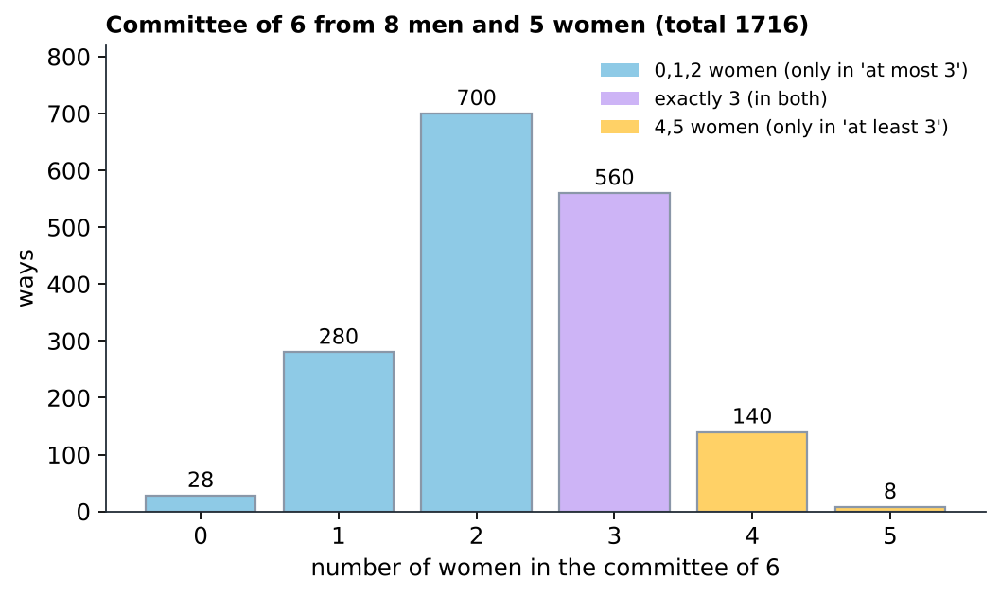

*One term per case. The case of exactly 3 women appears in both (ii) and (iii).*

```cpp
/*
  Problem: committees of `seats` people from `men` men and `women` women,
  number of women between loWomen and hiWomen (both included).
*/
long long committeeWays(int men, int women, int seats, int loWomen, int hiWomen) {
    long long total = 0;
    for (int w = loWomen; w <= hiWomen; w++)
        total += binomialExact(women, w) * binomialExact(men, seats - w);
    return total;
}
```

Checked: (4,4) → 140, (3,5) → 708, (0,3) → 1568. A brute force over all 13-bit masks with exactly six 1-bits gives the same values.

**Theorem 2.3.2 (binomial coefficients).** For $0 \le r \le n$: (1) $\binom{n}{r} = \frac{n!}{r!(n-r)!}$. (2) $\binom{n}{r} = \binom{n}{n-r}$. (3) Pascal's rule $\binom{n}{r} = \binom{n-1}{r-1} + \binom{n-1}{r}$ for $1 \le r \le n-1$. (4) $\binom{n}{0} + \binom{n}{1} + \dots + \binom{n}{n} = 2^n$.

Parts 1 to 3 are the derivations above ($\frac{{}^nP_r}{r!}$, leave out $n - r$, choose or skip item 1). Part 4 is the missing one. Small example: row 5 of Pascal's triangle is 1, 5, 10, 10, 5, 1, and the sum is $32 = 2^5$.

Why part 4 holds:
1. Every subset of $\{1, \dots, n\}$ has some size $r$ between 0 and $n$.
2. There are $\binom{n}{r}$ subsets of size $r$, so the left side counts all subsets.
3. Each of the $n$ elements is in the subset or not, two options each, so by the product rule there are $2^n$ subsets in all.

This proof needs: (1) $0 \le r \le n$. Outside that range define $\binom{n}{r} = 0$ and test the range before using the formula. (2) The elements are distinguishable. Choosing $r$ of $n$ identical items has only one outcome.

<TheoremCode unit="2.3/thm-2" />

The first line is Pascal's rule with numbers, the second is part 4.

**Theorem 2.3.7 (lattice paths).** The number of lattice paths from $(0, 0)$ to $(a, b)$ with $a, b \ge 0$, using steps $(1, 0)$ and $(0, 1)$, is $\binom{a+b}{a}$. From $(x_1, y_1)$ to $(x_2, y_2)$ it is $\binom{(x_2 - x_1) + (y_2 - y_1)}{x_2 - x_1}$ when both differences are non-negative, and 0 otherwise.

Small example first: from $(0, 0)$ to $(2, 2)$ there are $\binom{4}{2} = 6$ paths: RRUU, RURU, RUUR, URRU, URUR, UURR.

Why it works:
1. Every such path has exactly $a + b$ steps, and $a$ of them go right.
2. Map a path to the set of positions (among $1, \dots, a+b$) of its right steps.
3. Different paths give different sets, and every set of $a$ positions comes from exactly one path, the one that steps right exactly there. This is a bijection with the subsets of size $a$.
4. Shifting the start to the origin gives the second form.

This proof needs: (1) only the two step types, each of length 1. Paths that must avoid some cells need inclusion-exclusion over the forbidden cells. (2) The general method: find a bijection between the objects and a set you can count, and check both directions (every object maps somewhere, and every target comes from exactly one object).

<TheoremCode unit="2.3/thm-7" />

The example is the small example above. A path through a given point is a first half and a second half, and "and" multiplies:

<CodeSnippet unit="2.3/paths-through" />

For a grid from $(0, 0)$ to $(5, 3)$, the paths through $(3, 3)$ number $\binom{6}{3} \cdot \binom{2}{2} = 20 \cdot 1 = 20$. The function `paths` returns 0 when a difference is negative. Cost: $O(1)$ per query after the tables. Another way: the paths that avoid a point are the total minus the paths through it.

Common mistake: adding the two halves. For the example above the program prints $20 + 1 = 21$ instead of 20. Fix: both halves happen together, so multiply (product rule). Add only disjoint cases.

## Lines, circles and chessboard

Example: find the maximum number of points of intersection for 8 lines and 4 circles.

Two shapes of a given kind can meet in a fixed maximum number of points. So count the pairs of each kind with nCr and multiply by that maximum.

There are three types of intersections, where C is a circle and L is a line:

- C+C: two circles meet in at most 2 points, and there are $^4C_2$ pairs of circles, so this gives $2 [^4C_2]$.
- C+L: a circle and a line meet in at most 2 points, so this gives $2 \times [^4C_1 \cdot ^8C_1]$.
- L+L: two lines meet in 1 point, so this gives $1 \times {}^8C_2$.

We add the three counts:

$2 [^4C_2] + 2 [^4C_1 \cdot ^8C_1] + [^8C_2]$

(4C2 = 6, 4C1 · 8C1 = 32, 8C2 = 28) = 12 + 64 + 28 = 104. (For the maximum we assume general position: no two lines are parallel, and no three of the shapes meet at one point. Two circles meet in at most 2 points, a circle and a line in at most 2 points, two lines in 1 point.)

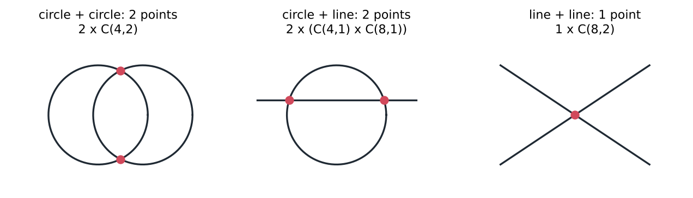

*Two circles meet in at most 2 points, a circle and a line in at most 2, and two lines in 1.*

A small example: 2 circles + 3 lines → 2·1 + 2·(2·3) + 3 = 2 + 12 + 3 = 17 points (the figure was computed and shows exactly 17).

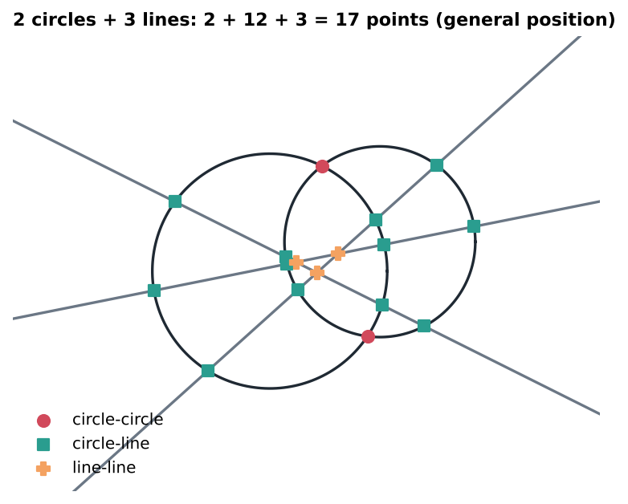

*Red: C+C, green: C+L, orange: L+L.*

Example: find the total number of squares on an N x N chessboard.

Let us try an easier version first: the total number of subarrays in an array of size N. (A subarray is a block of consecutive elements. Here N = 6.)

Way 1: count the subarrays of size 1, 2, 3, ... N, which gives 6 + 5 + 4 + .... + 1. This is $\frac{6 \times (6+1)}{2}$ = 21 (also 6 + 5 + 4 + 3 + 2 + 1 = 21).

Way 2: every subarray has a start and an end. If we choose any two walls, there is a subarray between them. There are 7 walls for N = 6, so ${}^7C_2$ is the number of subarrays.

(N = 6 → 7 walls, 7C2 = 21 = 6·7/2 ✓. A brute-force loop also gives 21.)

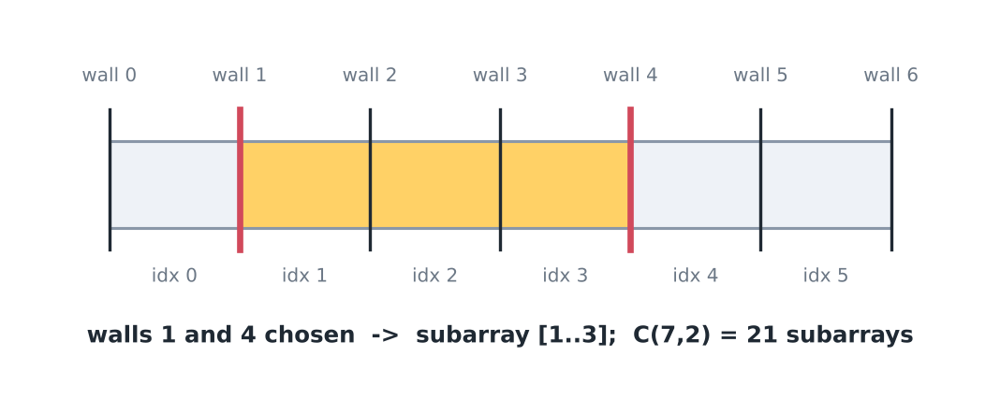

*Choosing wall 1 and wall 4 gives the subarray [1..3].*

A rectangle on the board is fixed by choosing 2 of the n+1 horizontal grid lines and 2 of the n+1 vertical grid lines.

Now find the number of rectangles in an n×n chessboard. There are n+1 horizontal lines, so there are ${}^{n+1}C_2$ ways to choose two of them, and the same number of ways for the vertical lines. So the number of rectangles is ${}^{n+1}C_2 \cdot {}^{n+1}C_2$.

(N = 4 → 10 × 10 = 100. This count includes squares, because a square is also a rectangle.)

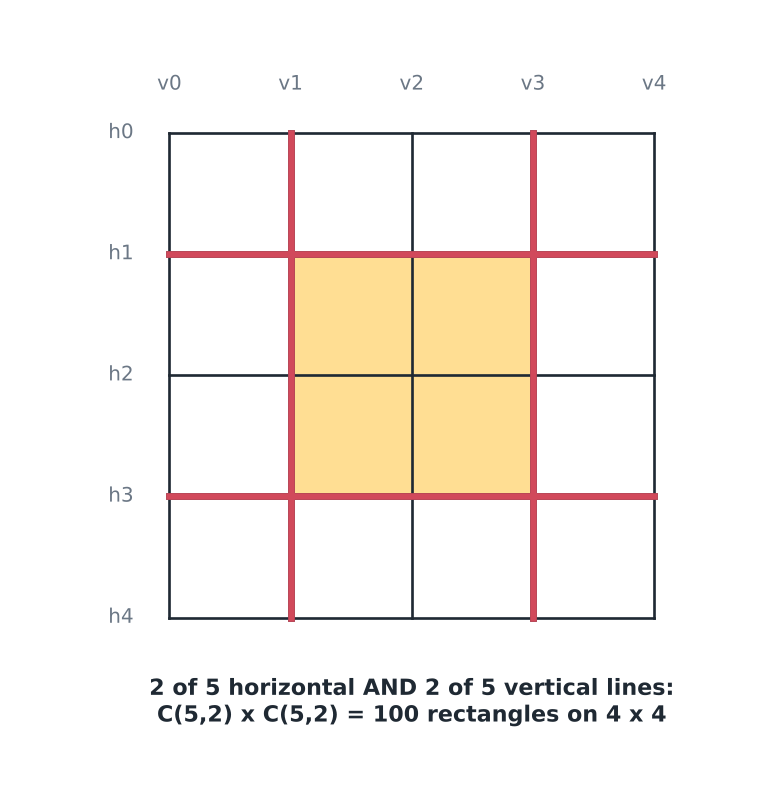

*Choosing the lines h1, h3, v1 and v3 gives the shaded rectangle.*

To count only the squares, group them by size.

Count the squares by size: size 1 has $n^2$ squares, size 2 has $(n-1)^2$, size 3 has $(n-2)^2$, and so on, down to size n, which has 1 square.

(A square of size k can have its top-left corner in any of (n-k+1) rows and any of (n-k+1) columns, so there are $(n-k+1)^2$ of them.)

So the total is $1^2 + 2^2 + 3^2 + .... + n^2$
= $\frac{n(n+1)(2n+1)}{6}$

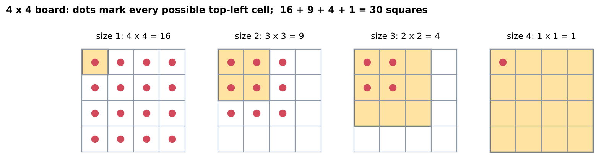

*For a 4×4 board the total is 16 + 9 + 4 + 1 = 30.*

Note: the first attempt in the notebook (something like 2[nC1 . nC1]) is crossed out and unclear, so the size-by-size sum is the final method. For N = 1 to 8, both the rectangle formula and the square formula match a brute-force count (N = 4: 100 rectangles and 30 squares).

The counts of this section as functions. The first one uses `binomialExact` from the Permutations section:

```cpp
// New function (not from the Fabricator repo): the three intersection types as code.
/*
  Problem: maximum intersection points of `lines` lines and `circles` circles (general position).
  circle+circle: 2 points, circle+line: 2 points, line+line: 1 point.
*/
long long maxIntersections(int lines, int circles) {
    return 2 * binomialExact(circles, 2)
         + 2 * binomialExact(circles, 1) * binomialExact(lines, 1)
         + binomialExact(lines, 2);
}

// New function (not from the Fabricator repo): choose 2 of the n+1 walls.
/*
  Problem: number of subarrays of an array of size n. Choose 2 of the n+1 walls.
*/
long long subarrayCount(long long n) { return (n + 1) * n / 2; }

// New function (not from the Fabricator repo): choose 2 horizontal and 2 vertical lines.
/*
  Problem: number of rectangles on an n x n board: choose 2 of n+1 horizontal lines
  and 2 of n+1 vertical lines.
*/
long long rectangleCount(long long n) {
    long long pairs = (n + 1) * n / 2;      // C(n+1, 2)
    return pairs * pairs;
}

// New function (not from the Fabricator repo): the sum of squares formula.
/*
  Problem: number of squares on an n x n board: 1^2 + 2^2 + ... + n^2.
*/
long long squareCount(long long n) { return n * (n + 1) * (2 * n + 1) / 6; }
```

Compiled and run: `maxIntersections(8, 4)` is 104 and `maxIntersections(3, 2)` is 17, the same as the numbers above. `subarrayCount(6)` is 21, the same as a loop over all start and end positions. `rectangleCount(4)` is 100 and `squareCount(4)` is 30, and both match a loop over all pairs of lines for N = 1 to 8. Cost: O(1) time and memory for each of them (in `maxIntersections` every binomial has a bottom number of at most 2).

Common mistake: in `squareCount` the product n(n+1)(2n+1) overflows a `long long` from n = 1664511 on, even though the final answer is far smaller. For larger n use `__int128` for the product, or take the answer under a modulus with the inverse of 6.

## Inclusion-Exclusion Principle

Idea: when we count the items that belong to "at least one of the groups", an item that lies in two groups is counted twice. So add the groups, subtract the overlap. That's all.

Example on a small set:

\{1, 2, 3, 4, 5, 6\}

Count the numbers that are odd and divisible by 3 (both at once). The odd numbers are \{1, 3, 5\}, the numbers divisible by 3 are \{3, 6\}, and the common element is \{3\}.

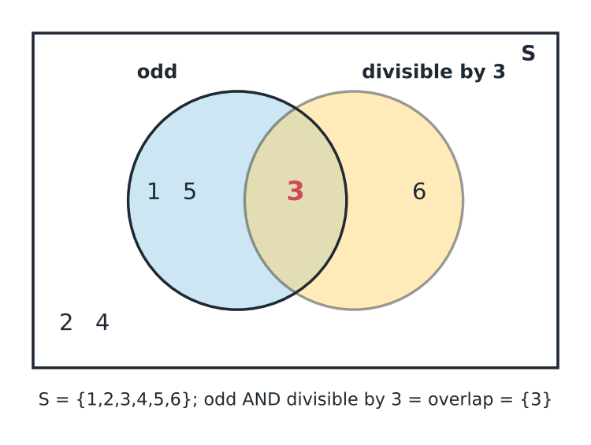
*The overlap is \{3\}. The numbers 2 and 4 are outside both groups. The answer is \{3\}.*

$n(A \cup B) = n(A) + n(B) - n(A \cap B)$

Here ∪ means "or" (union) and ∩ means "and" (intersection).

Notice that: $n(A)$ and $n(B)$ both counted the common elements, so we subtract them once.

### Dice problem

Example: a die is rolled 4 times and the numbers are listed. Find the number of different throws such that the largest number appearing in the list is not 4.

The set S of all throws has 4 blanks, \{ ___ ___ ___ ___ \}, and each blank takes a value in [1,6].

Think of it as: count the opposite, then subtract from total.

$n(\text{not 4 as max}) = \text{total} - n(\text{max as 4})$
$= 6^4 - [4^4 - 3^4]$

In total, every blank has [1,6], so there are $6^4$ options.

To make 4 the maximum, let every blank be in [1,4], which gives $4^4$ options.

But this can lead to wrong choices.

By allowing the range [1,4] we also allow \{ 1 3 2 3 \}, whose max is 3, not 4. That is a wrong choice.

Hence, we remove the [1,3] choices, which number $3^4$.

So $[4^4 - 3^4]$ counts the throws with 4 as the maximum.

ans = $6^4 - (4^4 - 3^4) = 1296 - 175 = 1121$

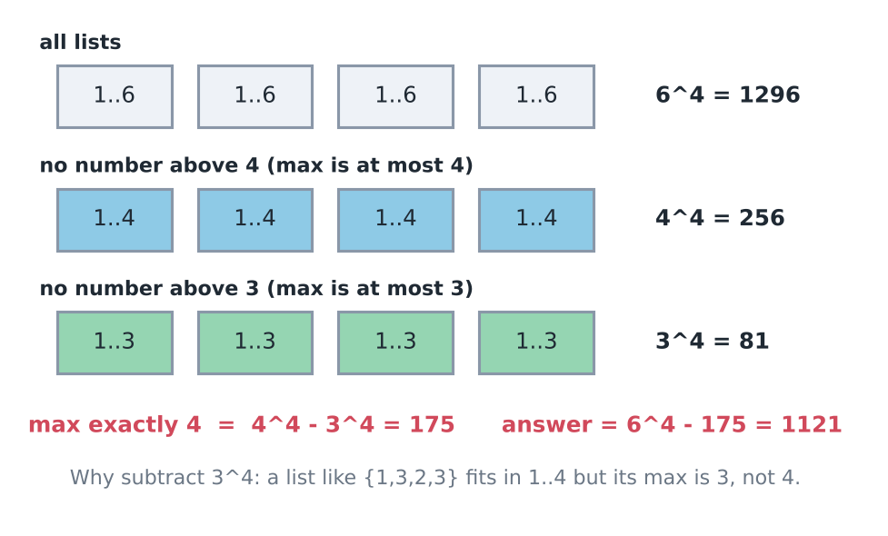
*The number of throws with maximum exactly 4 equals (all values in 1..4) minus (all values in 1..3).*

As a function. A lambda is a small unnamed function written inside another function, and here it is used as a helper for the power:

```cpp
// New function (not from the Fabricator repo): the dice complement count as code.
/*
  Problem: a die with `faces` sides is rolled `rolls` times and the numbers are listed in order.
  Count the lists whose largest number is NOT `top`.
  Complement: all lists - (lists with max <= top - lists with max <= top-1).
*/
long long lists_with_max_not(int rolls, int faces, int top) {
    auto power = [](long long base, int exp) {   // lambda: tiny helper defined in place
        long long result = 1;
        for (int i = 0; i < exp; i++) result *= base;
        return result;
    };
    return power(faces, rolls) - (power(top, rolls) - power(top - 1, rolls));
}
```

Compiled and run: `lists_with_max_not(4, 6, 4)` returns 1121. It was also compared with a listing of all outcomes for 1 to 5 rolls of dice with 2 to 6 faces and every value of `top`, with no difference. Cost: O(rolls) multiplications and O(1) memory.

### Letters problem

Example: find the number of permutations of the letters a, b, c, d, e, f, g taken all together, such that neither 'cad' nor 'beg' appears.

Count all arrangements, then remove the arrangements that contain "cad" or "beg". We want the region outside both circles.

$n(S) - n(\text{cad} \cup \text{beg})$

$n(S) = 7!$

$7! - (n(\text{cad}) + n(\text{beg}) - n(\text{cad} \cap \text{beg}))$

$7! - (5! + 5! - 3!)$ ✓

Side calculation:

- For cad: the items are [cad], b, e, f, g, which gives 5! (glue c-a-d into ONE item, so 5 items remain).
- For beg: the items are [beg], a, c, d, f, which gives 5!.
- For both cad and beg: the items are [cad], [beg], f, which gives 3!.

$= 5040 - (120 + 120 - 6) = 5040 - 234 = 4806$

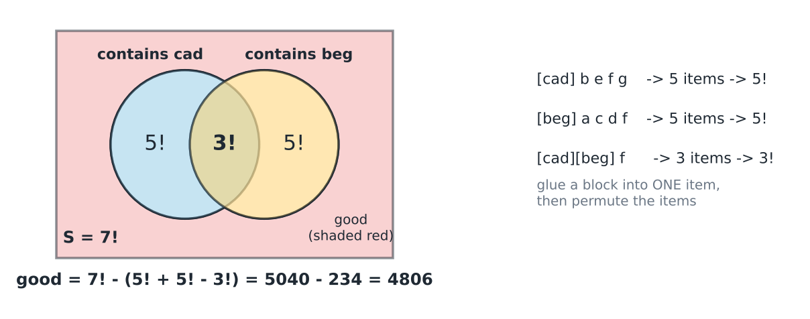
*The good arrangements are outside both circles (red).*

As a function. Gluing one block of `block_len` letters leaves `letters - block_len + 1` items, and gluing both blocks leaves `letters - 2 * block_len + 2` items:

```cpp
// New function (not from the Fabricator repo): the two-block count as code, for blocks that share no letter.
/*
  Problem: count the permutations of `letters` distinct letters in which neither of two
  letter-disjoint blocks of length `block_len` appears as consecutive letters.
*/
long long permutations_avoiding_two_blocks(int letters, int block_len) {
    auto factorial_small = [](int n) {
        long long f = 1;
        for (int i = 2; i <= n; i++) f *= i;
        return f;
    };
    long long total = factorial_small(letters);
    long long has_one_block = factorial_small(letters - block_len + 1);
    long long has_both = factorial_small(letters - 2 * block_len + 2);
    return total - (2 * has_one_block - has_both);
}
```

Compiled and run: `permutations_avoiding_two_blocks(7, 3)` returns 4806, the same as a listing of all 5040 arrangements of abcdefg with `next_permutation` that rejects those containing "cad" or "beg". A second check: for abcdef with the blocks "ab" and "cd" the function gives 504, and the listing also gives 504. Cost: O(letters) time and O(1) memory. Common mistake: the formula assumes that the two blocks use different letters, as cad and beg do. Do not use it when they share a letter.

### Three sets

Example: find the number of integers between 1 and 1000 that are divisible by at least one of \{2, 3, 5\}.

Optional question: what would happen if the set contains numbers that are not co-prime? (This is answered after the figure below.)

Let A, B and C be the numbers divisible by 2, 3 and 5. Then:

$n(A \cup B \cup C) = n(A) + n(B) + n(C) - n(A \cap B) - n(B \cap C) - n(A \cap C) + n(A \cap B \cap C)$

$n(A) = \frac{1000}{2} = 500$

$n(B) = \lfloor \frac{1000}{3} \rfloor = 333$

$n(C) = \lfloor \frac{1000}{5} \rfloor = 200$

$- n(A \cap B) = \lfloor \frac{1000}{6} \rfloor = 166$

$- n(B \cap C) = \lfloor \frac{1000}{15} \rfloor = 66$

$- n(A \cap C) = \lfloor \frac{1000}{10} \rfloor = 100$

$+ n(A \cap B \cap C) = \lfloor \frac{1000}{30} \rfloor = 33$

ans = $500 + 333 + 200 - 166 - 66 - 100 + 33 = 734$

Check: the other 1000 - 734 = 266 numbers are divisible by none of 2, 3, 5. In each block of 30 numbers, 8 are co-prime to 30, so the 33 full blocks give 264, and 991 and 997 in the last part of the range add 2 more: 266.

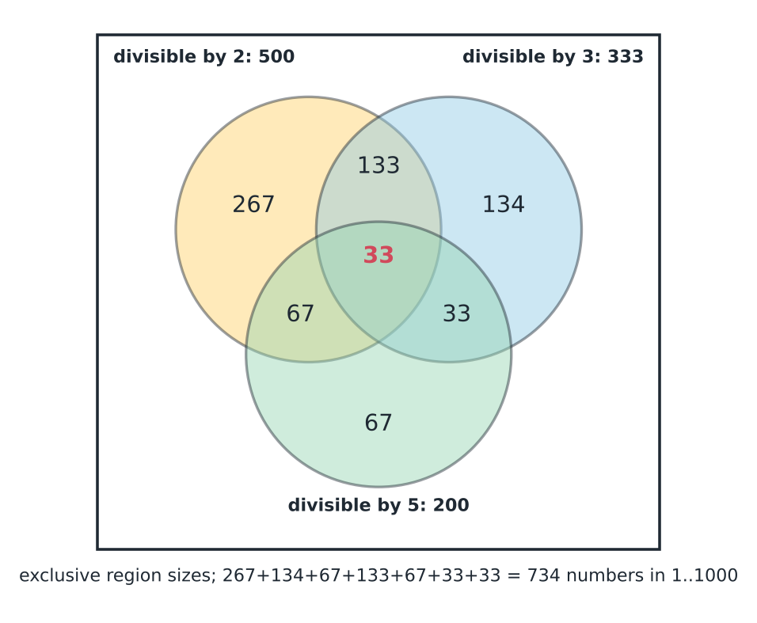
*The size of each region (numbers that belong to exactly those groups). The sizes add up to 734.*

Optional part: what if the numbers are not co-prime (they share a factor)? "Divisible by 2 and 3" means divisible by 6 = 2×3, but this product rule works only when the numbers are co-prime. If they are not co-prime, use the lcm (least common multiple) instead of the product.

For example, for \{4, 6\}, a number divisible by both is divisible by lcm(4,6) = 12 (not 24). So up to 1000 the count is $250 + 166 - 83 = 333$.

For any set of size k, loop over all $2^k - 1$ non-empty subsets (using a bitmask). A subset of odd size is added and a subset of even size is subtracted. The T.C. (time complexity) is $O(2^k \cdot k)$. If the lcm crosses the limit, the term is 0, so stop early (this also avoids overflow).

```cpp
// Problem:
// Count the integers in [1, limit] divisible by at least one number of the set
// d (the numbers do NOT have to be coprime).
// Inclusion-exclusion over every non-empty subset: the count divisible by all
// numbers of the subset is limit / lcm(subset); add for odd-sized subsets,
// subtract for even-sized ones.
long long count_divisible_by_any(long long limit, const vector<long long>& d) {
    int k = d.size();
    long long total = 0;
    for (int mask = 1; mask < (1 << k); mask++) {      // each mask = one subset
        long long l = 1;
        bool too_big = false;
        for (int i = 0; i < k; i++) {
            if (!(mask >> i & 1)) continue;
            l = l / __gcd(l, d[i]) * d[i];             // lcm, dividing first avoids overflow
            if (l > limit) { too_big = true; break; }  // no number fits, term is 0
        }
        if (too_big) continue;
        long long term = limit / l;
        if (__builtin_popcount(mask) % 2 == 1) total += term;
        else total -= term;
    }
    return total;
}
```

**Theorem 2.3.6 (inclusion-exclusion).** Let $U$ be a finite set and $A_1, \dots, A_m$ subsets of it (the bad properties). For a set $S$ of indices let $N(S)$ be the number of elements that lie in every $A_i$ with $i \in S$, with $N(\emptyset) = |U|$. Then the number of elements in none of the $A_i$ is

$$\sum_{S} (-1)^{|S|} N(S),$$

over all $2^m$ sets $S$. For two sets this is $|U| - |A_1| - |A_2| + |A_1 \cap A_2|$.

Small example first. Among $1, \dots, 100$, the numbers divisible by 2, 3 or 5 are $50 + 33 + 20 - 16 - 10 - 6 + 3 = 74$, so 26 are divisible by none. For 4 elements, the permutations with no fixed point are $24 - 24 + 12 - 4 + 1 = 9$.

Why it works:
1. Take an element $x$ that lies in exactly $t$ of the sets. It is counted in $N(S)$ exactly when $S$ is a subset of those $t$ indices.
2. So its total contribution is $\sum_{j=0}^{t} (-1)^j \binom{t}{j}$.
3. For $t = 0$ this is 1.
4. For $t \ge 1$ it is $(1 - 1)^t = 0$. This uses $(1 + y)^t = \sum_j \binom{t}{j} y^j$ with $y = -1$; the expansion itself comes from choosing, in each of the $t$ factors, either 1 or $y$.
5. So exactly the elements in none of the sets are counted, once each.

This proof needs: (1) $N(S)$ is computable for every set $S$, usually by a formula (multiples of an lcm, stars and bars with some bounds raised). (2) The $2^m$ terms are affordable: $m$ up to about 20 with bitmasks, or $N(S)$ depends only on $|S|$, so the sum runs over $j = |S|$ with $\binom{m}{j}$ sets each. (3) The signs alternate. Modulo $p$, add $p$ before reducing a subtraction.

<TheoremCode unit="2.3/thm-6" />

The first line is the divisibility count, the second is the fixed-point count from the Derangement section.

Common mistake: reversing the signs. For the numbers up to 47 divisible by none of $\{2\}$, the correct answer is $47 - 23 = 24$. With the signs swapped the program computes $23 - 47 = -24$. A negative count is a sure sign. Fix: sign $(-1)^{|S|}$, starting with $+N$ for the empty set.

## Counting solutions for Linear Equations

(Using the stars and bars method).

$x_1 + x_2 + x_3 + ...... + x_r = n$

$0 \le x_1, x_2, x_3, ......, x_r \le n$. Find the number of solutions.

Take a small case, with 3 variables and the total 5. Some solutions are:

$x_1 + x_2 + x_3 = 5$

```
1 + 2 + 2
1 + 1 + 3
5 + 0 + 0
    :
```

Draw [5 + (number of variables) - 1] stars (crosses): 5 + 3 - 1 = 7 crosses.

Choose any 2 of the crosses, and we have our solution. The two chosen crosses act as dividers that cut the 7 crosses into 3 groups:

- If the 4th and 6th crosses are chosen, the groups are 3, 1, 1, which is the solution (3, 1, 1).
- If the 2nd and 5th crosses are chosen, the groups are 1, 2, 2, which is the solution (1, 2, 2).

These group sizes are the values of the variables.

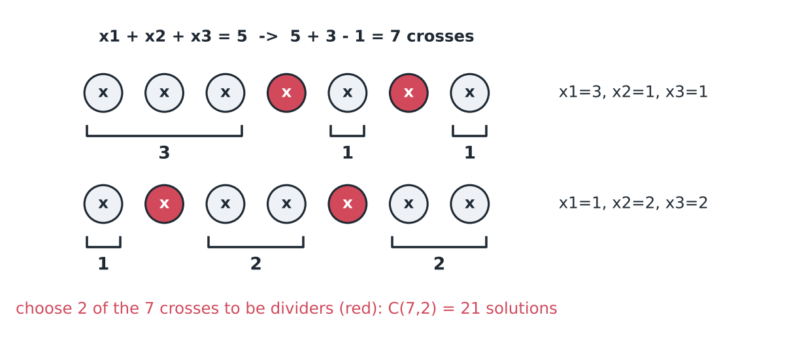
*The circled crosses are the dividers. Choosing 2 of the 7 crosses gives 21 ways.*

The formula ${}^{n+r-1}C_{r-1}$ (boxed in the notebook) gives the total number of solutions.

So basically: to separate r variables we need r-1 dividers, and the total number of positions is n + r - 1 (n stars plus r-1 dividers). Choosing which positions hold the dividers fixes the whole solution. For n=5, r=3 → ${}^{7}C_{2} = 21$.

Why brute force fails: testing every tuple of r values from 0 to n needs $(n+1)^r$ checks. For r = 10 and n = 100 this is $101^{10}$, about $1.1 \times 10^{20}$. The formula needs one binomial coefficient.

Dry run on a smaller case: $x_1 + x_2 = 2$ has n = 2, r = 2, so ${}^{3}C_{1} = 3$ solutions: (0,2), (1,1), (2,0). A group may be empty, which happens when two dividers are next to each other or a divider is at an end.

### Another variation

What if:

$1 \le x_1, x_2, x_3, ...., x_r \le n$

Previously the lower bound was 0.

$x_1 + x_2 + x_3 + .... x_r = N$

$x_i = y_i + 1$    ($x_i$: 1...N, $y_i$: 0...N-1)

Substitute this into the equation:

$y_1 + 1 + y_2 + 1 + ...... + y_r + 1 = N$

$\sum y_i + r = N$

$\sum y_i = N - r$

$0 \le y_i \le N - r$

Now it is the same as before with n = N - r:

So ${}^{n+r-1}C_{r-1}$ becomes ${}^{N-r+r-1}C_{r-1}$, which is ${}^{N-1}C_{r-1}$.

Note: the bottom number must be $r-1$ (there are only r-1 dividers). Check N=5, r=3 → ${}^{4}C_{2} = 6$: (1,1,3) (1,3,1) (3,1,1) (1,2,2) (2,1,2) (2,2,1). With $r$ at the bottom we'd get ${}^{4}C_3 = 4$, wrong.

(Code for this = just nCr, see below.)

Both formulas as functions. The helper `choose` computes a small exact nCr by multiplying and dividing at every step (the division is exact because the partial result is itself a binomial coefficient):

```cpp
// New function (not from the Fabricator repo): the stars and bars counts as code.
/*
  Problem: count the solutions of x1 + x2 + ... + xr = n.
  With every xi >= 0 the answer is C(n + r - 1, r - 1).
  With every xi >= 1, give each variable 1 first: answer C(n - 1, r - 1).
*/
long long choose(long long top, long long pick) {      // small exact C(top, pick)
    if (pick < 0 || pick > top) return 0;
    if (pick > top - pick) pick = top - pick;
    long long result = 1;
    for (long long i = 1; i <= pick; i++) {
        result *= (top - pick + i);
        result /= i;                                   // exact at every step
    }
    return result;
}

long long solutions_nonnegative(long long n, long long r) { return choose(n + r - 1, r - 1); }
long long solutions_positive(long long n, long long r)    { return choose(n - 1, r - 1); }
```

Compiled and run: `solutions_nonnegative(5, 3)` is 21 and `solutions_positive(5, 3)` is 6, the same as above. Both formulas also match a brute-force recursion for every n up to 9 and r from 1 to 5. Cost: O(r) time and O(1) memory. For large n use one of the three nCr methods of the next section instead, because `choose` multiplies before it divides and can overflow.

**Theorem 2.3.5 (stars and bars).** Let $n \ge 0$ and $k \ge 1$. (1) The number of solutions of $x_1 + \dots + x_k = n$ in integers $x_i \ge 0$ is $\binom{n+k-1}{k-1}$. (2) With $x_i \ge 1$ for all $i$ it is $\binom{n-1}{k-1}$. (3) With lower bounds $x_i \ge l_i$ it is $\binom{n - L + k - 1}{k - 1}$, where $L = l_1 + \dots + l_k$, and 0 if $n < L$.

Small example first: 7 identical candies for 3 children give $\binom{9}{2} = 36$ ways, or $\binom{6}{2} = 15$ if every child gets at least one.

Why it works:
1. Write a solution as a row of $n$ stars and $k-1$ bars: $x_1$ stars, a bar, $x_2$ stars, a bar, and so on.
2. Every row of $n+k-1$ symbols with exactly $k-1$ bars comes from exactly one solution, and back. This is a bijection.
3. A row is fixed by the positions of its bars, so there are $\binom{n+k-1}{k-1}$ rows. This is part 1.
4. Part 2: put $y_i = x_i - 1 \ge 0$. These are the solutions of $y_1 + \dots + y_k = n - k$, so apply part 1.
5. Part 3: the same substitution with $y_i = x_i - l_i$. If $L > n$ there is no solution.

This proof needs: (1) identical items and labelled groups. Identical groups (partitions of a number) are a different, harder count. (2) Only lower bounds shift away. An upper bound $x_i \le u_i$ needs inclusion-exclusion (the section above).

<TheoremCode unit="2.3/thm-5" />

The line shows both counts from the small example. The general version as a tested unit:

<CodeSnippet unit="2.3/stars-bars" />

Trace for $x_1 + x_2 = 5$ with $x_1 \ge 1$ and $x_2 \ge 0$: $L = 1$, so the count is $\binom{5 - 1 + 1}{1} = 5$. Common mistake: forgetting to shift the lower bound. The program then counts all 6 solutions of $x_1 + x_2 = 5$ with $x_i \ge 0$, including $x_1 = 0$, which is not allowed. Fix: subtract $L$ first. Cost: the factorial table has $n - L + k$ entries, so $O(n + k)$.

### Example: Count Ways to Make Array With Product

[LeetCode 1735](https://leetcode.com/problems/count-ways-to-make-array-with-product/). In short: for up to $10^4$ queries $(n, k)$ with $n, k \le 10^4$, count the arrays of $n$ positive integers whose product is $k$, modulo $10^9 + 7$.

Idea, in the recognition steps:

- Budget: for $n = 10^4$ there are astronomically many arrays, so listing is out. Per query, trial division of $k$ costs about $\sqrt{k} = 100$ steps, which is plenty. The factorial table needs values up to about $10^4 + 13$.
- Tools: look at the primes of $k$. The array has product $k$ exactly when, for every prime $p$ of $k$, the exponents of $p$ in the entries add up to the exponent $e$ of $p$ in $k$. So each prime is "$e$ identical copies of $p$ spread over $n$ labelled entries", which is stars and bars. Different primes are independent, so their counts multiply.
- Deciding property: the copies of one prime are identical and the entries are positions, so they are labelled. The entries are recovered from their exponents by unique factorisation, so no array is counted twice.

Trace for $n = 2$, $k = 6 = 2 \cdot 3$. Prime 2 has $e = 1$: $\binom{1 + 2 - 1}{1} = 2$. Prime 3 has $e = 1$: also 2. The product is 4, and the arrays are $[1, 6]$, $[2, 3]$, $[3, 2]$, $[6, 1]$.

<CodeSnippet unit="2.3/example-2" />

Cost: $O(\sqrt{k})$ per query after an $O(N)$ table. Common mistake: using $\binom{e + n}{n}$ or $\binom{e}{n}$. For $n = 1$ the only array is $[k]$, and the correct formula gives $\binom{e}{0} = 1$. Another way: precompute the smallest prime factor of every $k \le 10^4$ and factorise each query in $O(\log k)$; with $10^4$ queries trial division is already fast enough.

## Coding math stuff

### i) factorials

We can use a recurrence relation: fact (n) = n * fact (n-1), called recursively, with the base case f(0) = 1.

This is good only when we need a factorial only once.

What if we need several factorials, or the same factorial many times?

We build a factorial array & precompute its values (precompute: calculate once, before the queries start).


*The values can grow large. Use the modulus if the question gives one.*

Then simply use fact[i] wherever and whenever needed.

Build = O(n) once, lookup = O(1). 21! already overflows long long, so the modulus is necessary.

```cpp
// Fabricator/Maths/nCr.cpp
long long factorial(long long n){
    long long fact = 1;
    for(long long i=2; i<=n; i++){
        fact = (fact * i) % MOD;
    }

    return fact;
}

const int DEF_SIZE = 1000100;
long long fact[DEF_SIZE];
void factorial_precomputed(long long n){
    fact[0] = fact[1] = 1;
    for(long long i=2; i<DEF_SIZE; i++){
        fact[i] = (fact[i-1] * i) % MOD;
    }
}
```

The parameter n of factorial_precomputed is not used: it always fills DEF_SIZE = 1000100 entries. Checked: the table starts 1 1 2 6 24 120 720, and fact[20] = 146326063, which is 20! modulo $10^9+7$.

Note: Factorial.cpp has `int fact[]`, and `fact[i-1] * i` overflows int from 13! onwards. Use the long long version above.

### ii) nCr

The formula is $\frac{n!}{(n-r)!\, r!}$.

There are three ways to code this. Each one fits different limits on n and r.

**Case I:** r is small ($r \le 30$), n is large

In $\frac{n!}{(n-r)!\, r!}$, most of the numerator is cancelled out by $(n-r)!$.

We can directly compute the following,

$\frac{n \times (n-1) \times (n-2) \times .... \times (n-r+1)}{1 \times 2 \times 3 \times .... \times r}$

```cpp
ans = 1
for (i = 0; i<r; i++){
    ans *= (n-i);
    ans /= (i+1);
}
```

The result is always an integer. This is because of the following theorem: the product of x consecutive numbers is always divisible by x!.

Why is the division exact? After step i, ans = ${}^{n}C_{i+1}$, which is an integer. For example ${}^{5}C_2$: 1·5/1 = 5, then 5·4/2 = 10. Another trace, ${}^{6}C_3$: 6/1 = 6, then 6·5/2 = 15, then 15·4/3 = 20.

Note: `ans *= (n-i)` happens before the division, so for big n it can overflow even if the final answer fits. Also use only min(r, n-r) iterations, because ${}^nC_r = {}^nC_{n-r}$. Cost: O(r) multiplications and divisions, with no extra memory.

```cpp
// Fabricator/Maths/nCr.cpp
// n<=40 and r<=n
// O(r)
long long nCr_basic(long long n, long long r){
    long long ncr = 1;
    for(long long i=1; i<=r; i++){
        ncr *= (n - i + 1);
        ncr /= i;
    }

    return ncr;
}
```

**Case II:** Table method

${}^nC_r = {}^{n-1}C_{r-1} + {}^{n-1}C_r$

For example, ${}^3C_2 = {}^2C_1 + {}^2C_2$ is the sum of these two values.

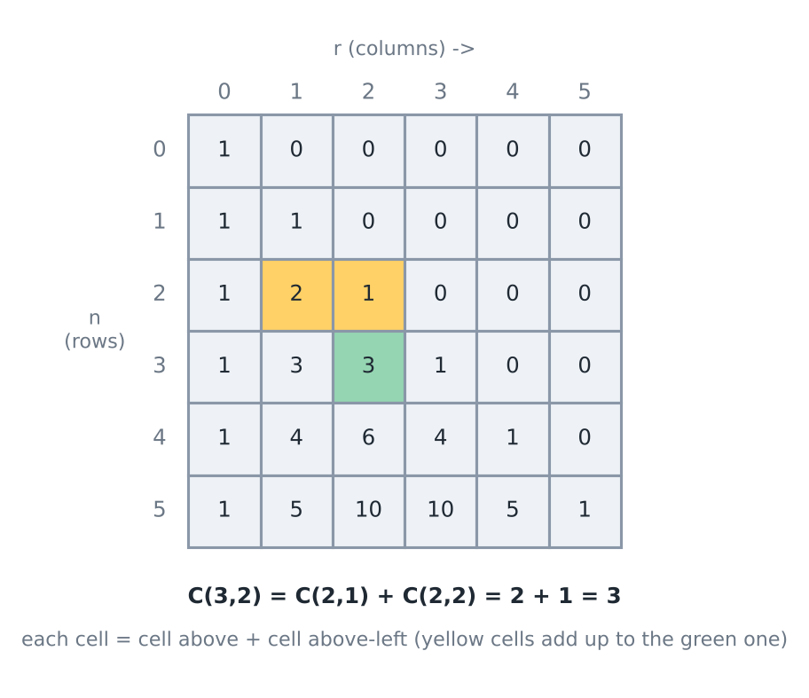
*Each cell is the cell above plus the cell above-left. The two yellow cells add up to the green cell.*

- A modulus can be used easily.
- The modulus does not need to be prime, because we do not need an inverse.
- We can easily build a 1000x1000 matrix and stay within the memory limit (mem lim).

T.C. = O(n²). Memory: 1001 × 1001 long long values × 8 bytes ≈ 8 MB.

```cpp
// Fabricator/Maths/nCr.cpp
// Pascal's Triangle
// O(n^2)
long long ncr[1001][1001];
long long nCr_tabular(long long n, long long r, long long mod){
    ncr[0][0] = 1;
    
    for(long long i=1; i<=n; i++){
        for(long long j=0; j<=i; j++){
            if(j == 0) {
                ncr[i][j] = ncr[i-1][j] % mod;
            }
            else{
                ncr[i][j] = (ncr[i-1][j] + ncr[i-1][j-1]) % mod;
            }
        }
    }

    return ncr[n][r];
}
```

**Case III:** factorial precalculate:

$fact[i] = (i! \;\%\; mod)$.

We need ${}^nC_r = \frac{n!}{(n-r)!\, r!}$ for $n, r \le 10^6$. All the values can be fetched from the fact array, and the inverses can also be computed easily:

${}^nC_r = n! * inv((n-r)!) * (r!)^{-1}$

The T.C. is O(log (mod)) per query, not including the factorial precomputation.

What is inv? The inverse of x mod p is the number y such that $x \cdot y \equiv 1 \pmod p$. Instead of dividing by x, we multiply by y. For a prime p, $y = x^{p-2}$ (Fermat's little theorem), computed by fast power in O(log p). This is why Case III needs a prime modulus (and n &lt; p), while Case II does not.

Even better: store inv_fact[] as well. Then we compute only one inverse, and get the rest by `inv_fact[i-1] = inv_fact[i] * i`. Then each query takes O(1). Memory: two arrays of $10^6$ long long values = 16 MB.

Small trace with p = 7 (only to see the idea). 5! = 120 and 120 mod 7 = 1, so inv_fact[5] = 1. Then inv_fact[4] = 1 x 5 = 5. Check: 4! = 24, 24 mod 7 = 3, and 3 x 5 = 15, 15 mod 7 = 1, so 5 is the inverse of 4!. Next, inv_fact[3] = 5 x 4 mod 7 = 6, and 3! x 6 = 36, 36 mod 7 = 1.

```cpp
// Fabricator/Maths/BinomialCoefficients.cpp
long long bin_pow(long long base, long long exp){
    long long ans = 1;
    while(exp){
        if(exp & 1){
            ans = (ans * base) % MOD;
        }
        
        base = (base * base) % MOD;
        exp >>= 1;
    }
    return ans;
}

long long inverse(long long x){
    return bin_pow(x, MOD - 2);
}

long long fact[DEF_ARR_SIZE];
long long inv_fact[DEF_ARR_SIZE];

void factorial_inverse(){
    fact[0] = fact[1] = 1;
    for(long long i=2; i<DEF_ARR_SIZE; i++){
        fact[i] = (fact[i-1] * i) % MOD;
    }

    inv_fact[DEF_ARR_SIZE - 1] = inverse(fact[DEF_ARR_SIZE - 1]);
    for(long long i=DEF_ARR_SIZE - 1; i>0; i--){
        inv_fact[i-1] = (inv_fact[i] * i) % MOD;
    }
}
```

```cpp
// Fabricator/Maths/nCr.cpp
// n, q, r <= 10^6
// O(log MOD)
// Use for queries, answer from precomputed values
long long nCr_fact(long long n, long long r){
    long long num = fact[n];
    long long den = (fact[n-r] * fact[r]) % MOD;

    return (num * inverse(den)) % MOD;
}

// n,q,r<=10^6
// O(1)
// Use for queries, answer from precomputed values
long long nCr_fact_inv(long long n, long long r){
    long long num = fact[n];
    long long den = (inv_fact[n-r] * inv_fact[r]) % MOD;

    return (num * den) % MOD;
}
```

Note: the `inverse` in nCr.cpp is `return (num, MOD - 2);` (comma operator, so it returns MOD-2 only). Use the `inverse` from BinomialCoefficients.cpp above.

Which one when?

| Case | limits | T.C. per query | mod |
|---|---|---|---|
| I direct loop | r ≤ 30, n huge | O(r) | none |
| II table | n ≤ 1000 | O(1) after O(n²) | any |
| III factorials | n ≤ 10^6 | O(log p) / O(1) | prime |

For stars and bars (above), the answer is just an nCr, so use whichever case fits n + r - 1.

**Theorem 2.3.3 (factorial tables).** Let $p$ be prime and $N < p$. Compute $f_i = i! \bmod p$ for $0 \le i \le N$, then $g_N = f_N^{p-2} \bmod p$ and $g_{i-1} = g_i \cdot i \bmod p$ for $i = N, \dots, 1$. Then $g_i = (i!)^{-1} \bmod p$ and $\binom{n}{r} \equiv f_n \, g_r \, g_{n-r} \pmod p$ for $0 \le r \le n \le N$. The tables take $O(N + \log p)$ steps, and each coefficient then takes $O(1)$.

This is Case III above. His trace with $p = 7$ is the small example. The part that was left open is why the inverse exists:
1. Since $N < p$, every factor of $i!$ is below $p$, so none is a multiple of $p$.
2. A prime divides a product only if it divides a factor (Euclid's lemma), so $p \nmid i!$ and the inverse exists.
3. $g_N$ is that inverse by Fermat's formula, and $((i-1)!)^{-1} = (i!)^{-1} \cdot i$ because $(i-1)! = i!/i$.
4. $\binom{n}{r} = n! \cdot (r!)^{-1} \cdot ((n-r)!)^{-1}$ is a fraction whose denominator is not divisible by $p$, so its residue is the product of the residues (fractions modulo a prime, lesson 2.2).

This proof needs: (1) $p$ is prime and every $n$ used is below $p$. With $n \ge p$, $n!$ is a multiple of $p$ and the formula breaks. (2) The tables fit in memory, up to a few million entries.

<TheoremCode unit="2.3/thm-3" />

Common mistake: stepping down with $i - 1$ instead of $i$, that is `inv_fact[i-1] = inv_fact[i] * (i-1)`. The last step then sets `inv_fact[0]` to 0, so every $\binom{n}{0}$ and $\binom{n}{n}$ becomes 0. For example $\binom{3}{0}$ prints 0 instead of 1. Fix: $((i-1)!)^{-1} = (i!)^{-1} \cdot i$. Test $\binom{n}{0}$ and $\binom{n}{n}$ explicitly.

### Example: Knight

[AtCoder ABC 145 D](https://atcoder.jp/contests/abc145/tasks/abc145_d). In short: a piece starts at $(0, 0)$ and moves by $(+1, +2)$ or $(+2, +1)$. Count the move sequences that reach $(X, Y)$, for $X, Y \le 10^6$, modulo $10^9 + 7$.

Idea, in the recognition steps:

- Budget: $X, Y \le 10^6$ means about $6.7 \cdot 10^5$ moves. Trying both moves at every step is exponential, and a table over $10^{12}$ cells is far too large. We need about $O(X + Y)$.
- Tools: only the number of moves of each kind matters for where the piece ends. $a$ moves of the first kind and $b$ of the second reach $(a + 2b, 2a + b)$, whatever the order. Fixed counts of two kinds of steps, in some order, is a choice of positions, so it is a bijection with subsets.
- Deciding property: from $a + 2b = X$ and $2a + b = Y$ we get $a = \frac{2Y - X}{3}$ and $b = \frac{2X - Y}{3}$. They must be non-negative integers, otherwise the answer is 0. The system has exactly one solution, so every valid sequence has exactly these counts.

Why it works: map each sequence to the set of positions of its $(1, 2)$ moves. Different sequences give different sets, and every set of $a$ positions among $a + b$ gives one sequence. So the answer is $\binom{a+b}{a}$, taken from factorial tables.

Trace for $(X, Y) = (3, 3)$: $a = \frac{6 - 3}{3} = 1$ and $b = 1$, so the answer is $\binom{2}{1} = 2$ (the sequences $(1,2),(2,1)$ and $(2,1),(1,2)$). For $(1, 1)$: $2Y - X = 1$ is not divisible by 3, so the answer is 0.

<CodeSnippet unit="2.3/example-1" />

Cost: $O(X + Y)$ for the factorials and one fast power each. Common mistake: testing only divisibility and not the signs. For $(X, Y) = (1, 5)$ the value $2Y - X = 9$ is divisible by 3, but $2X - Y = -3$ gives $b = -1$, and no sequence exists. Fix: also require $2Y \ge X$ and $2X \ge Y$.

## Derangement

A derangement is a permutation where no element appears in its original position. It is also called a no-fixed-point permutation.

Example with three letters. The positions 1, 2, 3 originally hold A, B, C. The arrangement C A B is valid: it is a derangement, because every letter moved. The arrangement C B A is not valid, because B is at the same position as in the original.

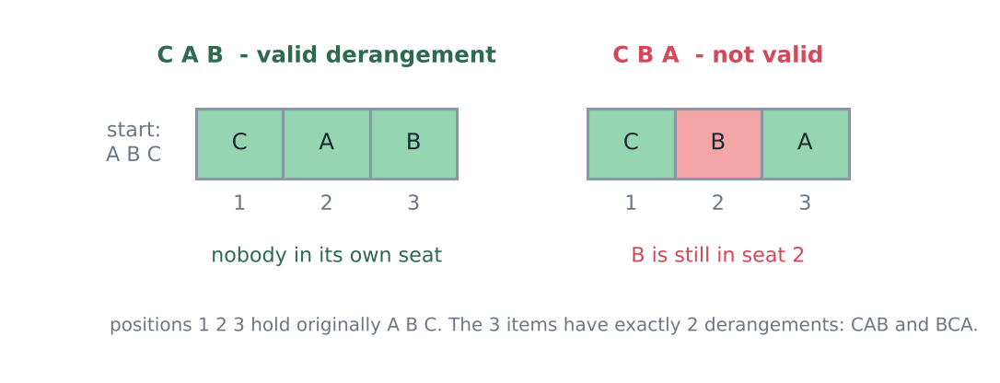
*CAB is a derangement. CBA is not, because B did not move.*

How many ways to derange n objects?

To count the derangements, start from all N! permutations and remove those that keep at least one item in its place, using inclusion-exclusion.

The formula, for N elements (A, B, ...... E), is:

$N! - ( {}^NC_1 (N-1)! ) + {}^NC_2 (N-2)! - {}^NC_3 (N-3)! ...$

Here ${}^NC_1 (N-1)!$ counts the permutations in which at least 1 element is at the same place, and we subtract it.

(Choose which items stay in place, permute the rest, then inclusion-exclusion fixes the double counting: a permutation with 2 fixed items is counted once for each of them.)

${}^NC_i (N-i)! = \frac{N!}{(N-i)!\, i!} \times (N-i)! = \frac{N!}{i!}$

$N! - \frac{N!}{1!} + \frac{N!}{2!} - \frac{N!}{3!} \; ...... \; \frac{N!}{N!}$

Last term has sign $(-1)^N$.

Trace for N = 3: 3! - 3!/1! + 3!/2! - 3!/3! = 6 - 6 + 3 - 1 = 2. The two derangements of ABC are BCA and CAB.

Question: in how many ways can the letters of the word "SWORD" be arranged such that no letter is in its original position?

$D(5) = 5! - \frac{5!}{1!} + \frac{5!}{2!} - \frac{5!}{3!} + \frac{5!}{4!} - \frac{5!}{5!}$

$= 5 \times 4 \times 3 - 5 \times 4 + 5 - 1$

$= 60 - 20 + 5 - 1$

$= 44$

Question: there are five balls of different colors and 5 boxes with the same colors as the balls. In how many ways can the balls be placed so that no ball goes in the box of the same color?

$D(5) = 44$. (It is the same problem with different names.)

Question: there are 6 cards and 6 envelopes, both numbered 1, 2, 3, 4, 5, 6. In how many ways can the cards be placed so that no card is in an envelope with the same number, and card 1 is always placed in envelope 2?

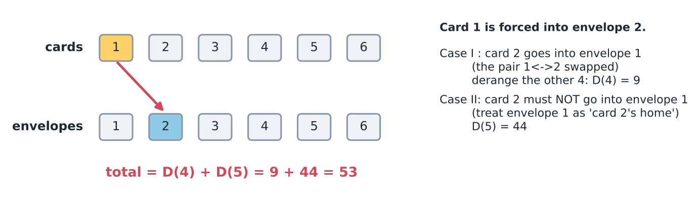
*Card 1 is fixed in envelope 2. Case I gives 9 ways and Case II gives 44 ways.*

Case I: card 2 goes in envelope 1, and we derange the remaining 4 cards, which gives D(4).

Case II: card 2 cannot go in envelope 1, which gives D(5). (Now card 2 also has one banned envelope, just like the other 4 cards, so this is the same as a derangement of 5 items.)

$sol(n) = D(4) + D(5) = 9 + 44 = 53$   (a brute-force check also gives 53)

Using the example above as a reference, the same two cases give a rule for any N. Take N elements a_1, a_2, a_3, ......, a_n and N positions.

The element a_1 has N-1 options to go. Let us say a_1 goes to position x. Two cases arise:

- a_x goes to position 1, which gives D(N-2).
- a_x does not go to position 1, which gives D(N-1).

So the total number of derangements is (N-1) [ D(N-2) + D(N-1) ].

$D(N) = (N-1) [\, D(N-1) + D(N-2) \,]$ ✓

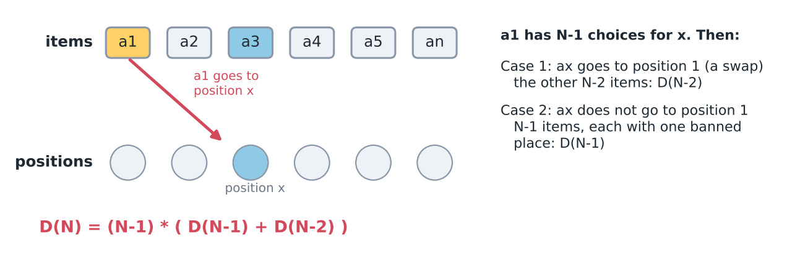
*The element a1 has N-1 choices, and then two cases arise.*

Why the second case is D(N-1): if a_x does not go to position 1, then a_x has one banned position (position 1), like each of the other N-2 elements has its own banned position. Together with a_1 already placed, these N-1 elements form a derangement problem of size N-1.

$D(0) = 1$ and $D(1) = 0$. Then:

- $D(2) = 1$
- $D(3) = 2 \times (1+0) = 2$
- $D(4) = 3 \times (1+2) = 9$
- $D(5) = 4 \times (9+2) = 44$

Another formula is $D(N) = N \times D(N-1) + (-1)^N$.

Check: $D(5) = 5 \times 9 - 1 = 44$ ✓

Also, D(N) is the nearest integer to N!/e. For example, D(10) = 1334961.

The Fabricator file has one recursive version and three table versions. They use the constants MOD = 1000000007 and DEF_ARR_SIZE = 1000100.

```cpp
// Fabricator/Maths/Derangement.cpp
// Derange (Recursvie)
// O(2^n) TC
long long derange_rec(long long n){
    if(n == 1) return 0;
    if(n == 2) return 1;

    return (n-1) * (derange_rec(n-2) + derange_rec(n-1));
}

// Derange (Precomputation)
// O(n) TC and SC
long long der[DEF_ARR_SIZE];

void derange_pre(){
    der[0] = 1;
    der[1] = 0;

    for(long long i=2; i<DEF_ARR_SIZE; i++){
        der[i] = (i - 1) * (der[i-1] + der[i-2]);
    }
}

// Derange with modulo (Precomputation)
// O(n) TC and SC
long long der_mod[DEF_ARR_SIZE];

void derange_mod_pre(){
    der_mod[0] = 1;
    der_mod[1] = 0;

    for(long long i=2; i<DEF_ARR_SIZE; i++){
        long long previous_der = (der_mod[i-1] + der_mod[i-2]) % MOD;
        der_mod[i] = ((i-1) * previous_der) % MOD;
    }
}

// Derange with modulo (Precomputation)
// O(n)
long long der_mod2[DEF_ARR_SIZE];

void derange_mod_pre2(){
    der_mod2[0] = 1;
    der_mod2[1] = 0;

    for(long long i=2; i<DEF_ARR_SIZE; i++){
        der_mod2[i] = (i * der_mod2[i-1]) % MOD;
        long long shift = (i & 1) ? -1 : 1;

        der_mod2[i] = (der_mod2[i] + shift) % MOD;
    }
}
```

```cpp
// Fabricator/Maths/ChristmasParty.cpp
long long derange(long long num){
    if(num == 0){
        return 1;
    }

    long long der_prev = 1;
    long long der = 0;
    for(long long i=2; i<=num; i++){
        der_prev = (der_prev + der) % MOD;
        long long temp = der;
        der = ((i-1) * der_prev) % MOD;
        der_prev = temp;
    }

    return der;
}
```

Note: derange_rec(0) never stops (its base cases are only 1 and 2), and the recursion takes exponential time because it recomputes the same values. derange_pre has no mod, so it overflows after N ≈ 20. All versions give 0 1 2 9 44 265 1854 14833 133496 1334961 for N = 1..10. For N = $10^6$ the three modular versions (derange_mod_pre, derange_mod_pre2 and derange) all give 102701088.

Cost: the table versions do one multiplication and one addition per index, so O(N) time and O(N) memory; a rolling pair of two variables (as in ChristmasParty.cpp) reduces the memory to O(1).

## Recognition cards

A card names one technique, the property that decides it, and the signals that rule it in or out. Use the cards to decide before you code.

<Cards topic="2.3" />

## Quick revision

- Sum rule: OR → add. Product rule: AND → multiply.
- Plate: 26·25·9·9·8 = 421200. Palindrome: $26^{\lceil N/2 \rceil}$. Odd digits with no equal neighbours: 5·$4^{N-1}$.
- n items can be ordered in n! ways. nPr = n!/(n-r)!. With duplicates, divide by the factorial of each repeat count (13!/(3!4!6!) = 60060).
- nCr = n!/(r!(n-r)!) = nPr/r!. nCr = (n-1)C(r-1) + (n-1)Cr.
- "At least" or "at most" → add the cases one by one (committee: 140, 708, 1568; or total minus the unwanted cases).
- 8 lines + 4 circles: 2·4C2 + 2·4C1·8C1 + 8C2 = 104.
- Subarrays: (N+1)C2. Rectangles: ((N+1)C2)². Squares: n(n+1)(2n+1)/6.
- n(A ∪ B) = n(A) + n(B) - n(A ∩ B); 3 sets: + singles - pairs + triple. If the numbers are not co-prime, use the lcm.
- Dice max not 4 → $6^4 - (4^4 - 3^4) = 1121$. cad/beg → $7! - (5!+5!-3!) = 4806$. 1..1000 by 2,3,5 → 734.
- Stars and bars: $x_1 + ... + x_r = n$, $x_i \ge 0$ → ${}^{n+r-1}C_{r-1}$. $x_i \ge 1$ → ${}^{N-1}C_{r-1}$.
- Precompute fact[] with the modulus. nCr: small r → direct loop (exact), n ≤ 1000 → Pascal table (any modulus), n ≤ 10^6 → fact + inv_fact (prime modulus). The exact multiply-then-divide loop is safe in a long long for n up to 61.
- Derangement: $D(N) = N! \sum (-1)^i / i!$; $D(N) = (N-1)(D(N-1) + D(N-2))$; $D(N) = N D(N-1) + (-1)^N$; D(0)=1, D(1)=0, 0 1 2 9 44 265.
- Theorem 2.3.1: multiply options only if the number of options does not depend on earlier choices and each object is built in one way. Sort the limits for distinct values.
- Theorem 2.3.2: a row of Pascal's triangle sums to $2^n$ (every subset has some size).
- Theorem 2.3.3: factorial tables need a prime $p > n$; $p \nmid i!$ because every factor is below $p$.
- Theorem 2.3.4: $\frac{n!}{c_1! \cdots c_k!}$ arrangements; copies must be indistinguishable.
- Theorem 2.3.5: lower bounds shift away, $\binom{n - L + k - 1}{k - 1}$, and 0 if $L > n$; upper bounds need inclusion-exclusion.
- Theorem 2.3.6: an element in exactly $t$ sets contributes $(1-1)^t$, so only elements in none are counted; signs alternate.
- Theorem 2.3.7: paths with $a$ rights and $b$ ups are $\binom{a+b}{a}$; through a point, multiply the two halves.

## Check yourself

### Identification drill

Each item names a problem without saying which card decides it. Choose a card, write the property you checked, then reveal the answer.

<Drill topic="2.3" />

### Look-alike pairs

Two problems that read almost the same but need different tools. The flipping difference is the one detail that changes the decision.

<LookalikePairs topic="2.3" />

### Self-test

Answer each question on paper before opening its answer.

<SelfTest topic="2.3" />

### Checkpoint

Three problems in 120 minutes. Solve at least 2 of 3 in time and choose the right card on at least 8 of the 11 drill items.

<Checkpoint topic="2.3" />

### Decision map update

How this topic's cards are chosen against the tools you already have.

<DecisionMapUpdate topic="2.3" />

## Practice problems

**CSES**

- [CSES task 1079](https://cses.fi/problemset/task/1079)
- [CSES task 1717](https://cses.fi/problemset/task/1717)

**Codeforces**

- [Codeforces 844B](https://codeforces.com/contest/844/problem/B)
- [Codeforces 1096B](https://codeforces.com/problemset/problem/1096/B)
- [Codeforces 1272C](https://codeforces.com/problemset/problem/1272/C)
- [Codeforces 131C](https://codeforces.com/problemset/problem/131/C)
- [Codeforces 1328B](https://codeforces.com/problemset/problem/1328/B)
- [Codeforces 1674B](https://codeforces.com/problemset/problem/1674/B)
- [Codeforces 1840C](https://codeforces.com/problemset/problem/1840/C)
- [Codeforces 459B](https://codeforces.com/problemset/problem/459/B)
- [Codeforces 476B](https://codeforces.com/problemset/problem/476/B)
- [Codeforces 478B](https://codeforces.com/problemset/problem/478/B)
- [Codeforces 610A](https://codeforces.com/problemset/problem/610/A)
- [Codeforces 630C](https://codeforces.com/problemset/problem/630/C)

**HackerRank**

- [ncr table](https://www.hackerrank.com/challenges/ncr-table/problem)
- [euler001](https://www.hackerrank.com/contests/projecteuler/challenges/euler001/problem)

**Maang (AlgoZenith)**

- [Divide the Piles](https://maang.in/problems/Divide-the-Piles-67)
- [Number of Diagonals](https://maang.in/problems/Number-of-Diagonals-68)
- [Number of Intersecting Diagonals](https://maang.in/problems/Number-of-Intersecting-Diagonals-69)
- [Number of Parts in Convex Polygon](https://maang.in/problems/Number-of-Parts-in-Convex-Polygon-70)
- [Number of Ways to Reach B](https://maang.in/problems/Number-of-Ways-to-Reach-B-71)
- [Solve the Equation](https://maang.in/problems/Solve-the-Equation-73)

### Problem ladder

<Ladder topic="2.3" />
