import TopicHeader from '../../../components/TopicHeader.astro';
import Ladder from '../../../components/Ladder.astro';
import TheoremCode from '../../../components/TheoremCode.astro';
import CodeSnippet from '../../../components/CodeSnippet.astro';
import WhatYouNeed from '../../../components/WhatYouNeed.astro';
import Cards from '../../../components/Cards.astro';
import Drill from '../../../components/Drill.astro';
import LookalikePairs from '../../../components/LookalikePairs.astro';
import SelfTest from '../../../components/SelfTest.astro';
import Checkpoint from '../../../components/Checkpoint.astro';
import DecisionMapUpdate from '../../../components/DecisionMapUpdate.astro';

<TopicHeader topic="2.4" />

## What this note covers

The contribution technique means this: instead of building every large object (every triplet, every subarray, every substring) and evaluating it, ask how much each small piece adds to the answer, then add those amounts.

Why this matters: an array of $n = 10^5$ elements has about $n(n+1)/2 \approx 5 \times 10^9$ subarrays. A program can do roughly $10^8$ simple operations per second, so looking at every subarray one by one is far too slow. Counting what each of the $n$ elements contributes takes only $n$ steps.

Here is a second small problem, this time from probability. A random order of $n = 10^5$ people is chosen, and all $n!$ orders are equally likely. On average, how many people stand in their own original place? Listing all $n!$ orders is impossible beyond $n = 12$ or so. Counting the orders with exactly $k$ people in place needs inclusion-exclusion for every $k$ (topic 2.3), which is heavy. But the answer takes one line. Each person stays in place with probability $\frac{1}{n}$, so the average number of people in place is $n \cdot \frac{1}{n} = 1$.

The rule behind it: an expected count is a sum of probabilities, one for each event, even when the events depend on each other. A total over all subarrays, subsets or pairs is the same idea without the averaging: a sum over elements of the value times the number of configurations in which the element counts. Two more tools complete the picture. Waiting times have a formula of their own, $\frac{1}{p}$ trials until a success. And the expected value of a non-negative whole number is $E[X] = \sum_{x \ge 1} P(X \ge x)$, which makes maxima easy.

What you need before this lesson:

<WhatYouNeed topic="2.4" />

This lesson does not cover:
- Expected values found by a recurrence over states ("from state $s$, the expected remaining time is ..."). That needs a table of answers, which is the dynamic programming of Phase 3.
- Variance, conditional expectation as a topic of its own, Markov chains and continuous distributions. They are not part of this course.

Terms used in this lesson:
- subarray = continuous part of array, like `arr[2..5]` (substring = same for strings)
- T.C. (time complexity) = how time grows with n. TLE = time limit exceeded
- pivot = one position we fix (mostly the end of a range) and then look at everything around it
- DS = data structure (map, set, ...)
- mod = remainder after division, here by $10^9+7$ (a prime number that keeps results inside a normal integer range)
- ans = the answer being built; cur = the running value for the current position
- $\binom{n}{r}$ (n choose r) = number of ways to choose $r$ things out of $n$, order doesn't matter. e.g. $\binom{n}{2} = n(n-1)/2$
- i, j, k = positions in the array, counted from 0, so the last position is n-1
- inversion = a pair of positions (i, j) with i &lt; j but arr[i] > arr[j] (the bigger value comes first)
- Fenwick tree (also called BIT, binary indexed tree) = a small structure that keeps counts or sums and answers "sum of the first p cells" and "add to one cell", both in $O(\log n)$ time
- freq = frequency map, it stores how many times each value was seen so far

Terms from probability, used in the second half of this lesson:
- **finite probability space** = a finite set of outcomes, each with a probability $P(\omega) \ge 0$, all adding up to 1. When all outcomes are equally likely, $P(\omega)$ is 1 over the number of outcomes. An **event** is a set of outcomes, and $P(A)$ is the sum of $P(\omega)$ over the outcomes in $A$. Example: for a fair die, $P(\text{even}) = \frac{3}{6}$.
- **random variable** = a number $X(\omega)$ given to each outcome. Its **expected value** is $E[X] = \sum_\omega X(\omega) P(\omega)$, the average weighted by probability. Example: for a die, $E[X] = \frac{1 + 2 + 3 + 4 + 5 + 6}{6} = 3.5$.
- **indicator** of an event $A$ = the variable $\mathbb{1}_A$ that is 1 on the outcomes of $A$ and 0 elsewhere.
- **independent** events = events with $P(A \text{ and } B) = P(A) P(B)$. Example: two dice rolls, or two coin flips.

Contents:
- Contribution technique (the map)
  - Linearity of expectation
  - Counting by indicators
  - Tail sums
  - Waiting times
  - Worked example: expected salary (ABC326 E)
- Atomic item contribution: triplets
- Contribution as a theorem, sum of widths of all subsets, worked example: Cell Distance
- Atomic item contribution: inversions of all subarrays
- Expected inversions of a random order
- Contribution at pivot: Extension
- Contribution at pivot: DS usage
- Atomic item again: distinct characters in all substrings
- Recognition cards
- Quick revision
- Check yourself
- Practice problems

## Contribution technique

The contribution technique is always applicable whenever we count, sum or even optimize.

The figure below is the map of this lesson. Each branch is one way of asking "who adds to the answer?".

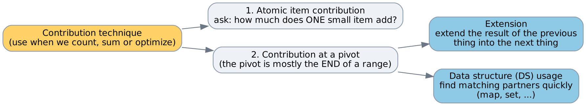
*Two branches: atomic means one small item, and pivot means fixing the end. The pivot branch splits again into extension (extend the contribution of the previous thing into the next thing) and DS usage.*

Atomic item contribution: pick the smallest thing that adds to the answer (one element, one pair, one character) and count how many times it is added. Contribution at pivot: fix one position, usually the end of the range, and answer the question "what ends here?". There are two ways to do that. Extension reuses the answer of the previous end. DS usage (data structure usage) keeps the earlier elements in a map, set or tree and searches in it.

### Where the idea started: one bit at a time

You have used the contribution technique before, in [topic 1.7](../../phase-1/1-7-bits/). There the card "One bit at a time" turned the sum of the XOR over all pairs into a sum over the bits, with $2^b \cdot c_b \cdot (n - c_b)$ for each bit $b$. The small item was one bit, and the count was how many pairs differ at that bit. Here the same view meets a random choice.

Question: a subset of arr is chosen uniformly at random among all $2^n$ subsets, the empty one included. What is the expected XOR of the chosen values?

Example: arr = [1, 2, 3]. The subsets {}, {1}, {2}, {3}, {1, 2}, {1, 3}, {2, 3}, {1, 2, 3} have XORs 0, 1, 2, 3, 3, 2, 1, 0. The sum is 12, so the average is $12 / 8 = 1.5$.

Brute force: list all $2^n$ subsets. That is hopeless beyond $n \approx 25$ (topic 0.5).

Better: take one bit $b$. If no value has it, no subset has it. If some value $x$ has it, pair every subset with the subset that differs from it only in $x$. Adding or removing $x$ flips bit $b$ of the XOR, so exactly half of the subsets have bit $b$ set, and the probability is $\frac{1}{2}$. By linearity of expectation (Theorem 2.4.1, in the next section), $E[\text{XOR}] = \sum_b 2^b \cdot \frac{1}{2}$ over the bits that some value has, which is half of the OR of all values. For [1, 2, 3] the OR is 3 and the answer is $1.5$. Without the average, the same count says that the sum of the XOR over all subsets is the OR times $2^{n-1}$, the base case of the card in topic 1.7.

To avoid fractions the code returns twice the expected value, which is the OR itself.

<CodeSnippet unit="2.4/subset-xor-average" />

Dry run on [1, 2, 3]: `all` becomes 1, then 3, then 3. The function returns 3, which is twice 1.5. T.C. $O(n)$, S.C. $O(1)$. It matched the $2^n$ brute force on 5000 random inputs.

Common mistake: adding the values instead of OR-ing them. For arr = [3, 3] the subsets {}, {3}, {3}, {3, 3} have XORs 0, 3, 3, 0, so the average is 1.5 and twice it is 3. The sum of the values gives 6, because a bit that two values share is counted twice, but it is set in the XOR of exactly half of the subsets only once. Fix: use OR.

The last rung of the card "Totals by contribution", Expected Power, mixes both ideas. The square of a XOR splits over pairs of bits (topic 1.7), and the expected value of each pair of bits is a probability, which linearity adds up.

### Linearity of expectation

So far every number was exact. Now the numbers are random and we want their average. Small example first: roll two dice and ask for the average sum. The brute force lists the 36 outcomes. Each die shows each face in 6 of them, so the 36 sums add up to $6 \cdot 21 + 6 \cdot 21 = 252$, and $252 / 36 = 7$. The better way: one die averages $3.5$, so two dice average $3.5 + 3.5 = 7$, with no list at all.

This shortcut is true even when the two numbers depend on each other. Let $X$ be one die and $Y = 7 - X$ (the number on the opposite face). $Y$ is decided completely by $X$, yet $E[X + Y] = E[7] = 7 = 3.5 + 3.5$. Products are different. For $Y = X$ we get $E[X \cdot X] = \frac{1 + 4 + 9 + 16 + 25 + 36}{6} = \frac{91}{6} \approx 15.17$, which is not $3.5 \cdot 3.5 = 12.25$.

**Theorem 2.4.1 (linearity of expectation).** For random variables $X$ and $Y$ on the same experiment and a constant $c$, $E[X + Y] = E[X] + E[Y]$ and $E[cX] = c\,E[X]$. Hence $E[X_1 + \dots + X_n] = E[X_1] + \dots + E[X_n]$. No independence is needed.

In plain words: the average of a sum is the sum of the averages, even when the parts depend on each other. So an average over a huge set of outcomes can be found by averaging each part separately.

Small example: two dice, $E[\text{sum}] = 3.5 + 3.5 = 7$, without listing the 36 outcomes.

Why it works:
1. $E[X + Y] = \sum_\omega (X(\omega) + Y(\omega)) P(\omega)$, by the definition of expected value.
2. Split the sum in two: $\sum_\omega X(\omega) P(\omega) + \sum_\omega Y(\omega) P(\omega) = E[X] + E[Y]$.
3. A constant factor comes out of the sum the same way, so $E[cX] = c\,E[X]$.
4. Induction on the number of terms gives the sum of $n$ variables. $\square$

This proof needs: (1) all variables are defined on the same outcomes, that is, the same random experiment; (2) nothing about independence, because the variables may depend on each other in any way (products are different: $E[XY] = E[X]E[Y]$ does need independence); (3) a finite space, so the sums are finite (infinite waiting times use Theorem 2.4.4).

<TheoremCode unit="2.4/thm-1" />

### Counting by indicators

Small example first: a random order of 4 people. How many stand in their own place on average? The brute force lists the 24 orders. Position $i$ is in place in $3! = 6$ of them, so the 4 positions together give $4 \cdot 6 = 24$ people in place over 24 orders, an average of 1. The better way: each position stays with probability $\frac{1}{4}$, so the average is $4 \cdot \frac{1}{4} = 1$.

The events depend on each other. With three letters in three envelopes, if two letters are in the right envelope, the third one must be too. Linearity does not care.

**Theorem 2.4.2 (expected counts).** $E[\mathbb{1}_A] = P(A)$. So if $X$ counts how many of the events $A_1, \dots, A_n$ happen, then $E[X] = P(A_1) + \dots + P(A_n)$.

In plain words: the expected number of events that happen is the sum of their probabilities, because each event is a 0-or-1 variable whose average is its probability. The events may depend on each other.

Small example: fixed points of a random order of $n$ people, $n \cdot \frac{1}{n} = 1$. Inversions of a random order are worked out in the section "Inversions" below.

Why it works:
1. $E[\mathbb{1}_A] = \sum_{\omega \in A} 1 \cdot P(\omega) + \sum_{\omega \notin A} 0 \cdot P(\omega) = P(A)$.
2. A count is a sum of indicators: $X = \mathbb{1}_{A_1} + \dots + \mathbb{1}_{A_n}$.
3. Apply linearity (Theorem 2.4.1). $\square$

This proof needs: (1) the quantity is a count, or a weighted count $\sum w_i \mathbb{1}_{A_i}$, which gives $\sum w_i P(A_i)$; (2) each single probability $P(A_i)$ can be computed, often by symmetry.

<TheoremCode unit="2.4/thm-2" />

### Tail sums

Small example first: the larger of two dice. The brute force lists 36 outcomes. The value $v$ is the larger one in $2v - 1$ of them, so the total is $1 + 6 + 15 + 28 + 45 + 66 = 161$ and the average is $\frac{161}{36} \approx 4.47$. That is fine for two dice, but for $k = 10^9$ dice the list has $m^k$ outcomes. We need one simple question per value instead: "is the maximum at least $x$?"

For two dice, $P(\max \ge x) = 1 - \left(\frac{x-1}{6}\right)^2$, because the maximum is below $x$ only when both dice are below $x$. For $x = 1, \dots, 6$ this is $\frac{36}{36}, \frac{35}{36}, \frac{32}{36}, \frac{27}{36}, \frac{20}{36}, \frac{11}{36}$. They add up to $\frac{161}{36}$, the same answer.

**Theorem 2.4.4 (tail sum).** If $X$ takes values in $\{0, 1, 2, \dots\}$, then $E[X] = \sum_{x \ge 1} P(X \ge x)$. In particular, for independent $X_1, \dots, X_k$ with values in $\{1, \dots, m\}$, $P(\max X_i \le x) = \prod_i P(X_i \le x)$, so $E[\max] = \sum_{x=1}^{m} \left(1 - \prod_i P(X_i \le x - 1)\right)$.

In plain words: the expected value of a non-negative whole number is the sum over $x \ge 1$ of the probability that it is at least $x$. For a maximum of independent draws, the probability that it is at most $x$ is a product, so it is easy to find.

Small example: the larger of two dice. $P(\max \le x) = \left(\frac{x}{6}\right)^2$, so $E[\max] = 6 - \frac{0 + 1 + 4 + 9 + 16 + 25}{36} = 6 - \frac{55}{36} = \frac{161}{36} \approx 4.47$.

Why it works:
1. Write $X = \sum_{x \ge 1} [X \ge x]$. A value $v$ is counted once for each $x = 1, \dots, v$, which is $v$ times.
2. Take expectations. For a finite range this is linearity. For values without an upper bound the same exchange of sums holds, because all terms are non-negative.
3. For the maximum: $\max \le x$ exactly when every $X_i \le x$, and independence turns the probability of all of them into the product. $\square$

This proof needs: (1) non-negative whole-number values (for other values, sum $P(X \ge x)$ over the distinct values, with the gaps between them as weights); (2) independence of the $X_i$ for a maximum or minimum, such as dice or separate draws. With dependent values, $P(\max \le x)$ needs a count of its own.

<TheoremCode unit="2.4/thm-4" />

Now the version that prints the answer modulo a prime. When the answer is a fraction $\frac{P}{Q}$, compute every probability as a residue modulo the prime, with the inverse from Theorem 2.2.4. Sums and products of residues stay valid, so the residue of the exact expected value comes out.

Problem: $k$ numbers are drawn independently and uniformly from $1, \dots, m$ ($m \le 10^6$, $k \le 10^9$). Print the expected maximum modulo $998244353$. The list of $m^k$ outcomes is impossible. The tail sum has $m$ terms, each needing one fast power of about 30 rounds, so about $3 \cdot 10^7$ steps. Dry run for $m = 6$, $k = 2$: the terms are $1, \frac{35}{36}, \frac{32}{36}, \frac{27}{36}, \frac{20}{36}, \frac{11}{36}$, and the sum $\frac{161}{36}$ prints as $637767230$.

<CodeSnippet unit="2.4/expected-max" />

T.C. = $O(m \log k)$, memory $O(1)$. The same sum can be regrouped as $E[\max] = \sum_x x \cdot P(\max = x)$ with $P(\max = x) = \left(\frac{x}{m}\right)^k - \left(\frac{x-1}{m}\right)^k$. It is the same number.

Common mistake: shifting the tail sum by one, that is, using "all draws at most $x$" instead of "all draws at most $x - 1$". Input `2 6` (6 draws from $\{1, 2\}$) must give $\frac{127}{64}$, because the maximum is 1 only with probability $\frac{1}{64}$. The shifted code gives $\frac{63}{64}$. Fix: $P(X \ge x) = 1 - P(\text{all} \le x - 1)$. A quick check is $m = 1$, where the answer must be 1.

### Waiting times

Small example first: roll a die until a 6 appears. The brute force adds $t \cdot P(T = t)$ for $t = 1, 2, 3, \dots$ with $P(T = t) = \left(\frac{5}{6}\right)^{t-1} \frac{1}{6}$, an infinite sum. The better way is the tail sum above: $T \ge t$ means the first $t - 1$ rolls all failed, so $P(T \ge t) = \left(\frac{5}{6}\right)^{t-1}$, and the sum is a geometric series that equals 6.

**Theorem 2.4.5 (waiting times).**
1. If independent trials each succeed with probability $p > 0$, the expected number of trials up to and including the first success is $\frac{1}{p}$.
2. If a process passes through stages $1, \dots, k$ in order, and in stage $j$ each independent trial ends the stage with probability $p_j > 0$, the expected total number of trials is $\frac{1}{p_1} + \dots + \frac{1}{p_k}$.
3. (Coupon collector.) Drawing uniformly from $n$ kinds until every kind has appeared takes $n \left(1 + \frac{1}{2} + \dots + \frac{1}{n}\right)$ draws on average.

In plain words: repeating independent trials with success probability $p$ until the first success takes $\frac{1}{p}$ trials on average. A process made of stages one after another takes the sum of the stage times, which gives the coupon collector value.

Small example: a die until a 6 takes 6 rolls. All six faces take $6 \left(1 + \frac{1}{2} + \dots + \frac{1}{6}\right) = 6 \cdot 2.45 = 14.7$ rolls.

Why it works:
1. Part 1. The first success comes after trial $t - 1$ exactly when the first $t - 1$ trials fail, so $P(T \ge t) = (1 - p)^{t-1}$.
2. By Theorem 2.4.4, $E[T] = \sum_{t \ge 1} (1 - p)^{t-1} = \frac{1}{1 - (1 - p)} = \frac{1}{p}$, a geometric series.
3. Part 2. The total is the sum of the stage lengths. Apply part 1 to each stage and add (linearity).
4. Part 3. After $j$ kinds have been seen, a draw shows a new kind with probability $\frac{n - j}{n}$, so stage $j$ takes $\frac{n}{n - j}$ draws on average. Add over $j = 0, \dots, n - 1$. $\square$

This proof needs: (1) independent trials with a fixed success probability inside each stage; (2) stages that come one after another. If the probability depends on more than the stage number, for example on the whole history, a recurrence over states is needed, which is Phase 3.

<TheoremCode unit="2.4/thm-5" />

Template: you own $c$ of $n$ kinds and want the expected number of further draws, modulo $998244353$ ($n \le 10^6$). Simulation gives only an estimate, not a residue. The stage sum has one term per missing kind, each with one inverse, about $n \cdot 30$ steps. Dry run for $n = 6$, $c = 0$: $\frac{6}{6} + \frac{6}{5} + \frac{6}{4} + \frac{6}{3} + \frac{6}{2} + \frac{6}{1} = 14.7$. With $c = 3$ of $n = 4$, only the last stage is left: $\frac{4}{1} = 4$.

<CodeSnippet unit="2.4/coupon-collector" />

T.C. = $O(n \log p)$ because of one fast power per stage (or $O(n)$ with a table of inverses), memory $O(1)$.

Common mistake: ignoring the coupons already owned and looping from $j = 0$. Input `4 3` must print 4, but the loop from 0 adds the stages $j = 0, 1, 2$ as well and gives $4\left(1 + \frac{1}{2} + \frac{1}{3} + \frac{1}{4}\right) = \frac{25}{3}$. Fix: start the loop at $j = c$.

### Worked example: expected salary (ABC326 E)

Example: [AtCoder ABC326 E, Revenge of "The Salary of AtCoder Inc."](https://atcoder.jp/contests/abc326/tasks/abc326_e). Start with $x = 0$ and roll a fair $N$-sided die again and again. While the roll $y$ is bigger than $x$, pay $A_y$ and set $x = y$. Stop at the first roll $y \le x$. Print the expected total pay modulo $998244353$, with $N \le 3 \cdot 10^5$.

Idea. Budget: $N = 3 \cdot 10^5$ allows $O(N)$ or $O(N \log N)$. The process can follow exponentially many paths, so they cannot be listed. Tools: the pay is a sum of $A_y$ times "$A_y$ is paid", so by Theorem 2.4.2 the expected pay is $\sum_y A_y \cdot P(A_y \text{ is paid})$, although the events are far from independent. Deciding property: each single probability needs a formula. Since $x$ only increases, $A_y$ is paid exactly when the rolls so far are some increasing values $t_1 < \dots < t_j < y$, followed by $y$.

Fix $y$ and a set $T \subseteq \{1, \dots, y - 1\}$ of size $j$. The rolls "the elements of $T$ in increasing order, then $y$" have probability $\left(\frac{1}{N}\right)^{j+1}$, because the rolls are independent. These cases are disjoint for different $T$, so by the binomial theorem (topic 2.3)

$$P(A_y \text{ is paid}) = \sum_{j=0}^{y-1} \binom{y-1}{j} \frac{1}{N^{j+1}} = \frac{1}{N}\left(1 + \frac{1}{N}\right)^{y-1}.$$

Trace for $N = 3$, $A = (3, 2, 6)$: $P$ is $\frac{1}{3}, \frac{4}{9}, \frac{16}{27}$, so $E = 3 \cdot \frac{1}{3} + 2 \cdot \frac{4}{9} + 6 \cdot \frac{16}{27} = \frac{49}{9}$, which prints as $776412280$. (Check $y = 2$ by hand: first roll 2, probability $\frac{1}{3}$, or first roll 1 then 2, probability $\frac{1}{9}$, total $\frac{4}{9}$.)

<CodeSnippet unit="2.4/example-1" />

Cost: $O(N)$ after one inverse of $N$, memory $O(1)$ besides the array. Common mistake: using the exponent $y$ instead of $y - 1$. For $N = 1$, $A = (5)$ the answer is 5, because the first roll always pays, but the exponent $y$ gives $10$.

## Atomic item contribution

Question: Given an array of n elements, choose all triplets (i,j,k) such that ($0 \le i < j < k \le n-1$) and calculate their sum, modulo $10^9+7$.

Brute force, three nested loops, one for each position of the triplet:

```cpp
for (0 ≤ i < n)
    for (i < j ≤ n)
        for (j < k ≤ n)
            ans += arr[i] + arr[j] + arr[k];
```

This is $O(n^3)$, which gives TLE (time limit exceeded).

How slow? For $n = 1000$ there are about $1.7 \times 10^8$ triplets, already near the limit. For $n = 10^5$ there are about $1.7 \times 10^{14}$.

Note: j and k loops should stop at `< n`, last index is n-1.

Take 4 elements a, b, c, d and write all triplets. They are abc, acd, abd and bcd. Adding them up gives $3 \times a + 3b + 3c + 3d = \text{ans}$.

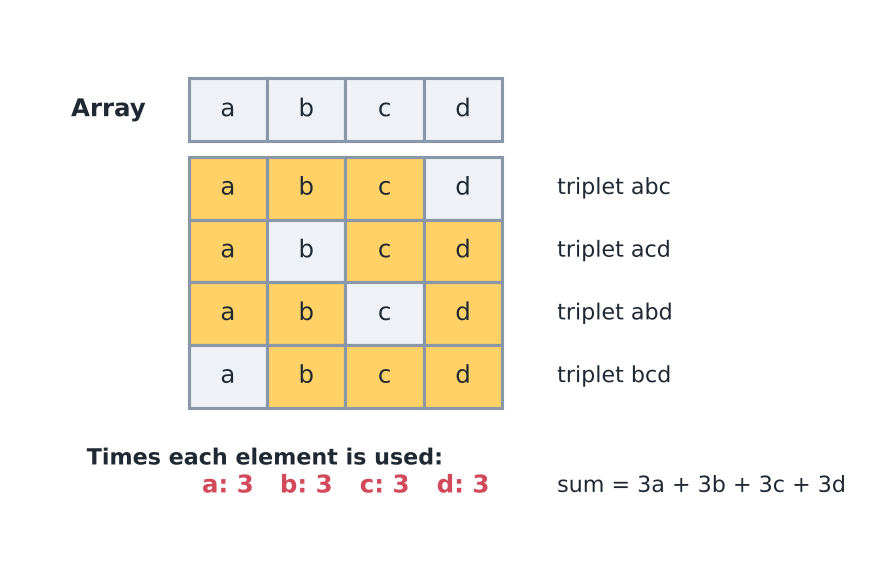
*There are 4 triplets, and every element appears in 3 of them.*

Notice that every element comes exactly 3 times. Why? Because, when we choose any number, then we have to choose the other 2 numbers out of the **n-1** numbers left. That is, there are 2 places to fill, out of (n-1) options.

So the element a is counted this many times:

$a \times \binom{n-1}{2}$

For the 4 elements above this is $\binom{3}{2} = 3$, which matches the 3 triplets that contain a.

![a[x] with two empty slots, shown for the three positions of a[x].](../../../assets/notes/2-4-expected-value/fig03_roles.png)
*a[x] is fixed; the other 2 places are filled from the remaining n-1 elements.*

The contribution of any element of the array thus becomes

a[x] * $^{n-1}C_2$, where we choose two out of (n-1) elements without any order.

ans = $\sum_{i=0}^{n-1} (a[i] \times {}^{n-1}C_2)$

ans = $^{n-1}C_2 \times \sum_{0}^{n-1} a[i]$ &nbsp; (the sum of the elements of the array)

Check with a,b,c,d = 1,2,3,4: $^{3}C_2 = 3$, sum = 10, so ans = 30. Brute force also gives 30.

Why are we allowed to group by element? The answer is a sum of many small terms, and each term is one element taken from one triplet. Adding these terms triplet by triplet or element by element adds the same terms in a different order, so the total is the same.

T.C. (time complexity) = $O(n)$ (just one pass for the sum), memory $O(1)$. Edge cases: if $n < 3$ there is no triplet, so ans = 0. Use long long: for $n = 10^5$, `(n-1)*(n-2)/2` is about $5 \times 10^9$, which does not fit in a 32-bit int (limit about $2.1 \times 10^9$). Both `ways` and `total` are kept below $10^9+7$, so their product is below about $10^{18}$ and still fits in a long long. Negative values → `((x % mod) + mod) % mod`, because in C++ the remainder of a negative number is negative.

```cpp
/*
  Problem: given n numbers, look at every triplet of positions (i, j, k)
  with 0 <= i < j < k <= n-1. Return the sum of arr[i] + arr[j] + arr[k]
  over all triplets, modulo 1e9+7.
  Idea: every element is in exactly C(n-1, 2) triplets, so
  answer = C(n-1, 2) * (sum of the array).
*/
long long tripletSum(const vector<long long>& arr) {
    const long long MOD = 1000000007;
    long long n = arr.size();
    if (n < 3) return 0;                               // no triplet exists
    long long ways = ((n - 1) * (n - 2) / 2) % MOD;    // C(n-1, 2)
    long long total = 0;
    for (long long v : arr) total = ((total + v) % MOD + MOD) % MOD;  // keeps it in [0, MOD)
    return ways * total % MOD;
}
```

Why does the ordering not matter? There are three places where a[x] can sit relative to the 2 other chosen positions:

- If one chosen position is on its left and one is on its right, then a[x] is j.
- If both chosen positions are on its left, then a[x] is k.
- If both chosen positions are on its right, then a[x] is i.

In other words, whichever 2 other positions we choose, the role of a[x] (i, j or k) is decided by where it sits among them. One set of 3 positions is exactly one triplet. So we count sets, never orders.

Common mistake: choosing the 2 other positions in order, which gives (n-1)(n-2) instead of $^{n-1}C_2$ = (n-1)(n-2)/2. Every pair of positions is then counted twice, so the answer doubles (60 instead of 30 for 1, 2, 3, 4).

Same thinking, another problem (Fabricator/ContributionTechnique/SumOfDifference.cpp): sum of $|a_i - a_j|$ over all pairs $i < j$. The brute force looks at all $n(n-1)/2$ pairs, which is about $5 \times 10^9$ for $n = 10^5$. Sorting doesn't change this sum, because $|a - b|$ is the same for both orders and every pair of elements is still counted once. After sorting, element at index i is bigger in `i` pairs (all before it) and smaller in `n-i-1` pairs (all after it). In a pair the bigger value is added and the smaller value is subtracted, so contribution = $(i - (n-i-1)) \times \text{value}$. T.C. = $O(n \log n)$ because of sort, memory $O(n)$ for the sorted copy. With equal values the formula still works, because a pair of equal values adds and subtracts the same number. The answer can be large, so it is kept in a long long.

Example: sorted [1, 3, 6]. Index 0 is the smaller value in 2 pairs and the bigger value in 0 pairs, and so on. Contributions: $(0-2) \times 1 = -2$, $(1-1) \times 3 = 0$, $(2-0) \times 6 = 12$. Total 10. Check by hand: $|1-3| + |1-6| + |3-6| = 2 + 5 + 3 = 10$.

```cpp
// Fabricator/ContributionTechnique/SumOfDifference.cpp (input reading removed, loop is same)
/*
  Problem: for an array, return the sum of |arr[i] - arr[j]| over all pairs
  i < j. Sorting does not change this sum. In sorted order the element at
  index i is the bigger one in i pairs and the smaller one in (n-i-1) pairs,
  so its contribution is (i - (n-i-1)) * value.
*/
long long sumOfDifferences(vector<int> arr) {
    int n = arr.size();
    vector<int> arr_sorted(arr);
    sort(arr_sorted.begin(), arr_sorted.end());
    long long sol = 0;
    for(int i=0; i<n; i++){
        long long smaller_than_current = i;
        long long larger_than_current = n - i - 1;
        sol += (smaller_than_current - larger_than_current) * (long long)(arr_sorted[i]);
    }
    return sol;
}
```

### Contribution as a theorem

Small example first: the sum of the sums of all subarrays of $(1, 2, 3)$. Listing the six subarrays gives $1 + 2 + 3 + 3 + 5 + 6 = 20$. By elements: index $i$ lies in $(i+1)(n-i)$ subarrays, which is $3, 4, 3$, so the total is $1 \cdot 3 + 2 \cdot 4 + 3 \cdot 3 = 20$. Another one: the sum of the maxima of all non-empty subsets of the sorted distinct array $(1, 2, 3)$. The seven subsets have maxima $1, 2, 3, 2, 3, 3, 3$, total 17. By elements: $a_i$ is the maximum of the subsets that hold it and only smaller elements, which is $2^i$ subsets, so $1 \cdot 1 + 2 \cdot 2 + 3 \cdot 4 = 17$.

**Theorem 2.4.3 (contribution technique).** Let $\mathcal{C}$ be a finite set of configurations and $f(c) = \sum_i v_i \cdot [\text{element } i \text{ counts in } c]$. Then

$$\sum_{c \in \mathcal{C}} f(c) = \sum_i v_i \cdot N_i,$$

where $N_i$ is the number of configurations in which element $i$ counts. If all configurations are equally likely, the expected value is this total divided by $|\mathcal{C}|$.

In plain words: a total over many configurations is a sum over elements of the value times the number of configurations in which it counts. Swapping the order of the two sums means the configurations never have to be listed.

Small example: for $(1, 2, 3)$ the total is 20 over 6 subarrays, so the average subarray sum is $\frac{20}{6} = \frac{10}{3}$.

Why it works:
1. Exchange the order of the two sums: $\sum_c \sum_i v_i [i \text{ counts in } c] = \sum_i v_i \sum_c [i \text{ counts in } c]$.
2. The inner sum is $N_i$, so the total is $\sum_i v_i N_i$.
3. Dividing by $|\mathcal{C}|$ is linearity with $P(c) = \frac{1}{|\mathcal{C}|}$. $\square$

This proof needs: (1) the value of a configuration is a sum over elements of a value times a condition on that element (a minimum, a maximum, "this pair is in the subarray"); (2) $N_i$ can be counted for each element, by positions ($(i+1)(n-i)$ subarrays contain index $i$), by sorting ($2^i$ subsets have $a_i$ as maximum), or by the nearest greater elements on the left and right (topic 1.6; for equal values treat one side as strictly greater and the other as greater or equal, so no subarray is counted twice); (3) totals grow fast, so use `long long` or a modulus.

<TheoremCode unit="2.4/thm-3" />

### Sum of widths of all subsets

Question: the sum of (maximum minus minimum) over all non-empty subsets of an array, modulo $10^9 + 7$, with $n \le 2 \cdot 10^5$. There are $2^n - 1$ subsets, so listing them is impossible. After sorting, $a_i$ is the maximum of $2^i$ subsets and the minimum of $2^{n-1-i}$ subsets, so the answer is $\sum_i a_i (2^i - 2^{n-1-i})$.

Dry run for sorted $(1, 2, 3)$: maxima total $1 \cdot 1 + 2 \cdot 2 + 3 \cdot 4 = 17$, minima total $1 \cdot 4 + 2 \cdot 2 + 3 \cdot 1 = 11$. The answer is $17 - 11 = 6$. Check by the formula: $1(1 - 4) + 2(2 - 2) + 3(4 - 1) = -3 + 0 + 9 = 6$.

<CodeSnippet unit="2.4/subset-widths" />

T.C. = $O(n \log n)$ for the sort and $O(n)$ for the powers of 2, memory $O(n)$. Another way: compute the sum of maxima and the sum of minima separately. The minima are the maxima of the negated array, so one function serves both.

Common mistake: computing the contributions before sorting. Input `2`, then `5 4`, prints $-1$ (that is $1000000006$) instead of 1, because "$a_i$ is the maximum of $2^i$ subsets" holds only when the elements before it are smaller. Sorted, $4 \cdot (1 - 2) + 5 \cdot (2 - 1) = 1$. Another common mistake: forgetting the minima. Input `1`, then `2`, prints 2 instead of 0, because a single element is both the maximum and the minimum. Fix: each element has two contributions, $+2^i$ as a maximum and $-2^{n-1-i}$ as a minimum.

### Worked example: Cell Distance (ABC127 E)

Example: [AtCoder ABC127 E, Cell Distance](https://atcoder.jp/contests/abc127/tasks/abc127_e). On an $N \times M$ grid ($NM \le 2 \cdot 10^5$), add up, over all ways to choose $K$ cells, the sum of the Manhattan distances between all pairs of chosen cells, modulo $10^9 + 7$.

Idea. Budget: there are $\binom{NM}{K}$ choices, astronomically many, so we need about $O(NM)$ work. The question is a total over configurations, where the value of a configuration is a sum over its pairs of cells. That is Theorem 2.4.3: each pair of cells contributes its distance times the number of $K$-sets that contain both cells. Deciding property: that number is the same for every pair. The other $K - 2$ cells are chosen from the remaining $NM - 2$, so it is $\binom{NM-2}{K-2}$ (topic 2.3). The answer is $\binom{NM-2}{K-2}$ times the sum of the distances over all pairs of cells.

That sum splits into rows and columns, because the distance is $|r_u - r_v| + |c_u - c_v|$. Unordered pairs with row difference $d \ge 1$: the upper cell's row can be chosen in $N - d$ ways and each cell's column in $M$ ways, so $(N-d)M^2$ pairs. The row part is $\sum_{d=1}^{N-1} d(N-d)M^2$ and the column part is $\sum_{d=1}^{M-1} d(M-d)N^2$.

Trace for a $2 \times 2$ grid with $K = 2$: row part $1 \cdot 1 \cdot 4 = 4$, column part $4$, and $\binom{2}{0} = 1$, so the answer is 8. Check by hand: 4 adjacent pairs at distance 1 and 2 diagonal pairs at distance 2 give $4 + 4 = 8$. With $K = 3$ the factor is $\binom{2}{1} = 2$ and the answer is 16.

<CodeSnippet unit="2.4/example-2" />

Cost: $O(NM)$ for the factorial table, $O(N + M)$ for the two sums, and three fast powers for the inverses. Another way: sum over the row and column differences together, $\sum (dr + |dc|) \cdot (\text{pairs with those differences})$, which is $O(NM)$ because it visits every difference pair. For a row difference $dr \ge 1$ there are $(N - dr)(M - |dc|)$ pairs for each $dc$ from $-(M-1)$ to $M-1$, and for $dr = 0$ there are $N(M - dc)$ pairs for each $dc \ge 1$. Common mistake: counting ordered pairs. That doubles the sum, and the $2 \times 2$ example with $K = 2$ gives 16 instead of 8.

### Inversions

Question: an inversion of an array is a pair (i, j) such that ( i &lt; j , arr[i] > arr[j] ). The number of inversions of an array is the number of such pairs. For example, the array 4, 2, 1, 3 has 4 inversions:

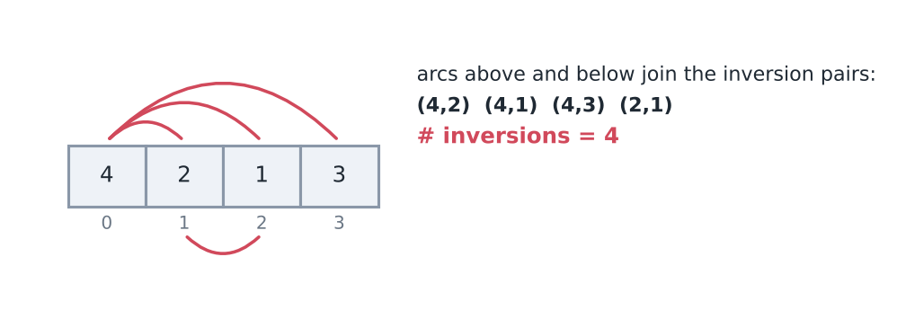
*The inversions are (4,2), (4,1), (4,3) and (2,1), so there are 4 inversions.*

The input is n and arr, with $n \le 1000$.

Find the sum of the number of inversions over all subarrays of the array. The figure below lists the subarrays of 4, 2, 1, 3 (subarrays of size 1 have no inversion and are left out) with the inversion count of each. The answer is 10.

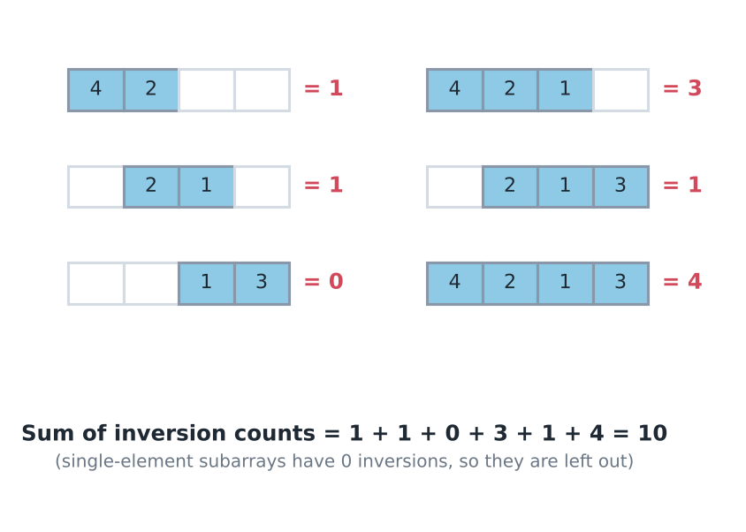
*The counts add up to 1 + 1 + 0 + 3 + 1 + 4 = 10. Subarrays of size 1 have 0 inversions.*

Brute force looks at about $n^2/2$ subarrays and counts the inversions inside each one by checking all pairs in it, up to $O(n^2)$ work, so $O(n^4)$ in total. Counting exactly, the sum over all lengths is about $n^4/24$, which is about $4 \times 10^{10}$ steps for $n = 1000$. At roughly $10^8$ steps per second that is several minutes, so it is too slow.

Here, we are required to count the contribution of each atomic item, and here each atomic item is an inversion pair (i, j).

The inversion count of a subarray is the number of inversion pairs inside it. So adding the counts over all subarrays gives the same total as adding, for every inversion pair, the number of subarrays that contain it. In the array 4, 2, 1, 3, the pair (4,2) lies in 3 subarrays, the pair (2,1) in 4, the pair (4,3) in 1 and the pair (4,1) in 2. The total is 3 + 4 + 1 + 2 = 10, which matches.

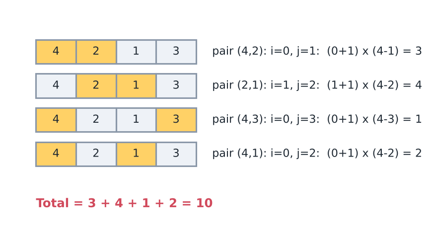
*The counts add up to 3 + 4 + 1 + 2 = 10.*

We need to find the number of subarrays that contain the pair (i,j).

**Note**: a subarray is fixed by choosing where it starts and where it ends. First count the subarrays that contain one single index i. There are (i+1) ways to start the subarray (at any position from 0 to i) and (n-i) ways to end it (at any position from i to n-1).

So a total of $(i+1) \times (n-i)$ subarrays contain `a[i]`.

For the pair, the start can be anything up to i, which gives (i+1) ways. The end can be anything from j on, which gives (n-j) ways. Start and end are chosen independently, and every such choice contains both i and j, because everything between the start and the end is inside the subarray.

So the number of subarrays is $(i+1) \times (n-j)$.

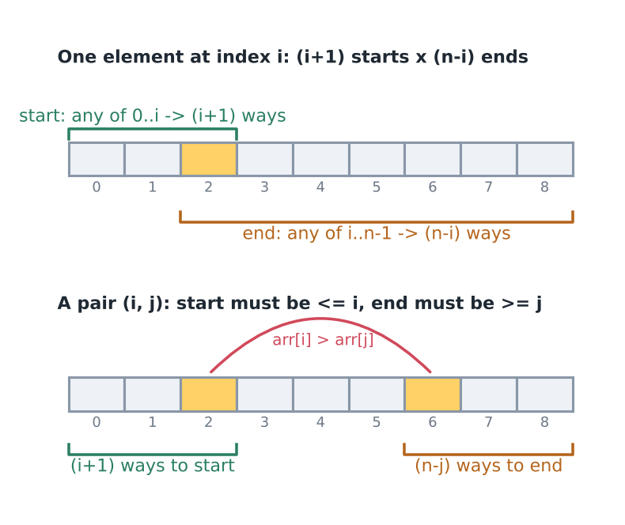
*The start is at or to the left of i, and the end is at or to the right of j.*

So the brute force over pairs, with the formula for the number of subarrays, is:

```cpp
ans = 0
for (i = 0 ... n)
    for (j = i+1 ... n)
        if (arr[i] > arr[j])
            ans += 1 * (i+1) * (n-j)
```

This is $O(n^2)$. For $n = 1000$ that is about $5 \times 10^5$ pairs, which is fast. Memory $O(1)$.

Note: loops go till `< n` in real code. Check: for (4,2), i = 0 and j = 1, so $1 \times 3 = 3$. For (2,1), i = 1 and j = 2, so $2 \times 2 = 4$. For (4,1), i = 0 and j = 2, so $1 \times 2 = 2$. For (4,3), i = 0 and j = 3, so $1 \times 1 = 1$. All four match the counts above. Use long long for ans: for $n = 1000$ the answer can reach about $4 \times 10^{10}$ (a strictly decreasing array), more than a 32-bit int holds.

Observation: middle elements lie in more subarrays than the corner ones, because they have more places to start on the left and more places to end on the right. For n = 7, (i+1)(n-i) = 7, 12, 15, 16, 15, 12, 7.

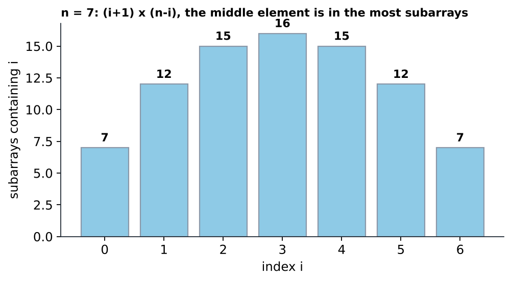
*The number of subarrays containing index i, for n = 7.*

What if $n$ is large, like $10^5$? $O(n^2)$ is about $5 \times 10^9$ pairs, too slow. Then pivot on j: for each j we need the sum of (i+1) over earlier i with arr[i] > arr[j], and then multiply this sum by (n-j). That is a "sum over earlier bigger elements", which a Fenwick tree handles (BIT, binary indexed tree: point update, prefix sum, both $O(\log n)$). The tree is indexed by the rank of the value (its place in the sorted list of distinct values), and the cell of arr[i] stores the weight i+1. For 4, 2, 1, 3: j=1 (value 2): the bigger earlier value is 4 with weight 1, so $1 \times (4-1) = 3$. j=2 (value 1): 4 and 2 are bigger, weights 1 + 2 = 3, so $3 \times (4-2) = 6$. j=3 (value 3): only 4, so $1 \times (4-3) = 1$. The total is 3 + 6 + 1 = 10, which matches. T.C. = $O(n \log n)$, memory $O(n)$. That is the DS usage branch below.

```cpp
// Used for the "n is large" case of the inversions question above.
// Two helper functions for the Fenwick tree (cells are numbered from 1).
void fenwickAdd(vector<long long>& bit, int pos, long long add) {
    for (; pos < (int)bit.size(); pos += pos & -pos) bit[pos] += add;
}
long long fenwickPrefix(const vector<long long>& bit, int pos) {
    long long s = 0;
    for (; pos > 0; pos -= pos & -pos) s += bit[pos];    // sum of cells 1..pos
    return s;
}

/*
  Problem: return the sum, over all subarrays, of the number of inversions
  inside the subarray (the same question as above, for large n).
  Idea: pivot on j. Every earlier i with arr[i] > arr[j] adds (i+1) * (n-j).
*/
long long inversionsOfAllSubarrays(const vector<int>& arr) {
    int n = arr.size();
    vector<int> vals(arr);
    sort(vals.begin(), vals.end());
    vals.erase(unique(vals.begin(), vals.end()), vals.end());   // distinct values, sorted
    int m = vals.size();
    vector<long long> bit(m + 1, 0);
    long long ans = 0;
    for (int j = 0; j < n; j++) {
        int rank = lower_bound(vals.begin(), vals.end(), arr[j]) - vals.begin() + 1;
        long long weight_of_bigger = fenwickPrefix(bit, m) - fenwickPrefix(bit, rank);
        ans += weight_of_bigger * (n - j);
        fenwickAdd(bit, rank, j + 1);                           // weight of position j is j+1
    }
    return ans;
}
```

A common mistake is to count values equal to arr[j] as bigger. Using the rank, "strictly bigger" means ranks above `rank`, so equal values are correctly left out. Another common mistake is to mix 0-based and 1-based positions. With 0-based positions the count is $(i+1)(n-j)$. With 1-based positions it is $i \times (n-j+1)$. Check: the pair (4,2) in 4, 2, 1, 3 has 1-based positions 1 and 2, and $1 \times (4-2+1) = 3$, the same as before.

#### Expected inversions of a random order

Same question with chance in it: the values are put in a uniformly random order. What is the expected number of inversions? Small example: the 6 orders of $(1, 2, 3)$ have $0 + 1 + 1 + 2 + 2 + 3 = 9$ inversions in total, so the average is $\frac{9}{6} = 1.5$.

By Theorem 2.4.2 the number of inversions is a sum of indicators, one per pair of elements. Two different values are in the wrong order in exactly half of the orders, because swapping them maps the orders where the pair is inverted to the orders where it is not. So each such pair has probability $\frac{1}{2}$, and for $n$ distinct values the expectation is $\binom{n}{2} \cdot \frac{1}{2}$. For $n = 3$ that is $1.5$. Two equal values are never inverted, so only pairs with different values count. Dry run for $(1, 1, 2)$: 3 pairs, 1 of them equal, so 2 unequal pairs and the expectation is 1. (The three orders $1\,1\,2$, $1\,2\,1$, $2\,1\,1$ have $0$, $1$, $2$ inversions, average 1.)

The code prints the answer modulo $998244353$, so the half is multiplied in as the inverse of 2.

<CodeSnippet unit="2.4/expected-inversions" />

T.C. = $O(n \log n)$ because of the `map`, memory $O(n)$. Another way: sort the array. For each position, the number of elements strictly smaller is the index of the first copy of its value, and adding these over all positions counts every unequal pair once, also in $O(n \log n)$.

Common mistake: counting pairs of equal values as inverted. Input `2`, then `1 1`, prints $\frac{1}{2}$ (the residue $499122177$) instead of 0. Fix: check the probability of each indicator, and give equal values probability 0. Another mistake: forgetting the probability. Input `2`, then `1 2`, prints 1 instead of $\frac{1}{2}$. An expected count is a sum of probabilities, not of possibilities, so multiply by the inverse of 2.

## Contribution at pivot [Extension]

Question: take the array [1 3 2]. Multiply the elements of each subarray and sum these products. The subarrays and their products are: [1] gives 1, [3] gives 3, [2] gives 2, [1 3] gives 3, [3 2] gives 6 and [1 3 2] gives 6. The sum is 21.

![All subarrays of [1 3 2] with products 1, 3, 2, 3, 6, 6.](../../../assets/notes/2-4-expected-value/fig08_subarray_products.png)
*The sum is 21.*

Find the sum of the products of the elements of all subarrays of an array.
Here $n \le 10^5$. There are about $5 \times 10^9$ subarrays, and one product can need up to $n$ multiplications, so brute force is far too slow.

Note: using the atomic contribution here is very difficult. It is generally used for a sum of sums or a sum of counts.

Why is it difficult? The product of a subarray is not a sum of small independent pieces, so we cannot assign a fixed amount to each element. Instead, pivot on the end: group the subarrays by the position where they end.

Intuition: every subarray ending at the new position is either an old subarray (ending one step earlier) with the new element appended, or the new element alone. So the old result can be reused instead of recomputed.

We group the subarrays of 1, 3, 2 by the position where they end. Some subarrays end at 3, and there will be some subarrays that end at 2.

Let's see subarrays ending at 3: `[1×3]` and `[3]`. These are just the subarray ending at 1 (`[1]`) with 3 multiplied, plus the new `[3]`. Similarly ending at 2: `[1×3×2]`, `[3×2]`, `[2]` = (old ones) $\times 2$ + `[2]`.

The figure below writes the products of each group. Each group is built from the group before it (the notes call this "repeated"). The update rule is `cur = cur × arr[i] + arr[i]`.

Note: this update is for `cur` (subarrays ending at i), not the final ans. ans just adds cur at each i.

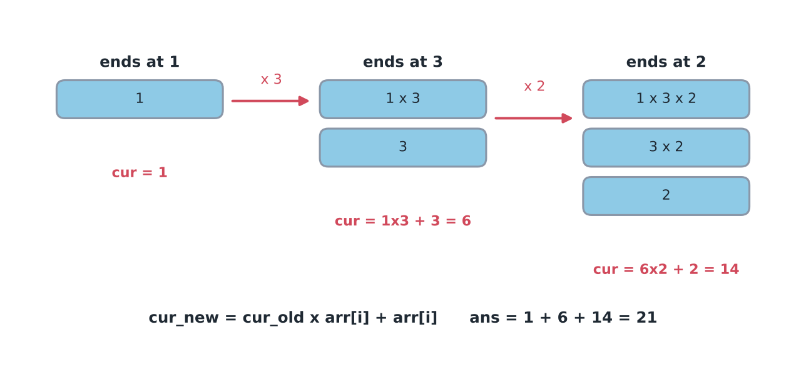
*The value of cur goes 1, 6, 14, so ans = 1 + 6 + 14 = 21.*

The same idea with letters: take all the subarrays ending at d. When e arrives, every one of them gets e added at the end, and the single subarray e is new.

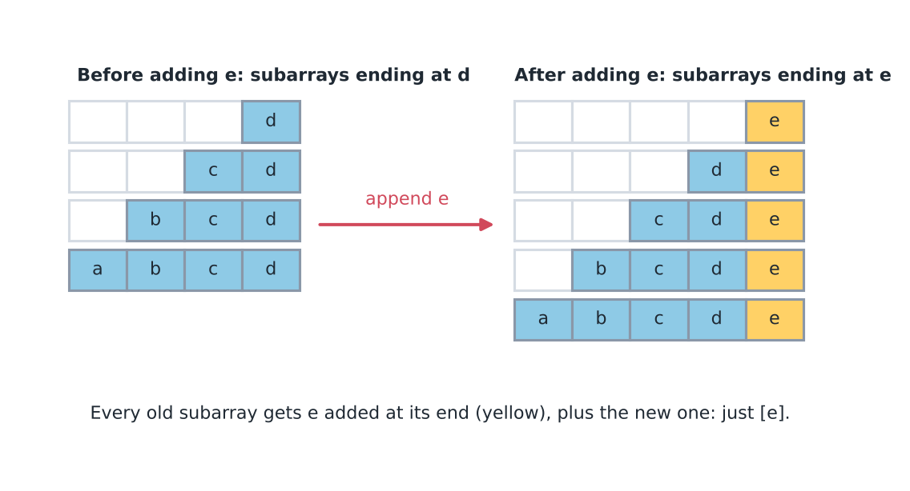
*Every old subarray gets e appended, plus the new subarray [e].*

Suppose a new element 'e' is added to the array. Can we reuse the previous result? Yes: we simply extend the previous result with 'e', and add the new subarray [e].

```cpp
int ans = 0
int cur = 0
for (int i=0; i<n; i++){
    cur = cur * arr[i] + arr[i];
    ans += cur;
}
```

Note: int will overflow because products grow fast, so use long long and mod. T.C. = $O(n)$, memory $O(1)$. Dry run for [1,3,2]: cur = 1, then $1 \times 3 + 3 = 6$, then $6 \times 2 + 2 = 14$. So ans = 1 + 6 + 14 = 21.

Why `cur × arr[i]` is right: cur is a sum of products $p_1 + p_2 + \dots$ of the subarrays that end at i-1. Appending arr[i] to each subarray multiplies each product by `arr[i]`, and $(p_1 + p_2 + \dots) \times a_i = p_1 \times a_i + p_2 \times a_i + \dots$, so one multiplication updates all of them at once. With mod, keep cur below $10^9+7$ so that `cur × arr[i]` stays below about $10^{18}$ and fits in a long long.

Here is the same loop with long long and mod added:

```cpp
// New function: the author's loop above with long long and mod added, because an int overflows.
long long sumOfSubarrayProducts(const vector<long long>& arr) {
    const long long MOD = 1000000007;
    long long ans = 0, cur = 0;
    for (long long x : arr) {
        long long xm = ((x % MOD) + MOD) % MOD;   // x brought into [0, MOD), also when x is negative
        cur = (cur * xm + xm) % MOD;              // all old products times x, plus the new subarray [x]
        ans = (ans + cur) % MOD;
    }
    return ans;
}
```

Run on [1, 3, 2] it returns 21, the same as the dry run. Run on [2, -1] the products are 2, -1 and -2, so the true sum is -1, and the function returns 1000000006, which is -1 modulo $10^9+7$. Common mistake: leaving out the `+ arr[i]` term. That term is the new subarray that holds only arr[i]. Without it, cur starts at 0 and stays 0 for ever.

Question: find the sum of the sums of all subarrays. We use the same technique again. The update rule is `cur = cur + arr[i] × (i+1)`.

Why $(i+1)$? There are $(i+1)$ subarrays ending at i, because the start can be any of $0..i$. Each of them gets arr[i] more. Dry run: cur = 1, then $1 + 3 \times 2 = 7$, then $7 + 2 \times 3 = 13$. ans = 1 + 7 + 13 = 21.

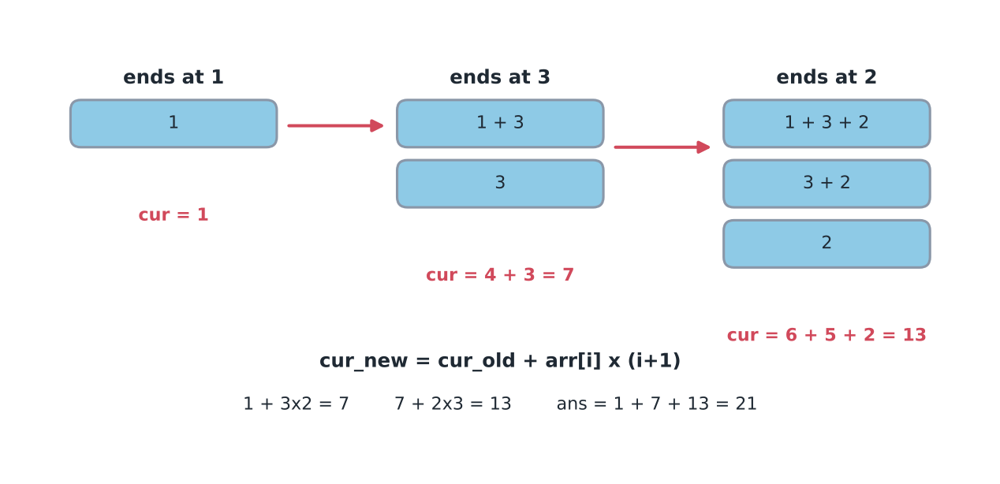
*The update is $\text{cur} = \text{cur} + a_i \times (i+1)$.*

Question: find the largest sum of any contiguous subarray. Take the array -1, 3, -2, 4. The best sum that ends at -2 is extended to reach 4, using extension.

- `cur = max(cur + arr[i], arr[i])`
- `ans = max(ans, cur)`

(The best subarray ending at -2 is [3,-2] = 1. For 4, we either extend it, giving 1+4 = 5, or start fresh, giving 4. The maximum is 5.) This is Kadane's algorithm. It works because a negative cur only makes the next sum smaller, so when cur + arr[i] is smaller than arr[i] (that is, cur is negative) the best choice is to drop the old part and start fresh.

![Bars of arr[i] and cur for -1, 3, -2, 4; cur is -1, 3, 1, 5.](../../../assets/notes/2-4-expected-value/fig12_kadane.png)
*The values of cur are -1, 3, 1, 5, so ans = 5.*

Note: start cur and ans with arr[0], not 0. Otherwise an all-negative array gives 0 (empty subarray, not allowed). For [-3,-1,-2] the answer is -1. T.C. = $O(n)$, memory $O(1)$.

```cpp
/*
  Problem: return the sum of the sums of all subarrays, modulo 1e9+7.
  Idea (extension): cur = sum of sums of subarrays that end at i.
  There are i+1 such subarrays and each one gains arr[i]:
  cur_new = cur_old + arr[i] * (i+1).
*/
long long sumOfSubarraySums(const vector<long long>& arr) {
    const long long MOD = 1000000007;
    long long ans = 0, cur = 0;
    for (int i = 0; i < (int)arr.size(); i++) {
        long long xm = ((arr[i] % MOD) + MOD) % MOD;
        cur = (cur + xm * (i + 1)) % MOD;
        ans = (ans + cur) % MOD;
    }
    return ans;
}

/*
  Problem: return the largest sum of a non-empty contiguous subarray
  (Kadane's algorithm). The array must have at least one element.
  Idea (extension): cur = best sum of a subarray ending at i. Either extend
  the best one ending at i-1, or start fresh at i.
*/
long long maxSubarraySum(const vector<long long>& arr) {
    long long cur = arr[0], ans = arr[0];             // start from the first element, not from 0
    for (int i = 1; i < (int)arr.size(); i++) {
        cur = max(cur + arr[i], arr[i]);
        ans = max(ans, cur);
    }
    return ans;
}
```

Simply put, if we know the answer for the range that ends at the previous position, then we can extend the current answer to the next end. Each step takes $O(1)$ time, so the whole scan is $O(n)$ time and $O(1)$ memory.

## Contribution at pivot [Using Data Structure]

Question: Two sum. We are given n and an array arr, and we look at two positions i &lt; j.

The condition is arr[i] + arr[j] == X.

Count the pairs $(i,j)$ satisfying the condition above. Brute force checks all $n(n-1)/2$ pairs, about $5 \times 10^9$ for $n = 10^5$, which is too slow.

**Note:** whenever we are given a set that has to satisfy a given condition and we have to count, then it might be a contribution problem.

For example, given (i,j) such that they satisfy f(i,j), we mark j (the right end) as the pivot and find all i that satisfy f(i,j).

Here f(i,j) means arr[i] + arr[j] == X.

We pivot on j and find all i's.

With j fixed, the condition becomes a search for the earlier values that are equal to one known number:

Therefore arr[i] == X - arr[j], and all the i satisfying this are counted in the answer.

Example: arr = 1, 2, 3, 4 and X = 5. The pairs of positions that add up to 5 are (1, 2) and (0, 3).

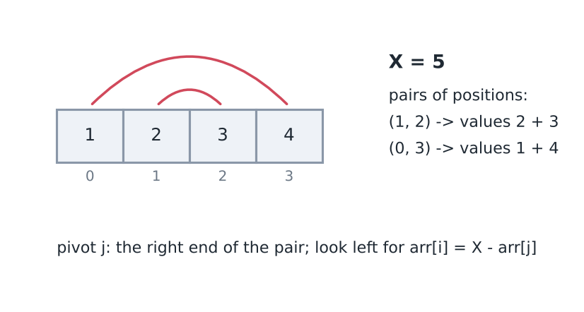
*For X = 5 the pairs of positions are (1,2) and (0,3).*

The pivot j splits the array, and every i lives in the part on the left of j.

We need to count the arr[i], that is, how many earlier elements have the value X - arr[j]. We create a freq map (frequency map) for this.

```cpp
map<int, int> freq;
for(int i=0; i<n; i++){
    int val = X - arr[i];
    ans += freq[val];
    freq[arr[i]]++;
}
```

Note: here the loop `i` is the pivot j. Query first, then insert arr[i], otherwise element pairs with itself. `ans` should be long long. T.C. = $O(n \log n)$ with map, $O(n)$ average with unordered_map. Memory $O(n)$. Equal values are counted correctly: for [2,2,2] and X = 4 the totals go 0, 1, 3, so 3 pairs. Reading `freq[val]` also creates an entry with count 0 when val is missing, which is harmless for the answer but uses extra memory.

Why this works: fixing j turns a condition on two positions into a search for one value among the earlier positions. Only earlier elements are in the map, so each pair is seen once, when its larger position is the pivot.

```cpp
// New function: the author's loop above, with find() so that a missing value does not create an empty map entry.
long long countPairsWithSum(const vector<int>& arr, int X) {
    map<int, int> freq;                  // value -> how many times seen so far
    long long ans = 0;
    for (int j = 0; j < (int)arr.size(); j++) {
        auto it = freq.find(X - arr[j]);
        if (it != freq.end()) ans += it->second;
        freq[arr[j]]++;                  // arr[j] is available only for later pivots
    }
    return ans;
}
```

For [1, 2, 3, 4] with X = 5 it returns 2, and for [2, 2, 2] with X = 4 it returns 3. A `map` costs $O(\log n)$ per step. An `unordered_map` is $O(1)$ on average, but on some judges, such as Codeforces, special inputs can make it slow, so `map` is the safe choice.

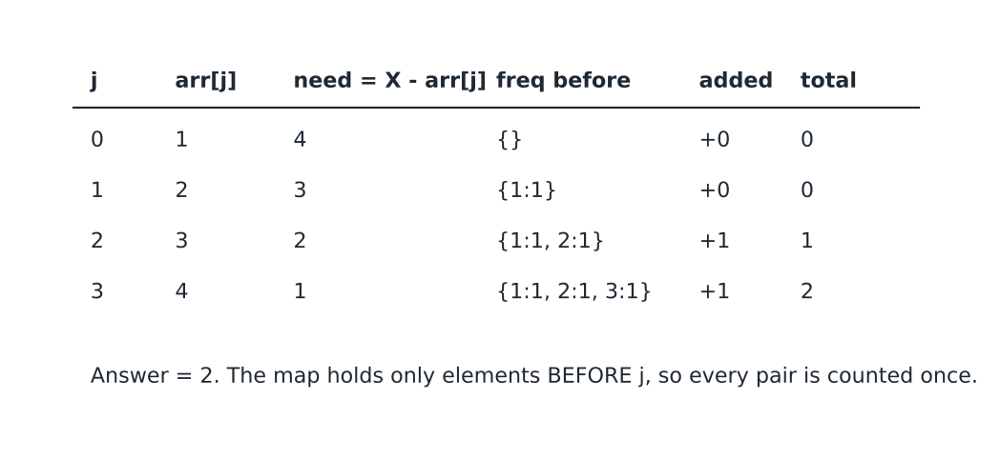
*In the trace the running total goes 0, 0, 1, 2.*

Question: given an array, find the smallest $a_i + a_j$ with $i \ne j$ and $a_i + a_j \ge k$. Brute force checks all pairs, which is $O(n^2)$.

Input: n and arr. For example, arr = 1 4 5 2 2 and k = 4.

Take j at the first 2 (index 3), so $a_j = 2$ and we need $a_i + 2 \ge 4$, which means $a_i \ge 2$. Among the earlier values 1, 4, 5 only 4 and 5 qualify, because $1 + 2 = 3$ is less than 4. The smallest valid one is 4. In symbols, $a_i + 2 \ge 4$, so $a_i \ge 2$.

Now take j at the last position (index 4), whose value is also 2. The condition is the same, $a_i \ge 2$, but now the earlier 2 at index 3 is available.

This looks like a use case for lower_bound. Hence, we can use a set and binary search.

(lower_bound(v) gives the first element $\ge v$ in the set. The smallest valid arr[i] gives the smallest sum for this j, and the answer is the smallest sum over all j. Dry run: for j = 0 the set is empty, so there is nothing to pair. For j = 1 we need a value $\ge 0$ among {1}, which is 1, so the sum is 5. For j = 2 we need a value $\ge -1$ among {1,4}, which is 1, so the sum is 6. For j = 3 we need a value $\ge 2$ among {1,4,5}, which is 4, so the sum is 6. For j = 4 we need a value $\ge 2$ among {1,4,5,2}, which is 2, so the sum is 4. The answer is 4.)

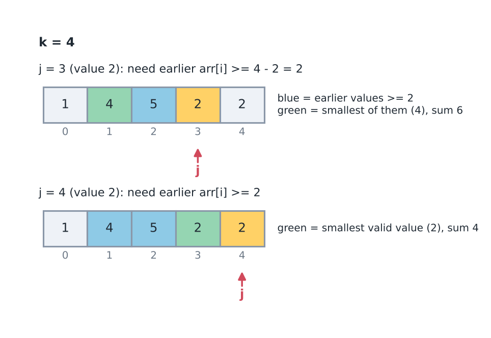
*For j = 3 the smallest valid earlier value is 4 (sum 6). For j = 4 it is 2 (sum 4).*

```cpp
int ans = INF;
set<int> allVal;

for (int j=0; j<n; j++){
    int val = k-arr[i]
    auto it = allVal.lower_bound(val);
    if (it != allVal.end()){
        ans = min(ans, arr[j] + *it);
    }
    allVal.insert(arr[j]);
}
```

Note: `k-arr[i]` should be `k-arr[j]`, there is no i here. INF = INT_MAX, and if ans is still INF at the end, then there is no such pair. T.C. = $O(n \log n)$, memory $O(n)$. The set keeps only one copy of each value, which is enough, because a pair needs just one earlier element with that value. Use long long if the values are large, since arr[j] + *it can overflow an int.

The same loop with his typo fixed:

```cpp
// New function: the author's lower_bound loop with k - arr[j] in place of his k - arr[i], and -1 when no pair exists.
long long smallestSumAtLeastK(const vector<int>& arr, int k) {
    const long long INF = LLONG_MAX;
    long long ans = INF;
    set<int> seen;                                   // the earlier values
    for (int j = 0; j < (int)arr.size(); j++) {
        auto it = seen.lower_bound(k - arr[j]);      // smallest earlier value that is at least k - arr[j]
        if (it != seen.end()) ans = min(ans, (long long)arr[j] + *it);
        seen.insert(arr[j]);
    }
    return ans == INF ? -1 : ans;
}
```

For [1, 4, 5, 2, 2] with k = 4 it returns 4. For [1, 1] with k = 5 no pair reaches 5, so it returns -1, and for the single element [3] there is no pair at all, so it also returns -1.

Pivot idea in Fabricator/ContributionTechnique/ContainerWithMostWater.cpp: pick 2 walls $i < j$, maximize $\min(h_i, h_j) \times (j - i)$. Trying all pairs is $O(n^2)$. Pivot = the shorter wall of the best pair. Sort walls by height, go from tallest down. Walls seen so far are all at least as tall as the current one, so min_idx and max_idx are the leftmost and rightmost of them. Every value it tries is a real container, and when the shorter wall of the best pair comes, both its walls are already seen. T.C. = $O(n \log n)$, memory $O(n)$. It needs $n \ge 2$, otherwise the loop does not run and the answer stays INT32_MIN.

Example: heights 1, 8, 6, 2, 5, 4, 8, 3, 7. The tallest walls are 8 (index 6) and 8 (index 1), then 7 (index 8). After the walls at indices 6 and 1 are seen, the range is 1..6, so the area is $\min(8,8) \times 5 = 40$. After the 7 at index 8 the range is 1..8, so the area is $\min(8,7) \times 7 = 49$. The smaller walls cannot widen the range, so 49 is the answer.

```cpp
// Fabricator/ContributionTechnique/ContainerWithMostWater.cpp
int maxArea(vector<int>& height) {
    int n = height.size();
    vector<pair<int, int>> idx_val;
    for(int i=0; i<n; i++){
        idx_val.push_back(make_pair(height[i], i));
    }
    sort(idx_val.begin(), idx_val.end());
    int min_idx = idx_val[n-1].second;
    int max_idx = idx_val[n-1].second;
    int ans = INT32_MIN;
    for(int i=n-2; i>=0; i--){
        min_idx = min(min_idx, idx_val[i].second);
        max_idx = max(max_idx, idx_val[i].second);
        int val = min(height[min_idx], height[max_idx]) * abs(max_idx - min_idx);
        ans = max(ans, val);
    }
    return ans;
}
```

## Atomic item again: distinct characters

Question: find the sum of the total number of distinct characters in all the substrings of a string.

(A substring is a continuous part of a string. A string of length n has n(n+1)/2 substrings, so for n = $10^5$ we cannot examine each one.)

For abbca the substrings of length 1 are 'a','b','b','c','a', and they have 5 distinct characters in total. The figure below lists the substrings of abbca by length, with the number of distinct characters in each one. The answer is 28.

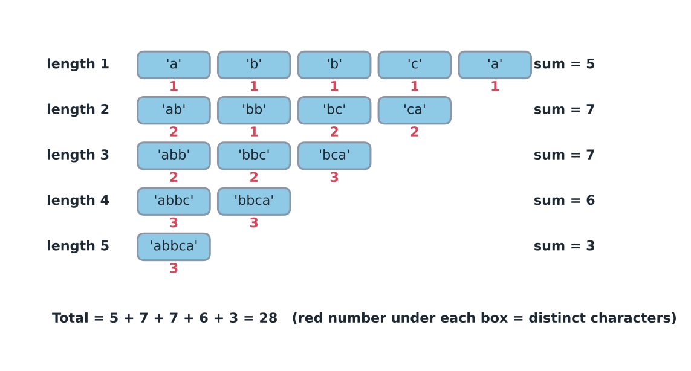
*The totals by length are 5 + 7 + 7 + 6 + 3 = 28.*

If a subarray has 3 distinct characters, it must contain 3 different letters.

Now take the number of subarrays that contain 'a'. In all of these subarrays the number of distinct characters increases by 1 because of 'a'. The same holds for all the other letters. So the answer is the sum, over all letters, of the number of substrings that contain that letter.

To count them, count the substrings that do not contain the letter and subtract from the total. For 'a' in abbca, there is a gap of 3 letters between the two a's. The number of subarrays that contain 'a' is the total minus the number of subarrays that don't contain 'a'.

The string has 5 letters, so the total is $^{6}C_2$ = 15 substrings. The gap of 3 letters has $^{4}C_2$ = 6 substrings, and none of them contains 'a'.

So the count for 'a' is $^6C_2 - {}^4C_2$ = 15 - 6 = 9. All of these subarrays have 1 extra distinct character because 'a' is present in them.

For 'b', the letters without b are 'a' on the left (1 letter) and 'ca' on the right (2 letters). So the count for 'b' is $^6C_2 - {}^2C_2 - {}^3C_2$ = 15 - 1 - 3 = 11.

For 'c', the parts without c are "abb" (3 letters) and "a" (1 letter), so the count is 15 - 6 - 1 = 8. The total is 9 + 11 + 8 = 28, which matches.

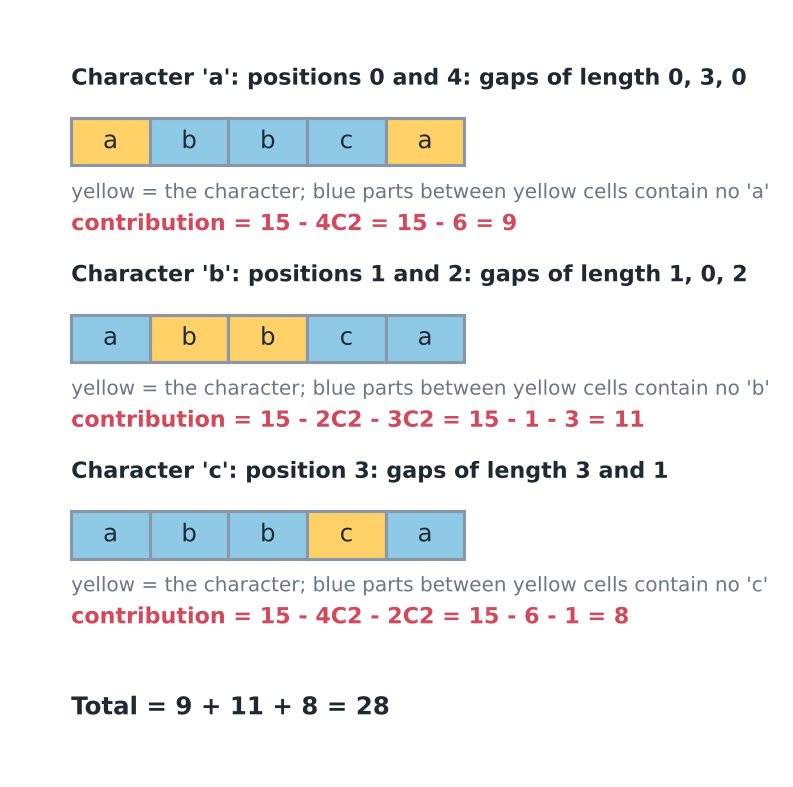
*The contributions add up to 9 + 11 + 8 = 28.*

In general, when x appears many times, the pieces before the first x, between two x's and after the last x hold all the subarrays without x. In the figure below, the example has 12 cells and three x.

Note: the number of subarrays that don't contain x is the total minus the subarrays inside each part between the x's. These parts and their subarrays won't contain x. For the example it is:

= $^{13}C_2$ - $^2C_2$ - $^3C_2$ - $^4C_2$ - $^4C_2$

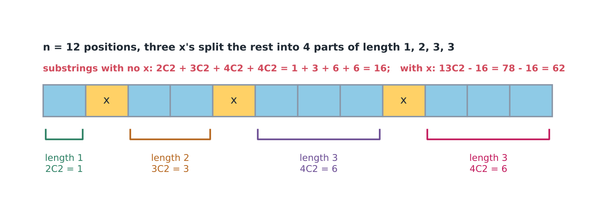
*The parts between the x characters contain no x.*

Note: the number of subarrays of an array of length n is $^{n+1}C_2$. (Think of n+1 cut lines around the n cells. Any 2 cut lines mark exactly one subarray.)

Note: part of length L has $^{L+1}C_2$ = L(L+1)/2 subarrays. Also the last part (after last x) and first part (before first x) count, even if length 0.

A check on a small string: the six substrings of aba are a, b, a, ab, ba and aba. They have 1, 1, 1, 2, 2 and 2 distinct characters, so the total is 9. The letter a is present in 5 of the substrings and b in 4, so a contributes 5 and b contributes 4.

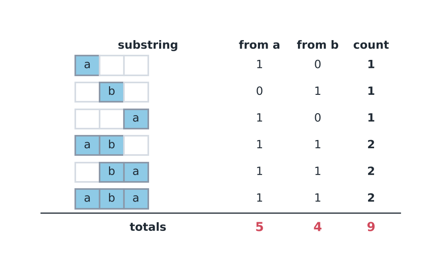
*The letter a gives 5 and b gives 4, so the total is 9.*

We calculate the contribution of each character and sum them.

The contribution of a character is the total number of subarrays minus the number of subarrays that don't have that character.

Here, the character is the atomic item that contributes. Whatever increases the answer is the atomic item.

Code (T.C. = $O(26 \cdot n)$, memory $O(1)$). For each letter it walks over the string once. Each gap between two copies of the letter, and the gap before the first and after the last copy, is subtracted as $\text{len}(\text{len}+1)/2$. Dry run for 'a' in abbca: the first a is at index 0 (gap 0), the next at index 4 (gap 3, subtract 6), the last gap is 0, so 15 - 6 = 9. A letter that never appears has one gap of length 5, so 15 - 15 = 0, as it should be.

```cpp
// Fabricator/ContributionTechnique/TotalAppealOfString.cpp
// Contribution - Atomic
long long appealSum_v2(string s){
    long long sol = 0;
    long long int n = s.size();
    for(char ch='a'; ch <= 'z'; ch++){
        int last = -1;
        long long contri = (n * (n+1))/2;
        for(int i=0; i<n; i++){
            if(s[i] == ch){
                long long len = i - last - 1;
                if(len > 0){
                    contri -= (len * (len + 1))/2;
                }
                last = i;
            }
        }
        long long len = n - last - 1;
        if(len > 0){
            contri -= (len * (len + 1))/2;
        }
        sol += contri;
    }
    return sol;
}
```

Same problem, other way (extension): let i be the end. Subarrays ending at i where s[i] is new (the first time it appears in that subarray) can start anywhere after the last occurrence of s[i], which gives $(i - \text{last})$ choices. `curr` = total distinct of all subarrays ending at i, so `curr += i - last`, `sol += curr`. The other subarrays ending at i already contain s[i], so their distinct count does not change when s[i] is appended. T.C. = $O(n)$, memory $O(1)$. Dry run on abbca: curr = 1, 3, 4, 8, 12 and sol = 1, 4, 8, 16, 28.

Another way to read the same sum: count each position as the first copy of its letter inside the substring. The left end of such a substring has $(i - \text{last})$ choices and the right end has $(n - i)$ choices, so position $i$ adds $(i - \text{last}) \times (n - i)$. For abbca this is 5 + 8 + 3 + 8 + 4 = 28.

```cpp
// Fabricator/ContributionTechnique/TotalAppealOfString.cpp
// Contribution - Extended/Incremental
long long appealSum(string s) {
    vector<int> last_seen(256, -1);
    long long sol = 0;
    long long curr = 0;
    for(int i=0; i<s.size(); i++){
        int idx = s[i] - 'a';
        curr += (i - last_seen[idx]);
        sol += curr;
        last_seen[idx] = i;
    }
    return sol;
}
```

Note: both assume lowercase letters, and `appealSum` compares int with `s.size()` (compiler warning only). Both give 28 for abbca.

Common mistakes: using $^{n}C_2$ instead of $^{n+1}C_2$ for the number of substrings of a string of length n, and leaving out the gap before the first copy and the gap after the last copy of the letter. Those two gaps count too, even when their length is 0 (then they subtract nothing).

Common mistakes in the first-occurrence form $(i - \text{last})(n - i)$, with the single-letter string `c` (the answer must be 1). If the previous position defaults to 0 instead of $-1$, the start has $i - 0 = 0$ choices for $i = 0$ and the program prints 0. With no earlier copy the start may be anywhere from 0 to $i$, which is $i + 1$ choices, so the default is $-1$ (his code already starts at $-1$). If the end is written as $(n - i - 1)$, then $1 \cdot (1 - 0 - 1) = 0$ again. The subarray may end at $i$ itself, so the ends are $i, \dots, n - 1$, which is $n - i$ choices.

Count unique chars (char counts only if it appears exactly once in the substring): same pivot + gaps thinking, `(pos[i] - pos[i-1]) * (pos[i+1] - pos[i])` for each occurrence. Here pos holds the positions of one letter, with -1 added in front and n added at the end. A substring has this occurrence as its only copy of the letter when it starts after the previous copy and ends before the next copy, which gives the product. For abbca the letter a gives 4 + 4, b gives 2 + 3 and c gives 8, so the total is 21. See Fabricator/ContributionTechnique/UniqueCharactersInString.cpp.

## Recognition cards

A card names one decisive property, the test for it, and the inputs that look similar but fail it. The four cards below belong to this lesson.

<Cards topic="2.4" />

## Quick revision

- Contribution technique: ask "which small piece adds to the answer?" (atomic item) or "which subarrays end here?" (pivot).
- Triplets: each element is in $\binom{n-1}{2}$ triplets, so ans = $\binom{n-1}{2} \times \text{sum(arr)}$. If $n < 3$, ans = 0. Choose the other two positions without order (a factor $(n-1)(n-2)$ would double the answer).
- Sum of $|a_i - a_j|$ over pairs: sort, then the element at index $i$ contributes $(i - (n-i-1)) \times \text{value}$.
- Subarrays containing index i: (i+1)(n-i). Subarrays containing the pair (i, j): (i+1)(n-j).
- Inversions of all subarrays: add $(i+1)(n-j)$ for each pair with `arr[i] > arr[j]`. $O(n^2)$; with a Fenwick tree (weight $i+1$ at the rank of `arr[i]`, multiply the sum of bigger earlier weights by $n-j$) $O(n \log n)$. The answer needs long long.
- Number of subarrays of an array of length n = $^{n+1}C_2$ = n(n+1)/2.
- Extension (pivot = end of the subarray; cur = value for subarrays ending at i):
  - product: $\text{cur} = \text{cur} \times a_i + a_i$; ans += cur (multiplication spreads over the sum of old products)
  - sum: $\text{cur} = \text{cur} + a_i \times (i+1)$; ans += cur
  - maximum sum (Kadane): cur = max(cur + arr[i], arr[i]); ans = max(ans, cur); start from arr[0]
- Data structure usage: for a condition f(i, j), pivot on j and search among the earlier i.
  - exact value: frequency map (query first, then insert)
  - at least / at most a value: set with lower_bound
  - longest-wall type of problem (container with most water): sort by height, the shorter wall of the best pair is the pivot
- Distinct characters in all substrings: for each character, total minus the sum of $^{L+1}C_2$ over the gaps that do not contain it. Extension version: curr += i - last, sol += curr.
- Unique characters in all substrings: each occurrence adds $(\text{pos}_i - \text{pos}_{i-1}) \times (\text{pos}_{i+1} - \text{pos}_i)$.
- Common mistakes: overflow (use long long and mod), negative numbers with %, loops that must stop at `< n`.
- Theorem 2.4.1: $E[X + Y] = E[X] + E[Y]$ and $E[cX] = c\,E[X]$, with no independence needed. Products need independence.
- Theorem 2.4.2: $E[\mathbb{1}_A] = P(A)$, so an expected count is a sum of probabilities. Fixed points of a random order: $n \cdot \frac{1}{n} = 1$. Inversions: half the pairs with different values.
- Theorem 2.4.3: a total over configurations is $\sum_i v_i N_i$. Divide by the number of configurations for the expected value. Sorted subset maxima: $a_i$ has $2^i$ subsets; after the sort, widths are $\sum_i a_i(2^i - 2^{n-1-i})$.
- Theorem 2.4.4: $E[X] = \sum_{x \ge 1} P(X \ge x)$. For the maximum of $k$ draws from $1..m$, $P(\max \ge x) = 1 - \left(\frac{x-1}{m}\right)^k$ (use "at most $x - 1$", not "at most $x$").
- Theorem 2.4.5: $\frac{1}{p}$ trials to the first success, stages add, coupon collector $n\left(1 + \frac{1}{2} + \dots + \frac{1}{n}\right)$. Start the sum at the coupons already owned.
- Printing a fraction modulo a prime: every probability becomes a residue (Theorem 2.2.4).

## Check yourself

### Identification drill

Each item names a problem without saying which card decides it. Choose a card, write the property you checked, then reveal the answer. Most items look like totals over many terms but are answered by cards of earlier topics.

<Drill topic="2.4" />

### Look-alike pairs

Two problems that read almost the same but need different tools. The flipping difference is the one detail that changes the decision.

<LookalikePairs topic="2.4" />

### Self-test

<SelfTest topic="2.4" />

### Checkpoint

<Checkpoint topic="2.4" />

### Decision map update

<DecisionMapUpdate topic="2.4" />

## Practice problems

Work through the ladder one card at a time. Each rung adds one twist to the rung before it. More problems for this topic are listed under "More practice".

<Ladder topic="2.4" />
