import TopicHeader from '../../../components/TopicHeader.astro';
import Ladder from '../../../components/Ladder.astro';
import WhatYouNeed from '../../../components/WhatYouNeed.astro';
import TheoremCode from '../../../components/TheoremCode.astro';
import CodeSnippet from '../../../components/CodeSnippet.astro';
import Cards from '../../../components/Cards.astro';
import Drill from '../../../components/Drill.astro';
import LookalikePairs from '../../../components/LookalikePairs.astro';
import SelfTest from '../../../components/SelfTest.astro';
import Checkpoint from '../../../components/Checkpoint.astro';
import DecisionMapUpdate from '../../../components/DecisionMapUpdate.astro';

<TopicHeader topic="3.1" />

## What this note covers

A function that calls itself is recursion. Doing brute force with that recursion (try all the options, and take back the one that turns out wrong) is backtracking. Drawing the recursion tree, tracing the call stack, N-Queens, subsets, permutations, finding the k-th element and fractals all come from this one idea.

Here is why the idea matters. Place $n = 10$ queens on a $10 \times 10$ board so that no two attack each other, and count the ways. Brute force picks one column for the queen of each row. That is $10^{10}$ placements, and each one needs about 45 pair tests (one for each pair of queens). So the work is $4.5 \cdot 10^{11}$ operations, which is more than an hour at $10^8$ operations per second.

Most of that work is wasted. Suppose the queens in rows 0 and 1 already attack each other. Then none of the $10^8$ ways to fill the other eight rows can help, and we should not even look at them. The same is true after three rows, after four rows and so on. So the rule is: build the answer one choice at a time, check the partial answer after every choice, and stop extending it as soon as it cannot succeed. For 10 queens this makes 35,539 calls instead of $10^{10}$ checks, and it finds all 724 solutions in a few milliseconds.

The same idea with a sharper check cuts optimisation searches: stop when even an optimistic guess cannot beat the best answer so far (branch and bound, below). A different trick, splitting the choices into two halves, takes $2^{40}$ subsets down to about $2 \cdot 2^{20}$ (meet in the middle, below).

- Recursion
- Fibonacci and the recursion tree
- Palindrome and tail recursion
- nCr (n choose r) using Pascal's triangle
- Print n to 1 and back
- Tower of Hanoi
- Trace following (the f(3) tree)
- Backtracking and the LCCMD (Level, Choice, Check, Move, Decide) framework
- Time complexity of backtracking and the 4 problems
- N-Queens (diagonals, search tree, variants)
- Print all subsequences / non-distinct permutations
- Backtracking revisited: subsets for unique elements
- Subsets with duplicates
- Permutations: distinct and non-distinct
- Balanced parentheses
- Kth form: k-th permutation
- K-th move of Tower of Hanoi
- Fractals
- Self-similar problems: Caracal vs Monster, Christmas burger, Nephren's riddle
- Branch and bound
- Meet in the middle
- Recognition cards
- Check yourself (drill, look-alike pairs, self-test, checkpoint, decision map)
- Quick revision
- Practice problems

Quick definitions before we start:
- **Recursion** = a function calling itself.
- **Base case** = the input for which the function does not call itself, it just returns. Without a base case the recursion never stops.
- **Recursive case** = the part where it calls itself on a smaller input.
- **Call stack** = the memory where every running call keeps its own `n`, `l`, `r` etc. A new call is pushed on the stack and a returning call is popped. Last in, first out.
- **Depth** = how many calls are sitting on the stack at the same time. S.C. (space complexity) of a recursion is mostly this depth.
- **T.C.** = time complexity (how many steps), **S.C.** = space complexity (how much extra memory).

### What you need

<WhatYouNeed topic="3.1" />

### What this topic does not cover

- Storing the answer of each recursive call so that a repeated call is answered at once (memoisation), and building tables of answers bottom-up. That is topic 3.2 (dynamic programming foundations). Nothing on this page teaches it.
- Search over the states of a graph, visiting each state once. That is topic 4.1 (breadth-first search and depth-first search).
- Bitmask dynamic programming for choosing an order of $n \le 20$ items. That is topic 3.7.
- Randomised search, heuristics such as simulated annealing, and constraint solvers. These are not part of this course.

### Terms used in this lesson

- **Partial solution**: the first few choices $c_0, \dots, c_{p-1}$ of a recursion over choices. Example: for queens, the columns of the queens in rows $0, \dots, p-1$, like `[1 3 _ _]`.
- **Search tree**: the recursion tree of the search, one node per call. A node at depth $p$ is one partial solution of length $p$. Example: 4 queens with no check has $1 + 4 + 16 + 64 + 256 = 341$ nodes.
- **Feasibility check**: a test that rejects a partial solution that cannot be completed to a valid answer. Pruning with it is what the Check step of LCCMD does.
- **Bound**: a test that rejects a partial solution that cannot be completed to an answer better than the best found so far.
- **Optimistic estimate**: for a maximisation, a number $U(s)$ for a partial solution $s$ that is at least the value of every complete solution extending $s$. Example: with items of non-negative value, "value so far plus the values of all undecided items" is optimistic. For a minimisation it is the reverse: the estimate is at most the cost of every completion.
- **Branch and bound**: backtracking for an optimisation problem that prunes with an optimistic estimate.
- **Meet in the middle**: split $n$ choices into two halves, list all $2^{n/2}$ choices of each half separately, and combine the two lists, usually after sorting one of them.

## Recursion

→ Recursion:

A function calling itself. →  `f() { f(); }`

Left (marked "↑ Easy to trace"):

```cpp
void f(int n){
    if (n<=0) return;
    cout << "Hi, " << n << endl;
    f(n-1);
}
```

Right (marked "↑ Difficult to trace."):

```cpp
void f(int n) {
    if (n<=0) return;
    f(n-2);
    cout << "Hi, " << n << endl;
    f(n-1);
}
```

As complexity increases, its very difficult to trace the recursion.

Tracing level:

|  | Speed | Understanding |
|---|---|---|
| i) Intuitive | Fast | Low |
| ii) Recursion Tree | Draw/Med | Med |
| iii) Recursion Stack | Slow | High. |

Increase with experience.

Easy one first. Look at `f(3)` and see what happens on the call stack. It prints `Hi, n` first and then calls `f(n-1)`.

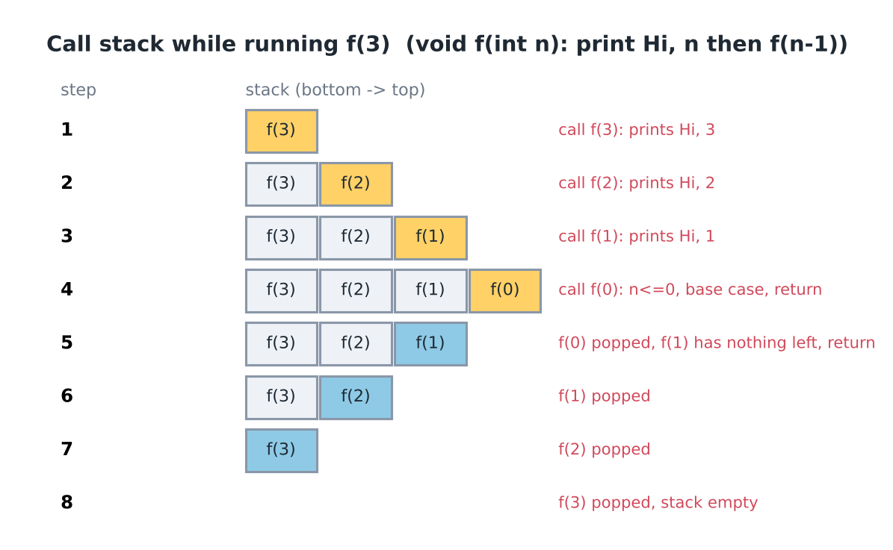

*f(3): push f(3), f(2), f(1), f(0). f(0) returns, then pops one by one*

Output: `Hi, 3`, `Hi, 2`, `Hi, 1`.

- Calls: n + 1 (f(3) → 4 calls, the last one is the base case).
- T.C. = O(n). S.C. = O(n), because n + 1 frames sit on the stack together.
- Common mistake: no base case, or a base case that is never reached (like `if (n==0) return;` and then calling `f(-5)`, n goes -6, -7, ... and never hits 0). The stack keeps filling up and the program crashes (stack overflow).

Now the right one: `f(n-2)`, print, `f(n-1)`. Do not trace this on the stack in your head, draw the tree. Every node is one call, and the left child runs first.

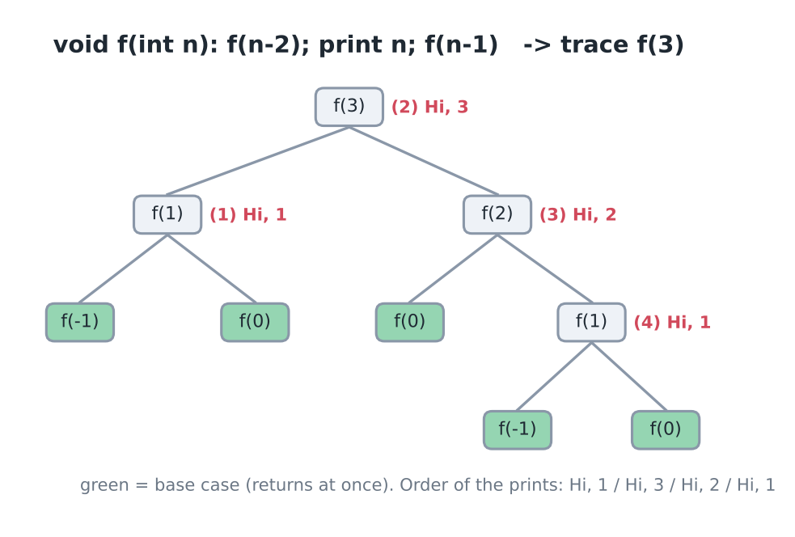

*f(3) → prints Hi 1, Hi 3, Hi 2, Hi 1. Print happens between the two calls, so in-order*

Idea: the print sits between the two calls. So for a node we first finish the whole left subtree, then print, then go right. For `f(4)` the output is `2 1 4 1 3 2 1` (7 prints, checked by running it).

Number of prints p(n) = 1 + p(n-2) + p(n-1): 1, 2, 4, 7, ... same shape as Fibonacci, so it grows exponentially.

## Fibonacci and the recursion tree

fib(n) = fib(n-1) + fib(n-2)

```cpp
int fib(int n){
    if (n<=1) return n;      // → base case
    return fib(n-1) + fib(n-2);
}
```

*n depends on n-1 & n-2.*

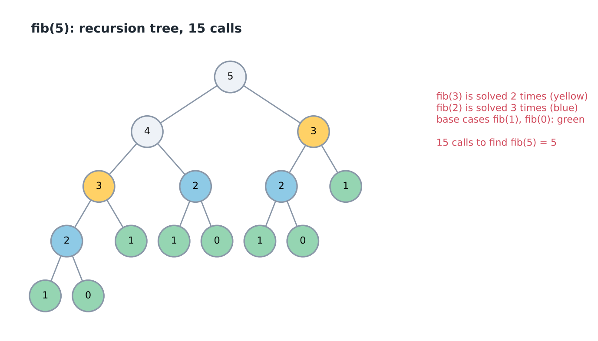

*Recursion tree. We need to draw a recursion tree for almost every problem.*

Idea: answer for n is built from the answers of two smaller inputs. Base case `n<=1` returns n itself (fib(0) = 0, fib(1) = 1).

Notice fib(3) is solved 2 times and fib(2) 3 times, same work again and again. That is why it is slow.

Number of calls = 2 × fib(n+1) − 1 (counted by running the code):

| n | fib(n) | calls |
|---|---|---|
| 5 | 5 | 15 |
| 10 | 55 | 177 |
| 20 | 6765 | 21,891 |
| 30 | 832,040 | 2,692,537 |
| 40 | 102,334,155 | 331,160,281 |

- T.C. = O(2^n) as a safe upper bound (the real growth is about 1.618^n). n = 40 is already 331,160,281 calls (about 330 million).
- S.C. = O(n). The deepest path is fib(n) → fib(n-1) → ... → fib(1), n frames. The tree is huge but only one path is alive at a time.
- Common mistake: base case written as `n==0` only. Then fib(1) calls fib(0) and fib(-1) and never stops. Also `int` overflows from fib(47) onwards (2,971,215,073).
- The same subproblem coming again and again is the hint for DP (dynamic programming: remember the answers). DP is a separate topic later in the course, and nothing on this page teaches it.

Recursion is used in 4 ways.

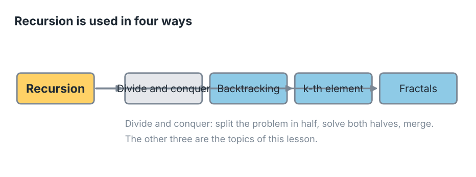

*Recursion is used in four ways*

There is no code for Divide and Conquer here (split the problem in half, solve both halves, merge the answers). The other three come below.

## Palindrome and tail recursion

Question: Check if a string is palindrome.

(Palindrome = reads the same from both ends, like `madam`.)

`s[0] == s[r]` & remaining string must also be palindrome.

Idea: compare the two ends. If they match, the problem shrinks to the inside part `l+1 .. r-1`, which is the same question on a smaller string.

```cpp
string s;

bool isPalindrome(int l, int r) {
    if (l>=r) return true;  // || if (r-l+1 <= 1) return true;
    return s[l] == s[r] && isPalindrome(l+1, r-1);
}
```

*isPalindrome(l+1, r-1) → tail recursion.*

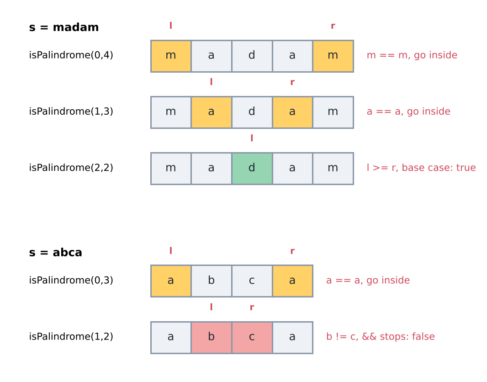

*madam: 3 calls. abca: stops at the second call*

If an expression has to be computed, always put the recursion at the end. This is called tail recursion.

Note: tail recursion means nothing is left to do after the recursive call, and its result is returned directly. Here `s[l] == s[r]` is computed first, and `&&` stops early when it is false (so `abca` never goes inside).

- Base case `l>=r`: covers an empty string and a single character (`r-l+1 <= 1`, same thing).
- T.C. = O(n) (at most n/2 + 1 calls). S.C. = O(n) stack depth (about n/2 frames). A compiler may turn a tail call into a loop, but do not depend on it.
- Common mistake: base case `l==r` only. For an even length like `abba` the pointers cross (l=2, r=1) without ever being equal, so the recursion walks outside the string.

## nCr using Pascal's triangle

Question: Calculate nCr using recursion.
↳ Using Pascal's Triangle.

(nCr = number of ways to choose r items out of n.)

```cpp
int ncr(int n, int r) {
    if (n<r) return 0;
    if (r==0 || r==n) return 1;
    return ncr(n-1, r-1) + ncr(n-1, r);
}
```

Idea: pick any one item. Either it is in the group (then choose r-1 from the remaining n-1) or it is not (choose r from n-1). That is `ncr(n-1, r-1) + ncr(n-1, r)`.

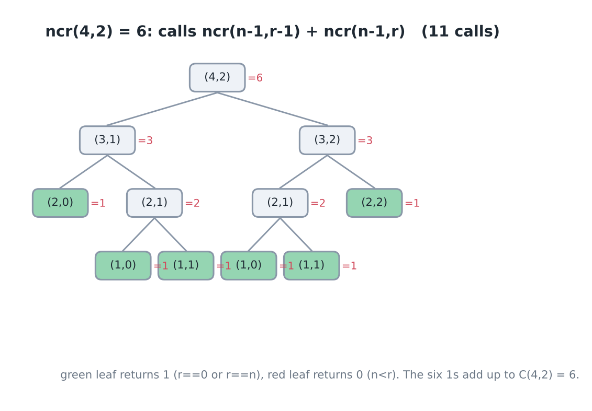

*ncr(4,2) = 6, 11 calls*

- Base cases: `n<r` → 0 ways, `r==0` or `r==n` → 1 way.
- Every leaf returns 1 and the answer is just those 1s added, so calls ≈ 2 × C(n,r) − 1. Checked: (4,2) → 11, (10,5) → 503, (20,10) → 369,511.
- T.C. = O(C(n,r)) calls, S.C. = O(n) depth.
- Common mistake: using this for big n (exponential, same repeated subproblems as fib). `int` also overflows: the middle value C(34,17) = 2,333,606,220 is bigger than 2^31 − 1.

## Print n to 1 and back

Question: for n=4, the code should print this. Write a recursive func.

```
4
3
2
1
2
3
4
```

Wrong attempt (crossed with a big X on the left):

```cpp
void f(int n){
    if (n==0) return;
    cout << n << endl;
    f(n-1);
    cout << n << endl;
}
```

*wrong prints → 4 3 2 1 1 2 3 4*

Note: the 1 comes twice because for n=1 it is printed before the call and again after the call (the n==0 call just returns). I left out `void` on paper.

Correct:

```cpp
void f(int n) {
    cout << n << endl;
    if (n==1) return;
    f(n-1);
    cout << n << endl;
}
```

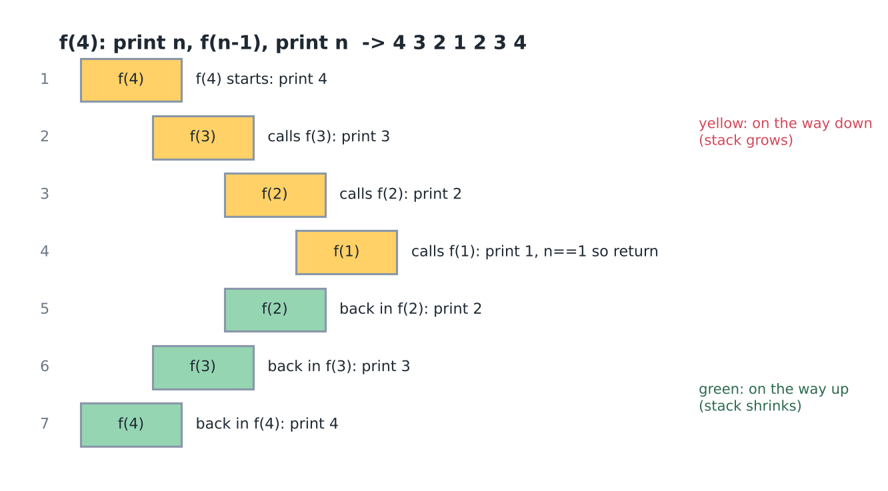

*before the call → runs on the way down. After the call → runs on the way up*

Idea: whatever is written before `f(n-1)` runs while the stack is growing, whatever is written after it runs while the stack is shrinking. Backtracking uses exactly this for the "revert" step (place, recurse, revert).

- T.C. = O(n), S.C. = O(n).
- Common mistake: base case `if (n==1) return;` before the first print, then 1 is never printed.

## Tower of Hanoi

Question: Tower of Hanoi.

Find the minimum number of moves to move discs from A to C using B.

(Rules: move one disc at a time, never put a bigger disc on a smaller one.)

There are three pegs A, B and C, and n discs on A. Move the n-1 discs above the nth disc to B, then the nth disc to C.

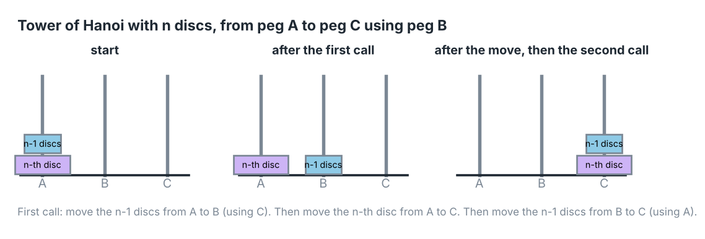

*The plan for n discs: move n-1 discs to B, move the nth disc to C, then move the n-1 discs onto it*

```cpp
void tower(int discs, int from, int to, int extra){
    if (discs == 0) return;
    tower(discs-1, from, extra, to);
    cout << discs << " from " << from << " to " << to << endl;
    tower(discs-1, extra, to, from);
}
```

→ The recursive function will work correctly iff the subproblem is being solved correctly by the recursion.

Like here, we are delegating the task of finding the solution for n-1 disc to the recursion, keeping only nth disc with us to move.

Trace for 2 discs (A = 1, B = 2, C = 3), `tower(2,1,3,2)`:
- tower(2,1,3,2) calls tower(1,1,2,3) (move 1 disc from 1 to 2 using 3).
- tower(1,1,2,3) calls tower(0,..) → returns. Print `1 from 1 to 2`. Calls tower(0,..) → returns. Pop.
- back in tower(2,1,3,2): print `2 from 1 to 3`.
- tower(1,2,3,1): print `1 from 2 to 3`.

3 moves. For 3 discs, 7 moves:

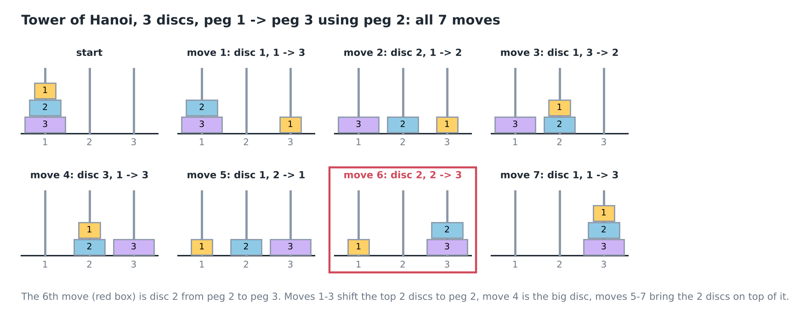

*3 discs: start and the position after every move*

How many moves? T(n) = T(n-1) + 1 + T(n-1) = 2·T(n-1) + 1. T(1) = 1, T(2) = 3, T(3) = 7 → T(n) = 2^n - 1 (see later, same T(n) is used for the k-th move).

- n = 10 → 1,023 moves, n = 20 → 1,048,575 moves, n = 64 → 18,446,744,073,709,551,615 moves.
- T.C. = O(2^n) (we print every move, so no better is possible). S.C. = O(n) (depth n).
- Common mistake: swapping `to` and `extra` in one of the two recursive calls. Check the order: first call `(from, extra, to)`, second call `(extra, to, from)`.

Same code from the repo (CSES 2165, print the count and then each move as `from to`):

```cpp
/*
https://cses.fi/problemset/task/2165
*/
// Fabricator/Recursion-Bactracking-Kth-Fractals/Tower-Of-Hanoi.cpp
int sol = 0;

void tower(int discs, int from, int to, int extra){
    if(discs == 0){
        sol++;
        return;
    }

    // moving n-1 discs to "extra" from "from" using "to"
    tower(discs - 1, from, extra, to);
    // moving nth disc to "to" from "from"
    //cout<<discs<<" moved from "<<from<<" to "<<to<<endl;
    cout<<from<<" "<<to<<endl;
    // now move n-1 discs from "extra" to "to" using "from"
    tower(discs - 1, extra, to, from);
}

void solve() {
    int n;
    cin>>n;
    cout<<(1<<n) - 1<<endl;
    tower(n, 1, 3, 2);

    //cout<<"total moves: "<<sol-1<<endl;
}
```

Note: `sol` counts the calls with `discs == 0`, that is 2^n of them (8 for n = 3), so the number of moves is `sol - 1`, as in the commented line.

## Trace following

Question: Trace following:

(`x` is a global vector, it holds the numbers chosen so far.)

```cpp
vector<int> x;

void f(int i) {
    if (i==0) {
        for (auto v : x) cout << v << " ";
        cout << endl;
        return;                 // "assuming return here"
    }
    f(i-1);
    x.push_back(i);
    f(i-1);
    x.pop_back();               // pop_back() takes no argument
}
```

Note: on paper the base case says "assuming return here", so the `return;` is there. And `x.pop_back(i)` should be `x.pop_back()`, it takes no argument.

f(3);

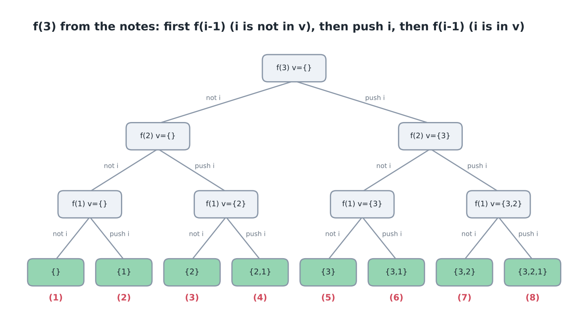

*f(3). The middle edge in the notes (v=\{3\}) is the `x.push_back(i)`. Prints in order: \{\}, \{1\}, \{2\}, \{2,1\}, \{3\}, \{3,1\}, \{3,2\}, \{3,2,1\}*

Look: each call has two children, first `f(i-1)` without i, then push i and `f(i-1)` with i. The last `pop_back` is the revert, so the vector is back to what the parent had.

8 leaves = 2^3 = 8 subsets. This same tree is the backtracking for subsets (below).

## Backtracking and the LCCMD framework

→ Backtracking:
 ↳ Brute force: exhaustively searching everything

Recursion is a language technique - func. calling itself.

Doing brute force using recursion is backtracking.

- framework:
 ↳ LCCMD

Important: always decide first how to represent the solution, and then apply this framework.

Level: For which stage currently I'm deciding.

Choice: At current level what values can I place.

check: Check if the choice is valid.

Move: Place, recurse, revert.

Decide: → mostly happens in base case.
 ↳ check more constraint given in problem.

LCCMD = Level, Choice, Check, Move, Decide. The two "C"s are different: the first C is Choice, the second C is Check.

Note: the most common mistake is forgetting the revert in Move, so one branch's choice leaks into the next. A dry run on a tiny input catches it.

Think of it as filling a form. Level = which field I am filling now. Choice = what can go in this field. Check = is it allowed given what is already filled. Move = write it, go to the next field, erase it when I come back. Decide = form full, is this a valid answer (count it, print it).

How the same framework looks for different problems (from the notes):

| | Level | Choice | Check | Move | Decide |
|---|---|---|---|---|---|
| N-Queens | the row in which I'm placing the queen | all the columns | is this column / diagonal free | place, recurse, revert | — |
| Print all subsequences | each element | take / not take | — | insert in subset if taken | — |
| Permutation (non-distinct) | index we're filling at | all elements of arr. with freq. | if freq>0 for that choice | insert, recurse, remove | — |

Now the guarantee behind the Check step. The generic loop is the plain recursion over choices from topic 0.5, plus one line (the `if ok` test):

```text
rec(pos):
    if pos == L: output the current sequence c[0..L-1]; return
    for each allowed choice v at position pos:
        c[pos] = v
        if ok(c[0..pos]): rec(pos + 1)
```

**Theorem 3.1.1 (pruning by feasibility).** On a complete sequence ($\text{pos} = L - 1$) let `ok` be the full validity check. Let `ok` never reject a partial solution that has a valid completion: whenever $c_0, \dots, c_p$ can be extended to a valid complete sequence, `ok` returns true. Then `rec(0)` outputs every valid complete sequence exactly once. If in addition `ok` is **exact** (it accepts exactly the partial solutions that have a valid completion), then every call lies on a path from the root to some output, so the number of calls is at most $(L + 1) \cdot S$, where $S$ is the number of outputs.

In plain words: build the answer one choice at a time and test every partial answer. If the test never rejects a partial answer that can still be completed, no valid answer is lost and each appears once. The rejected branches cost nothing.

Small example first: 4 queens, one queen per row, `ok` = "the new queen attacks none of the earlier ones". The test looks only at queens already placed, so it never rejects a placement that could be completed.

| row 0 | row 1 options that pass | what happens |
|---|---|---|
| column 0 | 2, 3 | after (0, 2) no column passes in row 2; after (0, 3) the queen at (2, 1) leaves nothing for row 3 |
| column 1 | 3 | (1, 3, 0, 2) is a solution |
| column 2 | 0 | (2, 0, 3, 1) is a solution |
| column 3 | 0, 1 | the mirror image of column 0: dead ends |

Why it works:
1. Without the test, the plain recursion reaches every sequence exactly once, along the path of its prefixes.
2. A valid sequence has a valid completion at every prefix (itself), so `ok` accepts each of its prefixes. Its path is never cut, so it is output.
3. An invalid sequence is never output, because it fails the test at $\text{pos} = L - 1$, and that test is the full validity check. So the outputs are exactly the valid sequences, each once. (The cost part of the proof is in the next section.)

This proof needs: (1) the test never rejects a partial solution that can still be completed. It may use only the choices made so far, and it must be implied by the final validity condition; (2) the shared state (counters, "used" marks, the `queens` vector) is restored when a call returns, so each call sees exactly its own partial solution.

Undoing: if the test reads shared arrays such as "column $j$ is taken", the recursion sets the mark before the call and clears it after the call. Each call then sees the marks of its own partial solution only.

## Time complexity of backtracking and the 4 problems

Now, when we write backtrack code for the n-queens.
the code behaves as n-nested loops in which we choice/check/move/decide.

This is true for all backtracking code because we are doing complete search/brute-force.

T.C.: (#choices)₁ × (#choices)₂ × ...... × (#choices)ₙ × (check+decide), where #choices means the number of choices at that level.

If choices are same.

(#choices)^N × (check+decide).

A small example first: 3 positions, 2 choices each. 3 nested loops vs the same job done with recursion levels.

```cpp
// n = 3 positions, 2 choices each (0 = not take, 1 = take): 3 nested loops
void loops3() {
    for (int a = 0; a < 2; a++)
        for (int b = 0; b < 2; b++)
            for (int c = 0; c < 2; c++)
                cout << a << b << c << endl;
}

// same thing with recursion: level = "which loop am I in"
int pick[3];

void rec(int level) {
    if (level == 3) {
        cout << pick[0] << pick[1] << pick[2] << endl;
        return;
    }
    for (int ch = 0; ch < 2; ch++) {
        pick[level] = ch;       // place
        rec(level + 1);         // recurse (revert = the next value of ch overwrites it)
    }
}
```

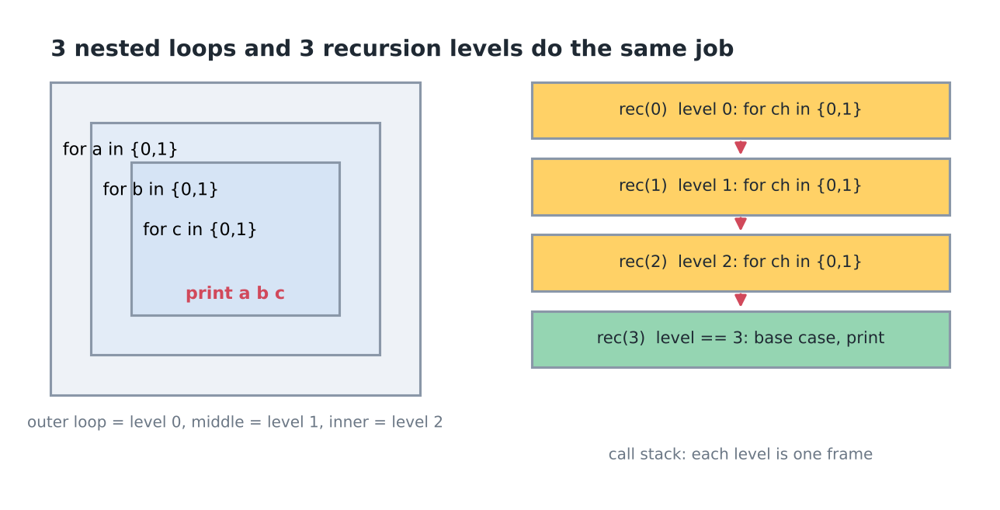

*outer loop = level 0, middle loop = level 1, inner loop = level 2*

With nested loops the depth is fixed (we have to write 3 loops in the code). With recursion the depth comes from the input n, so we can write "n nested loops". Both print the same 8 lines (checked).

Why this is the cost: every node has `#choices` children and the tree is `N` levels deep, so there are about `choices^N` leaves. Each leaf costs a check and a decide.

Worked numbers:

| Problem | Choices per level | Levels | Leaves (no pruning) | Example |
|---|---|---|---|---|
| Subsets (take / not take) | 2 | n | 2^n | n = 20 → 1,048,576 |
| Permutations (distinct) | n, then n-1, ..., 1 | n | n! | n = 8 → 40,320 |
| N-Queens | n columns | n rows | n^n | n = 8 → 16,777,216 |

**Pruning** = when the check fails we do not go down that branch, so the whole subtree below it is never visited. That is why backtracking is much better than the pure formula in practice (N-Queens numbers are in the next section). But in the worst case T.C. stays exponential, so n is always small (n ≤ 20 or so) in these problems.

- S.C. = O(depth) for the stack + O(depth) for the partial answer. Not O(number of answers).
- Common mistakes: forgetting the revert (the next branch starts with leftover choices), deciding the representation after writing the loops, storing/printing every answer when only the count was asked.

Two kinds of pruning. A feasibility check prunes the partial solutions that cannot be completed to a valid answer (queens that attack). A bound prunes the partial solutions that can be completed but not to anything better than the best answer found so far (see Branch and bound below).

Before writing any of these searches, estimate the number of nodes. Every tool here is exhaustive search: the answer is exact, and the running time depends only on how much is cut. For example, 8 queens is $8^8 = 16{,}777{,}216$ leaves on paper but only 2,057 calls in reality, so it is fast. Estimate first, then decide.

The cost part of Theorem 3.1.1. Steps 4 and 5 of the proof:
4. If `ok` is exact, every node that is called has a valid completion, so it is a prefix of some output.
5. Each output has $L + 1$ prefixes (lengths $0$ to $L$), so there are at most $(L + 1) \cdot S$ calls.

This proof needs (3): the running time is the number of nodes that pass the test times the cost of one test, and this must fit the budget. With an exact test it is at most (depth + 1) times the number of outputs. When the problem asks to print every object, that is the best possible.

- 4 problems.

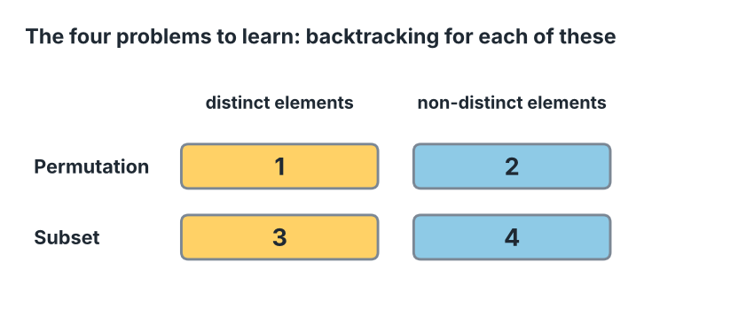

*Learn to write the backtracking of these four: (1) permutations of distinct elements, (2) permutations of non-distinct elements, (3) subsets of distinct elements, (4) subsets of non-distinct elements*

Note: in most cases the choices are the same at every level.

## N-Queens

Question: Think for N-queens problem → the number of ways to place queens on chess board.

Question: N-queens: given n×n chessboard, place n queens such that no 2 queens attack each other.

(A queen attacks along its row, its column and both diagonals.)

For example, n = 4.

![Two 4 by 4 boards, solutions [1 3 0 2] and [2 0 3 1]](../../../assets/notes/3-1-backtracking/fig09_nqueens_two_solutions.png)

*queens: [1 3 0 2]  [2 0 3 1]. 0 1 2 3 written below each array are the indices, these are levels.*

Represent → [_ _ _ _]

Only one queen fits in a row (two queens in one row attack each other). So I only decide the column of each row, and the "same row" check comes for free.

LCCMD:
Level: the row in which I'm placing the queen.
Choice: at current level what are my choices.
 ↳ here are all the columns.
check: check if my current placement of queen is valid.
move: place, recurse, revert.
decide: —

Recursion stack:

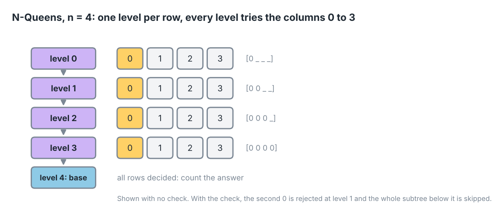

*we check validity & move forward*

Note: this stack shows the loop over columns at each level, with no check applied. With the check, `[0 0 _ _]` never happens: the second queen in column 0 is the same column as the first, so it is rejected at L-1 and all 4^2 = 16 leaves below it are skipped (of the 4^4 = 256 total).

checks: same row, same column, same diagonal.

i) curr_col != prev_col.
ii)

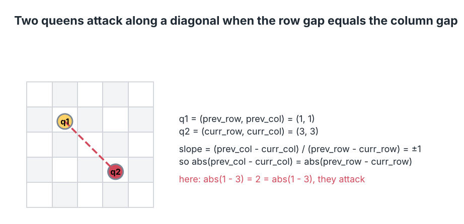

*q1 is at (prev_row, prev_col) and q2 is at (curr_row, curr_col)*

q1 and q2 can attack each other if they are on the same diagonal
⇒ slope = ±1

(prev_col − curr_col) / (prev_row − curr_row) = ±1

abs(prev_col − curr_col) = abs(prev_row − curr_row).

Another way to see the diagonals: on one "\" diagonal `row - col` never changes, on one "/" diagonal `row + col` never changes.

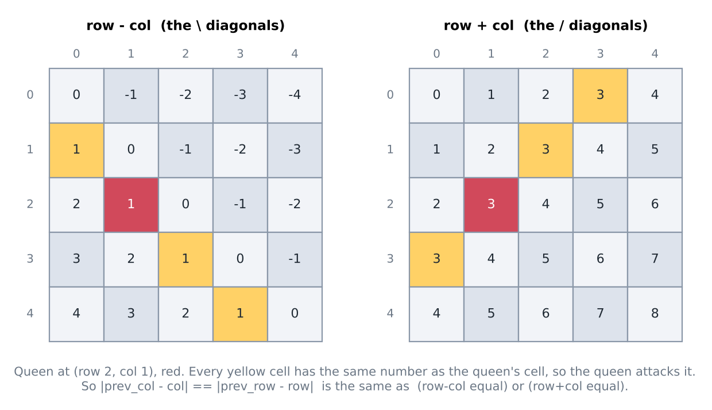

*same number as the queen's cell = attacked diagonal*

Trace for n = 4. The search goes row by row, tries columns left to right. Number in the circle = column chosen in that row.

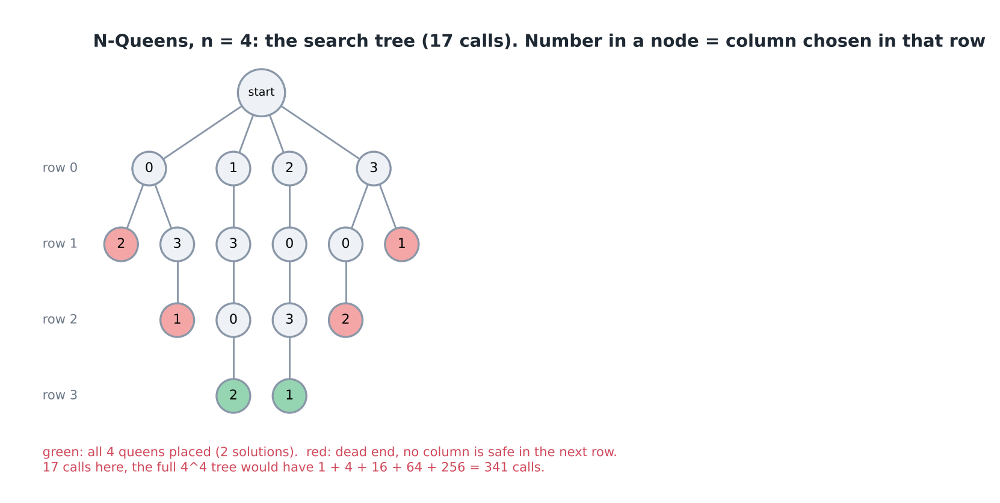

*17 calls. Dead ends are red, solutions are green: [1 3 0 2] and [2 0 3 1]*

Column 0 in row 0: row 1 can use col 2 or 3. [0 2] has no safe column in row 2, [0 3] goes to [0 3 1] and then row 3 has none. Back up (pop), try the next. The first solution, [1 3 0 2], is found in the second branch. (Dead end = loop ends without recursing, the queens vector is popped and the parent tries its next column.)

The code from the repo (comment lines on top are the problem statement):

```cpp
/*
N-Queens, given N X N board, find number of ways to place N queens
such that no queens attack each other
*/
// Fabricator/Recursion-Bactracking-Kth-Fractals/N-Queens.cpp
int n;
int sol = 0;
vector<int> queens;

bool can_place(int row, int col){
    for(int prev_row = 0; prev_row < row; prev_row++){
        int prev_queen_pos = queens[prev_row];

        if(prev_queen_pos == col)
            return false;

        // checking for diagonal using slope
        // the slope of the line will be +- 1 if the queens are in same diagonal
        if(abs(prev_queen_pos - col) == abs(prev_row - row))
            return false;
    }

    return true;
}

// O(n ^ n) => O(n!) => O(n!!)
void rec(int level){
    // base case
    if(level == n){
        sol++;
        //_print(queens);
        return;
    }

    // recurse

    // go through choices
    for(int col=0; col<n; col++){
        if(can_place(level, col)){
            // move
            // place
            queens.push_back(col);
            //recurse
            rec(level + 1);
            //revert
            queens.pop_back();
        }
    }

}

void solve() {
    cin>>n;

    rec(0);

    cout<<sol<<endl;
}
```

T.C.: O(N^N) worst | O(N! × N) upper bound.

How to read it: without any check every row has N choices, so N^N. The check kills the same column, so only placements with different columns survive, at most N! of them; each `can_place` loops over the previous rows, so N more per placement. In real runs it is far less than that:

| n | solutions | calls made | n^n | n! |
|---|---|---|---|---|
| 4 | 2 | 17 | 256 | 24 |
| 5 | 10 | 54 | 3,125 | 120 |
| 6 | 4 | 153 | 46,656 | 720 |
| 7 | 40 | 552 | 823,543 | 5,040 |
| 8 | 92 | 2,057 | 16,777,216 | 40,320 |
| 9 | 352 | 8,394 | 387,420,489 | 362,880 |

(n = 1 → 1, n = 2 → 0, n = 3 → 0 solutions. All counts checked by running the code.)

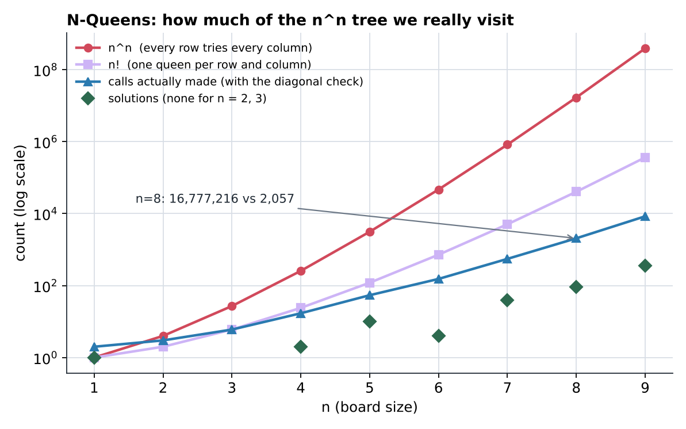

*n = 8: 16,777,216 leaves on paper, 2,057 calls in reality*

- S.C. = O(N) (queens vector + recursion depth).
- Common mistakes: forgetting `queens.pop_back()` (revert), checking only the column and forgetting the diagonals, using `row` and `level` mixed up.

`can_place` has a loop, so one check is O(N). It can be O(1): remember which column and which diagonals are already taken. `row - col` can be negative, so add `n - 1` to make it an index.

```cpp
// same N-Queens count, but the check is O(1): remember which column / diagonals are taken
bool col_used[20], diag1[40], diag2[40];     // diag1: row-col (+n-1 so it is never negative), diag2: row+col

int rec_fast(int row, int n){
    if(row == n) return 1;

    int ans = 0;
    for(int col=0; col<n; col++){
        if(col_used[col] || diag1[row - col + n - 1] || diag2[row + col]) continue;

        col_used[col] = diag1[row - col + n - 1] = diag2[row + col] = true;     // place
        ans += rec_fast(row + 1, n);                                            // recurse
        col_used[col] = diag1[row - col + n - 1] = diag2[row + col] = false;    // revert
    }
    return ans;
}
```

Same answers (1, 0, 0, 2, 10, 4, 40, 92, 352, 724 for n = 1 to 10).

Numbers for the search tree. With no check, the tree for 4 queens has $1 + 4 + 16 + 64 + 256 = 341$ nodes (every node is one partial solution). With the check it makes 17 calls. For 8 queens the unpruned tree has about $1.9 \cdot 10^7$ nodes and the search makes 2,057 calls. For 10 queens it is about $1.1 \cdot 10^{10}$ nodes against 35,539 calls, and 724 solutions. The check is not exact: after `[0 2]` row 2 is still called although nothing can follow. So the calls are more than $(L + 1) \cdot S$ (for 4 queens $5 \cdot 2 = 10$, and we make 17), but still very few.

<TheoremCode unit="3.1/thm-1" />

The same search with bitmasks (topic 1.7): keep three bitmasks, one for the occupied columns, one for the occupied diagonals and one for the occupied anti-diagonals. The free columns of the next row are the zero bits of their bitwise or. For the next row, shift the two diagonal masks by one in opposite directions. It is the same search with a faster test.

How big a board is safe? There is no clean formula for placement with checks. Small boards are known to be fast (queens up to about 12, a $9 \times 9$ grid puzzle with many givens), but always try the worst input before you trust it.

Common mistake (undoing only part of the state). In `rec_fast`, if the revert line clears `col_used[col]` but not the two diagonal marks, the stale diagonals of every queen ever tried stay set. A free $4 \times 4$ board then gives 0 instead of 2. Fix: undo every mark that was set before the call, and when several arrays change together, clear them in one statement that mirrors the one that set them (as the code above does).

Common mistake (checking one diagonal direction only). If the test `diag2[row + col]` is removed, a free $2 \times 2$ board gives 1 instead of 0. The queens at $(0, 1)$ and $(1, 0)$ attack along an anti-diagonal ($0 + 1 = 1 + 0$), but only equal `row - col` is checked. Fix: list every constraint (row, column, diagonal, anti-diagonal) and check each one when its last item is placed.

### N-Queens twisted

Same code, with a board where some squares are reserved: queens go only on free squares, but reserved squares do not block attacks. Only the choice changes: `board[level][col] != '*'`. Sample from the problem gives 65.

```cpp
/*
Your task is to place eight queens on a chessboard so that no two queens are attacking each other. 
As an additional challenge, each square is either free (.) or reserved (∗), and you can only place queens on the free squares. 
However, the reserved squares do not prevent queens from attacking each other.

How many possible ways are there to place the queens?

Input:
........
........
..*.....
........
........
.....**.
...*....
........

Output:
65
*/
// Fabricator/Recursion-Bactracking-Kth-Fractals/N-Queens-Twisted.cpp
bool check(int row, int col,vector<int> &pos){
    for(int prev_row = 0; prev_row < row; prev_row++){
        auto prev_col = pos[prev_row];
        if(prev_col == col || abs(prev_col - col) == abs(prev_row - row)){
            return false;
        }
    }

    return true;
}

int rec(int level, vector<string> &board, vector<int> &pos){
    if(level == 8){
        return 1;
    }

    int ans = 0;
    for(int col=0; col<8; col++){
        if(board[level][col] != '*' && check(level, col, pos)){
            pos.push_back(col);
            ans += rec(level + 1, board, pos);
            pos.pop_back();
        }
    }

    return ans;
}

void solve() {
    vector<string> board(8);
    vector<int> pos;
    for(int i=0; i<8; i++){
        cin>>board[i];
    }

    cout<<rec(0, board, pos)<<endl;
}
```

- T.C. = O(8^8) at worst and far less with the check (same shape as N-Queens, n = 8). S.C. = O(8).
- Common mistake: letting a reserved square block an attack. It only stops us from placing a queen there.

### N-S-Queens

An S-Queen = queen + knight. A knight attacks at (row ± 1, col ± 2) and (row ± 2, col ± 1). Earlier queens are all in earlier rows, and a knight reaches only 2 rows up, so only rows `row-1` and `row-2` need the extra check.

```cpp
/*
An S-Queen is a chess piece that combines the power of a knight and a queen.
Find the number of ways to place N S-Queens on an N×N chessboard.
*/
// Fabricator/Recursion-Bactracking-Kth-Fractals/N-S-Queens.cpp
int n;

bool check(int row, int col,vector<int> &pos){
    for(int prev_row = 0; prev_row < row; prev_row++){
        auto prev_col = pos[prev_row];
        if(prev_col == col || abs(prev_col - col) == abs(prev_row - row)){
            return false;
        }
    }

    if(row >= 1){
        int prev_col = pos[row - 1];
        if(abs(prev_col - col) == 2) return false;
    }

    if(row >= 2){
        int prev_col = pos[row - 2];
        if(abs(prev_col - col) == 1) return false;
    }

    return true;
}

int rec(int level, vector<int> &pos){
    if(level == n){
        return 1;
    }

    int ans = 0;
    for(int col=0; col<n; col++){
        if(check(level, col, pos)){
            pos.push_back(col);
            ans += rec(level + 1, pos);
            pos.pop_back();
        }
    }

    return ans;
}

void solve() {
    cin>>n;
    vector<int> pos;

    cout<<rec(0, pos)<<endl;
}
```

- T.C. = at most O(n! × n) like N-Queens, because the extra knight check looks at only two earlier rows. S.C. = O(n).
- Common mistake: checking all earlier rows for the knight move. A knight reaches only 2 rows up, and checking more rows would reject safe squares.

For n = 2 to 9 the answer is 0, n = 10 gives 4 (matched with a brute force that checks every pair of queens).

### Count Simple Paths (AtCoder ABC378 D)

[AtCoder Beginner Contest 378, problem D](https://atcoder.jp/contests/abc378/tasks/abc378_d). On an $H \times W$ grid with blocked cells ($H, W \le 10$), count the walks of exactly $K \le 11$ moves between side-adjacent empty cells that never visit a cell twice.

Idea, in six small steps.
1. Budget. There are at most 100 start cells and 11 moves, so a walk is a sequence of 12 cells. Listing all such sequences is $100^{12}$, impossible. But each move has at most 4 directions, and after the first move at most 3 (going straight back is a revisit). So there are at most $100 \cdot 4 \cdot 3^{10} \approx 2.4 \cdot 10^7$ walks without revisits. That fits in a second if each step costs $O(1)$.
2. Tools. Plain recursion over choices with 4 directions makes $100 \cdot 4^{11} \approx 4 \cdot 10^8$ sequences and checks each afterwards. That is too slow, and most of the work goes into walks that died on their second move. Backtracking with a check after every move is the "place with checks and undo" card. A counting formula (topic 2.3) does not apply, because blocked cells and the no-revisit rule destroy any simple count.
3. Deciding property. Both rules are checkable as soon as the cell is placed: "inside the grid and empty" looks only at the new cell, and "not visited" looks at the new cell and the cells already on the walk. A broken partial walk can never be repaired by later moves. So: a recursion from every empty start cell with a `visited` grid, set before each call and cleared after.
4. Proof for this problem. Every prefix of a valid walk satisfies the same rules, so the test never rejects it, and at length $K + 1$ the test has checked every rule for every cell. Theorem 3.1.1 applies, so each valid walk is counted exactly once. The `visited` marks are exactly the cells of the current prefix because each is set right before its call and cleared right after.

Trace on a $1 \times 3$ grid `...` with $K = 2$. Start at the left cell: move right (visited), move right again, 1 walk; the move left is a revisit and is skipped. Start at the middle: left then no more moves, so it needs 2 moves and fails after one; right likewise, so 0 walks. Start at the right: 1 walk. Total 2. (Walks of 2 moves: left to right and right to left.)

<CodeSnippet unit="3.1/example-1" />

Cost: at most $2.4 \cdot 10^7$ walks of length 12 with $O(1)$ per step, and $O(HW)$ space. The fully empty $10 \times 10$ grid with $K = 11$ has 3,882,208 walks and runs in under 0.1 seconds.

Common mistake: forgetting to clear `visited` after the call. The next direction then sees stale marks and the count is too small.

Alternative: grow the walks level by level and keep the list of all valid walks of length $j$. It visits the same walks but stores millions of them at the last level, while backtracking holds only the current one.

## Print all subsequences / non-distinct permutations

Question: Print all subsequences:

N=4 : [3,1,2,5].

(Subsequence = pick some elements, keep their order. Here every element is picked or not, so 2^4 = 16.)

L: each element
C: take/not take
C: —
M: insert in subset if taken
D: —

![Subsets of [3, 1, 2, 5]: for each element two choices, take or not take](../../../assets/notes/3-1-backtracking/fig27_take_slots.png)

*Y/N (take or not take) for each element*

Question: Print all permutation (non-distinct).

N = 3 : [2,2,3]

L: index we're filling at
C: all elements of arr. with freq.
C: if freq>0 for that choice
M: insert , recurse , remove.
D: —

(freq = frequency, how many copies of that value are still unused. Code for both is below.)

## Backtracking revisited: subsets for unique elements

→ Backtracking Revisited:

Core problems

The same four problems as before: subsets and permutations, each with unique elements or with duplicates.

Question: Subset for unique element array.

Take one element of the array, say the third. It is unique, so it has 2 choices: take it or do not take it.

L → index

C → 2 choices → do both one by one by backtracking.

C → no checks.

M → place, recurse, reverse.

D → no decision.

Take:
subset.push_back(arr[i])    ← place
rec(i+1)                    ← recurse
subset.pop_back();          ← revert.

Not take:
rec(i+1).

Idea: for one element there are only two worlds, "it is in the subset" and "it is not". First explore one world, come back (revert), then explore the other. Base case: level == n, all elements decided, print.

```cpp
/*
Given a set, generate all subsequences of it.
*/
// Fabricator/Recursion-Bactracking-Kth-Fractals/Generate-Subset.cpp
int n;
vector<int> v;
vector<int> subsequence;

void rec(int level){
    if(level == n){
        _print(subsequence);
        return;
    }

    // take
    subsequence.push_back(v[level]);
    rec(level + 1);
    subsequence.pop_back();

    // not take
    rec(level + 1);
}

void solve() {
    cin>>n;
    v.resize(n);

    for(auto &x: v) cin>>x;

    rec(0);
}
```

(`_print(v)` is my debug function from the template, it prints the vector as `[ 3 1 2 ]`. Here `v` is the input array and `subsequence` is the one being built.)

Trace for `3 1 2` (take first, so the order is a bit different from the f(3) tree above):
`[ 3 1 2 ]`, `[ 3 1 ]`, `[ 3 2 ]`, `[ 3 ]`, `[ 1 2 ]`, `[ 1 ]`, `[ 2 ]`, `[ ]`.

- Calls = 2^(n+1) − 1 (15 for n = 3). Subsets = 2^n. n = 20 → 1,048,576 subsets and 2,097,151 calls.
- T.C. = O(2^n · n) (2^n leaves, copying/printing a subset costs up to n). S.C. = O(n).
- Common mistake: missing `pop_back()` after the take branch, then the not-take branch still carries the element. Or forgetting `return` in the base case, then the code goes on to `v[level]` with `level == n`, outside the array.

The same subsets can be produced in another way, which is the key to the duplicates case. Choose the next element only among the indices larger than the last one chosen. Every subset of indices is then produced exactly once, as its elements in increasing order (a subset has exactly one increasing order). For `[3, 1, 2, 5]` that gives `[3]`, `[3 1]`, `[3 1 2]` and so on, never `[1 3]`. Theorem 3.1.2 below states this as part 1.

## Subsets with duplicates

Problem ④. `[1,1,2]`: the subsets are `[]`, `[1]`, `[1,1]`, `[2]`, `[1,2]`, `[1,1,2]`, 6 of them, not 8. Taking "first 1" or "second 1" is the same subset, so take/not take per position gives repeats.

Idea: group equal values. For a value with `freq` copies the choice is "how many copies do I take": 0, 1, ..., freq. So the choices at that level are freq + 1, not 2.

L: index of the distinct value. C: take c copies, c = 0..freq. C: —. M: push c copies, recurse, pop c copies. D: —.

```cpp
vector<int> val;             // distinct values
vector<int> freq;            // how many copies of each value we have
vector<int> cur;

void subsets_dup(int level){
    if (level == (int)val.size()) {
        _print(cur);
        return;
    }
    for (int c = 0; c <= freq[level]; c++) {                    // take c copies (c = 0 is "not take")
        for (int j = 0; j < c; j++) cur.push_back(val[level]);  // place
        subsets_dup(level + 1);                                 // recurse
        for (int j = 0; j < c; j++) cur.pop_back();             // revert
    }
}
```

For `val = {1,2}`, `freq = {2,1}`: `[ ]`, `[ 2 ]`, `[ 1 ]`, `[ 1 2 ]`, `[ 1 1 ]`, `[ 1 1 2 ]`.

- Number of subsets = (freq₁ + 1) × (freq₂ + 1) × ... = 3 × 2 = 6. (Same product idea as the T.C. formula above, here the choices are different at every level.)
- T.C. = O(that count × n). S.C. = O(n).
- Common mistake: taking `c` copies but popping only one. Or doing plain take / not take per position and removing the repeated subsets from the output afterwards (the tree is bigger and the dedupe is extra work).

Note: `subset_duplicate` in the repo's `Permutation.cpp` is unfinished (no `return` after the base case, and it takes each value at most once), so I did not use it.

**Theorem 3.1.2 (canonical order).**
1. Let the recursion choose the next element only among those with a larger index than the last one chosen. Then every subset of indices is produced exactly once, as its elements in increasing order.
2. Let the values $a_0 \le a_1 \le \dots \le a_{n-1}$ be sorted. At each call let the loop skip index $i$ when $i$ is not the first index tried in that loop and $a_i = a_{i-1}$. Then every distinct multiset of values (every sub-multiset of $a$) is produced exactly once.

In plain words: to list every subset once, always choose the next element from the ones after the last chosen. To list every collection of values once when some values repeat, sort first and skip a value that equals the previous try in the same loop.

Small example first: $a = (1, 2, 2)$. Without the skip, part 1 gives 8 subsets: $\{\}, \{1\}, \{1, 2\}, \{1, 2\}, \{1, 2, 2\}, \{2\}, \{2\}, \{2, 2\}$, with $\{1, 2\}$ and $\{2\}$ twice. With the skip, the second 2 is never the first try of a loop where the first 2 was available, and the 6 distinct multisets $\{\}, \{1\}, \{1, 2\}, \{1, 2, 2\}, \{2\}, \{2, 2\}$ come out once each.

Why it works:
1. Part 1. A subset of indices has exactly one increasing order, and the recursion produces every increasing sequence (the plain recursion over choices, with the allowed choices "larger than the last"). It produces no other sequence.
2. Part 2. Fix a multiset $M$ of values. Among the index sequences that give $M$ in non-decreasing order, call the one that uses the leftmost available indices for each value the canonical one.
3. The skip rule allows exactly the canonical sequence: in one loop, the first index of each run of equal values is tried and later indices of the same run are skipped.
4. So when a value $x$ is taken at some depth, it is taken at the first index of $x$ after the previous choice, which is what the canonical sequence does.
5. Any other sequence for $M$ takes some value at a later index of a run whose first index was available, and that is skipped.

This proof needs: (1) for part 1, the output is a set (order does not matter), so increasing index order is enough; (2) for part 2, the values are sorted so that equal values sit next to each other, and the skip compares with the previous index within the same loop (at the same depth), not with the last value taken.

<TheoremCode unit="3.1/thm-2" />

This is the sorted skip-rule version of the group-by-value recursion above.

<CodeSnippet unit="3.1/distinct-subsets" />

How it works: every call of `rec` is one sub-multiset (the values in `chosen`), recorded at once. Then each possible next value is added in turn. The next index is always larger than the last one taken (`rec(i + 1)`), and inside one loop a value equal to the previous try is skipped (`i > start && a[i] == a[i - 1]`). After each child call `chosen.pop_back()` undoes the addition. Because the values are sorted and the loop goes left to right, the collections come out in lexicographic order. The count is the same product $\prod (c + 1)$ as in the group-by-value version.

Common mistake (skipping equal values across depths). Writing `i > 0` instead of `i > start`. Input `0 0` then gives 2 collections ($\{\}$ and $\{0\}$) instead of 3. The second 0 is the first try of its loop in the call where the first 0 was just taken, but `i > 0` compares it with the previous index anyway and skips it. Fix: skip only a repeat within the same loop, `i > start`. A value equal to the one just taken is a different choice, not a repeat.

## Permutations: distinct and non-distinct

Question: Print all permutation (non-distinct). → Permutation of `[2,2,3]`.

First the distinct one (problem ①). Level = position we're filling. Choice = every element that is not used yet. Check = is it used.

```cpp
/*
Given an array of distinct elements, generate all permutations.
*/
// Fabricator/Recursion-Bactracking-Kth-Fractals/Permutation.cpp
int n;
vector<int> arr;
map<int, bool> is_used;
map<int, int> ele_count;
vector<int> perm;

void permutation_unique(int level){
    if(level == n){
        _print(perm);
        return;
    }

    // iterate over all elements and see if it is used
    // if not being used add in permutation
    for(int i=0; i<n; i++){
        if(!is_used[arr[i]]){
            perm.push_back(arr[i]);
            is_used[arr[i]] = true;
            permutation_unique(level + 1);
            perm.pop_back();
            is_used[arr[i]] = false;
        }
    }
}
```

Idea: at every position try every unused element, mark it used, recurse, unmark.

- Calls: 1 + n + n(n-1) + ... + n! (for n = 3 → 16, n = 8 → 109,601). About e × n!.
- T.C. = O(n · n!), S.C. = O(n). n = 8 → 40,320 permutations.
- Common mistake: `is_used` is a map on the value, so this works only when all values are different. With `[2,2,3]` the second 2 would be blocked as "used".

Now non-distinct (problem ②). If we loop over positions we get `[2,2,3]` twice (first 2 / second 2), 3! = 6 outputs, each repeated. Fix: loop over distinct values, with how many copies are left.

```cpp
/*
Given an array, generate all permutations if the elements are not distinct
i/p:
2,2,3

o/p:
2,2,3
2,3,2
3,2,2
*/
// Fabricator/Recursion-Bactracking-Kth-Fractals/Generate-Permutation2.cpp
int n;
vector<int> arr;
map<int, int> choices;
vector<int> perm;

void rec(int level){
    if(level == n){
        _print(perm);
        return;
    }

    map<int,int> temp = choices;
    for(auto v: temp){
        if(v.second > 0){
            perm.push_back(v.first);
            choices[v.first]--;
            rec(level + 1);
            perm.pop_back();
            choices[v.first]++;
        }
    }
}

void solve() {
    cin>>n;

    arr.resize(n);
    for(auto &x: arr) {
        cin>>x;
        choices[x]++;
    }

    rec(0);
}
```

Note: `temp` is a copy of `choices` so the loop is over the counts as they were when this level started.

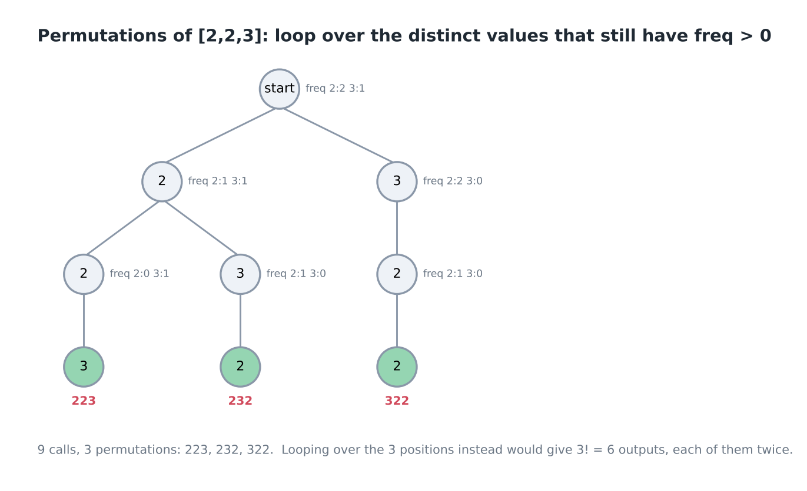

*3!/2! = 3 permutations: 223, 232, 322*

- Number of permutations = n! / (freq₁! × freq₂! × ...). [2,2,3] → 3!/2! = 3.
- T.C. = O(calls × distinct values), S.C. = O(n + distinct values).
- Common mistake: forgetting `choices[v.first]++` after the recursion (revert), the counts keep shrinking and later branches find nothing.

The same idea works for permutations of repeated values with a `used` array. At one position, try each value once: skip index $i$ when $a_i = a_{i-1}$ and index $i - 1$ is not used. Then equal values are always placed in index order (left to right), and two arrangements that differ only by swapping equal copies are not both produced. The number of outputs is $n! / (\text{freq}_1! \times \text{freq}_2! \times \dots)$ instead of $n!$.

<CodeSnippet unit="3.1/distinct-permutations" />

How it works: `current` holds the placed values and `used[i]` tells whether index $i$ is placed. Both are undone after the call. For `[2, 2, 3]` (sorted) the second 2 is skipped while the first 2 is unused, so `[2, 2, 3]` comes out once and not twice.

Alternative: writing `used[i - 1]` instead of `!used[i - 1]` is also correct (it passed 5000 stress tests when tried as a bug). It places equal copies right to left, which again allows exactly one order of the copies. But it finds that out late, because a copy can be placed only after all the copies to its right. For eight equal values the version above makes 9 calls and this one 2,781. For $(1, 1, 1, 2, 2, 2)$ it is 69 calls against 327, for the same 20 arrangements.

Common mistake (no skip for equal values). Delete the skip line and input `1 1` prints the arrangement `1 1` twice, because "place index 0, then index 1" and "place index 1, then index 0" are both produced. Fix: fix one order for equal values, as above.

## Balanced parentheses

(Same LCCMD, with a real check.) Given an even n, print all balanced strings of length n in lexicographic (dictionary) order. `(` comes before `)`, so trying `(` first gives the sorted order for free.

L: the position (how many characters are left). C: `(` or `)`. C: `(` only if open_count &lt; n/2, `)` only if close_count &lt; open_count. M: place, recurse, remove. D: —

```cpp
/*
You are given a positive even integer n. 
Your task is to print all balanced parentheses of length n in lexicographic order
*/
// Fabricator/Recursion-Bactracking-Kth-Fractals/Generate-Parenthesis-Easy.cpp
vector<string> ans;
int n;

void rec(int level, string curr_ans, int open_count, int close_count){
    // base case
    if(level == 0){
        ans.push_back(curr_ans);
        return;
    }

    // choices
    // check
    if(open_count < n/2){
        // move, place
        curr_ans += '(';
        // recurse
        rec(level - 1, curr_ans, open_count+1, close_count);
        // backtrack
        curr_ans.pop_back();
    }

    // check
    if(close_count < open_count){
        // move, place
        curr_ans += ')';
        // recurse
        rec(level - 1, curr_ans, open_count, close_count + 1);
        // backtrack
        curr_ans.pop_back();
    }
}

void solve() {
    cin>>n;

    rec(n, "", 0, 0);

    for(auto curr_ans: ans){
        cout<<curr_ans<<endl;
    }
}
```

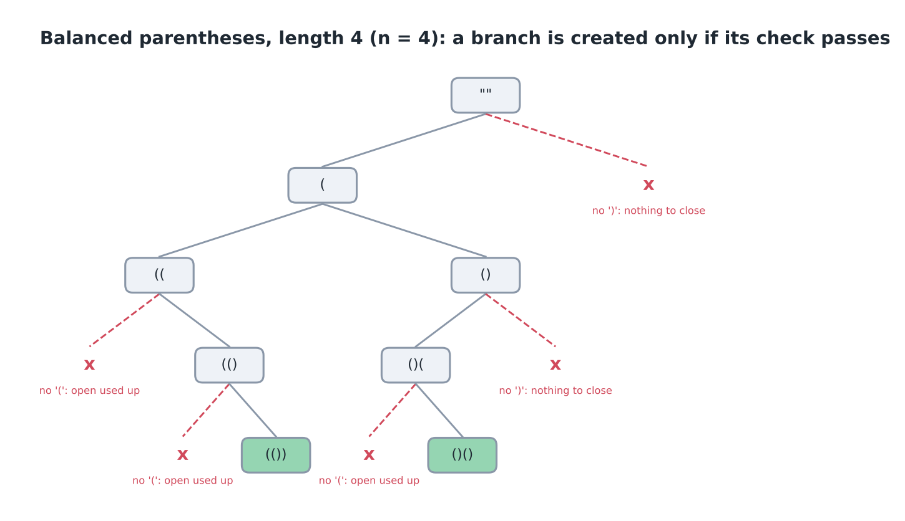

*n = 4 → `(())`, `()()`. Red = branch refused by the check*

Note: `curr_ans` is passed by value, so each call has its own copy. The `pop_back()` is still needed: in the same call we did `curr_ans += '('` and the second `if` must start from the original string.

- Count for n = 2, 4, 6, 8, 10 → 1, 2, 5, 14, 42 (Catalan numbers, a standard counting sequence). n = 12 → 132.
- T.C. = O(count × n). S.C. = O(n) depth.
- Common mistake: checking `close_count <= n/2` instead of `close_count < open_count`, then `)(` style strings come out.

## Kth form: k-th permutation

→ Kth Form:

Finding kth element/item in a setup.

Question: ABCA → if we generate all permutation in lexicographical order, what will be the 8th element?

total perm = 4! / (2! 1! 1!) = 12.

(Lexicographic order = dictionary order: AABC, AACB, ABAC, ABCA, ACAB, ACBA, BAAC, BACA, ...)

Solution 1: generate all the permutations and return the 8th element.
 ↳ may not be always possible.

(For 15 different letters that is 15! = 1,307,674,368,000 permutations. Infeasible.)

Solution 2:

when we generate permutation, it'll be of 4 chars.

_ _ _ _

Choices for the first character:
- A: the number of permutations that start with A is 3! = 6.
- B: the number for B is 3!/2! = 3.
- C: the number for C is 3!/2! = 3.

Given above information we know that the first char of 8th perm will be B.

A → 1 to 6
B → 7 to 9 ——→ 8th is here.
C → 10 to 12

Look: in sorted order, first come all the permutations that start with A (6), then those that start with B (3), then those that start with C (3). The 8th falls in the B block, so first char is B. We never generated anything, only counted.

B [ A _ _ _ ]
↳ options → A, A, C.

Counting the permutations for the first letter again, A has 5 (tally), B has 3 and C has 3. The 2nd element inside the B block is the 8th overall.

kth (8, \{A,A,B,C\}) → "B" + kth (2, \{A,A,C\})

↑ idea behind kth element.

options → \{A,A,C\}.
_ _ _

A → the number of permutations if started with A → 2!
C → the number of permutations if started with C → 2!/2! = 1

A has 2 permutations and C has 1. The 2nd element lies in the A block, so A must be placed first.

kth (2, \{A,A,C\}) → "A" + kth (2, \{A,C\})

_ _   options → \{A,C\}.

A → 1
C → 1  ← this is the second element.

kth (2, \{A,C\}) → "C" + kth (1, \{A\})
                          ↳ "A"

→ solution = B A C A. → 8th element.

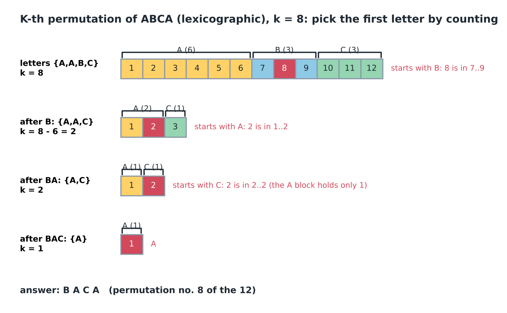

*k = 8 → B (k becomes 2) → A (k stays 2) → C (k becomes 1) → A*

Another ex:

[ _ _ _ ] options - A/B/C.

For this example the numbers of permutations are A: 5, B: 7, C: 10.

kth (14, \{......\}) → "C" + \{2, \{......\}\}
                          ↳ 14 - 5 - 7

Rule in one line: go over the letters in sorted order, for each letter `w` = number of permutations that start with it. If `k <= w` the letter is chosen, else `k -= w` and move to the next letter. After choosing, recurse on the rest with the same `k`.

Code in the same LCCMD style. `ways(len)` = len! divided by the freq! of every letter left (that is the 3!/2! = 3 in the notes).

```cpp
map<char,int> cnt;           // letters still left, with their frequency (map keeps them sorted)

long long ways(int len){     // no. of distinct permutations of the letters left in cnt, len = how many are left
    long long r = 1;
    for (int i = 2; i <= len; i++) r *= i;                              // len!
    for (auto &p : cnt)
        for (int i = 2; i <= p.second; i++) r /= i;                     // divide by every freq!
    return r;
}

string kth(long long k, int len){        // k-th (1-based) permutation in lexicographic order
    if (len == 0) return "";
    for (auto &p : cnt) {
        if (p.second == 0) continue;
        p.second--;                                  // place this letter first
        long long w = ways(len - 1);                 // no. of perms that start with it
        if (k <= w) {
            string rest = kth(k, len - 1);           // k is inside this block
            p.second++;                              // revert
            return string(1, p.first) + rest;
        }
        p.second++;                                  // revert
        k -= w;                                      // skip the whole block
    }
    return "";                                       // k was bigger than the total
}
```

Note: `Kth-Permutation.cpp` in the repo is half written (`k_included` has no body), so this is the full version of that idea. Checked for ABCA, AABC, ABC, AAAB, ABCDE, AABBCC against `next_permutation` for every k, and `kth(8, 4)` on ABCA gives BACA.

- T.C. = O(n × d × (n + d)) with d = distinct letters (n levels, d letters per level, `ways` costs O(n + d)). S.C. = O(n).
- `long long` is fine up to n = 20 (20! = 2,432,902,008,176,640,000). 21! overflows.
- Common mistakes: using 0-based k with the 1-based rule above; forgetting `k -= w`; forgetting to revert the count; not skipping letters whose count is 0.

## K-th move of Tower of Hanoi

Question: In Tower of Hanoi, find the k = 6th move for 3 disc.

Solution 1: Maintaining a counter for the moves & returning the kth move.
 ↳ infeasible because we might have to generate all the moves to maintain the counter.

Solution 2:

`rec(3,1,3,2)` is 7 moves in total. It splits into `rec(2,1,2,3)` (3 moves), the single move 1→3 (1 move) and `rec(2,2,3,1)` (3 moves).

T(n) → moves ??

T(1) → 1, T(2) → 3, T(3) → 7

T(n) = 2^n - 1

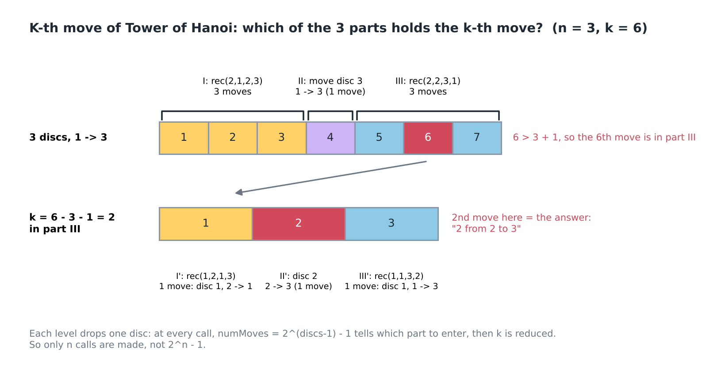

*3 disk: (I) 3 moves, (II) 1 move, (III) 3 moves. 6th move lies in (III) part. 6 - 3 - 1 = 2*

for finding 6th move.

The three parts are `rec(2,1,2,3)`, `move(1→3)` and `rec(2,2,3,1)`. The 2nd move inside the last part is the 6th move overall.

Same counting idea as the permutation. Instead of generating the moves, decide in which of the 3 parts k lies:
- `k <= numMoves` → inside the first part, go into `rec(discs-1, from, extra, to)` with the same k.
- `k == numMoves + 1` → it is the middle move, the nth disc from `from` to `to`. Done.
- else → `k -= numMoves + 1` and go into the third part `rec(discs-1, extra, to, from)`.

Here numMoves = 2^(discs-1) - 1.

```cpp
/*
Tower of Hanoi, n discs, move them from peg 1 to peg 3 using peg 2.
Print the k-th move of the optimal solution (without generating the others).
*/
// Fabricator/Recursion-Bactracking-Kth-Fractals/Kth-Tower-Of-Hanoi.cpp
// O(discs)
void kth_in_tower_of_hanoi(long long int k, long long int discs, int from, int to, int extra){
    if(discs == 0){
        return;
    }

    long long int numMoves = (1 << (discs - 1)) - 1;

    if(k <= numMoves){
        kth_in_tower_of_hanoi(k, discs - 1, from, extra, to);
        return;
    }

    k -= numMoves;

    if(k == 1){
        cout<<discs<<" from "<<from<<" to "<<to<<endl;
        return;
    }

    k -= 1;

    if(k <= numMoves){
        kth_in_tower_of_hanoi(k, discs - 1, extra, to, from);
        return;
    }
}

void solve() {
    long long int n, k;
    cin>>n>>k;

    kth_in_tower_of_hanoi(k, n, 1, 3, 2);
}
```

Trace for n = 3, k = 6: `numMoves` = 3, k > 3 so k = 3; k != 1 so k = 2; k &lt;= 3 → go into (2, from 2, to 3, extra 1). There numMoves = 1, k = 2 > 1 so k = 1, and k == 1 → print `2 from 2 to 3`. This matches the 6th move in the picture above. Checked: for n = 10 all 1,023 answers match the full move list.

- T.C. = O(discs) (one call per level, constant work, only one child is entered). S.C. = O(discs). The full list would be 2^n − 1 moves.
- Common mistake: `(1 << (discs - 1))` is an `int` shift. From discs = 32 it overflows. For n = 40, k = 2^39 it printed `33 from 2 to 1`, the right answer is `40 from 1 to 3`. Use `(1LL << (discs - 1))` for big n.

## Fractals

→ fractals:

Question: build the fractal picture step by step.

Step 0 is a plain square. Each step replaces every square by a smaller copy of the pattern. The picture is built from smaller copies of itself, so recursion fits.

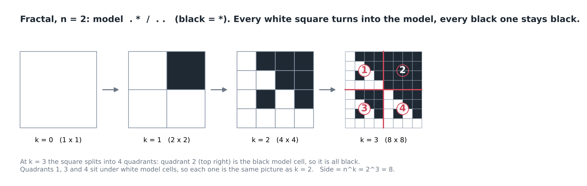

*0 → 1 → 2 → k=3. n = 2, side = 2^3 = 8 → n^k.*

(In the notes, hatched = black. Rule used in the repo problem, Codeforces 36B: the n × n model has `.` (white) and `*` (black). A white square becomes the model, a black square becomes all black.)

Cell by cell:

We check if the first position is white or black.

If first block (cell) is black then whole area is black.   |   1, 3 & 4 have same pattern if their first blocks are white.

That means at k = 3 the big square has 4 quadrants (marked 1, 2, 3, 4). Quadrant 2 sits under the black model cell → fully black. Quadrants 1, 3, 4 sit under white model cells → each is the same picture as k = 2.

Two ways to write it.

**Painter method**: start with an empty grid, recursively go into every block; at level 0 write the cell's colour into the grid. Needs the whole n^k × n^k grid.

```cpp
/*
Fractal (Codeforces 36B). n x n model of '.' (white) and '*' (black), k steps.
Step 0 is one white square. Each step: every white square becomes the model, every black square becomes all black.
Print the final n^k x n^k picture.
*/
// Fabricator/Recursion-Bactracking-Kth-Fractals/Fractal.cpp
int n, k;
string pat[3];
vector<vector<char>> grid;

// Painter Method
void rec(int x, int y, int level, int len, char ch){
    if(level == 0) {
        grid[x][y] = ch;
        return;
    }

    int nlen = len/n;
    if(ch == '.'){
        for(int i=0; i<n; i++){
            for(int j=0; j<n; j++){
                rec(x + i * nlen, y + j * nlen, level - 1, nlen, pat[i][j]);
            }
        }
    }
    else{
        for(int i=0; i<n; i++){
            for(int j=0; j<n; j++){
                rec(x + i * nlen, y + j * nlen, level - 1, nlen, '*');
            }
        }
    }
}

void solve() {
    cin>>n>>k;

    for(int i=0; i<n; i++){
        cin>>pat[i];
    }

    int len = 1;
    for(int i=0; i<k; i++){
        len = len * n;
    }

    grid = vector<vector<char>>(len, vector<char>(len, ' '));

    rec(0, 0, k, len, '.');

    for(auto row: grid){
        for(auto item : row){
            cout<<item;
        }

        cout<<endl;
    }
}
```

For `n = 2, k = 3` and model `.*` / `..` the output (checked against an independent version):

```
.*******
..******
.*.*****
....****
.***.***
..**..**
.*.*.*.*
........
```

- Calls = 1 + n² + n⁴ + ... + n^(2k) (85 for n = 2, k = 3). T.C. = O(n^(2k)) (one leaf per cell). S.C. = O(n^(2k)) for the grid, plus O(k) stack.

**Divide-Locate method**: do not draw anything, just find the colour of one cell. At level `L` the cell is in block `(r / n^(L-1), c / n^(L-1))` of the model. If that model cell is black, the cell is black. Otherwise throw away the block's position (`%`) and look inside.

```cpp
// Fabricator/Recursion-Bactracking-Kth-Fractals/Fractal2.cpp
int n, k;
vector<string> model;
long long powers[10]; // To precompute powers of N

char get_color(int r, int c, int level) {
    if (level == 0) return '.';

    int block_size = powers[level - 1];

    int bx = r / block_size;
    int by = c / block_size;

    if (model[bx][by] == '*') {
        return '*';
    }

    return get_color(r % block_size, c % block_size, level - 1);
}

void solve(){
    cin >> n >> k;
    model.resize(n);
    for (int i = 0; i < n; i++) {
        cin >> model[i];
    }

    powers[0] = 1;
    for (int i = 1; i <= k; i++) {
        powers[i] = powers[i - 1] * n;
    }

    int total_size = powers[k];

    for (int i = 0; i < total_size; i++) {
        for (int j = 0; j < total_size; j++) {
            cout << get_color(i, j, k);
        }
        cout << "\n";
    }
}
```

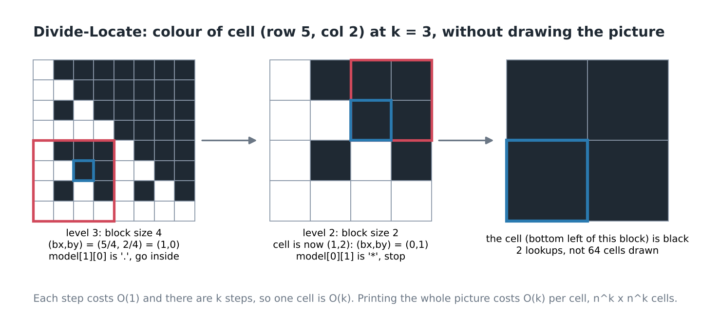

*(5, 2): model[1][0] is `.`, go inside; model[0][1] is `*`, black*

- T.C. = O(k) for one cell. Whole picture = O(k · n^(2k)).
- Common mistakes: `block_size = n^level` instead of `n^(level-1)` (off by one level); forgetting `% block_size` when going inside.

### Box fractal (POJ 2083)

A box fractal of degree n is 5 copies of degree n-1 placed in the 4 corners and the middle of a 3 × 3 arrangement. Side = 3^(n-1).

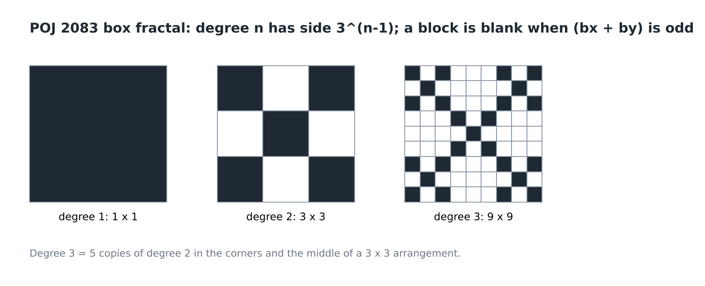

*the 3 × 3 blocks with (bx + by) odd stay empty*

Divide-Locate version (block position `(bx + by) & 1` → blank, else go inside):

```cpp
/*
http://poj.org/problem?id=2083

A fractal is an object or quantity that displays self-similarity, in a somewhat technical sense, on all scales. 
The object need not exhibit exactly the same structure at all scales, but the same "type" of structures must appear on all scales.
A box fractal is defined as below :
A box fractal of degree 1 is simply
X
A box fractal of degree 2 is
X X
 X
X X
If using B(n - 1) to represent the box fractal of degree n - 1, then a box fractal of degree n is defined recursively as following
B(n - 1)        B(n - 1)
        B(n - 1)
B(n - 1)        B(n - 1)

Your task is to draw a box fractal of degree n. -1 means end of input
*/
// Fabricator/Recursion-Bactracking-Kth-Fractals/Fractal-POJ.cpp
int powers[10];
int n;
vector<vector<char>> grid;

void prep_power(){
    powers[0] = 1;
    for(int i=1; i<10; i++){
        powers[i] = powers[i-1] * 3;
    }
}

// Divide - Locate Method
char get_char(int x, int y, int level){
    if(level == 1){
        return 'X';
    }

    int block_size = powers[level - 2];
    int bx = x / block_size;
    int by = y / block_size;

    if((bx + by) & 1){
        return ' ';
    }

    return get_char(x % block_size, y % block_size, level - 1);
}

void solve() {
    prep_power();

    int n;
    while(cin>>n && n != -1){
        int size = powers[n-1];

        for(int i=0; i<size; i++){
            for(int j=0; j<size; j++){
                cout<<get_char(i, j, n);
            }

            cout<<endl;
        }
    }
}
```

Painter version (skip the same blocks, recurse into the other 5):

```cpp
// Fabricator/Recursion-Bactracking-Kth-Fractals/Fractal-POJ.cpp
int powers[10];
int n;
vector<vector<char>> grid;

void prep_power(){
    powers[0] = 1;
    for(int i=1; i<10; i++){
        powers[i] = powers[i-1] * 3;
    }
}

void my_rec(int x, int y, int level, int len){
    if(level == 1){
        grid[x][y] = 'X';
        return;
    }

    int sub_len = len/3;

    for(int i=0; i<3; i++){
        for(int j=0; j<3; j++){
            if((i + j) & 1) continue;

            my_rec(x + i * sub_len, y + j * sub_len, level - 1, sub_len);
        }
    }
    // // top-left
    // my_rec(x, y, level - 1, sub_len);

    // // top-right
    // my_rec(x, y + 2 * sub_len, level - 1, sub_len);

    // // middle
    // my_rec(x + sub_len, y + sub_len, level - 1, sub_len);

    // // bottom-left
    // my_rec(x + 2 * sub_len, y, level - 1, sub_len);

    // // bottom-right
    // my_rec(x + 2 * sub_len, y + 2 * sub_len, level - 1, sub_len);
}

void my_solve() {
    prep_power();

    while(cin>>n && n != -1){
        int size = powers[n-1];

        grid = vector<vector<char>>(size, vector<char>(size, ' '));
        
        my_rec(0, 0, n, size);
        for(int i=0; i<size; i++){
            for(int j=0; j<size; j++){
                cout<<grid[i][j];
            }

            cout<<endl;
        }
    }
}
```

Note: the problem prints a line with `-` after every picture (see the sample output in the problem). These functions do not print it, so add `cout<<"-"<<endl;` after the printing loop of each degree. Without the `-` lines the pictures match the sample exactly (checked).

- Degree 4 → 27 × 27 = 729 cells, 5³ = 125 of them `X`.
- T.C. = O(side²) to print. Common mistake: using `/ 3^(level-1)` instead of `/ 3^(level-2)` here, because in this code level 1 is a single `X` (block size of level L is 3^(L-2)).

## Self-similar problems: Caracal vs Monster, Christmas burger, Nephren's riddle

Same recursion idea: the big object is made of smaller copies of itself, so we never build it, we count or locate.

### Caracal vs Monster (AtCoder ABC153 D)

Attack a monster of health X > 1 and it becomes two monsters of health X/2 (rounded down). Both are the same problem, so solve one and double it.

```cpp
/*
https://atcoder.jp/contests/abc153/tasks/abc153_d
Caracal fights a monster with health H. One attack on a monster:
  health 1  -> it disappears
  health X>1 -> it splits into two monsters, each with health floor(X/2)
Find the minimum number of attacks to make all monsters disappear.
*/
// Fabricator/Recursion-Bactracking-Kth-Fractals/CaracalVsMonster.cpp
long long int kill(long long h){
    if(h == 0){
        return 0;
    }

    if(h == 1){
        return 1;
    }

    h = h>>1;

    long long int stepsToKillAfterDivision = kill(h);

    return 1 + (stepsToKillAfterDivision << 1);
}

void solve() {
    long long h;
    cin>>h;

    cout<<kill(h)<<endl;
}
```

kill(4) = 1 + 2·kill(2), kill(2) = 1 + 2·kill(1), kill(1) = 1 → kill(2) = 3, kill(4) = 7. So kill(H) = 2^(⌊log₂ H⌋ + 1) − 1. H = 10^12 → 2^40 − 1 = 1,099,511,627,775.

- T.C. = O(log H) (40 calls for 10^12). S.C. = O(log H).
- Common mistake: simulating all the monsters (2^40 of them). The two halves are identical, so one call is enough.

### Christmas burger (AtCoder ABC115 D)

Layers from the bottom, level 2 = `B B P P P B P B P P P B B`. Eating the bottom X layers: how many patties?

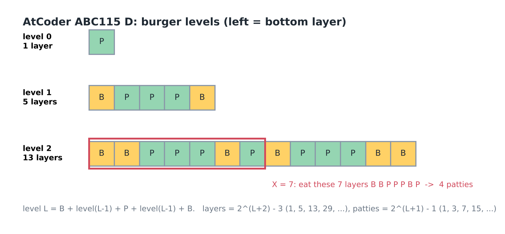

*level L = B + level(L-1) + P + level(L-1) + B*

Kth style: do not build the burger (level 50 has 2^52 − 3 = 4,503,599,627,370,493 layers). `bcnt`, `pcnt` store buns and patties of each level (pre-computed). Then walk the 5 parts: bottom bun, level L-1, patty, level L-1, top bun. If X ends inside a part, count the full parts before it and go inside that one part.

```cpp
/*
https://atcoder.jp/contests/abc115/tasks/abc115_d
Level-0 burger = P (one patty).
Level-L burger = B + (level L-1 burger) + P + (level L-1 burger) + B   (B = bun, P = patty).
Eat the bottom X layers of a level-N burger. How many patties are eaten?
*/
// Fabricator/Recursion-Bactracking-Kth-Fractals/Christmas.cpp
long long patties = 0;
long long int bcnt[51];
long long int pcnt[51];

void pre(){
    bcnt[0] = 0;
    pcnt[0] = 1;

    for(int i=1; i<=50; i++){
        bcnt[i] = 1 + bcnt[i-1] + bcnt[i-1] + 1;
        pcnt[i] = pcnt[i-1] + 1 + pcnt[i-1];
    }
}

long long int kth(long long k, long long level){
    if(k == 0){
        return 0;
    }
    if(level == 0){
        return 1;
    }

    long long total = 0;
    if(k <= 1){
        return total;
    }
    k-=1;

    if(k <= bcnt[level - 1] + pcnt[level - 1]){
        total += kth(k, level - 1);
        return total;
    }
    total += pcnt[level - 1];
    k -= (bcnt[level - 1] + pcnt[level - 1]);

    if(k <= 1){
        return total + 1;
    }
    total += 1;
    k-=1;

    if(k <= bcnt[level - 1] + pcnt[level - 1]){
        total += kth(k, level - 1);
        return total;
    }
    total += pcnt[level - 1];
    k -= (bcnt[level - 1] + pcnt[level - 1]);

    if(k <= 1){
        return total;
    }
    k-=1;
}

void solve() {
    long long int n, x;
    cin>>n>>x;

    patties = kth(x, n);

    cout<<patties<<endl;
}
```

Trace for N = 2, X = 7: skip the bottom bun (k = 6). Is 6 inside the first level-1 burger (5 layers)? No. So add all its 3 patties and k = 6 − 5 = 1. k = 1 is the middle patty → 3 + 1 = 4. Matches the picture (B B P P P B P → 4 patties).

Checked: all N ≤ 5 and every X against the real string. The sample `50 4321098765432109` gives 2160549382716056.

- T.C. = O(N) (only one recursive call per level), S.C. = O(N).
- Layers = 2^(N+2) − 3, patties = 2^(N+1) − 1 (N = 2 → 13 layers, 7 patties).
- Common mistakes: building the string; `int` instead of `long long`.

Note: the last `k-=1;` has no `return` after it, the compiler warns. It is never reached for a valid X (the `if(k <= 1) return total;` just before it fires first).

### Nephren's riddle (Codeforces 896 A)

f0 has 75 characters. fi = 34 chars + f(i-1) + 32 chars + f(i-1) + 2 chars, so len(i) = 2 · len(i-1) + 68. len(1) = 218, len(2) = 504 (checked against the real strings).

Idea: same as the burger. For the k-th character: if k is in a fixed piece (`fPrefix`, `sPrefix`, `suffix`) answer directly. If it is inside one of the two copies of f(i-1), subtract what came before and go to level i-1.

```cpp
/*
https://codeforces.com/problemset/problem/896/A
f0 = "What are you doing at the end of the world? Are you busy? Will you save us?"
fi = "What are you doing while sending \"" + f(i-1) + "\"? Are you busy? Will you send \"" + f(i-1) + "\"?"
Query (n, k): print the k-th character of fn, or '.' if fn has less than k characters.
*/
// Fabricator/Recursion-Bactracking-Kth-Fractals/Nephren-Gives-A-Riddle.cpp
string core = "What are you doing at the end of the world? Are you busy? Will you save us?";
string fPrefix = "What are you doing while sending \"";
string sPrefix = "\"? Are you busy? Will you send \"";
string suffix = "\"?";

unsigned long long len[100];

void pre(){
    len[0] = core.size();

    for(int i=1; i<100; i++){
        len[i] = fPrefix.size() + len[i-1] + sPrefix.size() + len[i-1] + suffix.size();
    }
}

char sol;

void kth(long long int k, int level){
    while (level > 60) {
        if (k < fPrefix.size()){ 
            sol = fPrefix[k];
            return;
        }
        k -= fPrefix.size();
        // Since len[n-1] is effectively infinite, we just go deeper into the first chunk
        level--; 
    }

    if(level == 0){
        if(k < core.size()){
            sol = core[k];
        }
        else{
            sol = '.';
        }

        return;
    }

    if(k >= len[level] && level <= 60){
        sol = '.';
        return;
    }

    if(k < fPrefix.size()){
        sol = fPrefix[k];
        return;
    }
    k-=fPrefix.size();

    if(k < len[level - 1]){
        kth(k, level - 1);
        return;
    }
    k-=len[level - 1];

    if(k < sPrefix.size()){
        sol = sPrefix[k];
        return;
    }
    k-=sPrefix.size();

    if(k < len[level - 1]){
        kth(k, level - 1);
        return;
    }
    k-=len[level - 1];

    if(k < suffix.size()){
        sol = suffix[k];
        return;
    }
    k-=suffix.size();

    sol = '.';

    return;
}

void solve() {
    int levels;
    long long k;

    cin>>levels>>k;

    kth(k-1, levels);

    cout<<sol;
}
```

Trace for f2, k = 100 (the code gets `k - 1` = 99 as 0-based): 99 ≥ 34 so skip `fPrefix` (k = 65). 65 &lt; len(1) = 218 so go into level 1. 65 ≥ 34 so skip `fPrefix` (k = 31). 31 &lt; len(0) = 75 so go into level 0 → `core[31]` = `f`. The 100th character of f2 is `f`.

- T.C. = O(n) per query (levels above 60 only strip `fPrefix`; below that one call per level). S.C. = O(n) at most.
- Level 60 would already have about 1.6 × 10^20 characters, so the strings can never be built.
- Common mistake: 1-based vs 0-based `k` (that is why `solve` calls `kth(k-1, levels)`).

Note: `len[i]` is about 143 · 2^i, which passes 2^64 at i = 57 and wraps around. It still works because k ≤ 10^18 never reaches that part (tested levels 48 to 70 and 99999, 100000 against exact big-number arithmetic).

## Branch and bound

For an optimisation problem ("the smallest possible largest load") feasibility alone cuts very little. Every partial assignment can be completed, so nothing is ever rejected. A bound cuts the partial solutions that can be completed but cannot win.

**Theorem 3.1.3 (branch and bound).** Let backtracking keep `best`, the best value of a complete solution found so far (initially $-\infty$ for a maximum), and prune a partial solution $s$ when $U(s) \le \text{best}$. If $U$ is optimistic ($U(s) \ge$ the value of every complete solution extending $s$), the search still returns the optimum.

In plain words: keep the best answer found so far and give up on a partial answer whose most optimistic completion cannot beat it.

Small example first: jobs of length $(8, 7, 5, 4, 3)$ go to 2 workers, and the larger load must be as small as possible. This is a minimisation, so the bound is reversed. A partial assignment is cut when its current larger load is already $\ge \text{best}$, because loads only grow. Jobs are tried longest first, each first on the less loaded worker. The first complete assignment is $8 + 4 + 3 = 15$ against $7 + 5 = 12$, so $\text{best} = 15$. From then on every branch that puts 8 and 7 on the same worker reaches load 15 at the second job and is cut with its whole subtree of $2^3$ completions. The search ends with $\text{best} = 14$ ($8 + 5$ against $7 + 4 + 3$), and the total $27$ shows nothing beats $\lceil 27 / 2 \rceil = 14$. A symmetry cut helps too: the first job may go to worker 0 only, because swapping the two workers gives the same loads.

Why it works:
1. Let $s^*$ be an optimal complete solution, of value $v^*$. If $s^*$ is reached, `best` becomes $v^*$.
2. Otherwise some prefix $s$ of $s^*$ was pruned, at a moment when $U(s) \le \text{best}$.
3. Since $U$ is optimistic, $v^* \le U(s) \le \text{best}$, so a solution of value at least $v^*$ had already been found.
4. Nothing beats the optimum, so $\text{best} = v^*$. Pruning on feasibility (Theorem 3.1.1) is kept as well.

This proof needs: (1) the estimate never understates what the rest can achieve (for a maximum, never smaller than the best completion; for a minimum, never larger than the cheapest completion); (2) `best` is the value of a complete solution actually found, not a guess; (3) there is no worst-case guarantee, because the bound helps only as much as the estimate is tight. So test the worst inputs. Two habits make the bound work sooner: try the most promising choices first (the largest items) so a good `best` is found early, and make the estimate as sharp as an easy formula allows.

<TheoremCode unit="3.1/thm-3" />

The unit shows the search without the symmetry cut. It makes 41 calls where the unpruned tree has 63 nodes.

The template for the smallest largest load:

<CodeSnippet unit="3.1/min-max-load" />

How it works: job $i$ goes to each worker in turn, and `currentMax` is the largest load so far. Loads only grow, so `currentMax` never exceeds the largest load of any completion. It is an optimistic estimate for a minimum, and a branch with `currentMax >= best` is cut. The jobs are sorted longest first so loads become large early and branches die near the root. A worker whose load equals that of an earlier worker is skipped: swapping two workers with equal loads turns any completion into one with the same largest load, so trying one of them is enough.

Alternative: binary search on the answer $L$ (topic 1.4) and ask "can the jobs be packed into $k$ workers of capacity $L$?" with the same backtracking. The cut is then "the job does not fit". It is the same search with a different cut.

Common mistake (a symmetry cut that is too strong). Using `load[v] <= load[w]` instead of `==`. Input `7 2` with jobs `2 6 8 14 8 6 9` then gives 28, and the correct answer is 27 ($9 + 8 + 8 + 2$ against $14 + 6 + 6$). Workers with equal loads are interchangeable, but a worker with a larger load is not. The wrong cut is close to the greedy rule "always the least loaded worker", which is not optimal. Fix: a symmetry cut may skip only choices that lead to the same outcomes. Prove the swap argument first.

Common mistake (an estimate that is not optimistic). Cutting with `currentMax + job[i] >= best`. Input `3 3` with jobs `8 1 1` gives 9 instead of 8. The estimate assumes the next job lands on the most loaded worker, but it can go to an empty one. After loads $(9, 1, 0)$ set $\text{best} = 9$, the branch with 8 on worker 0 and 1 on worker 1 has estimate $8 + 1 = 9 \ge 9$ and is cut, although its completion has largest load 8. Fix: the estimate must never be worse than some completion. The current largest load is safe, "plus the next job" is not.

## Meet in the middle

Brute force over $n = 40$ numbers is $2^{40} \approx 1.1 \cdot 10^{12}$ subsets, far out of budget. Two lists of $2^{20} \approx 10^6$ sums, one sort and $10^6$ binary searches of 20 steps are about $5 \cdot 10^7$ operations.

**Theorem 3.1.4 (meet in the middle).** Given $n$ numbers and a target $T$, the number of subsets with sum exactly $T$ (or at most $T$, or the subset sum closest to $T$) can be found in $O(2^{n/2} \cdot n)$ time. Split the numbers into halves $A$ and $B$, list the $2^{|A|}$ subset sums of $A$ and the $2^{|B|}$ subset sums of $B$, sort the list of $B$, and for each sum $x$ of $A$ look up the sums $y$ of $B$ with $x + y = T$ (or $\le T$, or closest to $T$) by binary search.

In plain words: split $n$ numbers, list the $2^{n/2}$ subset sums of each half, sort one list, and binary-search the partner of every sum of the other. That is about $2^{n/2} \cdot n$ steps instead of $2^n$.

Small example first: numbers $(3, 5 \mid 2, 6)$, $T = 8$. Sums of $A$: $0, 3, 5, 8$. Sorted sums of $B$: $0, 2, 6, 8$. Look up $8 - x$. For $x = 0$ the value 8 is found once (the subset $\{2, 6\}$). For $x = 3$ and $x = 5$ the values 5 and 3 are not in the list. For $x = 8$ the value 0 is found once (the subset $\{3, 5\}$). So 2 subsets have sum 8, which a check by hand confirms.

Why it works:
1. Every subset $S$ splits uniquely as $S = S_A \cup S_B$ with $S_A \subseteq A$, $S_B \subseteq B$, and $\operatorname{sum}(S) = \operatorname{sum}(S_A) + \operatorname{sum}(S_B)$.
2. So subsets correspond one-to-one to pairs (a sum from the list of $A$, a sum from the list of $B$), each list entry counted with its own subset.
3. The subsets with sum $T$ are the pairs with $x + y = T$. For a fixed $x$ the matching $y$ form one block of the sorted list of $B$, and two binary searches (Theorem 1.4.1) find its ends.
4. Each list has $2^{n/2}$ sums, built in $O(2^{n/2} \cdot n)$ by bitmasks or recursion. The sort and the lookups cost $O(2^{n/2} \cdot n)$ each.

This proof needs: (1) the objective splits into a part from each half that are combined by a simple rule (a sum, a bitwise exclusive or, a product), and the question about the combination can be answered from a sorted list (equal to, at most, closest to); (2) each half is small enough to list: $2^{20} \approx 10^6$ is comfortable, $2^{25}$ is at the edge of memory.

<TheoremCode unit="3.1/thm-4" />

The template for counting subsets with a bounded sum:

<CodeSnippet unit="3.1/mitm-count" />

How it works: `subsetSums` starts with the empty sum, and each element doubles the list by adding itself to every sum already there. The right list is sorted. For each left sum $x \le T$, the right sums $y$ with $x + y \le T$ are those $\le T - x$, a prefix of the sorted list, and `upper_bound` returns its length.

Alternative: sort both lists and use two pointers (topic 1.3). As $x$ increases, the largest valid $y$ only moves down, so one pass of $O(2^{n/2})$ replaces the binary searches.

Common mistake: `lower_bound` for "at most". It stops at the first $y \ge T - x$, so it counts only $y < T - x$ and misses every subset whose sum is exactly $T$. Input `1 0` with the number `4` gives 0, and the correct answer is 1 (the empty subset has sum $0 \le 0$). Fix: "at most $v$" is the prefix before the first element greater than $v$, which is `upper_bound`. Test with a $T$ that some subset sum hits exactly.

### Programming Contest (AtCoder ABC184 F)

[AtCoder Beginner Contest 184, problem F](https://atcoder.jp/contests/abc184/tasks/abc184_f). Given $N \le 40$ times $A_i \le 10^9$ and a limit $T \le 10^9$, find the largest total of a subset of the times that is at most $T$.

Idea, in six small steps.
1. Budget. $N = 40$ gives $2^{40} \approx 1.1 \cdot 10^{12}$ subsets, out of budget by a factor of $10^4$. But $2^{20} \approx 10^6$ is comfortable even with a sort and a binary search per element: about $2^{20} \cdot 20 \cdot 2 \approx 4 \cdot 10^7$ steps.
2. Tools. Branch and bound with "sum so far plus all remaining times" as the estimate has no guarantee: with 40 times of nearly equal size, very many subsets have sums just below $T$ and the estimate cuts little. A table indexed by the sum needs $10^9$ entries, too big. Meet in the middle fits, because the objective is a sum.
3. Deciding property. The total is (left sum) + (right sum). For a fixed left sum $x \le T$ the best partner is the largest right sum $\le T - x$, the element just before `upper_bound(T - x)` in the sorted right list. Each half has 20 elements. Meet in the middle beats branch and bound because its running time is guaranteed.
4. Proof for this problem. Every subset splits uniquely into a left part and a right part and the sums add (Theorem 3.1.4). The empty right sum 0 is in the list, so every $x \le T$ has a partner. Left sums above $T$ have none, since all times are positive. The maximum over $x$ covers every pair. Time $O(2^{N/2} \cdot N)$.

Trace on times $(3, 5 \mid 2, 6)$ with $T = 7$. Left sums $0, 3, 5, 8$; right sorted $0, 2, 6, 8$. $x = 0$: largest $y \le 7$ is 6, total 6. $x = 3$: largest $y \le 4$ is 2, total 5. $x = 5$: largest $y \le 2$ is 2, total 7. $x = 8 > 7$ is skipped. The answer is 7.

<CodeSnippet unit="3.1/example-2" />

Cost: two lists of $2^{N/2}$ sums, a sort and $2^{N/2}$ binary searches, so $O(2^{N/2} \cdot N)$ time and $O(2^{N/2})$ space (about 16 MB for two lists of $2^{20}$ `long long`).

Alternative: sort both lists and move two pointers (topic 1.3). The best partner can only move down the right list as $x$ grows, so one pass replaces the binary searches.

## Recognition cards

A card is one tool of this topic written in a fixed form: the property that decides it, how to test it, the shape of the constraints, the weak and kill signals, the cost, and a worked example. Read the card when a problem's limits and question look like its signals.

<Cards topic="3.1" />

## Quick revision

- Recursion = function calling itself. Base case + smaller input. Draw the recursion tree, not the stack, once it branches.
- Code before the recursive call runs going down, code after it runs coming back up.
- fib calls = 2·fib(n+1) − 1, exponential because of repeated subproblems. S.C. = depth.
- Tail recursion: the recursive call is the last thing (`return cond && f(...)`).
- Hanoi: n-1 discs to extra, move nth, n-1 discs onto it. T(n) = 2T(n-1) + 1 = 2^n − 1.
- Backtracking = brute force with recursion. LCCMD = Level, Choice, Check, Move (place, recurse, revert), Decide. Decide the representation first.
- T.C. = (#choices)₁ × ... × (#choices)ₙ × (check + decide), same choices → (#choices)^N × (check + decide). Pruning cuts subtrees.
- 4 problems: permutation / subset × distinct / non-distinct.
- Subsets: take / not take, 2^n. With duplicates: take c copies, (freq+1) choices per value.
- Permutations: distinct → n! with `is_used`. Non-distinct → loop over distinct values with freq > 0, n!/(freq!...).
- N-Queens: queens[row] = col. Check: `col` same, or `abs(dcol) == abs(drow)`. Diagonals: `row-col` and `row+col`. Calls for n = 8: 2,057 (not 8^8). Solutions n = 1..9: 1, 0, 0, 2, 10, 4, 40, 92, 352.
- Kth form: do not generate, count. k-th permutation: for each letter `w` = perms starting with it, `k <= w` → choose, else `k -= w`.
- K-th Hanoi: numMoves = 2^(discs-1) − 1; k in part I, the middle move, or part III (`k -= numMoves + 1`). O(n). Use `1LL <<` for big n.
- Fractals: painter (fill the grid) or divide-locate (colour of one cell in O(k)). Side = n^k. If the first block is black everything under it is black.
- Self-similar counting: Caracal `kill(h) = 1 + 2·kill(h/2)`; burger layers 2^(N+2) − 3; Nephren len(i) = 2·len(i-1) + 68.
- Theorem 3.1.1: if the check never rejects a completable partial solution, every valid sequence is output exactly once. With an exact check, calls are at most $(L + 1) \cdot S$, the best possible when printing all. Placement with checks has no clean formula: try the worst input (queens up to about 12 are fast).
- Theorem 3.1.2: choose the next only among larger indices; with repeated values sort and skip `a[i] == a[i-1]` when `i > start` (same loop). Permutations of repeated values: skip `i` when `a[i] == a[i-1]` and `i-1` is unused.
- Theorem 3.1.3: keep `best`, prune when the optimistic estimate cannot beat it. No guarantee, good for $n$ around 10 to 20 with few choices per step, a good order and a sharp estimate.
- Theorem 3.1.4: split into halves, list $2^{n/2}$ sums each, sort one, binary-search the partner. $O(2^{n/2} \cdot n)$, for $n$ around 30 to 45 when the objective splits. Use `upper_bound` for "at most".
- Five templates, each with its own brute-force check (bitmasks, `next_permutation`, every assignment): distinct sub-multisets, distinct arrangements, queen placements, smallest largest load, subsets with a bounded sum.
- Backtracking bugs rarely crash. They print a wrong list or count, often only with repeated values or ties, so stress-test against a brute force.
- Decision map: return all combinations, subsets, permutations, partitions means generating every candidate. Puzzle on a small board (queens, Sudoku, tiles, word path) means placement with checks. Minimise the maximum or maximise the minimum means bound pruning (or binary search on the answer, topic 1.4). $n$ up to 40 with a target means meet in the middle. $n \le 20$ and choose some items means bitmask (topic 0.5), unless items conflict.
- Common mistakes: missing base case, missing revert, off-by-one in levels, `int` overflow in `1 << n`, building the object instead of counting.

## Check yourself

### Identification drill

<Drill topic="3.1" />

### Look-alike pairs

<LookalikePairs topic="3.1" />

Two pairs to remember. Closest subsequence sum with $n = 40$ needs meet in the middle, while target sum with $n \le 20$ is a bitmask or a plain take or not take recursion. Printing the distinct arrangements of a string is generating every candidate, while counting them is a multinomial (topic 2.3) with no search at all.

### Self-test

<SelfTest topic="3.1" />

### Checkpoint

<Checkpoint topic="3.1" />

### Decision map update

<DecisionMapUpdate topic="3.1" />

## Practice problems

Recursion, Tower of Hanoi:

- [CSES 2165, Tower of Hanoi](https://cses.fi/problemset/task/2165)

Backtracking (N-Queens, parentheses):

- [Queens On Chessboard](https://maang.in/problems/Queens-On-Chessboard-272)
- [NQueens Revisited](https://maang.in/problems/NQueens-Revisited-143)
- [Generate Balanced Parenthesis, easy version](https://maang.in/problems/Generate-Balanced-Parenthesis-easy-version-484)

Kth form, fractals, self-similar:

- [POJ 2083, Fractal](http://poj.org/problem?id=2083)
- [AtCoder ABC115 D](https://atcoder.jp/contests/abc115/tasks/abc115_d)
- [AtCoder ABC153 D](https://atcoder.jp/contests/abc153/tasks/abc153_d)
- [Codeforces 896 A](https://codeforces.com/problemset/problem/896/A)

### Problem ladder

<Ladder topic="3.1" />
